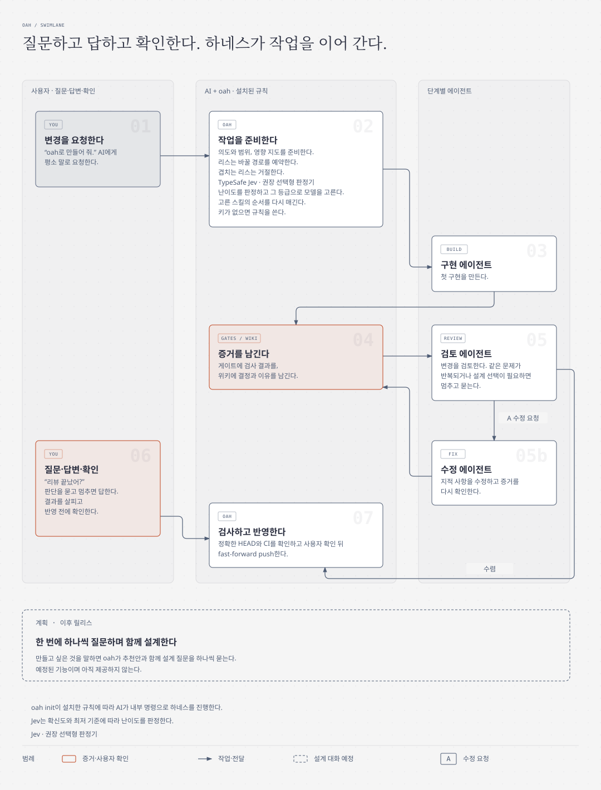
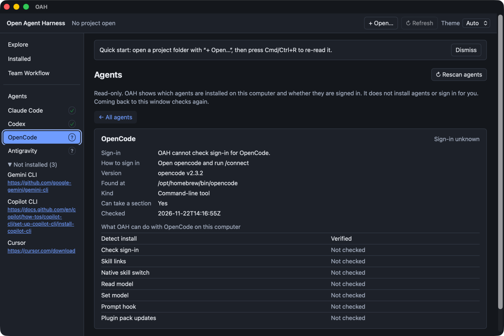
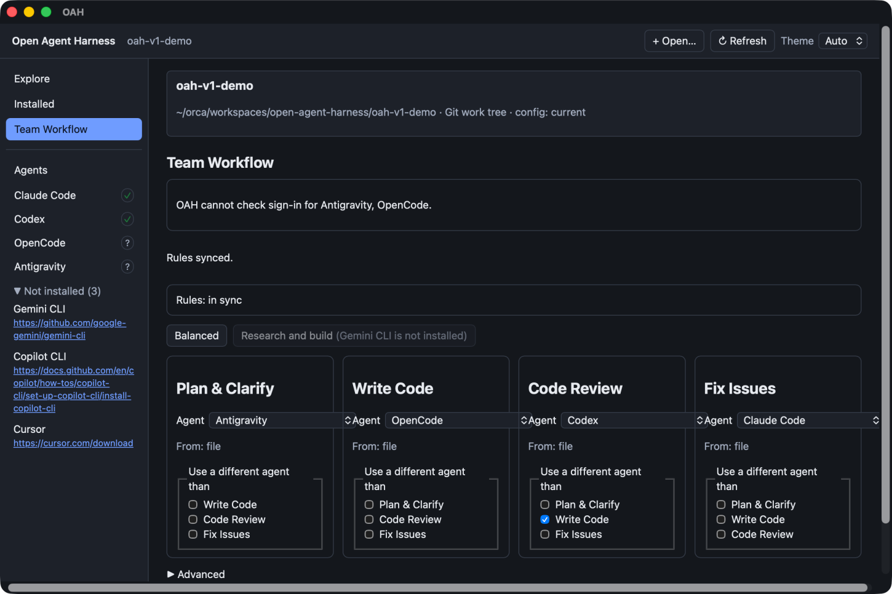

<p align="center">
  <picture>
    <source media="(prefers-color-scheme: dark)" srcset="docs/assets/banner-ko-dark.svg">
    
  </picture>
</p>

<p align="center">
  <a href="https://oah.rodeo/ko/"></a>
  <a href="https://github.com/KenSuh/open-agent-harness/actions/workflows/ci.yml"></a>
  <a href="LICENSE"></a>
  
  
</p>

<p align="center"><a href="README.md">English</a> · <strong>한국어</strong></p>

# open-agent-harness (`oah`)

**v1.0.0 다운로드** · [macOS DMG](https://github.com/KenSuh/open-agent-harness/releases/download/v1.0.0/OAH\_1.0.0_aarch64.dmg) · [Windows 설치 파일](https://github.com/KenSuh/open-agent-harness/releases/download/v1.0.0/OAH\_1.0.0_x64-setup.exe) · [SHA256SUMS](https://github.com/KenSuh/open-agent-harness/releases/download/v1.0.0/SHA256SUMS) · [릴리스 노트](https://github.com/KenSuh/open-agent-harness/releases/tag/v1.0.0)

macOS 앱은 임시 서명(ad hoc)만 적용했고 Apple 공증은 받지 않았다. Windows 설치 파일은 서명되지 않았다.
[데스크톱 설치와 서명 안내](#데스크톱-앱) · [처음 실행하기](#처음-실행하기) · [소스 CLI](#소스-cli) · [스킬 CLI](#cli에서-스킬-확인하고-고르기) · [문서](#문서)

## 이 프로젝트의 목적

`oah`는 각자에게 맞고 AI가 발전하는 만큼 함께 바뀌는 개발 환경을 만들도록 돕는다.
가져다 고쳐 쓸 수 있는 참고 구현이자 가이드다. **하네스**는 AI 코딩 도구를 둘러싼 도구와 규칙,
기록의 묶음이다.

AI가 전문가처럼 프로그램을 만들고 고치는 데 필요한 일을 스스로 챙긴다. 변경의 영향을 살피고, 프로젝트 위키를
관리하고, 결과를 검사하고, 리뷰와 수정을 이어 간다.
**사용자는 요청하고, AI가 판단을 물으며 멈추면 답하고, 반영 전에 확인한다.**

필요한 부분만 가져가도 되고, 전체 구성으로 시작해 자기 것으로 만들어도 된다. 예전 규칙과 스킬
(AI가 읽어 쓰는 작업 지침)은 새 모델의 능력을 막거나 결과를 나쁘게 만들 수 있다. 도움이 되는 것은 남기고,
필요 없어진 것은 지우며, 도구가 바뀌면 규칙도 바꾼다. `oah`도 계속 바뀐다.
기본값은 이해하고 바꾸기 쉬워야 한다.

### 역할마다 에이전트 고르기

OAH는 Claude Code가 첫 버전을 만들고 Codex가 검토하고 고치는 구성으로 시작했다.
v1.0.0의 **Team Workflow**에서는 저장소의 각 단계를 맡을 에이전트를 고를 수 있다.
기본값은 설계와 구현에 Claude Code, 리뷰와 수정에 Codex다.

### 어떤 AI 구성에도 맞춰 쓴다

데스크톱 앱에서는 **Claude Code, Codex, Gemini CLI, Copilot CLI, OpenCode, Antigravity**를
단계에 배정할 수 있다. **Agents**에는 스킬과 규칙 전용인 Cursor도 표시된다. 내 컴퓨터에서 쓸 수 있는 에이전트 중에서 고른다.

앱에서 배정을 저장하고 `AGENTS.md`의 관리 규칙에 동기화한다. 각 에이전트는 해당 도구에서 실행할 수 있다.
소스 CLI의 `oah call`은 단계 설정에 따라 Claude Code와 Codex CLI를 직접 실행한다.
전용 명령인 `oah review`와 자동 `oah fix`는 Codex를 실행한다.

## oah가 챙겨 주는 일

원하는 결과를 말하면 AI가 다음 도구를 함께 써서 작업을 이어 간다.

<picture>
  <source media="(prefers-color-scheme: dark)" srcset="docs/assets/features-ko-dark.svg">
  
</picture>

- **[영향 지도](docs/ko/concepts.md#영향-지도).** AI가 파일을 고치면 관련 코드, 문서, 다시 돌릴 검사를 보여 줘서
  작은 변경도 끝까지 챙기기 쉽다.
- **[프로젝트 위키](docs/ko/concepts.md#프로젝트-위키).** AI가 작업 이력과 결정, 그 이유를 코드 옆에 남긴다.
  다음 세션이 읽을 수 있는 기록이 남아 처음부터 다시 설명할 부담이 줄어든다.
- **[리스](docs/ko/concepts.md#리스).** 작업이 바꿀 경로를 예약하고 겹치는 리스는 거절한다.
  작업마다 범위가 분명해지고, 끝낼 때 실제 변경이 그 안에 있는지 확인한다.
- **[게이트](docs/ko/concepts.md#게이트).** AI가 “끝났다”의 기준을 검사로 만들고 결과를 기록한다.
  무엇이 통과했는지 물어보고 증거를 확인할 수 있다.
- **[구현과 리뷰](docs/ko/concepts.md#리뷰-루프와-수정).** 단계에 배정한 에이전트가 구현, 검토, 수정을 이어 간다.
  같은 문제가 반복되거나 설계 선택이 필요하면 멈추고 사용자에게 답을 구한다.
- **[TypeSafe Jev](docs/ko/how-it-works.md#선택형-판정기-jev).** 권장 선택형 판정기로, 고른 스킬의 순서를 다시 매긴다.
  확신도와 최저 기준을 지키면서 난이도를 판정해 그 등급으로 모델을 고를 수 있다. 키가 없으면 규칙이 판단한다.

## 어떻게 동작하는가

<picture>
  <source media="(prefers-color-scheme: dark)" srcset="docs/assets/how-it-works-v1-ko-dark.svg">
  
</picture>

AI에게 평소 말로 요청한다. `oah init`이 설치한 규칙과 각 명령의 다음 단계 안내에 따라 AI가 목표와 범위를
적고, 경로를 예약하고, 모델과 스킬을 고르며 리뷰 라운드 사이에 영향 지도를 확인한다. Jev를 켜면 난이도를
판정하고 고른 스킬의 순서를 다시 매길 수 있다. 구현을 맡은 에이전트가 변경을 만들고, 게이트는 검사 결과를,
위키는 이유를 남긴다. 리뷰를 맡은 에이전트가 검토하고 수정을 맡은 에이전트가 지적 사항을 고친다.
같은 문제가 반복되거나 설계 선택이 필요하면 멈추고 사용자에게 묻는다. 반복 횟수에 상한을 둘 수도 있다.

“리뷰 끝났어?”, “게이트 다 통과했어?”라고 물어본다. 결과를 살피고 확인한 뒤 프로젝트의 기본 브랜치에
반영한다. [CLI 작업 흐름](docs/ko/how-it-works.md)에서 내부 명령을 볼 수 있다.
그림에 표시한 안내형 설계 대화는 이후 릴리스에 계획돼 있다.

## 설치

### 데스크톱 앱

DMG는 macOS 13 이상을 실행하는 Apple Silicon Mac용이다. NSIS 설치 파일은 Windows 11 x64용이다.
[v1.0.0 다운로드](#open-agent-harness-oah)에서 설치 파일과 `SHA256SUMS`를 받는다. macOS에서는 `shasum -a 256`,
PowerShell에서는 `Get-FileHash -Algorithm SHA256`으로 받은 파일을 검사한다. 체크섬이 일치하면 파일을 연다.

- **macOS.** DMG를 열고 OAH를 응용 프로그램 폴더로 옮긴다. 앱은 임시 서명만 적용했고 Apple 공증은 받지 않아
  처음 열 때 경고가 나올 수 있다. 파일을 검증한 뒤 Apple의 안내를 따른다. [앱 열기에 관한 Apple 안내](https://support.apple.com/en-us/102445)
- **Windows.** 설치 파일을 실행한다. 서명되지 않은 설치 파일이므로 Microsoft Defender SmartScreen이 경고할 수 있고,
  조직 정책에 따라 설치가 제한될 수 있다.

### 소스 CLI

프로젝트 초기 설정, 스킬, 전체 작업 흐름에는 소스 CLI를 쓴다. Git과 Python 3.11 이상이 필요하다.
설치 프로그램은 필요한 도구를 확인하고 빠진 도구를 설치하기 전에 묻는다.

- **macOS.** [install.sh](https://github.com/KenSuh/open-agent-harness/releases/download/v1.0.0/install.sh)를 받아 `SHA256SUMS`와 대조한 뒤, 파일을 받은 폴더에서 `bash ./install.sh`를 실행한다. [macOS CLI 설치 안내](docs/ko/install-macos.md)
- **Windows.** [install.ps1](https://github.com/KenSuh/open-agent-harness/releases/download/v1.0.0/install.ps1)를 받아 `SHA256SUMS`와 대조한 뒤, 파일을 받은 폴더에서 `powershell -ExecutionPolicy Bypass -File .\install.ps1`을 실행한다. [Windows CLI 설치 안내](docs/ko/install-windows.md)

[macOS용 소스 압축 파일](https://github.com/KenSuh/open-agent-harness/releases/download/v1.0.0/open-agent-harness-v1.0.0.tar.gz)
또는 [Windows용 소스 압축 파일](https://github.com/KenSuh/open-agent-harness/releases/download/v1.0.0/open-agent-harness-v1.0.0.zip)을
검증해서 풀고 `install/` 안의 해당 설치 프로그램을 실행해도 된다. `--dry-run`(Windows에서는 `-DryRun`)을 붙이면 진행 단계를 미리 볼 수 있다.

그다음 새 터미널을 열어 버전을 확인한다.

```console
$ oah --version
oah 1.0.0
```

## 처음 실행하기

### 데스크톱 앱에서 팀 구성하기

1. **에이전트를 확인한다.** **Agents**에서 OAH가 찾은 에이전트와 확인 가능한 로그인 상태를 본다.
   사용할 에이전트의 설치 또는 로그인 안내를 따른 뒤 **Rescan agents**를 누른다.

   

   *에이전트 카드를 열면 로그인 방법과 작업 단계를 맡을 수 있는지 확인할 수 있다.*

2. **저장소를 열고 역할을 배정한다.** **+ Open…** 버튼으로 Git 작업 폴더를 고른 뒤 **Team Workflow**를 연다.
   준비 상태를 확인하고 카드마다 **Agent**를 고른다. 기본값은 **Plan & Clarify**와 **Write Code**에 Claude Code,
   **Code Review**와 **Fix Issues**에 Codex다. 카드의 **Use a different agent than**에서 다른 단계를 선택하면
   그 단계와 서로 다른 에이전트를 쓰도록 지정할 수 있다.

   

   *Code Review 카드에서 Write Code를 선택해 구현과 리뷰를 서로 다른 에이전트에 맡긴 예다.*

3. **프로젝트 규칙을 확인한다.** **Rules**에 동기화가 필요하다고 나오면 **Sync now**를 눌러 `AGENTS.md`의
   관리 대상 규칙을 갱신한다. 작업 폴더의 변경 사항을 살핀 뒤 커밋한다.

앱은 macOS에서 `~/.oah`, Windows에서 `%USERPROFILE%\.oah` 아래에 `settings.toml`과 `bin/`의 동봉 도구를 저장한다.
이 도구로 `doctor`, `sections show`, `rules check`, `rules sync`를 실행할 수 있다.

### CLI로 프로젝트 초기화하기

소스 CLI를 설치한 뒤 원격 저장소가 연결된 Git 저장소에서 `oah init`을 실행한다. 설정 계획을 검토하고
승인한 뒤 생성된 프로젝트 파일을 커밋한다. 그 프로젝트에서 AI를 열고 평소 말로 요청한다.

- “로그인 기능을 oah로 만들어 줘.”
- “리뷰 끝났어? 게이트 다 통과했어?”
- “이 버전을 반영해 줘.” 결과와 검사를 살핀 뒤 확인한다.

[첫 작업 따라 하기](examples/hello-oah/README.ko.md)는 Claude Code와 Codex를 기본 단계에 배정한 Git 저장소에서 진행한다.
[설정 상세](docs/ko/how-it-works.md#처음-실행하기)에서 설정 계획과 생성 파일을 설명한다.

### CLI에서 스킬 확인하고 고르기

`oah skills list`로 동봉하거나 연결한 스킬과 설치된 스킬을 확인한다. 이미 만든 설계에서 후보를 찾고
연결하기 전에 검토한다. 프로젝트와 설계의 ID를 넣고, 이후에는 각 명령이 출력한 검색 결과와 검토의 ID를 쓴다.

```sh
oah skills find --design PROJECT/DESIGN --provider seed
oah skills review --hit QUERY_ID:N
oah skills read --review REVIEW_ID
```

스킬을 검토하면 출처의 커밋과 라이선스가 기록된다. 검토한 스킬을 설계 단계에 연결하려면
`oah design coverage edit PROJECT DESIGN --from EDITS.json`에서 `link-skill` 작업을 쓰고, 출력된 `oah design save`
명령을 실행한다. 프로젝트에 설치할 스킬을 미리 보려면 `oah skills install ponytail --project --target claude --dry-run`을
실행한다. 설치 대상은 `claude`, `codex`, `both`다. [스킬 찾기와 검토](docs/ko/skills-and-capabilities.md#스킬-찾기와-검토) · [설계 단계](docs/ko/skills-and-capabilities.md#아홉-설계-단계)

v1.0.0에는 워커에게 스킬을 전달하는 데 필요한 검증된 호스트 프로필이 없다. `oah skills select --needs FILE --review REVIEW_ID`에
쓰는 파일을 `oah skills find --task`로 만들려면 해당 프로필이 필요하다.
[관리형 전달 요구 사항](docs/ko/skills-and-capabilities.md#필수-관리-전달)

## v0.4.0의 새 기능

데스크톱 앱이 나온 v1.0.0에 앞서 [v0.4.0 릴리스](https://github.com/KenSuh/open-agent-harness/releases/tag/v0.4.0)에는
아래 기능이 추가됐다. [v0.4.0 업그레이드 안내](docs/ko/upgrade.md#7-030에서-040으로)

- **설계 기록.** `oah design`은 번호를 매긴 설계 리비전과 승인 기록을 프로젝트 위키에 남겼다.
  `oah packet new --design`은 작업을 승인된 리비전에 연결하고 작업 중에 그 연결을 검사하도록 했다. [설계](docs/ko/concepts.md#설계)
- **확인할 수 있는 출처.** `oah sources`로 설계에 쓰인 공개 출처의 버전과 라이선스를 검증해 스냅샷을 남기고,
  원본이 바뀌었는지 확인할 수 있게 됐다. [설계 출처](docs/ko/design-sources.md)
- **아홉 설계 단계와 검토한 스킬.** `oah design coverage`는 남은 검사와 다시 확인할 검사를 보여 줬다.
  `oah skills find --design`, 스킬을 특정 커밋에 고정하는 검토, 설계나 작업에 맞춰 스킬을 고르는 기능이 추가됐다.
- **네이티브 하위 에이전트와 도구 경로.** `oah call ... --launcher native`는 검사를 마친 작업 지시를 리드가
  네이티브 하위 에이전트에게 넘길 수 있게 했다. `oah capabilities`에는 도구 확인, 경로 설정과 중계 기록이 추가됐다.
  관리형 스킬 전달과 `oah skills find --task`에는 검증된 호스트 프로필이 필요했다. v0.4.0에 그런 프로필이
  포함되지 않아 아무것도 보내기 전에 `OAH_SKILLS_BUDGET_EXCEEDED(target-capacity-unknown)`로 멈췄다.
  [일반 작업과 관리 입장](docs/ko/skills-and-capabilities.md#일반-작업과-관리-입장)
- **리뷰, Jev 호출과 반영 검사.** v0.4.0은 Codex 버전 고정, Jev 오류가 반복된 뒤 쉬는 시간, CI에 맡긴 게이트에
  대한 정확한 HEAD 검사를 추가했다. 리뷰와 평가의 임시 파일은 사용자 전용 폴더로 옮겼다.
  [임시 작업 폴더](docs/ko/concepts.md#임시-작업-폴더)

## 로드맵

도구가 바뀌면 계획도 바뀔 수 있다. [프로젝트 계획](docs/ko/PLAN.md)과 [릴리스 이력](https://github.com/KenSuh/open-agent-harness/releases)을 참고한다.

### 계획: 한 번에 하나씩 질문하며 함께 설계하기

**이후 릴리스에 계획된 기능이다.** 만들고 싶은 것을 말하면 oah가 추천안과 함께 설계
질문을 하나씩 묻는다. 사용자가 구현 전에 설계 결정에 직접 참여한다. 이 대화가 기대는 설계, 단계, 출처는
v0.4.0에 도입됐다. 이 업데이트에는 다음이 들어갈 예정이다.

- **한 번에 한 질문.** 핵심 설계 질문을 하나씩 묻고, 왜 중요한지와 추천 답을 함께 알려 준다. "모르겠다",
  "나중에 정하겠다", "해당 없음"으로 답할 수 있고, 멈춘 곳에서 다시 이어 갈 수 있다.
- **한 가지가 아니라 설계 전체.** 동작, 데이터 보관 기간, 서버가 어떤 판단을 맡는지, 비밀 정보, 프로젝트 밖에
  미치는 영향, 복구, 비용, 접근성을 다룬다. 결제는 해당하는 경우에 다룬다. 해당 없는 주제는 건너뛰고, 결정이
  바뀌면 그 결정과 관련된 설계를 다시 확인한다. v0.4.0은 이 주제들을 아홉 coverage 단계에 기록하며, 이를
  질문하는 일은 계획 단계다.
- **말하면 시작.** 지원하는 AI 도구에서 평소 말로 설계를 부탁하면 설계 대화가 열리고 한 질문씩 묻는 방식이
  적용된다. 원하지 않으면 끌 수 있다.
- **장단점과 함께 기술 조합 제안.** 프로젝트에 맞는 언어와 소스를 함께 추천하고, 그 조합을 배우고 운영할 때의
  장단점을 설명한다. Rust나 여러 언어를 쓰도록 강요하지 않는다.
- **작업에 맞춰 새로 확인하는 출처.** v0.4.0은 등록한 출처를 요청할 때나 하루에 한 번 확인한다. 작업을
  시작하거나 이어 갈 때 새로 확인하는 기능은 계획 단계다. 그때도 확인에 실패하면 최신으로 표시하지 않는다.
- **영향받는 작업만 오래됨.** v0.4.0에서는 더 새로운 리비전이 승인되면 묶인 작업이 모두 `stale`이 된다.
  결정마다 영향을 받는 작업 지시와 검토 결과를 추적해 변경을 승인할 때 그것만 "오래됨"으로 표시하는 기능은
  계획 단계다. 그런 작업을 반영하려면 해당 지시를 갱신하고 다시 검토해야 한다.
- **설계가 바뀌면 이전 프로젝트 자료까지 자동 수정.** 설계나 결정의 변경을 승인하면 oah가 gbrain으로 이전 설계에
  따라 만든 위키 페이지, 노트, 문서를 찾는다. 프로젝트에서 설정한 범위 안에서 변경의 영향을 받는 자료를
  갱신하며, 변경 사항은 되돌릴 수 있다. 검색에는 Ollama가 내 컴퓨터에서 만든 임베딩을 쓴다. 모든 사용자에게
  기본으로 켜질 예정이다. Ollama와 Bun, 약 2.7 GB의 디스크 공간, 처음 검색 색인을 만드는 시간이 필요하다.
- **지원하는 모든 호스트에 스킬 전달.** v0.4.0은 Claude Code, Codex, Orca 작업자, 네이티브 하위 에이전트에 같은
  방식으로 스킬 본문과 도구 결과를 준비하지만, 용량 검증 프로필을 갖춘 호스트에만 전달하며 아직 검증된 호스트가
  없다. 실제 호스트 검증은 계획 단계다.
- **반복되는 문제는 원인까지.** 수정 후 검토에서 같은 유형의 문제가 다시 발견되면, 앞선 수정으로 해결되지 않은
  이유를 설명하고 같은 원인으로 문제가 생긴 곳을 모두 고쳐야 한다. 그 유형의 문제가 다시 생기면 실패하는
  테스트도 하나 추가해야 한다.
- **설계 선택지 순위에 Jev 활용.** TypeSafe Jev가 대화 안에서 선택지의 순위를 매기는 데 도움을 줄 수 있다.
  설계의 기준은 기록된 사실과 사용자의 결정이다.

## 문서

| 문서 | 내용 |
|---|---|
| [동작 방식](docs/ko/how-it-works.md) | 각 부분의 연결, 전체 흐름, 검사, 요구 사항과 설정 상세. |
| [명령 안내](docs/ko/commands.md) | 필요한 명령과 실행 결과의 뜻. |
| [따라 하기 예제](examples/hello-oah/README.ko.md) | 작업 하나를 전체 흐름에 태워 단계별로 진행한다. |
| [개념](docs/ko/concepts.md) | 리스, 패킷과 의도, 난이도, 스킬, 영향 지도, 위키, 설계, 게이트, 리뷰, 반영, 업데이트, 툴킷, 임시 작업 폴더, CI, 동반 앱. |
| [설계 출처](docs/ko/design-sources.md) | 설계가 쓰는 라이브러리와 문서 따라가기, 스냅샷, 라이선스, 일일 검사. |
| [스킬과 능력](docs/ko/skills-and-capabilities.md) | 아홉 설계 단계, 스킬 찾기와 검토, 네이티브 하위 에이전트, 도구 경로, 관리형 전달의 한계. |
| [문제 해결](docs/ko/troubleshooting.md) | 자주 만나는 `OAH_*` 거절의 뜻과 다음에 실행할 명령. |
| [키](docs/ko/keys.md) | 선택 기능의 키를 어디에 두는지, 없으면 무엇이 꺼지는지. |
| [업그레이드](docs/ko/upgrade.md) | `oah`, 프로젝트 파일, 스킬, MCP 템플릿, 모델 업데이트와 릴리스별 변경 사항. |
| [macOS에 설치하기](docs/ko/install-macos.md), [Windows에 설치하기](docs/ko/install-windows.md) | 설치 프로그램 단계별 안내. |
| [CI 스타터](docs/ko/ci-starter.md) | `oah ci init`, CI 결과 읽기, 검사를 필수로 만들기. |
| [동반 앱](docs/ko/companions.md) | Orca와 Aside가 더해 주는 것과 설정 방법. |
| [툴킷](docs/ko/toolkit.md) | 함께 싣거나 연결한 스킬, MCP 템플릿, 명령줄 도구와 각각의 출처, 라이선스. |
| [계획](docs/ko/PLAN.md) | 전체 설계와 규칙마다의 이유. |

## 개발

[기여 안내](CONTRIBUTING.md)를 참고한다.
[개발 검사](docs/ko/how-it-works.md#개발)에서 테스트, CI, 개인정보 스캔과 커밋 작성 엔진 기록을 설명한다.

## 보안

API 키, 토큰, 비밀번호, 쿠키, OAuth 시크릿, 계정 식별자는 저장소와 그 이력, 릴리스, 이슈, CI 로그
어디에도 넣지 않는다.
[보안 규칙](docs/ko/how-it-works.md#보안)에서 키 보관, 스캔과 전체 정책을 설명한다. 취약점은 비공개로 신고한다. [보안 정책](SECURITY.md)

## 라이선스

`oah`는 [MIT 라이선스](LICENSE)로 배포하며 저작권자는 open-agent-harness 기여자다.
`skills/`의 스킬은 각 라이선스가 허락하는 것만 원본을 싣고 해당 라이선스를 함께 둔다.
다이어그램 HTML과 SVG는 MIT 라이선스인 diagram-design의 템플릿과 스타일을 바탕으로 만들었다.
[외부 저작물 고지](THIRD_PARTY_NOTICES.md)에 이 저작물과 oah가 실행하거나 연결하는 도구인
unlazy, superpowers, graphify, Claude Code, Codex CLI 등의 출처와 라이선스가 있다.
