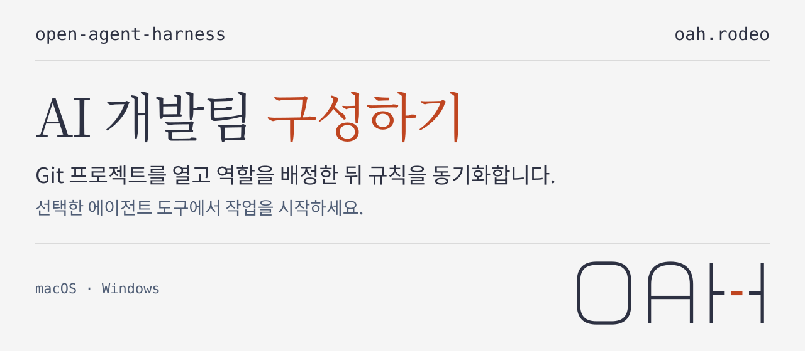
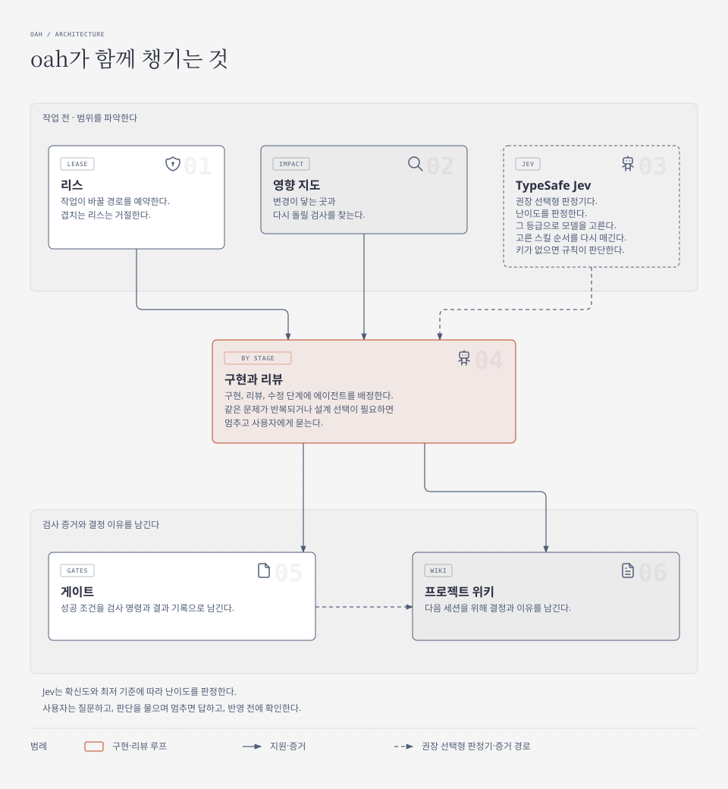
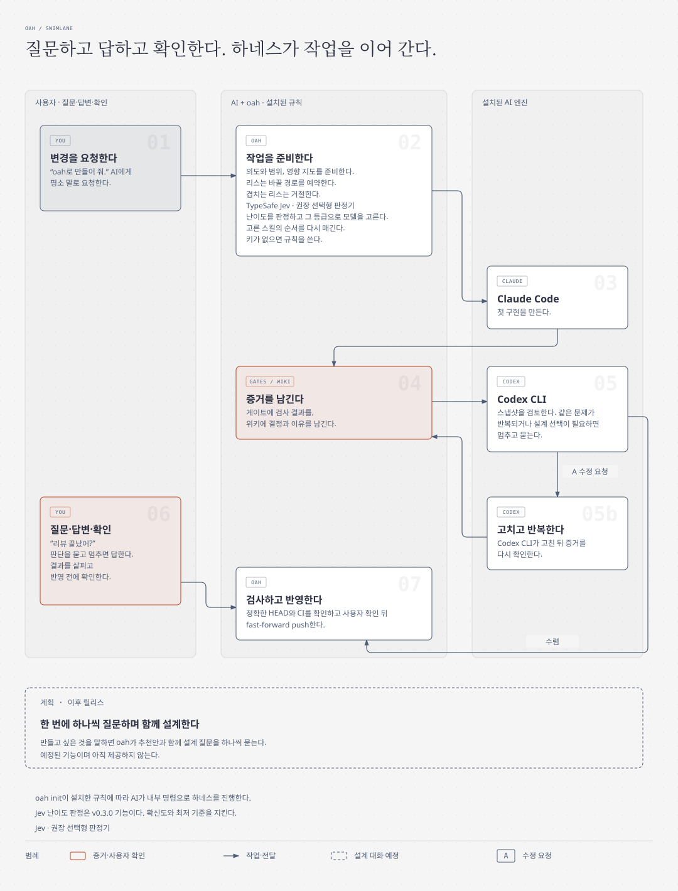

  

<a href="README.md">English</a> · <strong>한국어</strong>

# open-agent-harness (`oah`)

Open Agent Harness(OAH)는 AI 코딩 에이전트가 Git 저장소에서 정해진 범위 안에서 작업하고, 변경을 검토하고, 검사 결과를 기록하도록 돕는다.

## v1.0.0 다운로드

명령줄 도구가 포함된 데스크톱 앱을 받거나 전체 CLI를 소스에서 설치할 수 있다.

- **[macOS용 DMG 받기](https://github.com/KenSuh/open-agent-harness/releases/download/v1.0.0/OAH\_1.0.0_aarch64.dmg)** · Apple Silicon Mac, macOS 13 이상. 임시 서명(ad hoc), Apple 공증 없음.
- **[Windows용 설치 파일 받기](https://github.com/KenSuh/open-agent-harness/releases/download/v1.0.0/OAH\_1.0.0_x64-setup.exe)** · Windows 11 x64. 서명되지 않은 NSIS 설치 파일.

설치 파일을 열기 전에 [SHA256SUMS](https://github.com/KenSuh/open-agent-harness/releases/download/v1.0.0/SHA256SUMS)와 대조한다. 두 운영체제 모두 보안 경고를 표시할 수 있다. [v1.0.0 릴리스 노트](https://github.com/KenSuh/open-agent-harness/releases/tag/v1.0.0)

[첫 실행](#첫-실행) · [CLI 설치](#소스-cli-설치) · [문서](#문서)

## 첫 실행

1. **설치 파일을 검증하고 앱을 연다.** macOS에서는 `shasum -a 256`, PowerShell에서는 `Get-FileHash -Algorithm SHA256`으로 다운로드한 파일을 검사한다. 체크섬이 일치하면 macOS에서는 DMG를 열고 OAH를 응용 프로그램 폴더로 옮긴다. Windows에서는 설치 파일을 실행한다. 설치가 끝나면 OAH를 연다. [Apple의 앱 열기 안내](https://support.apple.com/en-us/102445)
2. **에이전트를 확인한다.** **Agents**에서 설치 여부와 로그인 상태를 확인한다. 사용할 에이전트의 설치 또는 로그인 안내에 따라 준비한 뒤 **Rescan agents**를 선택한다.
3. **저장소를 연다.** 상단의 **+ Open…** 버튼을 눌러 Git 작업 폴더를 고른다. **Team Workflow**에서 준비 상태를 확인하고 단계마다 에이전트를 지정한다. **Rules**에 동기화가 필요하다는 안내가 표시되면 **Sync now**를 눌러 `AGENTS.md`의 관리 대상 규칙을 갱신한다.

앱의 기본 데이터 폴더는 macOS에서 `~/.oah`, Windows에서 `%USERPROFILE%\.oah`다. 이곳의 `settings.toml`에 설정을 저장하고 `bin/`에 동봉된 도구를 복사한다. 이 도구로 에이전트 상태를 확인하는 `doctor`, 단계 구성을 보는 `sections show`, 규칙을 확인하고 동기화하는 `rules check`와 `rules sync`를 실행할 수 있다.

## 소스 CLI 설치

프로젝트 초기 설정과 전체 작업 흐름에는 소스 CLI를 사용한다. Git과 Python 3.11 이상이 필요하다. 설치 프로그램은 필요한 도구를 확인하고, 빠진 도구를 설치하기 전에 동의를 구한다.

- **macOS.** [install.sh](https://github.com/KenSuh/open-agent-harness/releases/download/v1.0.0/install.sh)를 받아 위의 체크섬으로 검증한 뒤, 파일을 받은 폴더에서 `bash ./install.sh`를 실행한다. [macOS CLI 설치 안내](docs/ko/install-macos.md)
- **Windows.** [install.ps1](https://github.com/KenSuh/open-agent-harness/releases/download/v1.0.0/install.ps1)를 받아 위의 체크섬으로 검증한 뒤, 파일을 받은 폴더에서 `powershell -ExecutionPolicy Bypass -File .\install.ps1`을 실행한다. [Windows CLI 설치 안내](docs/ko/install-windows.md)

[macOS용 소스 압축 파일](https://github.com/KenSuh/open-agent-harness/releases/download/v1.0.0/open-agent-harness-v1.0.0.tar.gz) 또는 [Windows용 소스 압축 파일](https://github.com/KenSuh/open-agent-harness/releases/download/v1.0.0/open-agent-harness-v1.0.0.zip)을 검증해서 풀고, `install/` 안의 해당 설치 프로그램을 실행해도 된다.

새 터미널에서 `oah --version`을 실행해 `oah 1.0.0`이 나오는지 확인한다. 원격 저장소가 설정된 Git 저장소에서 `oah init`을 실행한다. 설정 계획을 검토하고 승인한 뒤 생성된 프로젝트 파일을 커밋한다. [첫 작업 따라 하기](examples/hello-oah/README.ko.md)

## 이 프로젝트의 목적

1. **작업 범위를 정한다.** 무엇을 바꾸고 어떻게 확인할지, 어느 경로까지 수정할 수 있는지 적는다. [리스](docs/ko/concepts.md#리스)로 경로를 예약하고 [영향 지도](docs/ko/concepts.md#영향-지도)에서 관련 코드, 문서, 검사를 확인한다.
2. **구현하고 검토한다.** 소스 CLI는 단계 설정에 따라 Claude Code 또는 Codex CLI를 실행한다. 기본 구현 에이전트는 Claude Code다. [리뷰와 수정 전용 명령](docs/ko/concepts.md#리뷰-루프와-수정)은 Codex CLI로 읽기 전용 스냅샷을 검토하고 지적 사항을 수정한다.
3. **검사 결과를 남긴다.** [게이트](docs/ko/concepts.md#게이트)는 어떤 검사를 통과했는지 기록한다. [프로젝트 위키](docs/ko/concepts.md#프로젝트-위키)에는 다음 세션에서 참고할 결정과 그 이유를 남긴다.
4. **반영 여부를 결정한다.** 변경 사항과 리뷰 결과, 검사 기록을 살핀다. [`oah land`](docs/ko/concepts.md#반영)가 검토한 커밋이 프로젝트의 요건을 충족하는지 확인한다. 대상 브랜치에 반영할 시점은 사용자가 결정한다.

## 문서

- [동작 방식](docs/ko/how-it-works.md) · [명령 안내](docs/ko/commands.md) · [개념](docs/ko/concepts.md)
- [문제 해결](docs/ko/troubleshooting.md) · [업그레이드](docs/ko/upgrade.md) · [키 관리](docs/ko/keys.md)
- [설계 출처](docs/ko/design-sources.md) · [스킬과 도구 연동](docs/ko/skills-and-capabilities.md) · [툴킷](docs/ko/toolkit.md)
- [CI 시작하기](docs/ko/ci-starter.md) · [동반 앱](docs/ko/companions.md)

## 로드맵

[프로젝트 계획](docs/ko/PLAN.md)에서 설계와 앞으로의 작업을, [GitHub 릴리스](https://github.com/KenSuh/open-agent-harness/releases)에서 버전별 변경 사항을 확인할 수 있다.

## v0.4.0의 새 기능

[v0.4.0 릴리스](https://github.com/KenSuh/open-agent-harness/releases/tag/v0.4.0)에는 리비전을 남기는 설계 기록, 출처 스냅샷, 검토한 스킬을 관리하는 기능이 추가됐다. 자세한 내용은 [v0.4.0 업그레이드 안내](docs/ko/upgrade.md#7-030에서-040으로)를 참고한다.

- v0.4.0은 스킬 본문이나 중계한 도구 결과를 전달할 때 호스트의 수용량을 검증한 프로필이 필요했다. 프로필이 없으면 `OAH_SKILLS_BUDGET_EXCEEDED(target-capacity-unknown)`로 중단했다. [일반 작업의 입장 규칙](docs/ko/skills-and-capabilities.md#일반-작업과-관리-입장)

v0.4.0 배너와 작업 흐름 그림

<picture>
  <source media="(prefers-color-scheme: dark)" srcset="docs/assets/banner-ko-dark.svg">
  
</picture>

<picture>
  <source media="(prefers-color-scheme: dark)" srcset="docs/assets/features-ko-dark.svg">
  
</picture>

<picture>
  <source media="(prefers-color-scheme: dark)" srcset="docs/assets/how-it-works-ko-dark.svg">
  
</picture>

## 기여하기

[기여 안내](CONTRIBUTING.md)와 [개발 검사](docs/ko/how-it-works.md#개발)를 참고한다.

## 보안

API 키, 토큰, 비밀번호, 쿠키, OAuth 시크릿, 계정 식별자는 저장소나 그 이력, 릴리스, 이슈, CI 로그에 넣지 않는다. 취약점은 [보안 정책](SECURITY.md)에 따라 비공개로 신고한다.

## 라이선스

OAH는 MIT 라이선스로 배포한다. 함께 제공하는 스킬과 그림, 연동 도구의 라이선스는 [외부 저작물 고지](THIRD_PARTY_NOTICES.md)를 참고한다.

