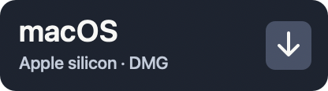
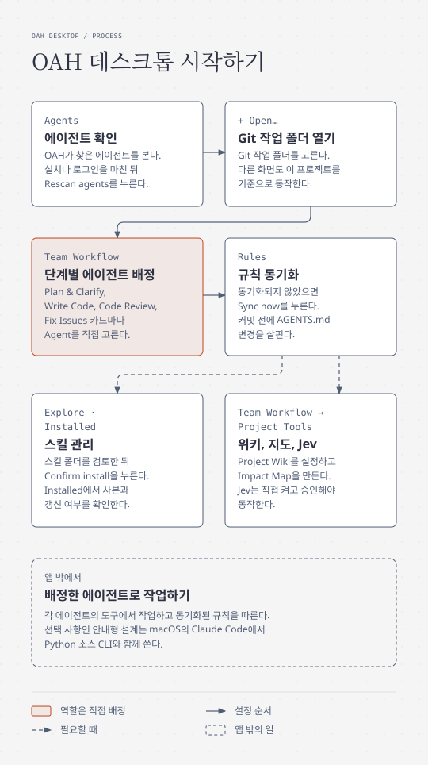
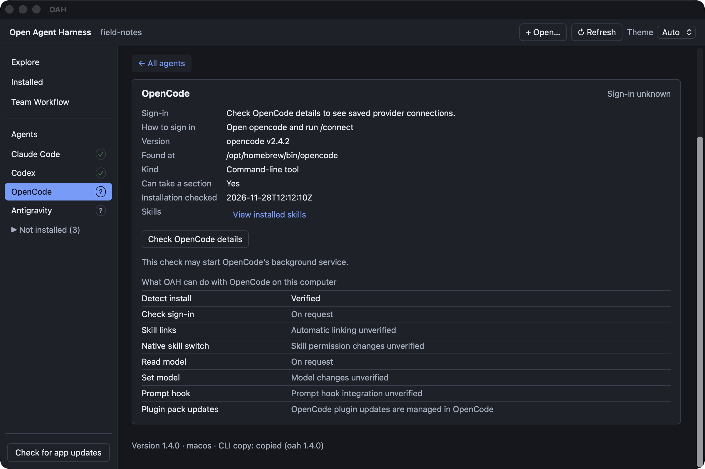
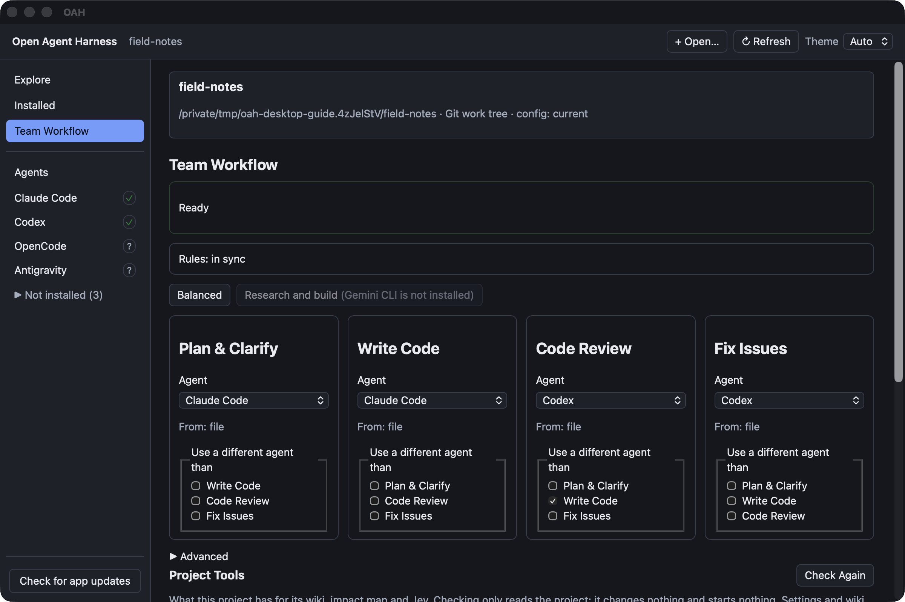
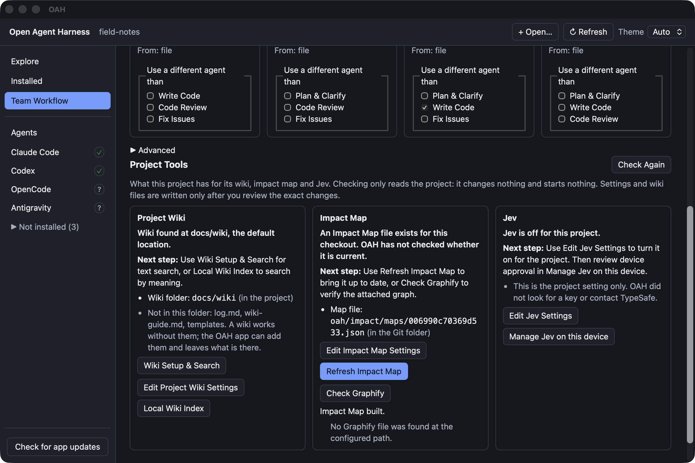
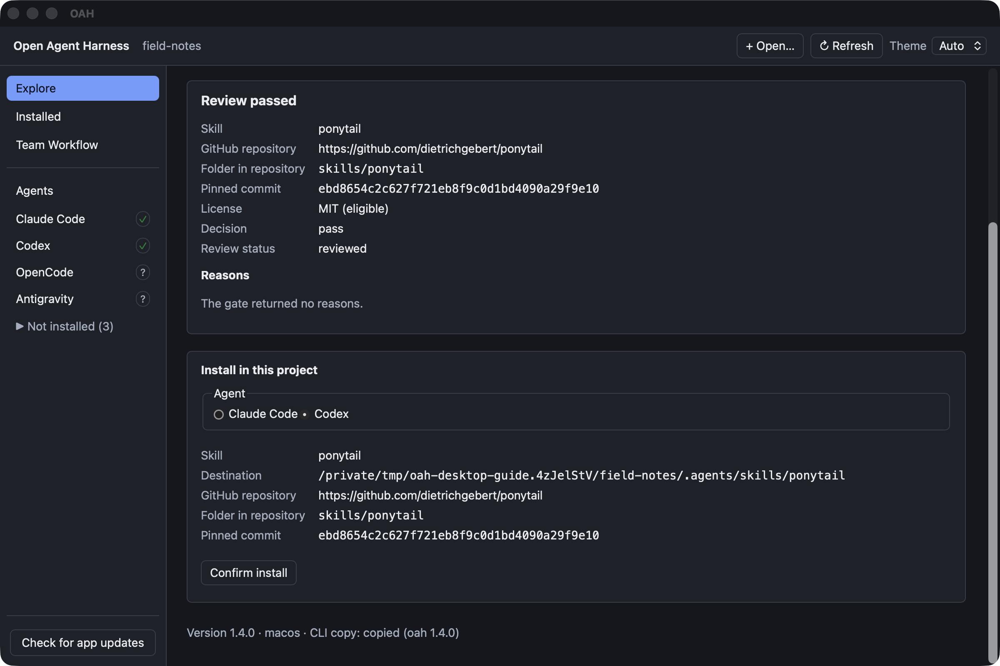
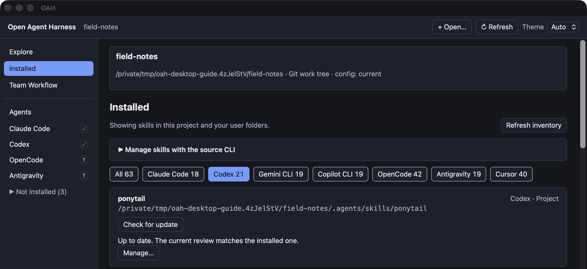

<p align="center">
  <picture>
    <source media="(prefers-color-scheme: dark)" srcset="docs/assets/banner-ko-dark.svg">
    
  </picture>
</p>

<p align="center">
  <a href="https://oah.rodeo/ko/"></a>
  <a href="https://github.com/KenSuh/open-agent-harness/actions/workflows/ci.yml"></a>
  <a href="LICENSE"></a>
  
  
</p>

<p align="center"><a href="README.md">English</a> · <strong>한국어</strong></p>

# open-agent-harness (`oah`)

**OAH 데스크톱에서 프로젝트에 맞는 AI 개발팀을 구성합니다.** Git 프로젝트를 열고 설치된 에이전트에 설계·구현·리뷰·수정을 배정한 뒤 **Team Workflow**에서 프로젝트 규칙을 동기화합니다.

**OAH 데스크톱 v1.4.0 다운로드**

<p>
  <a href="https://github.com/KenSuh/open-agent-harness/releases/download/v1.4.0/OAH_1.4.0_aarch64.dmg"></a>
  <a href="https://github.com/KenSuh/open-agent-harness/releases/download/v1.4.0/OAH_1.4.0_x64-setup.exe"></a>
</p>

[첫 프로젝트 설정](#데스크톱-앱-경로-팀-구성하기) · [데스크톱 설치](#데스크톱-앱) · [프로젝트 도구](#프로젝트-도구-설정하기) · [스킬 관리](#데스크톱에서-스킬-찾기-설치-갱신) · [릴리스 노트](https://github.com/KenSuh/open-agent-harness/releases/tag/v1.4.0) · [체크섬](https://github.com/KenSuh/open-agent-harness/releases/download/v1.4.0/SHA256SUMS) · [소스 CLI](#소스-cli)

<picture>
  <source media="(prefers-color-scheme: dark)" srcset="docs/assets/desktop-start-ko-dark.svg">
  
</picture>

[첫 프로젝트 설정 안내](#데스크톱-앱-경로-팀-구성하기)에서 OAH 데스크톱 v1.4.0 화면과 함께 따라 합니다.

## 설치

### 데스크톱 앱

DMG는 macOS 13 이상을 실행하는 Apple Silicon Mac용이다. NSIS 설치 파일은 Windows 11 x64용이다.
[v1.4.0 다운로드](#open-agent-harness-oah)에서 설치 파일과 `SHA256SUMS`를 받는다. macOS에서는 `shasum -a 256`,
PowerShell에서는 `Get-FileHash -Algorithm SHA256`으로 받은 파일을 검사한다. 체크섬이 일치하면 파일을 연다.

- **macOS.** DMG를 열고 OAH를 응용 프로그램 폴더로 옮긴다. 앱은 임시 서명만 적용했고 Apple 공증은 받지 않아
  처음 열 때 경고가 나올 수 있다. 파일을 검증한 뒤 Apple의 안내를 따른다. [앱 열기에 관한 Apple 안내](https://support.apple.com/en-us/102445)
- **Windows.** 설치 파일을 실행한다. 서명되지 않은 설치 파일이므로 Microsoft Defender SmartScreen이 경고할 수 있고,
  조직 정책에 따라 설치가 제한될 수 있다.

OAH를 사용 중이면 왼쪽 아래의 **Check for app updates**를 누른다. 새 버전이 있으면 **Install and restart**를
선택한다. OAH가 배포 서명을 검증한 뒤 업데이트를 설치한다. v1.2.0 이전 버전을 사용 중이면 최신 설치 파일을 받는다.

[OAH 데스크톱에서 첫 프로젝트 열기](#데스크톱-앱-경로-팀-구성하기)

## 처음 실행하기

### 데스크톱 앱 경로: 팀 구성하기

[Git 2.31 이상](https://git-scm.com/downloads)을 설치해 PATH에 등록하고, 내 컴퓨터에 Git 작업 폴더를 준비한다.
터미널에서 `git --version`을 실행해 설치를 확인할 수 있다.

1. **에이전트를 확인한다.** **Agents**에서 OAH가 찾은 에이전트와 확인 가능한 로그인 상태를 본다.
   사용할 에이전트의 설치 또는 로그인 안내를 따른 뒤 **Rescan agents**를 누른다.

   [](docs/assets/readme-v1/agents-1.4.0.png)

   *에이전트 카드를 열면 로그인 방법과 작업 단계를 맡을 수 있는지 확인할 수 있다.*

   **OpenCode** 카드의 **Check OpenCode details**를 눌러 저장된 연결과 기본 모델을 확인한다.
   OpenCode가 기본 모델을 제공하면 표시하며, 이 조회는 OpenCode 백그라운드 서비스를 시작할 수 있다.
   **View installed skills**를 누르면 **Installed**에서 OpenCode 스킬을 볼 수 있다.

2. **저장소를 열고 역할을 배정한다.** **+ Open…**으로 Git 작업 폴더를 고른 뒤 **Team Workflow**를 연다.
   카드마다 사용할 수 있는 **Agent**를 고른다. 배정이 앱의 검사를 통과하면 **Ready**가 표시된다.
   로그인 상태를 알 수 없으면 해당 에이전트의 도구에서 직접 확인한다. 필요한 에이전트가 목록에 없으면
   설치한 뒤 다시 확인하거나 다른 에이전트를 고른다. **Balanced** 프리셋은 **Plan & Clarify**와 **Write Code**에
   Claude Code, **Code Review**와 **Fix Issues**에 Codex를 배정한다. 배정을 바꾸면 OAH가 `.oah/config.toml`에
   저장한다. 구현과 리뷰를 다른 에이전트에 맡기려면 **Code Review** 카드의 **Use a different agent than**에서
   **Write Code** 체크를 유지한다.

   [](docs/assets/readme-v1/team-workflow-1.4.0.png)

3. **프로젝트 규칙을 확인한다.** **Rules**에 동기화가 필요하다고 나오면 **Sync now**를 눌러 `AGENTS.md`의
   관리 대상 규칙을 갱신한다. 그러면 **Rules: in sync**가 표시된다. 작업 폴더의 변경 사항을 살핀 뒤 커밋한다.

4. **작은 변경을 시도한다.** **Write Code**에 배정한 도구에서 같은 프로젝트를 열고 README 한 줄을 다듬는 등
   작은 작업을 요청한다. **Code Review**에 배정한 도구에서 변경 사항을 검토한다.

화면은 예제 Git 프로젝트를 연 macOS 앱이다. Windows 11 x64 앱도 같은 소스로 만든다.
필요에 따라 [스킬을 설치하거나](#데스크톱에서-스킬-찾기-설치-갱신)
[프로젝트 도구를 설정한다](#프로젝트-도구-설정하기).

앱은 macOS에서 `~/.oah`, Windows에서 `%USERPROFILE%\.oah` 아래에 `settings.toml`과 `bin/`의 동봉 도구를 저장한다.
이 번들 명령은 데스크톱 설정과 함께 작동한다.

### 프로젝트 도구 설정하기

Git 작업 폴더를 연 뒤 **Team Workflow → Project Tools**로 이동한다. 카드마다 도구의 상태와 다음 단계가 표시된다.
**Check Again**은 프로젝트를 읽기만 한다. 설정과 위키 파일은 바뀔 내용을 확인한 뒤에만 기록된다.

[](docs/assets/readme-v1/project-tools-1.4.0.png)

- **Project Wiki.** 앱에서 **Wiki Setup & Search**로 새 위키를 만들거나 기존 Markdown 노트 폴더를 지정하고
  텍스트로 검색한다. **Local Wiki Index**는 선택 기능으로, 직접 설치하고 실행한 gbrain과 Ollama로 커밋된 노트의
  의미 검색 인덱스를 만든다. OAH는 이 도구를 설치하거나 시작하거나 내려받지 않는다.
- **Impact Map.** 앱에서 **Build Impact Map** 또는 **Refresh Impact Map**으로 선택한 작업 폴더의 영향 지도를
  이 컴퓨터에서 만든다. **Check Graphify**는 기존 Graphify 파일이 현재 체크아웃과 맞는지 확인한다. Graphify
  그래프는 선택 사항이며 Graphify에서 직접 만든다. 영향을 받는 파일과 검사는 Python 소스 CLI의 `oah impact`로 조회한다.
- **Jev.** Impact Map 결과의 순서를 조정하는 선택 기능이며 직접 켜기 전에는 꺼져 있다. **Edit Jev Settings**로
  프로젝트에서 켜고, **Manage Jev on this device**에서 전송할 내용을 확인한 뒤 이 기기에서 승인한다. 같은 화면에서
  macOS 키체인이나 Windows 자격 증명 관리자에 키를 저장한다. [키와 승인 설정](docs/ko/keys.md)

### 데스크톱에서 스킬 찾기, 설치, 갱신

1. **스킬 폴더를 찾는다.** [OAH 툴킷 목록](docs/ko/toolkit.md)에서 저장소와 라이선스를 확인하거나, GitHub에서
   `SKILL.md`가 들어 있는 폴더를 찾는다. Ponytail(MIT)을 써 보려면 **Explore**의 **GitHub skill folder**에
   `dietrichgebert/ponytail/skills/ponytail`을 붙여 넣는다. `owner/repo/folder` 형식에서 `folder`는 저장소 안의 전체 폴더 경로다.
2. **검토하고 설치한다.** **Review**를 누르면 출처와 고정된 커밋, 라이선스, 검토 결과를 볼 수 있다. 설치 가능한
   스킬이면 **+ Open…**으로 설치할 프로젝트를 열고, 설치된 호환 에이전트를 골라 대상 경로를 확인한다. 프로젝트 안에서
   Claude Code는 `.claude/skills/`, Codex는 `.agents/skills/`를 쓴다. 경고가 있으면 읽고 확인한 뒤 **Confirm install**을 누른다.

   [](docs/assets/readme-v1/explore-1.4.0.png)
3. **설치된 스킬과 갱신 여부를 확인한다.** **Installed**에는 열어 둔 프로젝트와 사용자 폴더의 스킬이 각각 에이전트,
   범위, 경로와 함께 표시된다. 에이전트를 고르면 해당 에이전트의 스킬과 공유 스킬을 함께 볼 수 있다.
   **Refresh inventory**는 폴더를 다시 읽는다. 갱신할 수 있는 OAH 관리 프로젝트 사본에서
   **Check for update**를 누르면 원본의 최신 버전을 검토한다. 호환되는 새 버전이 검토를 통과하면 결과를 살피고
   경고가 있으면 확인한 뒤 **Apply update**를 눌러 갱신을 확정한다.

   [](docs/assets/readme-v1/installed-1.4.0.png)

4. **기존 스킬의 출처를 등록하거나 삭제한다.** **Installed**에서 스킬 옆 **Manage…**를 연다. **Register Git source**에
   GitHub 폴더나 `SKILL.md` 링크를 붙여 넣는다. 검토 파일과 일치하는 Claude Code·Codex 프로젝트 사본은
   **Check for update**로 갱신을 확인할 수 있다. **Remove…**에서는 대상 폴더와 사용하는 에이전트를 확인한 뒤
   폴더를 복구 위치로 옮길 수 있다.

**Installed**의 **Manage skills with the source CLI**를 펼치면 같은 일을 하는 Python 소스 CLI 명령이 나온다.
동봉된 네이티브 CLI에서는 `oah skills list`로 로컬 스킬 폴더를 확인할 수 있다. `--json`을 붙이면 해당 위치를 공유하는
에이전트가 있을 때 `compatible_agents`도 나타난다. [기존 스킬 관리 안내](docs/ko/skills-and-capabilities.md#이미-설치한-스킬-관리)

기술별 스킬 검색과 툴킷 관리는 [Python 소스 CLI](#cli에서-스킬-확인하고-고르기)를 쓴다.

## 소스 CLI로 작업하기

### 소스 CLI

프로젝트 초기 설정, 스킬, 전체 작업 흐름에는 소스 CLI를 쓴다. Git과 Python 3.11 이상이 필요하다.
설치 프로그램은 필요한 도구를 확인하고 빠진 도구를 설치하기 전에 묻는다.

- **macOS.** [install.sh](https://github.com/KenSuh/open-agent-harness/releases/download/v1.4.0/install.sh)를 받아 `SHA256SUMS`와 대조한 뒤, 파일을 받은 폴더에서 `bash ./install.sh`를 실행한다. [macOS CLI 설치 안내](docs/ko/install-macos.md)
- **Windows.** [install.ps1](https://github.com/KenSuh/open-agent-harness/releases/download/v1.4.0/install.ps1)를 받아 `SHA256SUMS`와 대조한 뒤, 파일을 받은 폴더에서 `powershell -ExecutionPolicy Bypass -File .\install.ps1`을 실행한다. [Windows CLI 설치 안내](docs/ko/install-windows.md)

[macOS용 소스 압축 파일](https://github.com/KenSuh/open-agent-harness/releases/download/v1.4.0/open-agent-harness-v1.4.0.tar.gz)
또는 [Windows용 소스 압축 파일](https://github.com/KenSuh/open-agent-harness/releases/download/v1.4.0/open-agent-harness-v1.4.0.zip)을
검증해서 풀고 `install/` 안의 해당 설치 프로그램을 실행해도 된다. `--dry-run`(Windows에서는 `-DryRun`)을 붙이면 진행 단계를 미리 볼 수 있다.

그다음 새 터미널을 열어 버전을 확인한다.

```console
$ oah --version
oah 1.4.0
```

### 다른 경로: 별도 프로젝트에서 소스 CLI 초기화하기

이 예제 실습에는 별도 작업 복사본을 사용한다. 소스 CLI의 `oah init`과 `oah rules sync`는 `AGENTS.md`의
관리 블록을 바꿀 수 있다. 소스 CLI를 설치한 뒤 원격 저장소가 연결된 Git 저장소에서 `oah init`을
실행한다. 설정 계획을 검토하고 승인한 뒤 생성된 프로젝트 파일을 커밋한다. 그 프로젝트에서 AI를 열고
평소 말로 요청한다.

- “로그인 기능을 oah로 만들어 줘.”
- “리뷰 끝났어? 게이트 다 통과했어?”
- “이 버전을 반영해 줘.” 결과와 검사를 살핀 뒤 확인한다.

[소스 CLI 첫 작업 따라 하기](examples/hello-oah/README.ko.md)를 진행한다.
[설정 상세](docs/ko/how-it-works.md#처음-실행하기)에서 설정 계획과 생성 파일을 설명한다.

### CLI에서 스킬 확인하고 고르기

다음 명령은 Git 프로젝트 폴더에서 전체 기능을 제공하는 [Python 소스 CLI](#소스-cli)로 실행한다.
데스크톱 앱에는 별도 동봉 도구가 있다. 설계가 없어도 내장 목록에서 기술별로 스킬을 찾을 수 있다.

```sh
oah skills find --tech database=postgresql --provider seed
oah skills review --seed S1
oah skills read --review REVIEW_ID
```

내장 목록에서 `supabase-postgres-best-practices`는 `S1`로 표시된다. `REVIEW_ID` 자리에 `review`가 출력한 ID를 넣으면
검토한 본문을 읽을 수 있다. 검토 기록에는 출처의 커밋과 라이선스가 담긴다. 저장된 검색 결과를 돌려주는 제공자를 썼다면
`find --json`에 나온 검색 ID와 결과 번호를 `--hit QUERY_ID:N`에 넣는다.

기존 설계에서는 `oah skills find --design PROJECT/DESIGN --provider seed`로 후보를 찾는다.
`oah design coverage edit PROJECT DESIGN --from EDITS.json`의 `link-skill` 작업으로 검토한 스킬을 단계에 연결하고,
출력된 `oah design save` 명령을 실행한다.
[스킬 찾기와 검토](docs/ko/skills-and-capabilities.md#스킬-찾기와-검토) · [설계 단계](docs/ko/skills-and-capabilities.md#아홉-설계-단계)

프로젝트에 설치할 스킬은 `oah skills list`에 나온 동봉 또는 연결 툴킷 항목의 이름으로 고른다. 아래 명령으로
Codex용 `ponytail` 항목의 설치 계획을 미리 보고, `--dry-run`을 빼고 실행해 설치한다.

```sh
oah skills list
oah skills install ponytail --project --target codex --dry-run
oah skills install ponytail --project --target codex
```

`oah skills update --project --check`로 갱신할 내용을 확인하고 `oah skills update --project`로 프로젝트가 추적하는
OAH 툴킷 사본을 갱신한다. 설치 대상은 `claude`, `codex`, `both`다. [툴킷 명령](docs/ko/toolkit.md#명령)

v1.4.0에는 워커에게 스킬을 전달하는 데 필요한 검증된 호스트 프로필이 없다. `oah skills select --needs FILE --review REVIEW_ID`에
쓰는 파일을 `oah skills find --task`로 만들려면 해당 프로필이 필요하다.
[관리형 전달 요구 사항](docs/ko/skills-and-capabilities.md#필수-관리-전달)

## 이 프로젝트의 목적

**하네스**는 코딩 에이전트의 작업을 안내하는 도구, 규칙과 기록의 묶음이다. OAH를 쓰면 Git 프로젝트마다
여러 에이전트에 같은 프로젝트 규칙을 적용할 수 있다. 사용하는 도구나 팀이 바뀌면 에이전트 배정과 스킬을 바꾼다.

### 역할마다 에이전트 고르기

**Team Workflow**에서 설계, 구현, 리뷰, 수정을 맡을 에이전트를 정한다. OAH가 배정을 `.oah/config.toml`에
저장하고 `AGENTS.md`의 관리 규칙을 동기화한다. 배정된 단계는 각 에이전트의 도구에서 진행한다.

<a id="어떤-ai-구성에도-맞춰-쓴다"></a>

### 지원 에이전트와 명령

데스크톱 앱에서는 **Claude Code, Codex, Gemini CLI, Copilot CLI, OpenCode, Antigravity**를
단계에 배정할 수 있다. **Agents**에는 스킬과 규칙에 쓸 수 있는 Cursor도 표시된다. 내 컴퓨터에서 쓸 수 있는
도구 중에서 고른다.

데스크톱 동봉 도구는 `doctor`, `sections show`, `rules check`, `rules sync`를 제공한다. Python 소스 CLI는
구현, 리뷰, 수정 단계의 배정을 읽는다. 소스 CLI의 `oah call`은 Claude Code와 Codex CLI를 직접 실행한다. 다른 에이전트는
각 도구에서 실행한다. 소스 CLI의 `oah review`는 Codex를 쓰며, 자동 수정 명령인 `oah fix`를 쓰려면
수정 역할에 Codex를 배정해야 한다.

## oah가 챙겨 주는 일

프로젝트 도구와 Python 소스 CLI를 사용해 변경이 어떤 파일, 검사, 결정에 영향을 주는지 확인한다.

<picture>
  <source media="(prefers-color-scheme: dark)" srcset="docs/assets/features-ko-dark.svg">
  
</picture>

- **[영향 지도](docs/ko/concepts.md#영향-지도).** AI가 파일을 고치면 관련 코드, 문서, 다시 돌릴 검사를 보여 줘서
  작은 변경도 끝까지 챙기기 쉽다.
- **[프로젝트 위키](docs/ko/concepts.md#프로젝트-위키).** AI가 작업 이력과 결정, 그 이유를 코드 옆에 남긴다.
  다음 세션이 읽을 수 있는 기록이 남아 처음부터 다시 설명할 부담이 줄어든다.
- **[리스](docs/ko/concepts.md#리스).** 작업이 바꿀 경로를 예약하고 겹치는 리스는 거절한다.
  작업마다 범위가 분명해지고, 끝낼 때 실제 변경이 그 안에 있는지 확인한다.
- **[게이트](docs/ko/concepts.md#게이트).** AI가 “끝났다”의 기준을 검사로 만들고 결과를 기록한다.
  무엇이 통과했는지 물어보고 증거를 확인할 수 있다.
- **[구현과 리뷰](docs/ko/concepts.md#리뷰-루프와-수정).** 단계에 배정한 에이전트가 구현, 검토, 수정을 이어 간다.
  같은 문제가 반복되거나 설계 선택이 필요하면 멈추고 사용자에게 답을 구한다.
- **[TypeSafe Jev](docs/ko/how-it-works.md#선택형-판정기-jev).** 권장 선택형 판정기로, 고른 스킬의 순서를 다시 매긴다.
  확신도와 최저 기준을 지키면서 난이도를 판정해 그 등급으로 모델을 고를 수 있다. 키가 없으면 규칙이 판단한다.

## 어떻게 동작하는가

<picture>
  <source media="(prefers-color-scheme: dark)" srcset="docs/assets/how-it-works-v1-ko-dark.svg">
  
</picture>

소스 CLI의 전체 작업 흐름에서는 `oah init`이 설치한 규칙과 각 명령의 안내에 따라 에이전트가 목표와 범위를
적고, 경로를 예약하고, 모델과 스킬을 고르며 리뷰 라운드 사이에 영향 지도를 확인한다. Jev를 켜면 난이도를
판정하고 고른 스킬의 순서를 다시 매길 수 있다. 구현을 맡은 에이전트가 변경을 만들고, 게이트는 검사 결과를,
위키는 이유를 남긴다. 리뷰를 맡은 에이전트가 검토하고 수정을 맡은 에이전트가 지적 사항을 고친다.
같은 문제가 반복되거나 설계 선택이 필요하면 멈추고 사용자에게 묻는다. 반복 횟수에 상한을 둘 수도 있다.

“리뷰 끝났어?”, “게이트 다 통과했어?”라고 물어본다. 결과를 살피고 확인한 뒤 프로젝트의 기본 브랜치에
반영한다. [CLI 작업 흐름](docs/ko/how-it-works.md)에서 내부 명령을 볼 수 있다.
Python 소스 CLI로 [Claude Code에서 안내형 설계 대화](docs/ko/skills-and-capabilities.md#안내형-설계)를 시작하거나 이어갈 수 있다.

## v0.4.0의 새 기능

데스크톱 앱이 나온 v1.0.0에 앞서 [v0.4.0 릴리스](https://github.com/KenSuh/open-agent-harness/releases/tag/v0.4.0)에는
아래 기능이 추가됐다. [v0.4.0 업그레이드 안내](docs/ko/upgrade.md#7-030에서-040으로)

- **설계 기록.** `oah design`은 번호를 매긴 설계 리비전과 승인 기록을 프로젝트 위키에 남겼다.
  `oah packet new --design`은 작업을 승인된 리비전에 연결하고 작업 중에 그 연결을 검사하도록 했다. [설계](docs/ko/concepts.md#설계)
- **확인할 수 있는 출처.** `oah sources`로 설계에 쓰인 공개 출처의 버전과 라이선스를 검증해 스냅샷을 남기고,
  원본이 바뀌었는지 확인할 수 있게 됐다. [설계 출처](docs/ko/design-sources.md)
- **아홉 설계 단계와 검토한 스킬.** `oah design coverage`는 남은 검사와 다시 확인할 검사를 보여 줬다.
  `oah skills find --design`, 스킬을 특정 커밋에 고정하는 검토, 설계나 작업에 맞춰 스킬을 고르는 기능이 추가됐다.
- **네이티브 하위 에이전트와 도구 경로.** `oah call ... --launcher native`는 검사를 마친 작업 지시를 리드가
  네이티브 하위 에이전트에게 넘길 수 있게 했다. `oah capabilities`에는 도구 확인, 경로 설정과 중계 기록이 추가됐다.
  관리형 스킬 전달과 `oah skills find --task`에는 검증된 호스트 프로필이 필요했다. v0.4.0에 그런 프로필이
  포함되지 않아 아무것도 보내기 전에 `OAH_SKILLS_BUDGET_EXCEEDED(target-capacity-unknown)`로 멈췄다.
  [일반 작업과 관리 입장](docs/ko/skills-and-capabilities.md#일반-작업과-관리-입장)
- **리뷰, Jev 호출과 반영 검사.** v0.4.0은 Codex 버전 고정, Jev 오류가 반복된 뒤 쉬는 시간, CI에 맡긴 게이트에
  대한 정확한 HEAD 검사를 추가했다. 리뷰와 평가의 임시 파일은 사용자 전용 폴더로 옮겼다.
  [임시 작업 폴더](docs/ko/concepts.md#임시-작업-폴더)

## 로드맵

도구가 바뀌면 계획도 바뀔 수 있다. [프로젝트 계획](docs/ko/PLAN.md)과 [릴리스 이력](https://github.com/KenSuh/open-agent-harness/releases)을 참고한다.

### 안내형 설계

[안내형 설계](docs/ko/skills-and-capabilities.md#안내형-설계)

### 예정 작업

프로젝트에 맞는 기술 조합을 제안하고, 작업을 재개할 때 등록한 출처를 다시 확인하는 기능을 검토하고 있다.
승인한 설계가 바뀌었을 때 영향을 받는 작업 지시, 리뷰와 위키 기록을 찾는 기능도 검토 중이다.
호스트의 관리형 스킬 전달 능력을 검증하고 같은 리뷰 문제가 반복되면 원인을 추적하는 작업도 계획에 포함된다.
범위와 선행 조건은 프로젝트 계획에서 확인할 수 있다.

## 문서

| 문서 | 내용 |
|---|---|
| [동작 방식](docs/ko/how-it-works.md) | 각 부분의 연결, 전체 흐름, 검사, 요구 사항과 설정 상세. |
| [명령 안내](docs/ko/commands.md) | 필요한 명령과 실행 결과의 뜻. |
| [따라 하기 예제](examples/hello-oah/README.ko.md) | 작업 하나를 전체 흐름에 태워 단계별로 진행한다. |
| [개념](docs/ko/concepts.md) | 리스, 패킷과 의도, 난이도, 스킬, 영향 지도, 위키, 설계, 게이트, 리뷰, 반영, 업데이트, 툴킷, 임시 작업 폴더, CI, 동반 앱. |
| [설계 출처](docs/ko/design-sources.md) | 설계가 쓰는 라이브러리와 문서 따라가기, 스냅샷, 라이선스, 일일 검사. |
| [스킬과 능력](docs/ko/skills-and-capabilities.md) | 아홉 설계 단계, 스킬 찾기와 검토, 네이티브 하위 에이전트, 도구 경로, 관리형 전달의 한계. |
| [문제 해결](docs/ko/troubleshooting.md) | 자주 만나는 `OAH_*` 거절의 뜻과 다음에 실행할 명령. |
| [키](docs/ko/keys.md) | 선택 기능의 키를 어디에 두는지, 없으면 무엇이 꺼지는지. |
| [업그레이드](docs/ko/upgrade.md) | `oah`, 프로젝트 파일, 스킬, MCP 템플릿, 모델 업데이트와 릴리스별 변경 사항. |
| [macOS에 설치하기](docs/ko/install-macos.md), [Windows에 설치하기](docs/ko/install-windows.md) | 설치 프로그램 단계별 안내. |
| [CI 스타터](docs/ko/ci-starter.md) | `oah ci init`, CI 결과 읽기, 검사를 필수로 만들기. |
| [동반 앱](docs/ko/companions.md) | Orca와 Aside가 더해 주는 것과 설정 방법. |
| [툴킷](docs/ko/toolkit.md) | 함께 싣거나 연결한 스킬, MCP 템플릿, 명령줄 도구와 각각의 출처, 라이선스. |
| [계획](docs/ko/PLAN.md) | 전체 설계와 규칙마다의 이유. |

## 개발

[기여 안내](CONTRIBUTING.md)를 참고한다.
[개발 검사](docs/ko/how-it-works.md#개발)에서 테스트, CI, 개인정보 스캔과 커밋 작성 엔진 기록을 설명한다.

## 보안

API 키, 토큰, 비밀번호, 쿠키, OAuth 시크릿, 계정 식별자는 저장소와 그 이력, 릴리스, 이슈, CI 로그
어디에도 넣지 않는다.
[보안 규칙](docs/ko/how-it-works.md#보안)에서 키 보관, 스캔과 전체 정책을 설명한다. 취약점은 비공개로 신고한다. [보안 정책](SECURITY.md)

## 라이선스

`oah`는 [MIT 라이선스](LICENSE)로 배포하며 저작권자는 open-agent-harness 기여자다.
`skills/`의 스킬은 각 라이선스가 허락하는 것만 원본을 싣고 해당 라이선스를 함께 둔다.
다이어그램 HTML과 SVG는 MIT 라이선스인 diagram-design의 템플릿과 스타일을 바탕으로 만들었다.
[외부 저작물 고지](THIRD_PARTY_NOTICES.md)에 이 저작물과 oah가 실행하거나 연결하는 도구인
unlazy, superpowers, graphify, Claude Code, Codex CLI 등의 출처와 라이선스가 있다.
