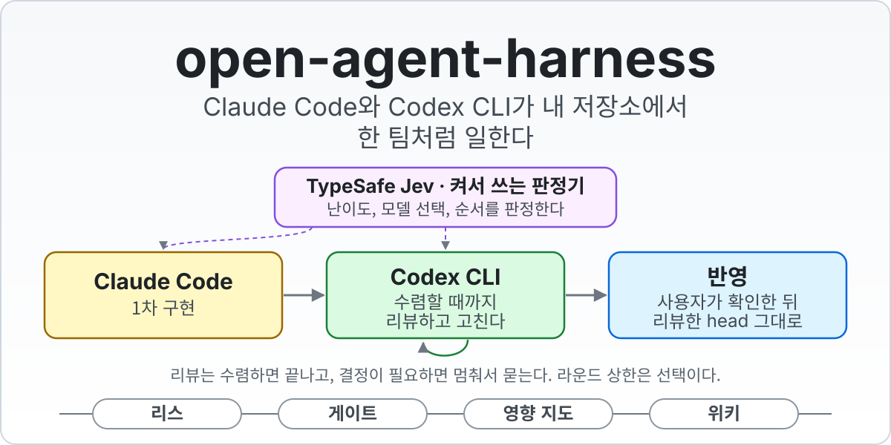
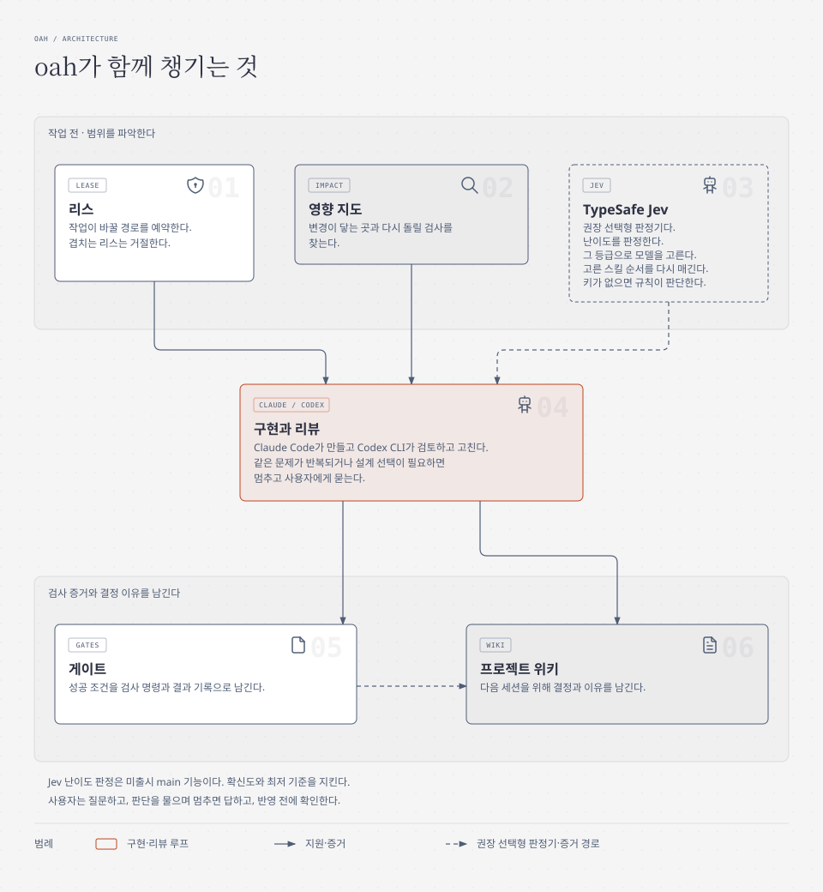
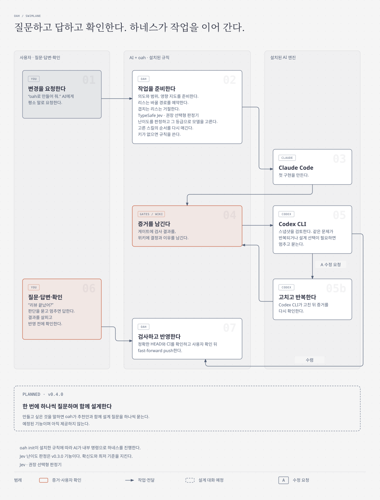

<p align="center">
  <picture>
    <source media="(prefers-color-scheme: dark)" srcset="docs/assets/banner-ko-dark.svg">
    
  </picture>
</p>

<p align="center">
  <a href="../../actions/workflows/ci.yml"></a>
  <a href="LICENSE"></a>
  
  
</p>

<p align="center"><a href="README.md">English</a> · <strong>한국어</strong></p>

# open-agent-harness (`oah`)

## 이 프로젝트의 목적

`oah`는 각자에게 맞고 AI가 발전하는 만큼 함께 바뀌는 개발 환경을 만들도록 돕는다.
가져다 고쳐 쓸 수 있는 참고 구현이자 가이드라인이다. **하네스**는 AI 코딩 도구를 둘러싼 도구와 규칙,
기록의 묶음이다.

AI가 전문가처럼 프로그램을 만들고 고치는 데 필요한 일을 스스로 챙긴다. 변경의 영향을 살피고, 프로젝트 위키를
관리하고, 결과를 검사하고, 리뷰와 수정을 이어 간다. 권장 선택형 판정기 TypeSafe Jev를 켜면 난이도를 판단하고
그 등급에 따라 모델도 자동으로 고른다(main에 있으며 아직 릴리스하지 않았다).
**사용자는 요청하고, AI가 판단을 물으며 멈추면 답하고, 반영 전에 확인한다.**

필요한 부분만 가져가도 되고, 전체 구성으로 시작해 자기 것으로 만들어도 된다. 예전 규칙과 스킬
(AI가 읽어 쓰는 작업 지침)은 새 모델의 능력을 막거나 결과를 나쁘게 만들 수 있다. 도움이 되는 것은 남기고,
필요 없어진 것은 지우며, 도구가 바뀌면 규칙도 바꾼다. `oah`도 계속 바뀐다.
기본값은 이해하고 바꾸기 쉬워야 하며, 작업을 가로막는 규칙은 고쳐야 할 설계 문제다.

### Claude가 구현하고 Codex가 검토하는 이유

이 역할 분담은 만든 사람의 개인적인 경험에서 나왔고, 측정한 비교 결과는 아니다. 내가 써 보니 Claude는
첫 버전을 만들면서 초보자가 놓치기 쉬운 부분까지 채우는 데 강했다. Codex는 정해진 범위 안에서 검사하고
고치는 데 강했다. 그래서 Claude가 먼저 만들고 Codex가 검토, 수정, 재검토한다.

### 어떤 AI 구성에도 맞춰 쓴다

지금 `oah` 명령은 **Claude Code**와 **Codex CLI**를 움직인다. 그 안의 아이디어는 다른 도구나 하네스를
포함해 **AI 하나만 써도, 여러 AI를 함께 써도** 적용할 수 있다. 필요한 부분을 가져가고 단계마다 자기에게
맞는 AI를 고른다.

## oah가 챙겨 주는 일

원하는 결과를 말하면 AI가 다음 도구를 함께 써서 작업을 이어 간다.

<picture>
  <source media="(prefers-color-scheme: dark)" srcset="docs/assets/features-ko-dark.svg">
  
</picture>

- **[영향 지도](docs/ko/concepts.md#영향-지도).** AI가 파일을 고치기 전에 관련 코드, 문서, 검사를 찾는다.
  다시 돌릴 검사를 알 수 있어 작은 변경도 끝까지 챙기기 쉽다.
- **[프로젝트 위키](docs/ko/concepts.md#프로젝트-위키).** AI가 작업 이력과 결정, 그 이유를 코드 옆에 남긴다.
  다음 세션이 이 기록을 읽으므로 처음부터 다시 설명할 부담이 줄어든다.
- **[리스](docs/ko/concepts.md#리스).** 작업이 바꿀 경로를 예약하고 겹치는 리스는 거절한다.
  작업마다 범위가 분명해지고, 끝낼 때 실제 변경이 그 안에 있는지 확인한다.
- **[게이트](docs/ko/concepts.md#게이트).** AI가 “끝났다”의 기준을 검사로 만들고 결과를 기록한다.
  무엇이 통과했는지 물어보고 증거를 확인할 수 있다.
- **[구현과 리뷰](docs/ko/concepts.md#리뷰-루프와-수정).** Claude Code가 만들고 Codex CLI가 검토, 수정, 재검토한다.
  같은 문제가 반복되거나 설계 선택이 필요하면 멈추고 사용자에게 답을 구한다.
- **[TypeSafe Jev](docs/ko/how-it-works.md#선택형-판정기-jev).** 권장 선택형 판정기로, 고른 스킬의 순서를 다시 매기고
  미출시 main에서는 난이도를 판단해 확신도와 최저 기준을 지키며 그 등급으로 모델을 자동 선택한다.
  키가 없으면 규칙이 판단한다.

## 어떻게 동작하는가

<picture>
  <source media="(prefers-color-scheme: dark)" srcset="docs/assets/how-it-works-ko-dark.svg">
  
</picture>

AI에게 평소 말로 요청한다. `oah init`이 설치한 규칙에 따라 AI가 목표와 범위를 적고, 경로를 예약하고,
영향 지도를 확인하며 모델과 스킬을 고른다. Jev를 켰다면 그 판정도 쓴다. Claude Code가 구현하고, 게이트는
검사 결과를, 위키는 이유를 남긴다. Codex CLI는 반영을 막는 지적이 없을 때까지 검토와 수정을 반복한다.
같은 문제가 반복되거나 설계 선택이 필요하면 멈추고 사용자에게 묻는다.

“리뷰 끝났어?”, “게이트 다 통과했어?”라고 물어본다. 결과를 살피고 확인한 뒤 프로젝트의 기본 브랜치에
반영한다. [전체 동작 방식](docs/ko/how-it-works.md)에서 AI가 내부에서 실행하는 명령을 볼 수 있다.
그림에 따로 표시한 안내형 설계 대화는 **v0.4.0에 계획돼 있다**.

> [!NOTE]
> **v0.2.0은 현재 릴리스다.** git과 pull request에 익숙한 개발자를 위한 버전이며 macOS와 네이티브 Windows를
> 지원한다. Linux는 아직 지원하지 않는다.

## 설치

OS마다 명령 하나로 `oah`를 설치한다. 빠진 도구는 설치하기 전에 묻고 도구마다 공식 명령을 보여 주며, 사용자의
비밀번호나 키는 보지 않는다. 클론에서 설치하려면 아래 명령을 실행한다. v0.2.0은 저장소의 릴리스 페이지에서
태그의 소스 압축 파일과 `SHA256SUMS`를 받는 방법도 있다. 압축 파일의 SHA-256이 `SHA256SUMS`의 해당 파일
지문과 일치할 때만 풀고 안의 설치 프로그램을 실행한다. 확인 방법은 아래 OS별 안내에 있다.

macOS에서는 먼저 git이 있어야 한다(`xcode-select --install`).

```sh
git clone https://github.com/KenSuh/open-agent-harness.git
cd open-agent-harness
bash install/install.sh
```

Windows PowerShell에서도 먼저 git이 있어야 한다(`winget install --id Git.Git -e`).

```powershell
git clone https://github.com/KenSuh/open-agent-harness.git
cd open-agent-harness
powershell -ExecutionPolicy Bypass -File .\install\install.ps1
```

`--dry-run`(Windows에서는 `-DryRun`)을 붙이면 아무것도 바꾸지 않고 모든 단계를 보여 준다. 설치 프로그램은 도구를
확인하고, uv(없으면 pipx나 pip)로 `oah`를 설치하고, 새 터미널에서 `oah`를 찾을 수 있는지 확인한 뒤 `oah doctor`를
실행한다. 자세한 안내는 [macOS에 설치하기](docs/ko/install-macos.md)와
[Windows에 설치하기](docs/ko/install-windows.md)에 있다.

그다음 새 터미널을 열고 확인한다.

```console
$ oah --version
oah 0.2.0
```

## 처음 실행하기

설치 프로그램을 한 번 실행하고, 프로젝트마다 `oah init`을 한 번 실행한다.
원격 저장소가 연결된 내 git 저장소 안에서 터미널을 연다.

```sh
oah init
```

안내형 설정이 선택 도구를 물어보고 전체 계획을 보여 준다. 사용자가 확인해야 파일을 바꾼다.
쓴 파일을 커밋한다. 그다음부터는 그 프로젝트에서 AI를 열고 말로 요청한다. 설치된 규칙이 AI에게 하네스를
진행하는 방법을 알려 준다.

- “로그인 기능을 oah로 만들어 줘.”
- “리뷰 끝났어? 게이트 다 통과했어?”
- “이 버전을 반영해 줘.” 결과와 검사를 살핀 뒤 확인한다.

같은 문제가 반복되거나 설계 선택이 필요해 AI가 멈추면 답하고 이어 간다. 명령은 이 대화 아래에서 실행된다.
[첫 작업 예제](examples/hello-oah/README.ko.md)는 20분쯤 걸린다. 내가 할 말, AI가 하는 일, 확인할 것을 먼저
보여 주고 전체 명령 예제를 이어 싣는다. [설정 상세](docs/ko/how-it-works.md#처음-실행하기)에서 모든 선택 사항과
생성 파일을 설명한다.

## 로드맵

아래 내용은 모두 **v0.2.0에서는 아직 쓸 수 없다**. 도구가 바뀌면 계획도 바뀔 수 있다.

### v0.3.0: 벤치마크로 고르는 모델

다음 내용은 v0.2.0 다음으로 계획하고 있다.

- 벤치마크 점수가 모델을 고른다. 난이도와 프로필(performance, balanced, efficient)이 작업에 필요한 점수를 정한다. balanced는 그
  점수에 닿는 가장 싼 모델을, efficient는 가격 대비 점수가 가장 좋은 모델을, performance는 가장 어려운 일에 최고점 모델을 쓴다. 난이도마다 모델을 정해 둔 표는 없고, 현재 모델은 모든
  프로필에서 후보가 된다.
- 점수는 키나 계정 없이 Epoch AI에서 가져온다. 자기 Artificial Analysis 키가 있으면 그 점수를 대신 쓴다. 공개 점수는 모델의 일반 성능을
  재는 것이고, 내 저장소에서의 성능을 재는 것은 아니다.
- 새 세대 모델은 점수가 나오면 합류하고, 낡거나 사라진 모델은 빠진다. 파일은 고치지 않는다. 바뀔 때마다 쉬운 말로 알리고 실행 기록에 남긴다.
- TypeSafe Jev가 작업의 Intent와 Scope 경로를 보고 난이도를 판정한다. Jev가 꺼져 있거나 확신도가 낮으면 규칙이 정한 난이도로 실행한다.
  호출을 막지는 않는다.
- 리뷰는 플래그, 패킷, 프로필, 판정이 무엇을 말해도 위험도에 맞는 하한 아래로 실행하지 않는다.
- 마지막 리스가 끝나면 `oah`가 각 도구의 업데이트 명령으로 Claude Code, Codex와 Claude Code 플러그인을 갱신할 수 있고,
  모델 목록은 다음 호출에서 새로 읽는다. Codex 플러그인과 MCP 서버는 갱신하지 않는다. oah 스킬은 기존 일일 점검을 유지한다
  (`oah skills update`). `oah init`에서 한 번 묻고, 끌 수 있다.
- `oah models report`가 모델 선택 기록을 집계하고, 내보내기로 나중에 비교할 사례를 남긴다. 횟수만으로 Jev의 효과가 증명되지는 않는다.

고정한 모델, tier 후보, 추론 강도 상한, 작업별 최저 기준은 그대로 유지된다.

### v0.4.0: 한 번에 하나씩 질문하며 함께 설계하기

**예정된 기능이며 아직 제공하지 않는다.** 만들고 싶은 것을 말하면 oah가 추천안과 함께 설계 질문을 하나씩
묻는다. 사용자가 구현 전에 설계 결정에 직접 참여한다.

## 문서

| 문서 | 내용 |
|---|---|
| [동작 방식](docs/ko/how-it-works.md) | 각 부분의 연결, 전체 흐름, 검사, 요구 사항과 설정 상세. |
| [명령 안내](docs/ko/commands.md) | 필요한 명령과 실행 결과의 뜻. |
| [따라 하기 예제](examples/hello-oah/README.ko.md) | 작업 하나를 전체 흐름에 태워 단계별로 진행한다. |
| [개념](docs/ko/concepts.md) | 리스, 패킷과 의도, 난이도, 스킬, 영향 지도, 위키, 게이트, 리뷰, 반영, 업데이트, 툴킷, CI, 동반 앱. |
| [문제 해결](docs/ko/troubleshooting.md) | 자주 만나는 `OAH_*` 거절의 뜻과 다음에 실행할 명령. |
| [키](docs/ko/keys.md) | 선택 기능의 키를 어디에 두는지, 없으면 무엇이 꺼지는지. |
| [업그레이드](docs/ko/upgrade.md) | `oah`, 프로젝트 파일, 스킬, MCP 템플릿, 모델 업데이트. |
| [macOS에 설치하기](docs/ko/install-macos.md), [Windows에 설치하기](docs/ko/install-windows.md) | 설치 프로그램 단계별 안내. |
| [CI 스타터](docs/ko/ci-starter.md) | `oah ci init`, CI 결과 읽기, 검사를 필수로 만들기. |
| [동반 앱](docs/ko/companions.md) | Orca와 Aside가 더해 주는 것과 설정 방법. |
| [툴킷](docs/ko/toolkit.md) | 함께 싣거나 연결한 스킬, MCP 템플릿, 명령줄 도구와 각각의 출처, 라이선스. |
| [계획](docs/ko/PLAN.md) | 전체 설계와 규칙마다의 이유. |

## 개발

[개발 검사](docs/ko/how-it-works.md#개발)에서 테스트, CI, 개인정보 스캔과 커밋 작성 엔진 기록을 설명한다.

## 보안

API 키, 토큰, 비밀번호, 쿠키, OAuth 시크릿, 계정 식별자는 저장소와 그 이력, 릴리스, 이슈, CI 로그
어디에도 넣지 않는다.
[보안 규칙](docs/ko/how-it-works.md#보안)에서 키 보관, 스캔과 전체 정책을 설명한다.

## 라이선스

`oah`는 [MIT 라이선스](LICENSE)로 배포하며 저작권자는 open-agent-harness 기여자다.
`skills/`의 스킬은 각 라이선스가 허락하는 것만 원본 그대로 싣고 해당 라이선스를 함께 둔다.
다이어그램 HTML과 SVG는 MIT 라이선스인 diagram-design의 템플릿과 스타일을 바탕으로 만들었다.
[외부 저작물 고지](THIRD_PARTY_NOTICES.md)에 이 저작물과 oah가 실행하거나 연결하는 도구인
unlazy, superpowers, graphify, Claude Code, Codex CLI 등의 출처와 라이선스가 있다.
