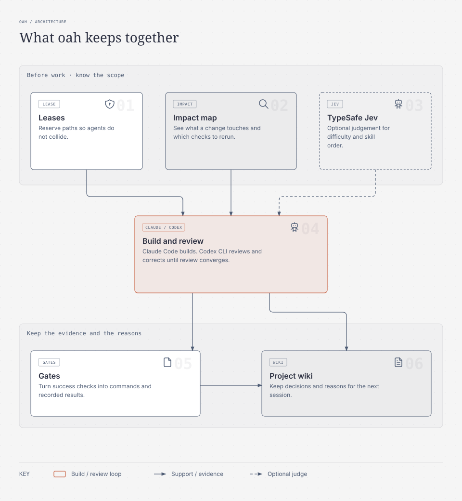
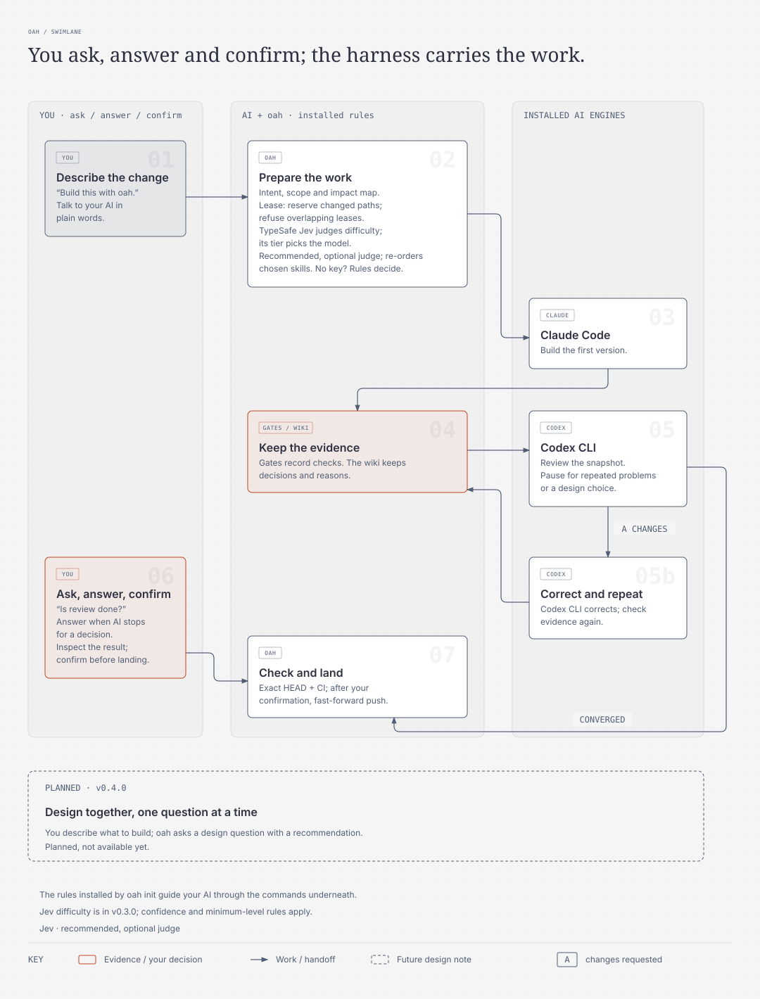

<p align="center">
  <picture>
    <source media="(prefers-color-scheme: dark)" srcset="docs/assets/banner-dark.svg">
    
  </picture>
</p>

<p align="center">
  <a href="../../actions/workflows/ci.yml"></a>
  <a href="LICENSE"></a>
  
  
</p>

<p align="center"><strong>English</strong> · <a href="README.ko.md">한국어</a></p>

# open-agent-harness (`oah`)

## Purpose: a harness that keeps adapting

`oah` helps you build an AI development workflow that fits you and keeps changing as AI improves.
It is a working reference and a guide you can adapt. A **harness** is the set of tools, rules and records
around an AI coding assistant.

Your AI takes care of the whole job of building and fixing a program like an expert: checking what a change
might affect, keeping the project wiki, proving the result and running the review cycle. With the recommended,
optional TypeSafe Jev judge on, it also judges difficulty and picks the model automatically through that difficulty
level (on main, awaiting release). **You ask, answer when the AI stops for a decision, and confirm before anything lands.**

Take the parts that help, or start with the whole setup and make it yours. Older rules and skills
(instructions an AI can load) can hold a newer model back or make its results worse. Keep what helps,
remove what no longer does, and change the rules as your tools change. `oah` keeps evolving too.
Its defaults should be easy to understand and change; a rule that gets in your way is a design problem to fix.

### Why Claude implements and Codex reviews

This split comes from the author's own experience, not a measured comparison. In my use, Claude is good
at filling in details a beginner might miss while building the first version. Codex is good at checking
and correcting work within a fixed scope. So Claude writes first; Codex reviews, corrects and reviews again.

### Use it with any AI setup

The `oah` command drives **Claude Code** and **Codex CLI** today. The ideas work with **one AI or several**,
including other tools and harnesses. Take the parts you need and give each stage to the AI that suits you.

## What oah does for you

You describe the result you want. Your AI uses these parts together to carry the work through.

<picture>
  <source media="(prefers-color-scheme: dark)" srcset="docs/assets/features-dark.svg">
  
</picture>

- **[Impact map](docs/concepts.md#the-impact-map).** When your AI changes a file, the impact map shows related code,
  documents and the checks to rerun. It can see which checks must run again, so a small edit is easier to follow through.
- **[Project wiki](docs/concepts.md#the-project-wiki).** Your AI keeps the task history, decisions and reasons
  beside the code. The next session has a record to read instead of making you explain everything again.
- **[Leases](docs/concepts.md#leases).** A lease reserves the paths a task changes, and an overlapping lease
  is refused. Each task has a clear scope, and its changes are checked against that scope when it finishes.
- **[Gates](docs/concepts.md#gates).** Your AI turns “done” into checks with recorded results.
  You can ask what passed and see the evidence.
- **[Build and review](docs/concepts.md#the-review-loop-and-corrections).** Claude Code builds; Codex CLI
  reviews, corrects and reviews again. A repeated problem or a design choice stops the loop for your answer.
- **[TypeSafe Jev](docs/how-it-works.md#jev-the-optional-judge).** The recommended, optional judge re-orders
  chosen skills and, on unreleased main, judges difficulty so its difficulty level (tier) picks the model automatically, subject
  to confidence and minimum-level rules. Without a key, the rules decide.

## How it works

<picture>
  <source media="(prefers-color-scheme: dark)" srcset="docs/assets/how-it-works-dark.svg">
  
</picture>

Talk to your AI in plain words. The rules installed by `oah init` and each command’s next-step message guide it
through recording your goal and scope, reserving paths, choosing the model and skills, and checking the impact
map between review rounds, with Jev when enabled.
Claude Code builds; the gates record check results and the wiki keeps the reasons. Codex CLI reviews and corrects
until no blocking findings remain, or stops for your answer when a problem repeats or a design choice is needed.
A round limit is optional.

Ask “Is the review done?” or “Did all the gates pass?” Inspect the result and confirm before it lands in your
project's main branch. The [full walkthrough](docs/how-it-works.md) shows the commands your AI runs underneath.
The guided design conversation shown separately in the figure is **planned for v0.4.0**.

> [!NOTE]
> **v0.2.0 is the current release.** It is for developers fluent with git and pull requests, on macOS and
> native Windows. Linux is not yet supported.

## Install

One command per OS installs `oah`. It asks before it installs any missing tool, shows the official command
for each one, and never sees your passwords or keys. To install from a clone, run the commands below.
For v0.2.0, you can instead download the tag’s source archive and `SHA256SUMS` from the repository’s release
page. Refuse to unpack it unless its SHA-256 matches that archive’s digest in `SHA256SUMS`; then run the
included installer. The OS guides below show how to check it.

macOS (you need git first: `xcode-select --install`):

```sh
git clone https://github.com/KenSuh/open-agent-harness.git
cd open-agent-harness
bash install/install.sh
```

Windows PowerShell (you need git first: `winget install --id Git.Git -e`):

```powershell
git clone https://github.com/KenSuh/open-agent-harness.git
cd open-agent-harness
powershell -ExecutionPolicy Bypass -File .\install\install.ps1
```

Add `--dry-run` (`-DryRun` on Windows) to see every step without changing anything. The installer checks the
tools, installs `oah` with uv (or pipx, or pip), checks that a new terminal finds `oah`, and runs `oah doctor`.
The full guides are [Install on macOS](docs/install-macos.md) and [Install on Windows](docs/install-windows.md).

Then open a new terminal and check:

```console
$ oah --version
oah 0.2.0
```

## First run

Run the installer once, then run `oah init` once in each project. Open a terminal in your project,
which needs to be a git repository with a remote:

```sh
oah init
```

The guided setup asks about optional tools, shows the complete plan, and changes files only after you
confirm. Commit the files it writes. From then on, open your AI in that project and talk to it; the installed
rules tell it how to run the harness.

- “Build login with oah.”
- “Is the review done? Did all the gates pass?”
- “Land this version.” Say this after inspecting the result and the checks.

When the AI stops for a repeated problem or a design choice, answer so it can continue. The commands run
underneath this conversation. [Your first task](examples/hello-oah/README.md) takes about 20 minutes and shows
what you say, what the AI does and what you check, followed by the complete command walkthrough.
[Setup details](docs/how-it-works.md#first-run) explain every option and generated file.

## Roadmap

Nothing below is **available in v0.2.0** yet. Plans can change as the tools change.

### v0.3.0: models chosen from benchmarks

Planned, after v0.2.0:

- Benchmark scores pick the model. Difficulty and a profile (performance, balanced, efficient) set the score a job needs. Balanced takes
  the cheapest model that reaches it, efficient the best score per price, and performance the top scorer for the hardest work. No table ties a difficulty to a
  model, and every current model is a candidate in every profile.
- Scores come from Epoch AI, with no key and no account. With your own Artificial Analysis key, oah uses those instead. Published
  scores measure general quality, not your repository.
- A new model generation joins once it has a score, and superseded or removed models drop out, with no file edited. Each change
  shows a plain notice and stays in the run record.
- TypeSafe Jev judges difficulty from the task's Intent and Scope paths. When Jev is off or has low confidence, the rule-based
  difficulty runs. A call is never blocked.
- A review never runs below the floor for its risk, whatever a flag, packet, profile or judge says.
- After the last lease finishes, `oah` can bring Claude Code, Codex and Claude Code plugins up to date with each tool's own update
  command, and the model lists refresh at the next call. Codex plugins and MCP servers are not updated; oah's skills keep their
  own daily check (`oah skills update`). `oah init` asks once, and you can turn it off.
- `oah models report` counts how model choices were made, and an export saves them as cases you can compare later. Counts alone do
  not prove Jev helped.

Your pinned models, tier pools, effort caps and task floors stay in force throughout.

### v0.4.0: design together, one question at a time

**Planned, not available yet.** You say what you want to build, and oah asks one design question at a time
with a recommendation. You take part in the design decisions before implementation begins.

## Documentation

| Page | What it covers |
|---|---|
| [How it works](docs/how-it-works.md) | How the parts fit, the full loop, checks, requirements and setup details. |
| [Commands](docs/commands.md) | Find a command and understand its result. |
| [Worked example](examples/hello-oah/README.md) | One task through the whole loop, step by step. |
| [Concepts](docs/concepts.md) | Leases, packets and intent, difficulty, skills, impact map, wiki, gates, review, landing, updates, toolkit, CI and companion apps. |
| [Troubleshooting](docs/troubleshooting.md) | The common `OAH_*` refusals, what they mean and what to run next. |
| [Keys](docs/keys.md) | Where each optional key lives, and what is off without it. |
| [Upgrade](docs/upgrade.md) | Updating `oah`, your project files, skills, MCP templates and models. |
| [Install on macOS](docs/install-macos.md), [on Windows](docs/install-windows.md) | The installers, step by step. |
| [CI starter](docs/ci-starter.md) | `oah ci init`, reading CI results and making checks required. |
| [Companion apps](docs/companions.md) | Orca and Aside: what they add and how to set them up. |
| [Toolkit](docs/toolkit.md) | Every bundled or linked skill, MCP template and CLI, with its source and license. |
| [The plan](docs/PLAN.md) | The full design and the reasons behind each rule. |

Every page has a Korean version under [`docs/ko/`](docs/ko/).

## Development

[Development checks](docs/how-it-works.md#development) covers tests, CI, privacy scans and commit attribution.

## Security

No API key, token, password, cookie, OAuth secret or account identifier may appear in the repository,
its history, releases, issues or CI logs.
[Security rules](docs/how-it-works.md#security) explains key storage, scans and the full policy.

## License and third-party notices

`oah` is released under the [MIT License](LICENSE), copyright open-agent-harness contributors.
Bundled skills under `skills/` are shipped unchanged where their licenses allow it, with their own licenses.
The diagram HTML and SVGs adapt the MIT-licensed diagram-design templates and styles.
[Third-party notices](THIRD_PARTY_NOTICES.md) credits these works and the tools oah runs or links to,
including unlazy, superpowers, graphify, Claude Code and Codex CLI.
