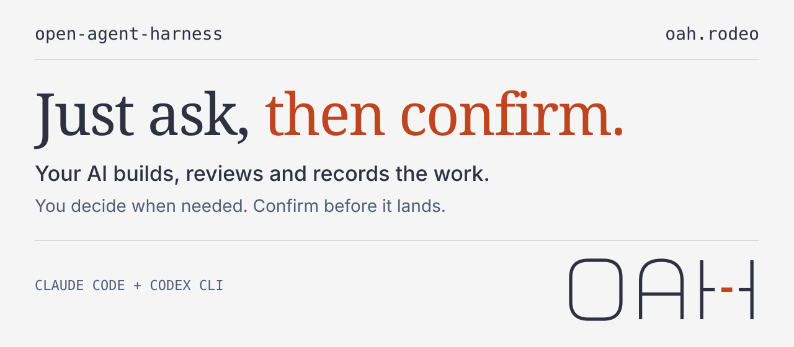
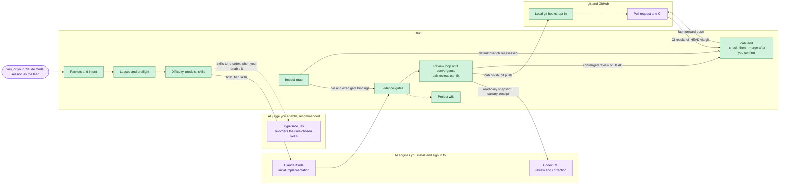
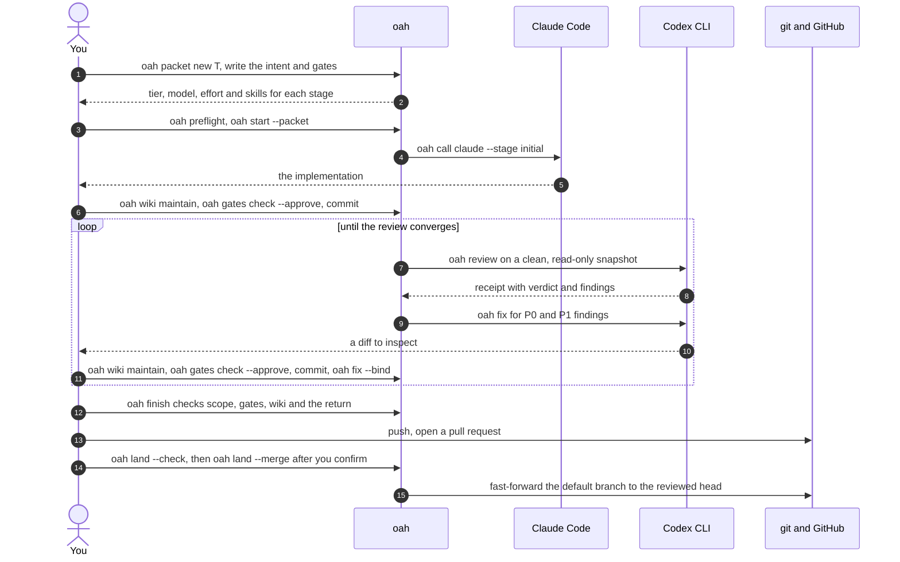

<p align="center">
  <picture>
    <source media="(prefers-color-scheme: dark)" srcset="docs/assets/banner-dark.svg">
    
  </picture>
</p>

<p align="center">
  <a href="../../actions/workflows/ci.yml"></a>
  <a href="LICENSE"></a>
  
  
</p>

<p align="center"><strong>English</strong> · <a href="README.ko.md">한국어</a></p>

# open-agent-harness (`oah`)

## Purpose: a harness that keeps adapting

`oah` is not meant to be the one perfect harness that everyone adopts as is. It is a worked reference and a
guideline for building a development environment that fits you and keeps changing as AI changes.

A harness is set up once and then usually left alone, while the models and skills under it keep improving. Rules
and skills that helped an older model can hold a newer one back from its full ability, and outdated skills can make
results worse. A good harness flows like water: it keeps up with each new model, drops skills that are no longer
needed, adds the ones that are, and changes its rules to match.

- **Adapt the parts you need.** If you already use other AI tools or another harness, read how `oah` handles
  leases, engine stages, evidence gates, the impact map, the wiki and the review loop, and carry over only the
  ideas that fit your tools. The rules are written down in [`docs/PLAN.md`](docs/PLAN.md) so they can be copied
  as ideas, not only as code.
- **Or follow it and make it yours.** If you start from `oah` as it is, treat it as a starting point: change the
  config, the stages and the rules to match your own goals, and grow your own project wiki and impact map as your
  code grows. The harness you end up with should be yours, not a copy of ours.
- **Keep updating it.** Review your models, skills and rules as the tools change. Remove what no longer helps and
  add what does. `oah` keeps updating too, so that its users can adapt to a changing AI environment together.

So `oah` prefers defaults you can understand and change over checks you cannot turn off. When a rule gets in
the way of your work or of a newer model, the project treats that as a design problem to fix.

### Why Claude implements and Codex reviews

This split is the author's own setup, based on personal experience rather than a measurement. In my use, Claude
is good at implementing a task while filling in what a beginner tends to miss, and Codex is good at checking and
correcting work inside a fixed scope. So I let Claude write the first version, and Codex review, correct and
re-review it.

### Use it with any AI setup

The `oah` command drives Claude Code and Codex CLI today, but the harness itself is not tied to them. Its parts
(leases, packets, gates, the review loop, the impact map and the wiki) work with a single AI or with several
different AIs. Fit them to your own environment, and give each stage to whichever AI works best for you.

`oah` is a small command-line tool that makes **Claude Code** and **Codex CLI** work as one disciplined
team on your own repository, with **TypeSafe Jev** as an optional judge. It is written for developers and
small teams who already use git and pull requests and want production-grade review discipline from AI
coding, on their own machine.

| Role | Tool | What it does |
|---|---|---|
| Implements | **Claude Code** | The first implementation of every task. |
| Reviews and corrects | **Codex CLI** | Review, correction and re-review, until the review converges. |
| Judges, if you enable it | **TypeSafe Jev** | Re-orders the closed lists that fixed rules produce, such as the skills for a task. It never adds or removes a candidate. |

Two AI coding sessions on one repository will happily edit the same files. "Done" means whatever the agent
says, and a review has no rule for when it is finished. `oah` gives both engines one rulebook:

- **Leases** keep parallel sessions off each other's paths.
- **A packet** states the goal and its success conditions, and that intent travels unchanged to every stage.
- **The task's difficulty** picks the model, the effort and the skills, by fixed rules you can read.
- **Gates** prove "done" with commands and recorded evidence.
- **Codex reviews, corrects and re-reviews** until the review converges, and stops to ask you when a decision
  is needed.
- **An impact map** says what a change affects, and **a project wiki** remembers why it was made.
- Work **lands only after you confirm**, and only the exact head that was reviewed.
- **Models and skills follow upstream updates**, with every change checked and logged.

`oah` is Python 3.11+ with the standard library only, and runs natively on macOS and Windows (no WSL). It does
not replace Claude Code or Codex: it drives them and keeps the records that make their work trustworthy.

> [!NOTE]
> **v0.2.0 is the current release.** It is for developers fluent with git and pull requests, on macOS and
> native Windows. Linux is not yet supported.

## Contents

- [Purpose: a harness that keeps adapting](#purpose-a-harness-that-keeps-adapting)
- [Roadmap](#roadmap)
- [How it fits together](#how-it-fits-together)
- [Strengths](#strengths)
- [Beginner mistakes oah guards against](#beginner-mistakes-oah-guards-against)
- [Install](#install)
- [First run](#first-run)
- [The loop](#the-loop)
- [Commands at a glance](#commands-at-a-glance)
- [Requirements](#requirements)
- [Documentation](#documentation)
- [Development](#development)
- [Security](#security)
- [License and third-party notices](#license-and-third-party-notices)

## Roadmap

Nothing below is **available in v0.2.0** yet. Plans can change as the tools change.

### v0.3.0: models chosen from benchmarks

Planned, after v0.2.0:

- Benchmark scores pick the model. Difficulty and a profile (performance, balanced, efficient) set the score a job needs. Balanced takes
  the cheapest model that reaches it, efficient the best score per price, and performance the top scorer for the hardest work. No table ties a difficulty to a
  model, and every current model is a candidate in every profile.
- Scores come from Epoch AI, with no key and no account. With your own Artificial Analysis key, oah uses those instead. Published
  scores measure general quality, not your repository.
- A new model generation joins once it has a score, and superseded or removed models drop out, with no file edited. Each change
  shows a plain notice and stays in the run record.
- TypeSafe Jev judges difficulty from the task's Intent and Scope paths. When Jev is off or has low confidence, the rule-based
  difficulty runs. A call is never blocked.
- A review never runs below the floor for its risk, whatever a flag, packet, profile or judge says.
- After the last lease finishes, `oah` can update Claude Code, Codex, plugins, MCP servers and skills, then re-read the model lists.
  `oah init` asks once, and you can turn it off.
- `oah models report` counts how model choices were made, and an export saves them as cases you can compare later. Counts alone do
  not prove Jev helped.

Your pinned models, tier pools, effort caps and task floors stay in force throughout.

## How it fits together



Purple boxes are tools outside oah that you install and sign in to; green boxes are parts of oah. Dashed arrows
are optional. Each part is explained in [Concepts](docs/concepts.md).

## Strengths

- **Engines by stage.** Claude Code writes the first version; Codex CLI reviews, corrects and re-reviews. A call
  for the wrong engine at a stage is refused (`OAH_STAGE_ENGINE_MISMATCH`) unless you override it, and the
  override is recorded.
- **Difficulty picks the model and effort.** Fixed rules score four axes and choose a tier; an effort the CLI
  cannot prove is recorded as unverified, and a lower launch effort fails (`OAH_EFFORT_DOWNGRADED`).
- **Skills chosen for the task,** each with a reason. An optional judge, TypeSafe Jev, only re-orders that list.
- **An impact map** lists the gates and commands that pin or run a changed file, so you re-run exactly those.
- **A project wiki** records decisions next to the code, and `oah finish` checks that it was maintained.
- **Evidence gates.** A task is done when its gates pass with recorded evidence, not when an agent says so.
  Gates watch repository files and the run environment only. They do not notice changes to external services or
  ignored untracked files, so check those separately.
- **Intent that travels** from the packet into the lease and the brief of every call.
- **Leases and preflight** keep parallel sessions off each other's files and off a stale base.
- **Reviews that converge.** Codex reviews a read-only snapshot, corrections are bound to their findings, and a
  repeat or a design question stops for your decision.
- **No secrets in the repository.** Keys are read at runtime only; `oah land` requires a gitleaks scan.
- **A toolkit with provenance** for skills and MCP templates, with exact pins and safe updates.
- **Easy setup:** one-command installers, `oah doctor`, and a guided `oah init` that shows its plan first.

## Beginner mistakes oah guards against

| Mistake | What oah does |
|---|---|
| Committing an API key | `oah init` adds `.env`, `*.pem`, `*.key` and similar to `.gitignore`; the opt-in pre-push hook scans pushed commits only when gitleaks is installed, otherwise warns and permits an unscanned push; `oah land` refuses without a scan (`OAH_LAND_SCAN_REQUIRED`). |
| Starting on a stale branch | `oah preflight` aborts when the base is behind and says which `git rebase` to run. |
| Starting with uncommitted changes | `oah preflight` warns, lists the files and allows proceeding if no other check aborts. |
| Two AI sessions on the same files | `oah start` refuses an overlapping lease (`OAH_LEASE_CONFLICT`); `oah finish` compares the real changes with the scope (`OAH_SCOPE_EXCEEDED`). |
| Pushing in the middle of a task | The opt-in pre-push hook refuses while any lease, active or stale, is recorded for this worktree (`OAH_PUSH_REFUSED`). |
| Letting an agent push or force-push | The shared rules block tells agents not to; landing is a command you confirm. |
| Calling work "done" with no evidence | `oah finish` and the Stop hook refuse unmet gates (`OAH_GATES_UNMET`). |
| Not knowing what a change breaks | `oah impact --changed-since` lists what to re-check, including untracked files, with `re-run:` lines. |
| Merging without review or CI | `oah land --check` checks the lease, intent, review, gates, impact, required checks, fast-forward, a gitleaks scan and CI at the exact head. Unverified CI blocks (`OAH_LAND_CI_UNVERIFIED`) unless you record an explicit exception. |
| Losing track of why a change was made | Packets keep the intent, review receipts keep the findings, and the wiki keeps the decisions. |
| No CI, or CI on one OS only | `oah ci init` writes a starter workflow for the runners you choose (macOS, Windows, Linux), after you confirm. |

## Install

One command per OS installs `oah`. It asks before it installs any missing tool, shows the official command
for each one, and never sees your passwords or keys. To install from a clone, run the commands below.
For v0.2.0, you can instead download the tag’s source archive and `SHA256SUMS` from the repository’s release
page. Refuse to unpack it unless its SHA-256 matches that archive’s digest in `SHA256SUMS`; then run the
included installer. The OS guides below show how to check it.

macOS (you need git first: `xcode-select --install`):

```sh
git clone https://github.com/KenSuh/open-agent-harness.git
cd open-agent-harness
bash install/install.sh
```

Windows PowerShell (you need git first: `winget install --id Git.Git -e`):

```powershell
git clone https://github.com/KenSuh/open-agent-harness.git
cd open-agent-harness
powershell -ExecutionPolicy Bypass -File .\install\install.ps1
```

Add `--dry-run` (`-DryRun` on Windows) to see every step without changing anything. The installer checks the
tools, installs `oah` with uv (or pipx, or pip), checks that a new terminal finds `oah`, and runs `oah doctor`.
The full guides are [Install on macOS](docs/install-macos.md) and [Install on Windows](docs/install-windows.md).

Then open a new terminal and check:

```console
$ oah --version
oah 0.2.0
```

## First run

Inside your project (a git repository with a remote), run the guided setup:

```sh
oah init
```

`oah init` first asks once about each option: tier agents, hooks, unlazy (the gate checker), the knowledge
graph, the CI starter, the companion apps Orca and Aside, the TypeSafe Jev re-ranker and automatic skill
updates. Then inspect the complete plan and confirm the changes before they are applied. It:

- checks every tool and installs only what you confirm;
- checks your Claude Code and Codex sign-ins with their own status commands, and shows the command to run
  when one is missing;
- writes `.oah/config.toml`, the rules block in `AGENTS.md` (imported by `CLAUDE.md`), the wiki in
  `docs/wiki/`, templates in `.oah/templates/` and `.gitignore` entries for local secret files;
- builds the first impact map.

A second run writes only what is still missing. Each question also has a flag, such as `--with-unlazy` or
`--without-ci`, so you can answer without a prompt. Commit what it wrote, then follow the worked example.

**Your first task:** [`examples/hello-oah`](examples/hello-oah/README.md) walks one small task through the
whole loop with real commands, in about 20 minutes.

## The loop



| Step | Commands | What it guarantees |
|---|---|---|
| Describe the task | `oah packet new`, `oah packet check`, `oah gates new` | The goal and its success conditions are written and accepted before work starts. |
| Start safely | `oah preflight`, `oah start --packet` | Your branch is fresh, and no other session holds your paths. |
| Implement | `oah call claude --stage initial`, or your own Claude Code session | Claude works from the packet, with the tier's model, effort and skills. |
| Prove it | `oah wiki maintain`, `oah gates check --approve`, commit | Every success condition has a command and recorded evidence. |
| Review and correct | `oah review`, `oah fix`, `oah fix --bind` | Codex reviews until the review converges; each round leaves a receipt. |
| Finish | `oah finish --return` | Changes stayed in scope, gates are met, and the return matches the intent. |
| Land | `oah land --check`, `oah land --merge` | The exact reviewed head lands after a secret scan and CI verification (or a recorded CI exception), when you confirm. |

Maintain the wiki, run the final approved gate check and commit in that order, including after every
correction. Unverified CI blocks landing by default: missing `gh`, no CI results, or a required check
missing for HEAD produces `OAH_LAND_CI_UNVERIFIED`. To accept that risk, pass
`--accept-unverified-ci "<reason>"` to `oah land --check` and `oah land --merge`. The exception and reason
are recorded for that exact head; CI stays `unverified` and never counts as a pass. Failed or pending CI
still blocks landing. See [Landing](docs/concepts.md#landing) for the target branch’s CI policy.

[Concepts](docs/concepts.md) explains each step; [Troubleshooting](docs/troubleshooting.md) explains each
refusal.

## Commands at a glance

| Command | What it does |
|---|---|
| `oah init` | Guided setup: tools, sign-ins, project files and the first impact map. |
| `oah doctor` | Checks the tools `oah` uses and prints the install command for each missing one. |
| `oah packet new` / `check` | Creates or checks a task packet (`.oah/tasks/<task>/PACKET.md`). |
| `oah intent show` / `check` | Shows a task's intent, its digest and its binding state. |
| `oah preflight` | Checks the base branch, the working tree and the leases before you start. |
| `oah start`, `renew`, `status`, `finish`, `release`, `log` | Leases: claim paths, extend, list, close with checks, drop, note. |
| `oah recommend` | Picks a tier from the four difficulty axes. |
| `oah models` | Shows, and with `--refresh` re-reads, the model each tier uses. |
| `oah call`, `oah wait` | Launches Claude Code or Codex for one stage and records the run; waits for a background run. |
| `oah gates` | Writes, lints and checks a task's gate ledger. |
| `oah check` | Portable assertions for gate CHECK lines. |
| `oah wiki` | Keeps the project wiki linked, sourced and tidy. |
| `oah impact` | Lists what to re-check when files or database objects change. |
| `oah eval` | Replays real cases with hidden expected answers and reports each variant, with its limits. |
| `oah graph` | Uses the graphify knowledge graph when graphify is installed. |
| `oah review` | Runs one Codex review round and records its receipt; `review summary` prints a block for the pull request. |
| `oah fix` | Has Codex correct the latest review's findings, then binds the committed correction. |
| `oah land` | Checks that the exact reviewed head may land, or lands it after you confirm. |
| `oah rules` | Keeps the shared rules block in `AGENTS.md` in sync. |
| `oah skills` | Lists, installs and updates bundled and linked skills. |
| `oah hooks` | Installs or removes the opt-in Claude Code and git hooks. |
| `oah ci` | Sets up GitHub Actions checks for your project. |

Every command takes `--help`. Exit codes are `0` done, `1` refused, `2` usage or an `ABORT` verdict from
`oah preflight`, `69` environment and `75` when `oah wait` reaches its timeout with the run still active
(run `oah wait <run-id>` again). Every refusal starts with an `OAH_*` code and says what to run next.

## Requirements

| | Requirement | Needed for |
|---|---|---|
| OS | **macOS 13+** or **Windows 11**, natively; no WSL. Windows 10 22H2 is best effort. Linux is not yet supported. | everything |
| Runtime | **Python 3.11+**. No third-party Python packages at runtime. | everything |
| Version control | **git**, and a remote such as a GitHub repository | everything |
| Engines | **Claude Code** and **Codex CLI**, installed and signed in by you | implementation, review and correction |
| Gates | **unlazy**, which needs **Node.js** | gates and the Stop hook |
| Landing | **gitleaks**, and **gh** for reading CI results | `oah land` |
| Optional | **uv** (recommended installer), **graphify** (knowledge graph), **TypeSafe Jev** (needs a TypeSafe account and key), **Orca** and **Aside** (companion apps) | convenience |

`oah doctor` checks every tool in this table except Jev, and prints the official install command for anything
missing. Jev's state shows in every `rerank=` result instead.

## Documentation

| Page | What it covers |
|---|---|
| [Worked example](examples/hello-oah/README.md) | One task through the whole loop, step by step. |
| [Concepts](docs/concepts.md) | Leases, packets and intent, difficulty, skills, impact map, wiki, gates, review, landing, updates, toolkit, CI and companion apps. |
| [Troubleshooting](docs/troubleshooting.md) | The common `OAH_*` refusals, what they mean and what to run next. |
| [Keys](docs/keys.md) | Where each optional key lives, and what is off without it. |
| [Upgrade](docs/upgrade.md) | Updating `oah`, your project files, skills, MCP templates and models. |
| [Install on macOS](docs/install-macos.md), [on Windows](docs/install-windows.md) | The installers, step by step. |
| [CI starter](docs/ci-starter.md) | `oah ci init`, reading CI results and making checks required. |
| [Companion apps](docs/companions.md) | Orca and Aside: what they add and how to set them up. |
| [Toolkit](docs/toolkit.md) | Every bundled or linked skill, MCP template and CLI, with its source and license. |
| [The plan](docs/PLAN.md) | The full design and the reasons behind each rule. |

Every page has a Korean version under [`docs/ko/`](docs/ko/).

## Development

Run the tests with Python 3.11, and again with the newest Python you have. Point `TMPDIR` at the git-ignored
`.tmp/` folder so every test write stays inside the checkout. Create the folder first: Python ignores a
`TMPDIR` that does not exist.

```sh
mkdir -p .tmp/test-tmp
TMPDIR="$PWD/.tmp/test-tmp" python3.11 -m unittest discover -s tests -t .
```

- **CI** runs the tests on macOS and Windows for every pull request to `main`. Pull requests that change only
  documentation skip the tests.
- **Secret scan.** A separate workflow runs gitleaks over the full history and the privacy scan on every pull
  request and every push, documentation included. Any finding fails it.
- **Before every push**, run the privacy scan with gitleaks required. It must print `PRIVACY_SCAN_CLEAN`:

  ```sh
  python3 tools/privacy_scan.py --gitleaks require
  ```

- Commits record which engine wrote them with an `Agent-Engine: claude|codex|human` trailer.

## Security

**The hard rule.** No API key, token, password, cookie, OAuth secret or account identifier ever enters this
repository, its history, releases, issues or CI logs.

- Keys are read only at runtime, from environment variables or the OS keychain, through one documented
  lookup. When a key is missing, the feature stays off and reports `unused(no key)`.
- Templates use `${ENV_VAR}` placeholders only.
- gitleaks and the privacy scan run before every push, and in CI on every pull request and every push, over
  the full history. Any finding fails the build.
- Keep your own keys in your environment or your keychain, never in project files. [Keys](docs/keys.md) says
  how.

## License and third-party notices

`oah` is released under the [MIT License](LICENSE), copyright open-agent-harness contributors. The only
third-party code it vendors is the bundled skills under `skills/`, shipped unchanged with their own licenses
and only where those licenses allow it. They, and the tools it runs or links to, such as unlazy, superpowers,
graphify, Claude Code and Codex CLI, are listed with their licenses in
[`THIRD_PARTY_NOTICES.md`](THIRD_PARTY_NOTICES.md).
