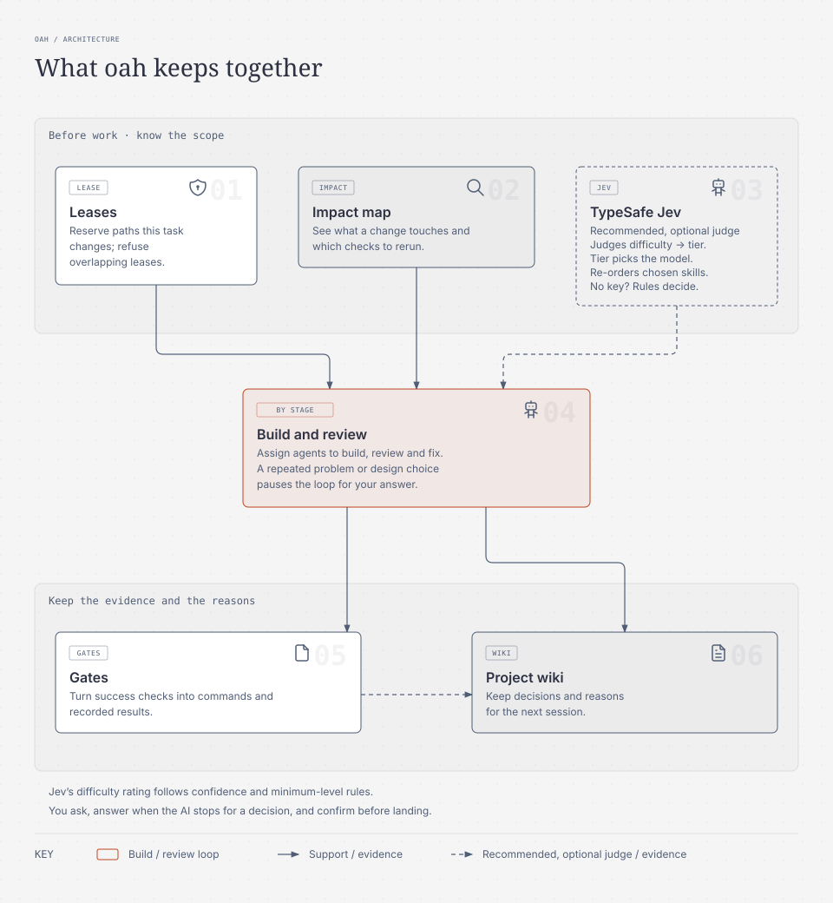
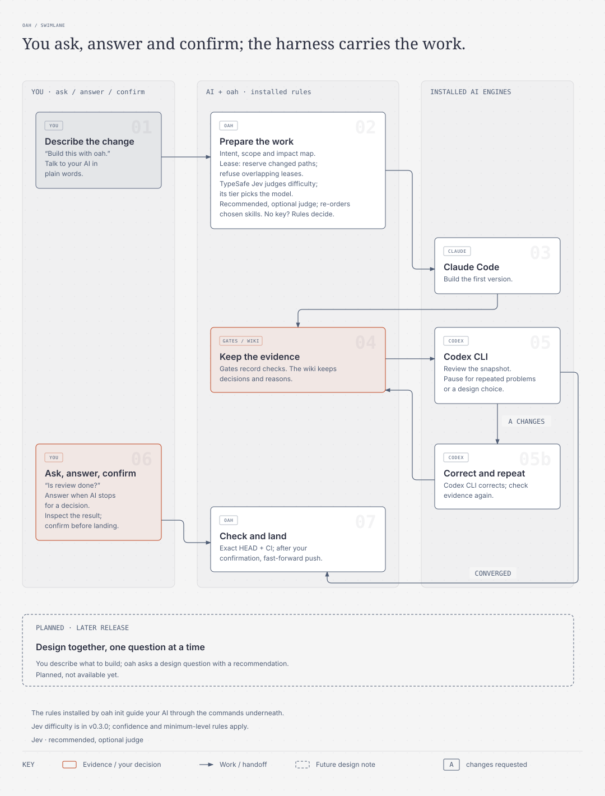

<p align="center">
  <picture>
    <source media="(prefers-color-scheme: dark)" srcset="docs/assets/banner-dark.svg">
    
  </picture>
</p>

<p align="center">
  <a href="https://oah.rodeo/"></a>
  <a href="../../actions/workflows/ci.yml"></a>
  <a href="LICENSE"></a>
  
  
</p>

<p align="center"><strong>English</strong> · <a href="README.ko.md">한국어</a></p>

# open-agent-harness (`oah`)

## Purpose: a harness that keeps adapting

`oah` helps you build an AI development workflow that fits you and keeps changing as AI improves.
It is a working reference and a guide you can adapt. A **harness** is the set of tools, rules and records
around an AI coding assistant.

Your AI takes care of the whole job of building and fixing a program like an expert: checking what a change
might affect, keeping the project wiki, proving the result and running the review cycle. With the recommended,
optional TypeSafe Jev judge on, it also judges difficulty and picks the model automatically through that difficulty
level in v0.3.0. **You ask, answer when the AI stops for a decision, and confirm before anything lands.**

Take the parts that help, or start with the whole setup and make it yours. Older rules and skills
(instructions an AI can load) can hold a newer model back or make its results worse. Keep what helps,
remove what no longer does, and change the rules as your tools change. `oah` keeps evolving too.
Its defaults should be easy to understand and change; a rule that gets in your way is a design problem to fix.

### Why Claude implements and Codex reviews

This split comes from the author's own experience, not a measured comparison. In my use, Claude is good
at filling in details a beginner might miss while building the first version. Codex is good at checking
and correcting work within a fixed scope. So Claude writes first; Codex reviews, corrects and reviews again.

### Use it with any AI setup

The `oah` command drives **Claude Code** and **Codex CLI** today. The ideas work with **one AI or several**,
including other tools and harnesses. Take the parts you need and give each stage to the AI that suits you.

## What oah does for you

You describe the result you want. Your AI uses these parts together to carry the work through.

<picture>
  <source media="(prefers-color-scheme: dark)" srcset="docs/assets/features-dark.svg">
  
</picture>

- **[Impact map](docs/concepts.md#the-impact-map).** When your AI changes a file, the impact map shows related code,
  documents and the checks to rerun, so a small edit is easier to follow through.
- **[Project wiki](docs/concepts.md#the-project-wiki).** Your AI keeps the task history, decisions and reasons
  beside the code. The next session has a record to read instead of making you explain everything again.
- **[Leases](docs/concepts.md#leases).** A lease reserves the paths a task changes, and an overlapping lease
  is refused. Each task has a clear scope, and its changes are checked against that scope when it finishes.
- **[Gates](docs/concepts.md#gates).** Your AI turns “done” into checks with recorded results.
  You can ask what passed and see the evidence.
- **[Build and review](docs/concepts.md#the-review-loop-and-corrections).** Claude Code builds; Codex CLI
  reviews, corrects and reviews again. A repeated problem or a design choice stops the loop for your answer.
- **[TypeSafe Jev](docs/how-it-works.md#jev-the-optional-judge).** The recommended, optional judge re-orders
  chosen skills and, in v0.3.0, judges difficulty so its difficulty level (tier) picks the model automatically, subject
  to confidence and minimum-level rules. Without a key, the rules decide.

## How it works

<picture>
  <source media="(prefers-color-scheme: dark)" srcset="docs/assets/how-it-works-dark.svg">
  
</picture>

Talk to your AI in plain words. The rules installed by `oah init` and each command’s next-step message guide it
through recording your goal and scope, reserving paths, choosing the model and skills, and checking the impact
map between review rounds, with Jev when enabled.
Claude Code builds; the gates record check results and the wiki keeps the reasons. Codex CLI reviews and corrects
until no blocking findings remain, or stops for your answer when a problem repeats or a design choice is needed.
A round limit is optional.

Ask “Is the review done?” or “Did all the gates pass?” Inspect the result and confirm before it lands in your
project's main branch. The [full walkthrough](docs/how-it-works.md) shows the commands your AI runs underneath.
The guided design conversation shown separately in the figure is **planned for a later release**.

> [!NOTE]
> **v0.4.0 is the current release.** It is for developers fluent with git and pull requests, on macOS and
> native Windows. Linux is not yet supported.

## Install

One command per OS installs `oah`. It asks before it installs any missing tool, shows the official command
for each one, and never sees your passwords or keys. To install from a clone, run the commands below.
For v0.4.0, you can instead download the tag’s source archive and `SHA256SUMS` from the repository’s release
page. Refuse to unpack it unless its SHA-256 matches that archive’s digest in `SHA256SUMS`; then run the
included installer. The OS guides below show how to check it.

macOS (you need git first: `xcode-select --install`):

```sh
git clone https://github.com/KenSuh/open-agent-harness.git
cd open-agent-harness
bash install/install.sh
```

Windows PowerShell (you need git first: `winget install --id Git.Git -e`):

```powershell
git clone https://github.com/KenSuh/open-agent-harness.git
cd open-agent-harness
powershell -ExecutionPolicy Bypass -File .\install\install.ps1
```

Add `--dry-run` (`-DryRun` on Windows) to see every step without changing anything. The installer checks the
tools, installs `oah` with uv (or pipx, or pip), checks that a new terminal finds `oah`, and runs `oah doctor`.
The full guides are [Install on macOS](docs/install-macos.md) and [Install on Windows](docs/install-windows.md).

Then open a new terminal and check:

```console
$ oah --version
oah 0.4.0
```

## First run

Run the installer once, then run `oah init` once in each project. Open a terminal in your project,
which needs to be a git repository with a remote:

```sh
oah init
```

The guided setup asks about optional tools, shows the complete plan, and changes files only after you
confirm. Commit the files it writes. From then on, open your AI in that project and talk to it; the installed
rules tell it how to run the harness.

- “Build login with oah.”
- “Is the review done? Did all the gates pass?”
- “Land this version.” Say this after inspecting the result and the checks.

When the AI stops for a repeated problem or a design choice, answer so it can continue. The commands run
underneath this conversation. [Your first task](examples/hello-oah/README.md) takes about 20 minutes and shows
what you say, what the AI does and what you check, followed by the complete command walkthrough.
[Setup details](docs/how-it-works.md#first-run) explain every option and generated file.

## New in v0.4.0

The current release includes these changes. The guided design conversation is not one of them; it stays on
the [roadmap](#roadmap). [Upgrade](docs/upgrade.md#7-from-030-to-040) says what changes when you update from v0.3.0.

- **Designs you keep.** `oah design` keeps the design of each product you build: numbered revisions, each
  acceptance with its reason, and pages and lists in the project wiki. Text outside oah's markers stays yours.
  Designs change only on the branch that registered them; other worktrees read that branch's copy.
  [Designs](docs/concepts.md#designs) has the rules.
- **Work follows the accepted design.** `oah packet new --design` binds a task to the accepted revision of its
  design, every brief carries that design, and call, review, fix, finish and land check it again. A newer accepted
  revision makes the task `stale` until you start it again or record with `oah design carry` that the change does
  not affect it, and `oah land` refuses a task whose design is not current. The check is per design revision.
- **Sources you can check.** `oah sources` follows the public libraries and documents a design builds on and keeps
  a verified snapshot of each version it saw, with its release and full license text. A license is eligible,
  eligible by choice, excluded or unknown, never guessed. A design's material decisions record the snapshot they
  were made against, and later checks say when an upstream moved on or a decision's inputs changed. Checks run when
  you ask or from an optional daily OS entry you install; a failed check is never shown as fresh.
  [Design sources](docs/design-sources.md) has the details.
- **Nine design stages and reviewed skills.** A design keeps a `coverage` part with nine stages, from purpose to
  confirm, and `oah design coverage` shows what is open and what needs a re-check. `oah skills find --design`
  searches a small built-in catalog, installed skills and skills.sh, the only search that sends anything, with a
  notice the first time. `oah skills review` pins a skill folder to a commit with its license, and
  `oah skills select` links reviewed skills to a task's needs. Finding and reviewing install nothing.
- **Native subagents and tool routes.** `oah call ... --launcher native` prepares the checked brief for your AI to
  give its own subagent, and `oah call settle` records the reply as evidence the lead reported, not proof of
  delivery. `oah capabilities show` lists the tools a child engine is configured with (names and flags, never
  values), `plan` routes each tool a skill names, and `relay` stores a result the lead fetched itself.
  **Limit:** no host has a qualified capacity profile in this release, so a dispatch that would carry skill texts
  or relayed tool results, and `oah skills find --task`, stop with
  `OAH_SKILLS_BUDGET_EXCEEDED(target-capacity-unknown)` before anything is sent. Ordinary work with no managed
  delivery, discovery, capability inputs or permitted, configured task advice keeps its existing path.
  [Skills and capabilities](docs/skills-and-capabilities.md#limits-in-this-release) lists every limit.
- **Jev in design steps.** With Jev on and its own judgement switch on (`[rerank.judgement]`, off by default), Jev
  can assess whether a source change matters to a design, choose which skill search runs first and suggest the next
  design stage. Each answer is advice within the options the fixed rules allow.
- **Safer reviews, Jev calls and landing.** `[review] codex_version` pins the reviewer's version and refuses a
  mismatch before anything is launched (`OAH_REVIEW_VERSION_MISMATCH`). After five timeouts, network errors or 429
  or 529 replies in a row, Jev is skipped for ten minutes (`unused(circuit-open)`), and
  `[rerank] max_requests_per_day` can cap its requests. A gate deferred with `ABANDON: G<n> ci-check: "<check run>"`
  closes at `oah land` only when every named check run succeeded at the exact HEAD.
- **Scratch in a folder only you can use.** Review snapshots, evaluation workspaces and other short-lived folders
  live under a per-user scratch folder, never in the system temp folder. When oah cannot prove that folder is yours
  alone, it stops with `OAH_SCRATCH_UNSAFE`. `oah doctor` lists leftovers and deletes nothing.
  [Scratch folders](docs/concepts.md#scratch-folders) names the folder for each OS.

## Roadmap

Plans can change as the tools change. The planned items below are not available in v0.4.0.

### Planned: design together, one question at a time

**Planned for a later release, not available yet.** You say what you want to build, and oah asks one design
question at a time with a recommendation. You take part in the design decisions before implementation begins.
v0.4.0 already keeps the designs, stages and sources this conversation builds on. The update is planned to
include:

- **One question at a time.** oah asks one key design question, says why it matters and recommends an answer.
  You can say you don't know, decide later, mark a question as not applicable, and pick up where you left off.
- **The whole design, not one issue.** The conversation covers behaviour, how long data is kept, what the server
  decides, secrets, effects outside the project, recovery, cost, accessibility and payment where it applies. It
  skips irrelevant topics and returns to the parts of the design that depend on a decision when it changes.
  v0.4.0 records these topics in the nine coverage stages; asking about them is planned.
- **Starts when you ask.** In supported AI tools, asking for a design in plain words opens the design
  conversation and applies its question-by-question method. You can turn this off.
- **Stack suggestions with trade-offs.** oah suggests a language and source combination that fits, with what it
  means for learning and operation. It never forces Rust or a multi-language setup.
- **Sources refreshed as work moves.** v0.4.0 checks registered sources when you ask or once a day. Refreshing
  them when work starts or resumes is planned; a failed refresh will still never be shown as fresh.
- **Only affected work goes out of date.** In v0.4.0 any newer accepted revision makes a bound task stale.
  Tracking which work instructions and reviews each decision affects, so that approving a change marks only those,
  is planned. Before such work can be merged, those instructions must be updated and those reviews run again.
- **Design changes update earlier project documents.** When you approve a change to the design or one of its
  decisions, oah uses gbrain to find earlier wiki pages, notes and documents that depend on the previous design.
  It updates affected material within the project's configured scope, and you can roll back those changes.
  gbrain searches on your computer using embeddings from Ollama. This feature is planned to be on by default for
  everyone. It needs Ollama, Bun, about 2.7 GB of disk space and time to build the first search index.
- **Skills delivered on every supported host.** v0.4.0 prepares skill texts and tool results the same way for
  Claude Code, Codex, Orca workers and native subagents, but delivers them only on a host with a qualified capacity
  profile, and none is qualified yet. Qualifying real hosts is planned.
- **Repeated problems are traced to their cause.** When the same kind of review problem comes back after a fix,
  the correction has to explain why the earlier fix missed it, fix every place with the same cause, and add one
  test that catches the whole kind.
- **Jev helps rank design options.** TypeSafe Jev can help rank options inside the conversation. The design
  follows recorded facts and your decisions.

## Documentation

| Page | What it covers |
|---|---|
| [How it works](docs/how-it-works.md) | How the parts fit, the full loop, checks, requirements and setup details. |
| [Commands](docs/commands.md) | Find a command and understand its result. |
| [Worked example](examples/hello-oah/README.md) | One task through the whole loop, step by step. |
| [Concepts](docs/concepts.md) | Leases, packets and intent, difficulty, skills, impact map, wiki, designs, gates, review, landing, updates, toolkit, scratch folders, CI and companion apps. |
| [Design sources](docs/design-sources.md) | Following a design's libraries and documents, snapshots, licenses and daily checks. |
| [Skills and capabilities](docs/skills-and-capabilities.md) | The nine design stages, finding and reviewing skills, native subagents, tool routes and this release's limits. |
| [Troubleshooting](docs/troubleshooting.md) | The common `OAH_*` refusals, what they mean and what to run next. |
| [Keys](docs/keys.md) | Where each optional key lives, and what is off without it. |
| [Upgrade](docs/upgrade.md) | Updating `oah`, your project files, skills, MCP templates and models, and what changes from 0.3.0 to 0.4.0. |
| [Install on macOS](docs/install-macos.md), [on Windows](docs/install-windows.md) | The installers, step by step. |
| [CI starter](docs/ci-starter.md) | `oah ci init`, reading CI results and making checks required. |
| [Companion apps](docs/companions.md) | Orca and Aside: what they add and how to set them up. |
| [Toolkit](docs/toolkit.md) | Every bundled or linked skill, MCP template and CLI, with its source and license. |
| [The plan](docs/PLAN.md) | The full design and the reasons behind each rule. |

Every page has a Korean version under [`docs/ko/`](docs/ko/).

## Development

[Development checks](docs/how-it-works.md#development) covers tests, CI, privacy scans and commit attribution.

## Security

No API key, token, password, cookie, OAuth secret or account identifier may appear in the repository,
its history, releases, issues or CI logs.
[Security rules](docs/how-it-works.md#security) explains key storage, scans and the full policy.

## License and third-party notices

`oah` is released under the [MIT License](LICENSE), copyright open-agent-harness contributors.
Bundled skills under `skills/` are shipped unchanged where their licenses allow it, with their own licenses.
The diagram HTML and SVGs adapt the MIT-licensed diagram-design templates and styles.
[Third-party notices](THIRD_PARTY_NOTICES.md) credits these works and the tools oah runs or links to,
including unlazy, superpowers, graphify, Claude Code and Codex CLI.
