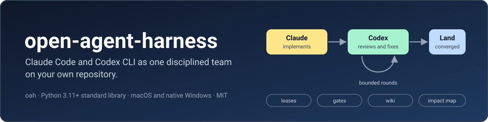
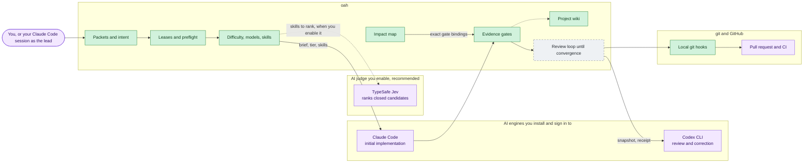
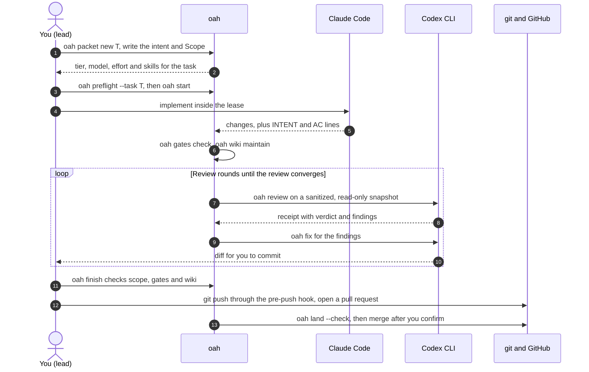
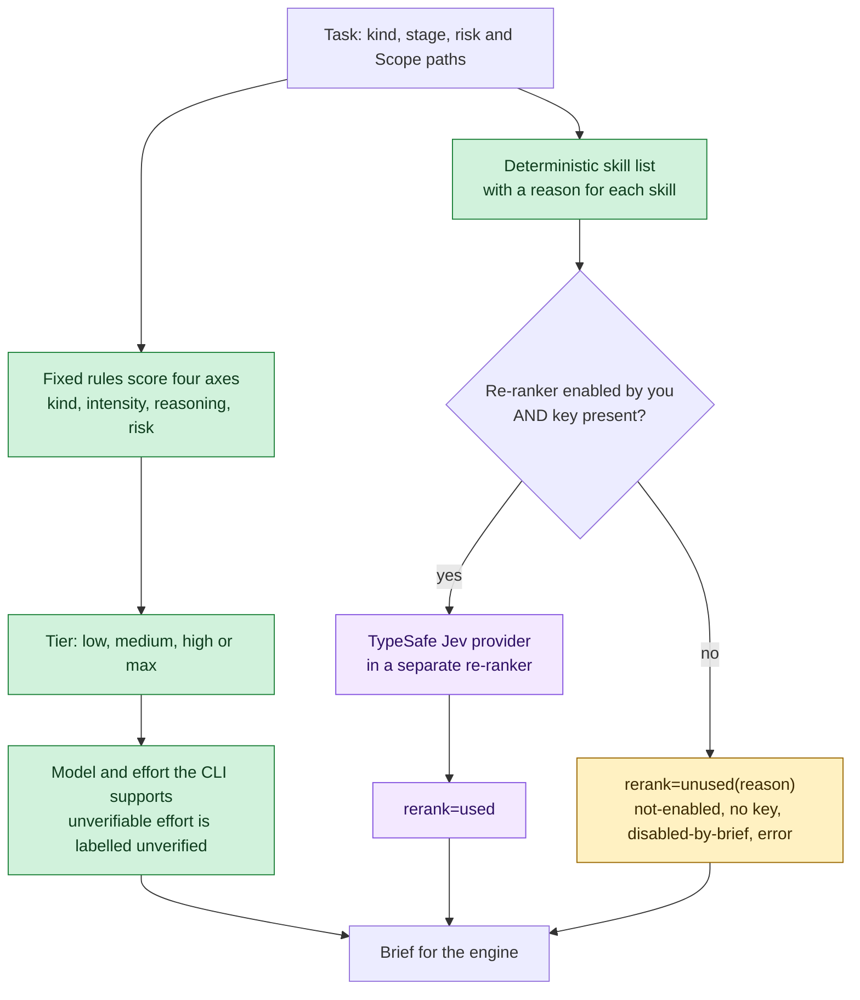
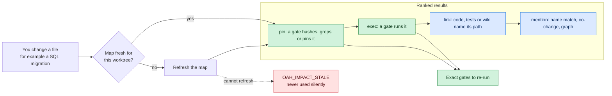
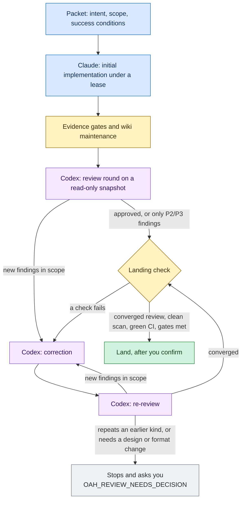
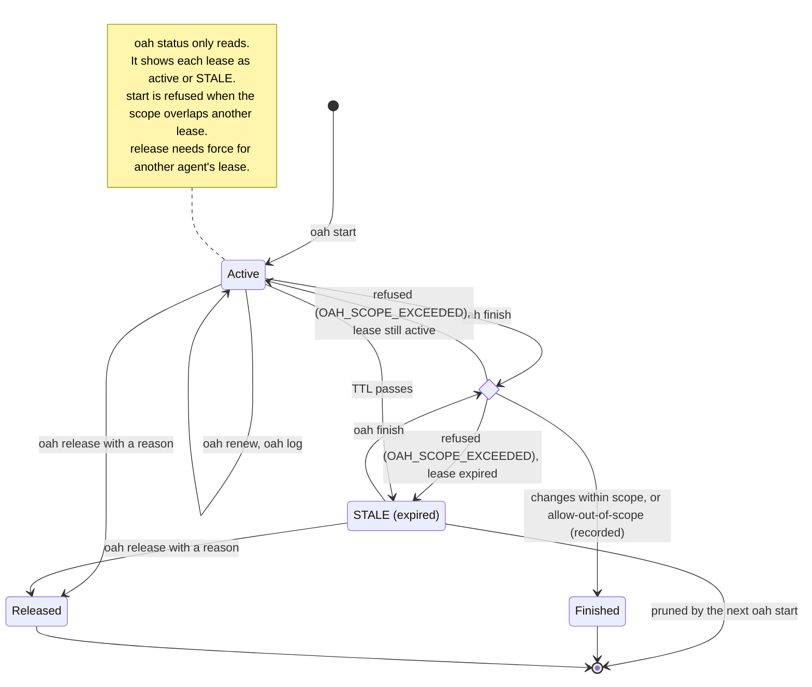
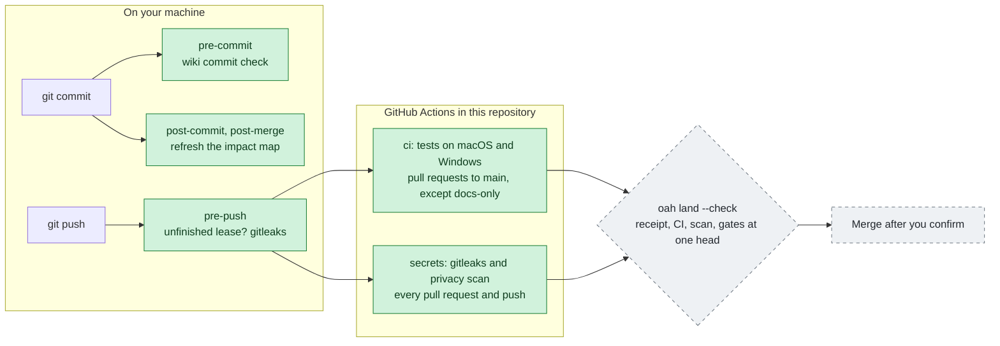
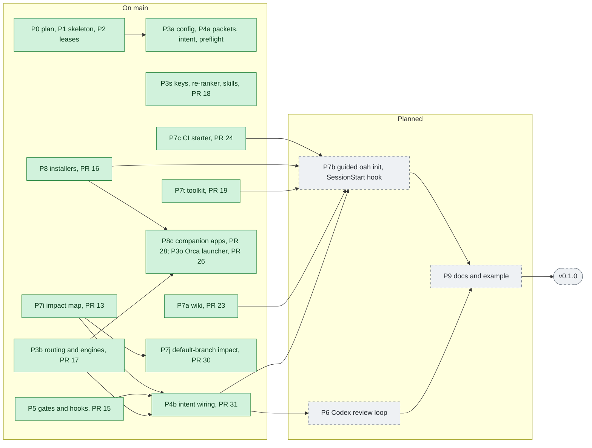

<p align="center">
  
</p>

<p align="center">
  <a href="../../actions/workflows/ci.yml"></a>
  <a href="LICENSE"></a>
  
  
</p>

# open-agent-harness (`oah`)

`oah` is a small command-line tool that makes **Claude Code** and **Codex CLI** work as one disciplined
team on your own repository, with **TypeSafe Jev** as the judge. It is written for people who are starting
to program with AI.

| Role | Tool | What it does |
|---|---|---|
| Implements | **Claude Code** | The first implementation of every task. |
| Reviews and corrects | **Codex CLI** | Review, correction and re-review, until the review converges. |
| Judges | **TypeSafe Jev** | Ranks the closed candidates that fixed rules produce: skills today (#18, #31), impact results later. The engine checks the evidence before it acts. |

Jev is the recommended judge beside Claude Code and Codex CLI, but it is never required. It runs only
when you enable it and a key is present. Today you enable it in config; the one-time consent question in
guided `oah init` is planned (P7b), and `oah doctor` does not check Jev yet. Without Jev the fixed rules
decide alone.

Two AI coding sessions on one repository will happily edit the same files. "Done" means whatever the
agent says, and a review has no rule for when it is finished and no proof. `oah` gives the engines and the
judge one rulebook:

- **Claude implements first. Codex reviews, corrects and re-reviews** until the review converges.
- **The task's difficulty picks the model, the effort and the skills.** Fixed rules decide first. When you
  enable Jev, it re-orders the skills, and every packet plan, brief and run record says whether it was used.
  Impact ranking with Jev is planned.
- **An impact map** tells you what a change affects and which checks to run again.
- **A project wiki** remembers why things were done.
- **"Done" is a ledger of evidence**, and work lands only after the review converges and CI is green.

`oah` is Python 3.11+ with the standard library only. It runs natively on macOS and Windows (no WSL).
It does not replace Claude Code or Codex: it drives them and keeps the records that make their work
trustworthy.

> [!WARNING]
> **Developer preview. Not ready for general use yet.**
> On `main` today: the project skeleton (`oah --version`, `oah doctor`, the privacy scan, CI on macOS and
> Windows), leases, the config loader, packets, intent and preflight, routing and `oah call`, skills, gates,
> hooks, the impact map, the wiki, the toolkit, the installers, the CI starter and the optional companion
> apps. The Codex review loop (P6), the guided `oah init` with the SessionStart hook (P7b) and the full
> docs (P9) are planned. Commands, file formats and this README will change.

## Contents

- [At a glance](#at-a-glance)
- [Strengths](#strengths)
- [Beginner mistakes oah guards against](#beginner-mistakes-oah-guards-against)
- [How it works](#how-it-works)
- [What works today](#what-works-today)
- [Requirements and supported platforms](#requirements-and-supported-platforms)
- [Roadmap](#roadmap)
- [Development](#development)
- [Security](#security)
- [License and third-party notices](#license-and-third-party-notices)
- [한국어 소개](#한국어-소개)

**Status labels used in this README**

| Label | Meaning |
|---|---|
| **available** | On `main`. You can run it today. A number such as (#17) names the pull request that landed it. |
| **planned** | Designed in [`docs/PLAN.md`](docs/PLAN.md). Not built yet. |

## At a glance



Green is available, grey dashed is planned, and purple is outside `oah`.

## Strengths

| Strength | What you get | Status |
|---|---|---|
| **Engines by stage** | Claude does the initial implementation. Codex reviews, corrects and re-reviews. `oah call <engine> --stage <s>` refuses the wrong engine for a stage (`OAH_STAGE_ENGINE_MISMATCH`). | available (#17) |
| **Difficulty picks model and effort** | Four axes (kind, intensity, reasoning, risk) are scored by fixed rules into a tier: low, medium, high or max. Each tier maps to a model and an effort that the CLI really supports. An effort that cannot be verified is recorded as `unverified`, never assumed. | available (#17) |
| **Skills chosen for the task** | Skills are selected by kind, stage, risk and the file kinds in Scope, each with a reason. | available (#18) |
| **A judge for closed choices** | TypeSafe Jev ranks the candidates that fixed rules produce: skills first, impact results later. It never adds or removes a candidate. It runs only with your consent and a key, and guided `oah init` asks once. Every result says `rerank=used` or `rerank=unused(<reason>)`, so you can see when the fixed rules decided alone. | provider: available (#18) · skills and briefs: available (#31) · impact results: planned · `oah init` question: planned (P7b) |
| **Impact map** | "If I change this file, what must I re-check?" The result order is pin > exec > link > mention, and pin and exec rows name the gates in your ledgers that pin or run the path. A SQL plugin maps tables, routines and GRANTs. A stale map is refreshed or refused, never used silently. A second map follows the latest default branch. | map: available (#13) · gate bindings: available (#31) · default-branch map: available (#30) |
| **Project wiki** | An Obsidian-compatible `docs/wiki/` with an index and a newest-first log, kept current by `oah wiki maintain` before every commit and review. | available (#23) |
| **Evidence gates** | "Done" is an [unlazy](https://github.com/Leonxlnx/unlazy) ledger of checks with evidence. `oah finish` refuses unmet gates, and an opt-in Stop hook keeps a Claude Code session from ending with them. | available (#15) |
| **Intent that travels** | One intent section (problem, outcome, success conditions) goes to every stage, worker and reviewer, byte for byte. A changed goal raises its revision. | packets and checks: available · in worker briefs: available (#17) · bound to leases: available (#31) |
| **Leases and preflight** | Two sessions cannot claim overlapping paths. Preflight refuses a stale branch or a contested scope before work starts. | available |
| **Reviews that converge, labelled honestly** | Codex reviews a sanitized snapshot, shows with a canary that it could read that snapshot, and leaves a receipt per round. Rounds continue until the review converges, and the loop stops to ask you when a decision is needed. A review is called independent only when the mechanism proves it. | planned (P6) |
| **No secrets in the repository** | Keys are read only at runtime from the environment or the OS keychain. gitleaks runs before push and in CI. | this repository's CI: available · key lookup: available (#18) · pre-push scan: available (#15) |
| **Toolkit with provenance** | Bundled skills and MCP templates with their source, pinned commit and license. Updates are checked, validated and rolled back on failure. | available (#19) |
| **Easy setup** | One install command per OS, then `oah init` checks tools, installs only what you confirm and walks you through the sign-ins. | installers: available (#16) · guided `oah init`: planned (P7b) |

## Beginner mistakes oah guards against

These are the slips that most often hurt people who build something with AI and push it to git.

| Common mistake | What `oah` does about it | Status |
|---|---|---|
| Committing an API key or token | The opt-in `pre-push` hook runs gitleaks over exactly the commits being pushed and refuses on a finding. Keys come only from the environment or the OS keychain (`oah.secrets`); a missing key turns the feature off with `unused(no key)`. `oah init` adds `.env`, `.env.*`, `*.pem` and `*.key` to `.gitignore`. | pre-push: available (#15) · key lookup: available (#18) · `.gitignore` entries: planned (P7b) |
| Starting on a stale branch | `oah preflight` fetches the default branch. If HEAD is behind, the verdict is ABORT with the exact rebase command. It also lists new commits that touch your scope. | available |
| Starting on top of uncommitted changes | `oah preflight` warns about a dirty working tree and names the files. | available |
| Two AI sessions editing the same files | `oah start` refuses a scope that overlaps another lease and names the holder. Preflight aborts on the same overlap. `oah finish` compares the real changes with the scope. | available |
| Pushing in the middle of a task | The `pre-push` hook refuses while an unfinished lease exists on this worktree. | available (#15) |
| Letting an AI agent push, force-push or rewrite history | The rules block that `oah rules sync` writes into `AGENTS.md` (and `CLAUDE.md` imports) says workers never push, merge, force-push, rewrite shared history or delete branches. You push after `oah finish`. | available (#23) |
| An AI saying "done" with no evidence | Gates hold a command, an expected result and recorded evidence. `oah finish` refuses unmet gates, and the Stop hook keeps a Claude Code session from ending with them. | available (#15) |
| Not knowing what a change breaks | `oah impact` lists references to a file in code, tests, workflows, migrations and wiki pages; `--changed-since REV` takes paths from a diff. Pin and exec rows name the exact gates to re-run. | references: available (#13) · gate bindings: available (#31) |
| Merging without review | Codex reviews in rounds until the review converges, with a receipt per round. `oah land --check` needs a converged review receipt, the CI runs, the scan and the gates, all bound to the exact head. `--merge` lands only after you confirm. | planned (P6) |
| Losing track of why a change was made | Each task has a packet with its intent and success conditions. The wiki log gets an entry for each task. Commits record the engine that wrote them (`Agent-Engine:` trailer). | packets: available · wiki log: available (#23) · engine trailer in worker briefs: available (#17) · used in review labels: planned (P6) |
| Pushing with no CI, or testing on one OS only | `oah ci init` shows a starter GitHub Actions workflow for your project and writes it only with your consent. It runs your tests on the OSes you pick and a pinned gitleaks secret scan, with actions pinned to full SHAs and no secrets in the file. `oah land --check` reads the CI runs through `gh`. This repository's own CI already tests on macOS and Windows. | `oah ci init`: available (#24) · this repository: available |

## How it works

### The workflow, end to end



| Step | Command | Status |
|---|---|---|
| Packet with an intent section | `oah packet new`, `oah packet check`, `oah intent show/check` | available |
| Tier, model, effort and skills in the packet | `oah recommend`, skill selection, then recorded by `oah packet new` | scoring: available (#17) · skills: available (#18) · in `packet new`: available (#31) |
| Preflight and lease | `oah preflight`, `oah start` | available · binding the intent with `oah start --packet`: available (#31) |
| Claude implements | your interactive Claude Code session, or `oah call claude` for a second lane | `oah call`: available (#17) · Orca launcher: available (#26) |
| Gates and wiki maintenance | `oah gates check`, `oah wiki maintain --task T` | gates: available (#15) · wiki: available (#23) |
| Codex review, correction and re-review | `oah review`, `oah fix`, `oah review summary` | planned (P6) |
| Finish | `oah finish`: scope check | available · gate and wiki-maintenance guards: available (#15, #23) · intent return check: available (#31) |
| Push and land | `pre-push` hook, then `oah land --check` / `--merge` | hook: available (#15) · landing: planned (P6) |

**The intent cannot drift.** The packet's intent section is the only statement of the goal. Review and
correction briefs carry it byte for byte, and a later round must reuse the source bound at the first
dispatch (`OAH_INTENT_SOURCE_MISMATCH`). A changed goal raises the `Revision` of the same `Intent-ID`
and must be accepted again. Every return ends with `INTENT <id>@r<n> <digest>` and one
`AC<n>: met|unmet|deferred — <evidence>` line per success condition. The digest and `oah intent check`,
the briefs and the source-mismatch refusal (#17), binding at `oah start --packet` and the return check at
`oah finish --return` (#31) are available. `oah review` will check returns the same way (planned, P6).

**Long runs.** `oah call --background` returns a run id at once, and `oah wait <run-id>` blocks for at most
nine minutes per call, so agent shell tools with a ten-minute limit can keep waiting. Every call writes
its prompt, output and a `result.json` with the model and effort it used. `--launcher orca` runs the
worker in an Orca terminal instead of a plain process. (available, #17, #26)

### Difficulty, models and skills



**Deterministic first, AI-assisted second, always honest about which.**

- **Rules decide the tier.** `oah recommend --kind --intensity --reasoning --risk` adds up a score per axis,
  then applies lifts and floors. Risk `critical` means `max`, and a migration or security task is at least
  `high`. `--tier` overrides, and the override is recorded. (available, #17; [`docs/PLAN.md`](docs/PLAN.md)
  5.5, A10)
- **Models follow updates.** Each engine has an editable strongest-first list. Claude defaults to the CLI
  aliases `opus`, `sonnet` and `haiku`, which Claude Code resolves to its newest models. Codex starts from
  its effective configured model. A model you pin always wins, and every change is logged with old, new,
  when and why. (available, #17; A14)
- **Effort is what the model supports, with no fixed cap.** `highest` resolves to the top reasoning level
  that Codex lists for the model. A launch whose header reports a lower effort fails
  (`OAH_EFFORT_DOWNGRADED`). An effort that cannot be read is recorded as `unverified`. Claude's inference
  effort is recorded as unverified until it can be observed. (available, #17; A1)
- **Skills are chosen by rules, too.** The selector reads the installed Claude and Codex skill folders and
  the kit cache, and picks by kind, stage, risk and the file kinds in Scope, with a reason for each
  skill. An empty Scope warns instead of silently selecting nothing. (available, #18; A9)
- **Jev is the recommended judge, and it runs only with your consent.** The re-ranker with the TypeSafe
  Jev provider (#18) runs only when you enable it AND a key is present; a key alone never enables it.
  Today you enable it in config (`[rerank]`). Guided `oah init` will ask once, say what it may cost and
  which candidate and evidence data it sends, and record your choice (planned, P7b). Skill selection in
  `oah packet new` and `oah call` asks it to re-order the skills, never to add or remove one, and the
  packet plan, the brief and the run record say `rerank=used` or `rerank=unused(<reason>)` (#31). Impact
  ranking is still planned, and `oah doctor` does not check Jev yet. Selection telemetry stays in a local
  file. (available, #18, #31; A9, A10)

### The impact map



- `oah impact <path>… [--changed-since REV] [--strong-only] [--json]` uses deterministic layers only:
  `git grep` references, wiki pages, files that changed together and, when graphify is installed, graph
  neighbours. The gate layer reads your gate ledgers (`.oah/tasks/*/GATES.md` by default) and lists each
  gate whose CHECK or EXPECT pins or runs the path, so you know exactly which gates to re-run.
- **Freshness has an identity.** The map is stored per worktree and bound to HEAD, the staged index, the
  dirty and untracked files it reads, every gate ledger, the config bytes and the tool version. Any change
  makes it stale.
- **It knows your database.** The default SQL plugin reads migrations for tables, views, routines,
  triggers, indexes and GRANTs, and links them to code as `db_table:`, `db_routine:` and `db_grant:`
  entities. A task that touches the database must report that query. A project without the plugin says
  `db-impact: unavailable` instead of skipping it.
- **The latest default branch counts too.** Before a query, `oah impact` fetches the remote's default
  branch, read-only, and keeps a second map for it next to the worktree map. The output labels both with
  their commit SHAs. `--offline`, or a failed fetch, uses the last fetched ref and labels it stale.
- **Impact re-ranking is planned.** `oah impact` already prints `rerank=unused(<reason>)`, but no provider
  is connected yet. The planned integration may re-order results but must never remove a pin or exec row.

Status: available (#13). Gate bindings and the automatic refresh in `preflight` and `packet new` came in
#31, and the default-branch map in #30. The `post-commit` and `post-merge` refresh hooks are available
(#13, #15). The refresh before `oah review` is planned (P6).

### The project wiki

```text
docs/wiki/
  index.md             catalog by category
  log.md               newest first, below <!-- OAH:LOG_INSERT_BELOW -->
  log_archive_NN.md    older whole entries, moved by rollover, never edited
  decisions/           decision records
```

- Obsidian opens it as a vault: notes link with `[[wikilinks]]`, and every note names its sources.
- `oah wiki maintain --task T` writes the task's log entry and index line before the final commit, the
  gates and the review, and again after corrections. Running it twice adds nothing twice. `oah finish`
  only checks that it was done.
- **The log never grows without limit.** Above 512,000 bytes, the oldest whole entries move to the next
  `log_archive_NN.md`. Each move is journalled. If a file changes during the move, wiki commands stop
  until you reconcile it and run `oah wiki recover`; nothing is restored or deleted behind your back.
- `oah wiki lint` and `oah wiki hygiene` report broken links, unindexed notes, missing sources and other
  real problems. They only list candidates; no wiki command deletes or moves a note on its own.

Status: available (lane P7a, #23). The design is [`docs/PLAN.md`](docs/PLAN.md) 5.10, A8, A12 and A18.

### The review loop



Status: planned (P6). The design is [`docs/PLAN.md`](docs/PLAN.md) 5.9, changed by plan amendment 5 (A22,
PR #20).

- **Rounds continue until the review converges.** There is no fixed number of rounds. Codex reviews,
  corrects and re-reviews while each round brings new findings inside the task's scope.
- **Convergence ends the series.** A round that approves, or reports only P2/P3 findings, ends it. Those
  findings are recorded as follow-ups.
- **The loop asks you only when it must.** It stops with `OAH_REVIEW_NEEDS_DECISION` when a finding
  repeats a kind an earlier round already tried to fix, or when the fix needs a design or stored-format
  change.
- **A budget is your choice.** Set `[review] max_rounds` in `.oah/config.toml` if you want one; it is unset
  by default. Reaching it stops with `OAH_REVIEW_ROUNDS_EXHAUSTED`, and `--extra-round` continues and is
  recorded.
- **The reviewer sees a clean tree.** Codex reviews a fresh clone of the exact head with the agent
  instruction files (`AGENTS.md`, `CLAUDE.md`, `.claude/`, `.codex/` and others) removed, and must echo a
  canary token from that tree.
  The canary proves only that it could read the snapshot, and the receipt says no more than that.
- **Labels are honest.** A receipt says `independent: true` only when every commit in base..head has a
  known author engine different from the reviewer. Unknown authorship gives `unknown`, and a Codex
  re-review of a Codex correction is `false`.
- **Nothing is dropped silently.** Follow-ups and open decisions go to you, the person who runs `oah`.

### Leases

This diagram matches the code in [`src/oah/lease.py`](src/oah/lease.py) today.



- `oah start` creates an active lease. It is refused with `OAH_LEASE_CONFLICT` when its scope overlaps
  another lease. The scope `repo` overlaps everything.
- `oah renew` sets a new expiry and can replace the scope. It is refused on an expired lease
  (`OAH_LEASE_EXPIRED`). `oah log` appends a note to the event log and leaves the lease as it is.
- `oah status` is read-only. It takes no lock and creates no file.
- `oah finish` compares the files changed since the lease started (committed, staged, unstaged and
  untracked) with the scope. Files outside the scope refuse it with `OAH_SCOPE_EXCEEDED`, unless you
  pass `--allow-out-of-scope`, which is recorded.
- `oah release` needs `--reason`, and `--force` to release another agent's lease. Both are recorded.
- An expired lease shows as `STALE` in `oah status`. It is not deleted until the next `oah start` prunes it.
  Until then it cannot be renewed (`OAH_LEASE_EXPIRED`), but it can still be released, or finished with
  the same scope check.
- Scope is advisory while writing: a lease cannot stop an editor from writing outside it. That is why
  `finish` checks the real changes.
- `oah start --packet <PACKET.md>` takes the scope from the packet and binds its intent; `oah status` then
  shows `intent=current`. (#31)
- **Workers use your lease.** A worker that `oah call` launches carries `OAH_WORKER=1` and never starts,
  renews, releases or finishes a lease: every lease write refuses with `OAH_WORKER_LEASE_REFUSED`.
  Initial and correction workers run in your leased worktree, and a read-only review may use any tree.
  (#31)

### Git, CI/CD and hooks



**Local hooks for your project** (all opt-in and project-local). `oah hooks install` shows the exact change
before it writes, and replaces a hook it did not write only with `--force`, keeping that hook as a backup. Status:
available. The installer, `pre-push` and the Claude Code Stop hook came in #15, the `post-commit` and
`post-merge` refresh commands in #13, and the wiki `pre-commit` check in #23. The SessionStart hook is
planned (P7b).

| Hook | What it does |
|---|---|
| `pre-push` | Refuses while an unfinished lease exists on this worktree. When gitleaks is installed, scans exactly the commits being pushed and refuses on a finding; otherwise it reports `unused(no gitleaks)`. |
| `post-commit`, `post-merge` | Refresh the impact map incrementally. |
| `pre-commit` | Blocks a commit that shortens `log.md` without its archive, edits an archive or a raw source, or adds non-UTF-8 bytes to the wiki. |
| Claude Code Stop | Blocks the session from ending while the governing lease's gates are unmet, with a progress guard so it cannot wedge. |

**Before you start, and before you land.** `oah preflight` checks that your branch is not behind the
default branch and that no other lease claims your paths (available). `oah land --check` checks the
converged review receipt, the CI runs (through `gh`, when present), the scan and the gates against the
exact head, and `--merge` lands only after you confirm (planned, P6).

**This repository's own CI/CD** (available):

- [`.github/workflows/ci.yml`](.github/workflows/ci.yml) runs the unit tests, the package install,
  `oah --version` and the privacy scan on `macos-latest` and `windows-latest` for every pull request to
  `main`. Pull requests that change only documentation skip it. Actions are pinned to full commit SHAs.
- [`.github/workflows/secrets.yml`](.github/workflows/secrets.yml) runs on every pull request and every
  push, documentation included. It installs gitleaks 8.30.1, verified by SHA-256, and runs
  `tools/privacy_scan.py --gitleaks require` over the tree, the commit identities and the full history.
  Any finding fails it.
- The release checklist repeats the full-history scan before the `v0.1.0` tag.

**CI for your own project** (available, lane P7c, #24; guided `oah init` is planned, P7b). `oah ci init`, or guided `oah init` with your
consent, shows `.github/workflows/oah-ci.yml` in full before writing it. A test job runs on the OSes you
pick (the current OS by default) with the test command you confirm. A secret-scan job runs gitleaks,
pinned by version and SHA-256, on every push and pull request. Every action is pinned to a full commit
SHA, `permissions` is `contents: read`, and the file holds no secret. An existing workflow is never
overwritten without showing the difference and asking. `oah` does not change repository settings; the
docs explain how to make the checks required.

### Companion apps

Optional companion apps are available (lane P8c, #28): Orca (Stably AI) runs coding agents side by
side in separate git worktrees, and Aside (aside.com) is a web agent that Claude Code and Codex use through
MCP. Setup installs either one only with your consent, from the vendor's official source. See
[`docs/companions.md`](docs/companions.md).

## What works today

Everything in this section was run on macOS with Python 3.11 before it was written down.

### Install from a clone (for development)

macOS (zsh or bash):

```sh
git clone https://github.com/KenSuh/open-agent-harness.git open-agent-harness
cd open-agent-harness
python3.11 -m venv .venv
source .venv/bin/activate
python -m pip install -e .
```

Windows (PowerShell):

```powershell
git clone https://github.com/KenSuh/open-agent-harness.git open-agent-harness
cd open-agent-harness
py -3.11 -m venv .venv
.venv\Scripts\Activate.ps1
python -m pip install -e .
```

The Windows steps were not run for this README. CI runs the tests and `oah --version` on Windows for
pull requests that change code. If PowerShell refuses to run `Activate.ps1`, run
`Set-ExecutionPolicy -Scope Process -ExecutionPolicy RemoteSigned` in that window first, or use
`.venv\Scripts\activate.bat` from `cmd.exe`.

### Check the install

```console
$ oah --version
oah 0.1.0.dev0
```

`oah doctor` checks the tools `oah` needs and prints the official install command for anything that is
missing. It exits 0 with `DOCTOR_OK` when every required tool is present, and 1 with
`DOCTOR_MISSING required=<n>` otherwise. An excerpt (versions and one path shortened):

```console
$ oah doctor
oah doctor (macOS)
  TOOL      STATUS  VERSION  NOTE
  git       ok      …        version control
  python    ok      3.11.…   runs oah
  …
  codex     ok      …        review and correction; signed in
  …

DOCTOR_OK
```

Add `--json` for machine-readable output.

### Leases in a fresh repository

Make a throwaway repository and take a lease on `src`:

```sh
mkdir hello && cd hello
git init
echo "# hello" > README.md
git add README.md
git commit -m "first commit"
```

```console
$ oah start --task hello --agent claude --scope src
OAH_LEASE_STARTED task=hello agent=claude scope=src expires=2026-10-23T09:18:45.201080Z

$ oah status
active  task=hello agent=claude scope=src expires=2026-10-23T09:18:45.201080Z  worktree=…/hello

$ oah log --task hello --agent claude --message "starting on src"
OAH_NOTE_LOGGED task=hello
```

(path shortened in the `status` line.)

A second agent cannot take an overlapping scope. The refusal names the holder (path shortened):

```console
$ oah start --task other --agent codex --scope src/app.py
OAH_LEASE_CONFLICT: scope src/app.py overlaps task hello held by claude (scope src; expires 2026-10-23T09:18:45.201080Z; worktree …/hello)
```

Now create `src/app.py` and also `docs/notes.md`, which is outside the scope. `finish` refuses until the
scope covers every change:

```console
$ oah finish --task hello --agent claude --summary "add app"
OAH_SCOPE_EXCEEDED: changes outside scope src: docs/notes.md. Widen the scope with oah renew --scope, or pass --allow-out-of-scope (recorded)

$ oah renew --task hello --agent claude --scope src --scope docs
OAH_LEASE_RENEWED task=hello agent=claude scope=src,docs expires=2026-10-23T09:18:45.624862Z

$ oah finish --task hello --agent claude --summary "add app"
OAH_LEASE_FINISHED task=hello agent=claude changed=2
```

Releasing someone else's lease needs `--force` (path shortened in the first reply):

```console
$ oah start --task tidy --agent claude --scope README.md
OAH_LEASE_STARTED task=tidy agent=claude scope=README.md expires=2026-10-23T09:18:45.849786Z

$ oah release --task tidy --agent codex --reason "taking over"
OAH_LEASE_NOT_YOURS: task tidy held by claude (scope README.md; expires 2026-10-23T09:18:45.849786Z; worktree …/hello); pass --force to release it anyway

$ oah release --task tidy --agent codex --reason "taking over" --force
OAH_LEASE_RELEASED task=tidy holder=claude by=codex
```

An expired lease shows as `STALE`, and the next `start` prunes it (paths shortened):

```console
$ oah start --task quick --agent claude --scope tests --ttl-hours 0.0002
OAH_LEASE_STARTED task=quick agent=claude scope=tests expires=2026-10-23T05:18:46.779404Z

$ oah status
STALE   task=quick agent=claude scope=tests expires=2026-10-23T05:18:46.779404Z  worktree=…/hello

$ oah start --task next --agent claude --scope tests
OAH_LEASE_STARTED task=next agent=claude scope=tests expires=2026-10-23T09:18:47.715811Z

$ oah status
active  task=next agent=claude scope=tests expires=2026-10-23T09:18:47.715811Z  worktree=…/hello
```

Useful facts about leases:

| Fact | Value |
|---|---|
| Default lease time | 4 hours (`--ttl-hours`, above 0 and at most 168) |
| Where state lives | `oah/` inside the repository's git common directory, shared by every worktree and never shown in `git status`. `OAH_STATE_DIR` overrides it. |
| Event log | Every change is appended to `events.jsonl` next to `leases.json`. |
| Exit codes | `0` done, `1` refused (for example a conflict), `69` environment problem (for example not a git repository) |
| Task and agent names | Letters, digits, `.`, `_` and `-`. Up to 64 characters for a task and 32 for an agent. |

### Packets, intent and preflight

This example needs a remote, so that preflight can check whether your branch is fresh. A local bare
repository plays the remote:

```sh
mkdir demo && cd demo
git init --bare remote.git
git clone remote.git hello
cd hello
echo "# hello" > README.md
git add README.md
git commit -m "first commit"
git push origin HEAD
```

Create a packet for the task. A new packet is a draft, and the check says what is still missing:

```console
$ oah packet new hello
warning OAH_SCOPE_EMPTY: the task's Scope lists no paths, so no skill was chosen by file kind; add the paths the task may change to its Scope
impact=map built at fb81c97981e1
OAH_PACKET_CREATED .oah/tasks/hello/PACKET.md
plan: initial → claude → medium; review → codex → medium; correction → codex → medium
skills: initial=… review=… correction=… rerank=unused(not-enabled)
Next: describe the problem, the outcome and checkable success conditions, check the Scope paths and the plan, then change 'Status: draft' to 'Status: accepted' and run: oah packet check hello

$ oah packet check hello
error OAH_INTENT_NOT_ACCEPTED: Status is draft. Read the intent; when it says what you want, change Status to accepted (a draft cannot be bound to a lease)
warning OAH_PACKET_PLACEHOLDER: template text is still in the intent: <what is wrong or missing today>, <what is true when this task is done>, <checkable condition>; replace it
warning OAH_SCOPE_EMPTY: ## Scope lists no paths. Add one bullet per path this task may write, or '- repo' for the whole repository; oah start --packet refuses an empty Scope
OAH_PACKET_INVALID .oah/tasks/hello/PACKET.md errors=1 warnings=2
```

Open `.oah/tasks/hello/PACKET.md` and replace the placeholders. In this example the changed lines are:

```markdown
Status: accepted
The project has no greeting.
`python src/app.py` prints a greeting.
- AC1: `python src/app.py` prints `hello`.
- src
```

(`Status: accepted` replaces the whole `Status: draft …` line, and `- src` goes under `## Scope`.) Commit
and push the packet, then check it again:

```console
$ git add .oah
$ git commit -m "packet for hello"
$ git push origin HEAD

$ oah packet check hello
OAH_PACKET_OK .oah/tasks/hello/PACKET.md intent=hello@r1 status=accepted acs=1 scope=1 warnings=0

$ oah intent show hello
state=unbound (no lease for task hello)
intent=hello revision=1 status=accepted
digest=sha256:f03535d83958914f008092dca3fe928a299a5510509d8eae120542f818cee0f1
source=.oah/tasks/hello/PACKET.md
acs=AC1
INTENT hello@r1 sha256:f03535d83958914f008092dca3fe928a299a5510509d8eae120542f818cee0f1
```

(git's own output is left out. The default branch is `main` here; yours may be `master`. The digest
changes with any byte of the intent section. The skills in `packet new`'s output depend on the skills you
have installed.) `state=unbound` is expected: no lease binds the intent yet. Once preflight passes,
`oah start --task hello --agent claude --packet .oah/tasks/hello/PACKET.md` takes the lease on the
packet's Scope and binds the intent, and `oah intent show hello` then reports `state=current`.

Now a teammate pushes a commit to `src`, from another clone. Preflight refuses to start on the old base and
prints the command that fixes it (excerpt; your commit ids will differ):

```console
$ oah preflight --task hello
[abort] base: HEAD is 1 commit behind origin/main. Update first: git rebase origin/main
[ok]    dirty: the working tree is clean
[ok]    leases: no other lease overlaps src
[warn]  recent: 1 commit on origin/main since the packet was last committed (0528c8638aac) touch your scope; read them before you start
          4822a2c add util
…
OAH_PREFLIGHT verdict=ABORT aborts=1 warnings=1
Fix the [abort] lines above, then run oah preflight again.
Not proven by this preflight:
- that the code builds, the tests pass or the success conditions are met
…

$ git rebase origin/main
Successfully rebased and updated refs/heads/main.

$ oah preflight --task hello
[ok]    base: HEAD is up to date with origin/main
…
OAH_PREFLIGHT verdict=PROCEED_WITH_WARNINGS aborts=0 warnings=1
Read the [warn] lines above before you start.
```

Preflight also aborts when another lease holds part of your scope (path shortened):

```console
$ oah start --task other --agent codex --scope src/app.py
OAH_LEASE_STARTED task=other agent=codex scope=src/app.py expires=2026-10-23T11:57:41.357868Z

$ oah preflight --task hello
…
[abort] leases: other already holds overlapping paths. Wait for it to finish, pick other paths, or ask its holder to release it
          task other held by codex (scope src/app.py; expires 2026-10-23T11:57:41.357868Z; worktree …/hello)
…
OAH_PREFLIGHT verdict=ABORT aborts=1 warnings=1
```

| Verdict | Exit code | Meaning |
|---|---|---|
| `PROCEED` | 0 | Every check passed. |
| `PROCEED_WITH_WARNINGS` | 0 | Read the `[warn]` lines first. |
| `ABORT` | 2 | Fix the `[abort]` lines, then run preflight again. |

Every report ends with a "Not proven by this preflight" list, so a green verdict never claims more than it
checked. `--offline` skips the fetch, and `--touch PATH…` checks paths without a packet. Project-specific
checks go in `[preflight].checks` in `.oah/config.toml`, as argv lists that must exit 0.

## Requirements and supported platforms

| | Requirement | Needed for |
|---|---|---|
| OS | **macOS 13+** or **Windows 11**, natively. No WSL. Windows 10 22H2 is best effort. Linux probably works but is not tested. | everything |
| Runtime | **Python 3.11+**. No third-party Python packages at runtime. | everything |
| Version control | **git** | everything |
| Engines | **Claude Code** and **Codex CLI**, installed and signed in by you | `oah call` and the review loop (planned, P6) |
| Judge | **TypeSafe Jev**, recommended: a TypeSafe account and API key. `oah` reads the key only at runtime, from the environment or the OS keychain, and never writes it to the repository. | ranking skills (available, #18, #31) and impact results (planned). Without it, `oah` uses the fixed rules and records `rerank=unused(<reason>)`. |
| Gates | **unlazy**, which needs **Node.js** | gates and the Stop hook |
| Optional | **uv** (recommended installer), **graphify** (knowledge graph), **gh** (pull requests from the terminal), **gitleaks** (secret scan before push) | convenience |

`oah doctor` already checks all of these except Jev. It counts Claude Code, Codex CLI, Node.js and
unlazy as required, because the workflow needs them. Jev's consent and key status appear in every
re-ranker result instead.

## Roadmap

The full design is in [`docs/PLAN.md`](docs/PLAN.md). Section 11 lists the phases, and section 15 lists
the lanes they are built in.



Arrows show the main dependencies; the full table is in [`docs/PLAN.md`](docs/PLAN.md) section 15.

| Phase or lane | Contents | Status |
|---|---|---|
| P0 | The plan ([`docs/PLAN.md`](docs/PLAN.md)) | available |
| P1 | Skeleton: `oah --version`, `oah doctor`, privacy scan, CI on macOS and Windows | available |
| A17 | The secret-scan workflow: gitleaks and the privacy scan on every pull request and push | available |
| P2 | Leases: `oah start`, `renew`, `status`, `finish`, `release`, `log` | available |
| P3a | `oah.config` loader, command discovery, `oah doctor` | available (#7) |
| P4a | `oah packet new/check`, `oah intent show/check`, `oah preflight` | available (#11) |
| P3b | Routing, difficulty scoring and `oah recommend`, engine adapters, `oah call` and `oah wait`, run records, the model catalog (`oah models`) | available (#17) |
| P3s | `oah.secrets` key lookup, the consent- and key-gated re-ranker with the TypeSafe Jev provider, skill selection | available (#18) |
| P5 | Gates (unlazy) and `oah check` helpers, the `finish` guard, git hooks and the Claude Code Stop hook | available (#15) |
| P7i | The impact map with a freshness identity and the default SQL plugin | available (#13) |
| P7t | The toolkit: bundled skills with provenance, safe skill updates, MCP templates | available (#19) |
| P8 | One-command installers, guided tool setup with consent, install guides | available (#16) |
| P7a | The Obsidian wiki: maintenance, lint, hygiene, log rollover and recovery; the rules block | available (#23) |
| P3o | Optional Orca launcher for `oah call` | available (#26) |
| P7c | CI starter for your project: `oah ci init` (A21) | available (#24) |
| P8c | Optional companion apps Orca and Aside, installed with consent (A20) | available (#28) |
| P7j | Impact reads the latest default branch (A23) | available (#30) |
| P4b | Intent wiring into leases and `oah call`; skills and difficulty in `packet new`; impact gate bindings; workers use the dispatcher's lease | available (#31) |
| CI | The unit tests split into three shards per OS | available (#32) |
| Amendment 5 | The plan text for A20, A21 and A22 | available (#20) |
| P6 | Automated Codex review and correction until convergence: `oah review`, `oah fix`, receipts, `oah land` | planned |
| P7b | Guided `oah init`, tier agents, hook wiring with the SessionStart hook, `oah handoff` | planned |
| P9 | Full docs, the worked example `examples/hello-oah`, troubleshooting | planned |
| Release | `v0.1.0` | planned |

## Development

Run the tests with Python 3.11. Point `TMPDIR` at the git-ignored `.tmp/` folder so that every test
write stays inside the checkout. Create the folder first: Python ignores a `TMPDIR` that does not exist.

```sh
mkdir -p .tmp/test-tmp
TMPDIR="$PWD/.tmp/test-tmp" python3.11 -m unittest discover -s tests -t .
```

- **CI** runs the tests on macOS and Windows for every pull request to `main`. Pull requests that change
  only documentation skip the tests.
- **Secret scan.** A separate workflow runs on every pull request and every push, documentation
  included. It runs gitleaks over the full history and the privacy scan, and any finding fails it.
- **Before every push**, run the privacy scan with gitleaks required. It must print `PRIVACY_SCAN_CLEAN`.

```sh
python3 tools/privacy_scan.py --gitleaks require
```

- Commits record which engine wrote them with an `Agent-Engine: claude|codex|human` trailer.

## Security

**The hard rule.** No API key, token, password, cookie, OAuth secret or account identifier ever enters
this repository, its history, releases, issues or CI logs.

- Keys are read only at runtime, from environment variables or the OS keychain, through one documented
  lookup. When a key is missing, the feature stays off and reports `unused(no key)`.
- Templates use `${ENV_VAR}` placeholders only.
- gitleaks and the privacy scan run before every push. They also run in CI on every pull request and every
  push, over the full history, and any finding fails the build.
- Keep your own keys in your environment or your keychain, never in project files.

**철칙.** API 키, 토큰, 비밀번호, 쿠키, OAuth 시크릿, 계정 식별자는 이 저장소와 그 이력, 릴리스, 이슈, CI
로그 어디에도 들어가지 않는다.

- 키는 실행할 때만 환경 변수나 OS 키체인에서 읽는다. 조회 경로는 문서로 정한 한 가지뿐이다. 키가 없으면 그
  기능은 꺼 둔 채 `unused(no key)`라고 알린다.
- 템플릿에는 `${ENV_VAR}` 자리표시자만 쓴다.
- push하기 전에는 늘 gitleaks와 개인정보 스캔을 돌린다. CI에서도 pull request와 push가 있을 때마다 전체 이력을
  검사한다. 하나라도 걸리면 빌드가 실패한다.
- 내 키는 내 환경 변수나 키체인에만 두고 프로젝트 파일에는 절대 넣지 않는다.

## License and third-party notices

`oah` is released under the [MIT License](LICENSE), copyright open-agent-harness contributors.
The only third-party code it vendors is the bundled skills under `skills/`, shipped unchanged with their own
licenses and only where those licenses allow it. They, and the tools it runs or links to, such as unlazy,
superpowers, graphify, Claude Code and Codex CLI, are listed with their licenses in
[`THIRD_PARTY_NOTICES.md`](THIRD_PARTY_NOTICES.md).

---

## 한국어 소개

### oah는 무엇인가

`oah`는 **Claude Code**와 **Codex CLI**가 내 저장소에서 규율 있게 한 팀으로 일하도록 돕는 작은 명령줄
도구다. 판정은 **TypeSafe Jev**가 맡는다. AI로 프로그래밍을 막 시작한 사람을 가장 먼저 염두에 두고 만든다.

| 역할 | 도구 | 하는 일 |
|---|---|---|
| 구현 | **Claude Code** | 모든 작업의 1차 구현을 맡는다. |
| 리뷰와 수정 | **Codex CLI** | 리뷰가 수렴할 때까지 리뷰하고 고친 뒤 다시 리뷰한다. |
| 판정 | **TypeSafe Jev** | 정해진 규칙이 만든 닫힌 후보의 순위를 매긴다. 스킬 순위는 available (#18, #31)이고 영향 결과 순위는 planned다. 엔진은 근거를 확인한 뒤에 움직인다. |

Jev는 Claude Code, Codex CLI와 함께 권장하는 판정기지만 필수는 아니다. 사용자가 켜고 키가 있을 때만
돈다. 지금은 설정에서 켠다. 안내형 `oah init`에서 한 번 동의를 묻는 일은 planned (P7b)이고 `oah doctor`는
아직 Jev를 확인하지 않는다. Jev가 없으면 정해진 규칙만으로 판단한다.

AI 코딩 세션 둘이 한 저장소를 함께 쓰면 같은 파일을 동시에 고치기 쉽다. "끝났다"는 에이전트의 말뿐이고
리뷰는 언제 끝나는지 정한 규칙도 증거도 없다. `oah`는 엔진과 판정기에 같은 규칙을 적용한다.

- **Claude가 먼저 구현하고 Codex가 리뷰하고 고친 뒤 다시 리뷰한다.** 리뷰가 수렴할 때까지 이어 간다.
- **작업 난이도에 따라 모델과 추론 강도, 스킬을 고른다.** 먼저 정해진 규칙으로 판단한다. Jev를 켜면
  스킬 순서를 다시 매기고 패킷 계획과 지시문, 실행 기록마다 Jev를 썼는지 밝힌다. 영향 결과 순위는 planned다.
- **영향 지도**는 변경이 무엇에 닿는지, 어떤 검사를 다시 돌려야 하는지 알려 준다.
- **프로젝트 위키**는 왜 그렇게 했는지를 기억한다.
- **"끝났다"는 증거 원장으로 보인다.** 리뷰가 수렴하고 CI가 통과한 뒤에만 작업을 반영한다.

`oah`는 Python 3.11 이상과 표준 라이브러리만으로 동작한다. macOS와 Windows에서 WSL 없이 바로 돈다.
Claude Code나 Codex를 대신하지 않는다. 두 도구를 움직이고 그 작업을 믿을 수 있게 하는 기록을 남긴다.

### 현재 상태

> [!WARNING]
> **개발자 미리보기다. 아직 누구나 쓸 수 있는 단계가 아니다.**
> 지금 `main`에 있는 것은 프로젝트 뼈대(`oah --version`, `oah doctor`, 개인정보 스캔, macOS·Windows CI)와
> 리스, 설정 로더, 패킷, 의도, 사전 점검, 라우팅과 `oah call`, 스킬, 게이트, 훅, 영향 지도, 위키, 툴킷,
> 설치 프로그램, CI 시작 워크플로, 선택형 동반 앱이다. Codex 리뷰 루프(P6), SessionStart 훅을 포함한 안내형
> `oah init`(P7b), 전체 문서(P9)는 계획 단계다. 명령과 파일 형식, 이 문서는 바뀔 수 있다.

이 문서에서 쓰는 상태 표시는 다음과 같다.

| 표시 | 뜻 |
|---|---|
| **available** | `main`에 있다. 지금 실행할 수 있다. (#17)처럼 붙은 번호는 그 기능을 반영한 pull request다. |
| **planned** | [`docs/PLAN.md`](docs/PLAN.md)에 설계만 있다. |

### 강점

| 강점 | 내용 | 상태 |
|---|---|---|
| 단계별 엔진 | Claude가 1차 구현을 하고 Codex가 리뷰와 수정, 재리뷰를 맡는다. 단계에 맞지 않는 엔진은 `OAH_STAGE_ENGINE_MISMATCH`로 거절한다. | available (#17) |
| 난이도에 맞춘 모델과 강도 | 종류, 강도, 추론, 위험의 네 축을 정해진 규칙으로 점수 매겨 low, medium, high, max 중 하나로 정한다. 모델과 추론 강도는 CLI가 실제로 지원하는 값만 쓴다. 확인할 수 없는 강도는 `unverified`로 기록하고 짐작하지 않는다. | available (#17) |
| 작업에 맞춘 스킬 | 작업 종류, 단계, 위험, Scope의 파일 종류로 스킬을 고르고 스킬마다 이유를 붙인다. | available (#18) |
| 닫힌 선택을 위한 판정기 | TypeSafe Jev가 정해진 규칙이 만든 후보의 순위를 매긴다. 스킬부터 시작하고 영향 결과가 뒤따른다. 후보를 더하거나 빼지는 않는다. 사용자 동의와 키가 있어야 돌며 안내형 `oah init`이 한 번 묻는다. 결과마다 `rerank=used`나 `rerank=unused(<이유>)`가 붙어서 정해진 규칙만으로 판단한 때도 드러난다. | 제공자는 available (#18) · 스킬과 지시문 연결은 available (#31) · 영향 결과는 planned · `oah init` 질문은 planned (P7b) |
| 영향 지도 | "이 파일을 바꾸면 무엇을 다시 확인해야 하나?"에 답한다. 결과 순서는 pin > exec > link > mention이고 pin과 exec 행은 그 경로를 고정하거나 실행하는 원장의 게이트를 짚는다. SQL 플러그인이 테이블과 루틴, GRANT를 이어 준다. 낡은 지도는 새로 만들거나 거절하며 몰래 쓰지 않는다. 최신 기본 브랜치를 따르는 지도도 하나 더 둔다. | 지도는 available (#13) · 게이트 결속은 available (#31) · 기본 브랜치 지도는 available (#30) |
| 프로젝트 위키 | Obsidian에서 열리는 `docs/wiki/`다. 색인과 최신순 로그가 있다. 커밋과 리뷰 전마다 `oah wiki maintain`이 최신으로 유지한다. | available (#23) |
| 증거 게이트 | "끝났다"를 [unlazy](https://github.com/Leonxlnx/unlazy) 원장의 증거로 보인다. 게이트가 비어 있으면 `oah finish`가 거절한다. 선택형 Stop 훅은 Claude Code 세션이 그 상태로 끝나지 못하게 한다. | available (#15) |
| 따라다니는 의도 | 문제, 바라는 결과, 성공 조건을 담은 의도 절 하나가 모든 단계와 워커, 리뷰어에게 바이트 그대로 간다. 목표가 바뀌면 개정 번호를 올린다. | 패킷과 검사는 available · 워커 지시문에 싣는 일은 available (#17) · 리스와의 결속은 available (#31) |
| 리스와 사전 점검 | 두 세션이 겹치는 경로를 동시에 잡지 못한다. 사전 점검은 낡은 브랜치나 남이 잡은 범위에서 작업을 시작하지 못하게 한다. | available |
| 수렴하는 정직한 리뷰 | Codex는 정리된 스냅샷을 리뷰하고 카나리로 그 스냅샷을 읽을 수 있었음을 보인다. 라운드마다 영수증을 남긴다. 리뷰가 수렴할 때까지 라운드를 이어 가고 결정이 필요할 때만 멈춰 사용자에게 묻는다. 독립 리뷰라는 표시는 장치가 입증할 때만 붙는다. | planned (P6) |
| 저장소에 비밀 없음 | 키는 실행할 때만 환경 변수나 OS 키체인에서 읽는다. push 전과 CI에서 gitleaks를 돌린다. | 이 저장소의 CI는 available · 키 조회는 available (#18) · push 전 스캔은 available (#15) |
| 출처가 분명한 툴킷 | 함께 싣는 스킬과 MCP 템플릿마다 출처와 고정 커밋, 라이선스를 적는다. 업데이트는 검증을 거치고 실패하면 되돌린다. | available (#19) |
| 쉬운 설치 | OS마다 설치 명령 하나를 실행한 다음 `oah init`이 도구를 확인한다. 사용자가 허락한 것만 설치하고 로그인 과정을 안내한다. | 설치 프로그램은 available (#16) · 안내형 `oah init`은 planned (P7b) |

### 초보자가 자주 하는 실수와 oah

무언가를 만들어 git에 push할 때 초보자가 자주 놓치는 것들이다.

| 흔한 실수 | `oah`가 하는 일 | 상태 |
|---|---|---|
| API 키나 토큰을 커밋한다 | 선택형 `pre-push` 훅이 push할 커밋만 gitleaks로 검사하고 걸리면 막는다. 키는 환경 변수나 OS 키체인에서만 읽는다(`oah.secrets`). 키가 없으면 기능을 끄고 `unused(no key)`라고 알린다. `oah init`은 `.env`, `.env.*`, `*.pem`, `*.key`를 `.gitignore`에 넣는다. | pre-push는 available (#15) · 키 조회는 available (#18) · `.gitignore` 항목은 planned (P7b) |
| 낡은 브랜치에서 작업을 시작한다 | `oah preflight`가 기본 브랜치를 가져와 비교한다. HEAD가 뒤처져 있으면 ABORT로 판정하고 rebase 명령을 알려 준다. 내 범위를 건드린 새 커밋도 보여 준다. | available |
| 커밋하지 않은 변경 위에서 시작한다 | `oah preflight`가 작업 트리가 깨끗하지 않다고 경고하고 파일을 짚는다. | available |
| AI 세션 둘이 같은 파일을 고친다 | `oah start`는 다른 리스와 겹치는 범위를 거절하고 누가 잡고 있는지 알려 준다. 사전 점검도 같은 겹침에서 멈춘다. `oah finish`는 실제 변경을 범위와 대조한다. | available |
| 작업 도중에 push한다 | 이 워크트리에 끝나지 않은 리스가 있으면 `pre-push` 훅이 거절한다. | available (#15) |
| AI 에이전트가 push나 force-push를 하거나 이력을 고쳐 쓴다 | `oah rules sync`가 `AGENTS.md`에 규칙 블록을 쓰고 `CLAUDE.md`는 그 파일을 불러온다. 이 블록은 워커가 push, merge, force-push, 공유 이력 고쳐 쓰기, 브랜치 삭제를 하지 못한다고 정한다. push는 `oah finish` 뒤에 사용자가 한다. | available (#23) |
| AI가 증거 없이 "끝났다"고 한다 | 게이트에는 명령과 기대 결과, 기록된 증거가 있다. 게이트가 비어 있으면 `oah finish`가 거절하고 Stop 훅은 Claude Code 세션이 끝나지 못하게 한다. | available (#15) |
| 변경이 무엇을 깨뜨릴지 모른다 | `oah impact`는 코드와 테스트, 워크플로, 마이그레이션, 위키 문서에서 파일을 참조하는 곳을 보여 준다. `--changed-since REV`는 diff에서 경로를 가져온다. pin과 exec 행이 다시 돌릴 게이트를 정확히 짚는다. | 참조는 available (#13) · 게이트 결속은 available (#31) |
| 리뷰 없이 병합한다 | Codex가 라운드마다 영수증을 남기며 리뷰한다. 리뷰가 수렴할 때까지 라운드를 이어 간다. `oah land --check`는 수렴한 리뷰 영수증과 CI 실행, 스캔, 게이트가 모두 같은 head에 묶여 있어야 통과한다. `--merge`는 사용자가 확인한 뒤에만 반영한다. | planned (P6) |
| 왜 바꿨는지 잊어버린다 | 작업마다 의도와 성공 조건을 담은 패킷이 있다. 위키 로그에는 작업마다 항목이 남는다. 커밋에는 쓴 엔진이 `Agent-Engine:` 트레일러로 남는다. | 패킷은 available · 위키 로그는 available (#23) · 워커 지시문의 엔진 트레일러는 available (#17) · 리뷰 표시에 쓰는 일은 planned (P6) |
| CI 없이 push하거나 한 OS에서만 테스트한다 | `oah ci init`이 내 프로젝트용 GitHub Actions 시작 워크플로를 먼저 보여 주고 사용자가 동의할 때만 쓴다. 이 워크플로는 사용자가 고른 OS에서 테스트를 돌리고 버전을 고정한 gitleaks로 비밀을 검사한다. action은 전체 SHA로 고정하고 파일에는 비밀을 넣지 않는다. `oah land --check`는 CI 실행 결과를 `gh`로 읽는다. 이 저장소의 CI는 이미 macOS와 Windows에서 테스트한다. | `oah ci init`은 available (#24) · 이 저장소는 available |

### 작업 흐름

위 영어 절의 [The workflow, end to end](#the-workflow-end-to-end) 도표가 전체 흐름을 보여 준다.

1. `oah packet new`로 패킷을 만들고 의도와 Scope를 적는다(available).
2. 난이도 점수로 tier와 모델, 추론 강도를 정하고 스킬을 고른다(available #17, #18). `packet new`가 이
   결과를 패킷에 적는다(available #31).
3. `oah preflight`와 `oah start`로 사전 점검을 하고 리스를 잡는다(available). `oah start --packet`은 의도를 리스에 결속한다(available #31).
4. Claude가 리스 안에서 구현한다. 두 번째 작업 줄은 `oah call claude`로 띄운다(available #17). 띄운 워커는 사용자의 리스를 그대로 쓰고 리스를 잡거나 끝내지 않는다(available #31).
5. `oah gates check`로 게이트를 확인하고(available #15) `oah wiki maintain`으로 위키를 정리한다(available #23).
6. Codex가 리뷰하고 고친 뒤 다시 리뷰한다. 라운드 수는 정해져 있지 않고 리뷰가 수렴할 때까지 이어 간다
   (planned P6). 승인이 나오거나 P2/P3 지적만 남은 라운드에서 끝나고 남은 지적은 후속 작업으로 기록한다.
   앞선 라운드에서 이미 고치려 한 종류의 지적이 다시 나오면 멈추고 사용자에게 묻는다. 고치는 데 설계나
   저장 형식 변경이 필요할 때도 마찬가지다. 상한을 두고 싶으면 `[review] max_rounds`를 설정한다. 기본값은
   비어 있다.
7. `oah finish`가 범위와 게이트, 위키, 의도 보고를 확인한다. 모두 available이다(게이트와 위키 정리 확인은
   #15, #23, 의도 보고 검사는 #31).
8. `pre-push` 훅을 거쳐 push하고 `oah land --check`로 반영 조건을 확인한다(훅은 available #15, 반영은 planned P6).

의도 절은 바뀌지 않고 모든 단계로 간다. 이후 라운드는 처음 결속한 출처를 그대로 써야 한다. 다른 출처를
주면 `OAH_INTENT_SOURCE_MISMATCH`로 거절한다(available #17). 모든 보고는 `INTENT <id>@r<n> <digest>` 한 줄과 성공 조건마다
`AC<n>: met|unmet|deferred — <근거>` 한 줄로 끝난다.

### 난이도, 모델, 스킬

- **tier는 규칙이 정한다.** `oah recommend --kind --intensity --reasoning --risk`가 축마다 점수를 더하고
  올림 규칙과 하한을 적용한다. 위험이 `critical`이면 `max`다. 마이그레이션과 보안 작업은 최소 `high`다.
  `--tier`로 바꿀 수 있고 그 사실은 기록된다(available #17).
- **모델은 업데이트를 따라간다.** Claude는 CLI 별칭 `opus`, `sonnet`, `haiku`를 기본으로 쓴다. Claude
  Code가 이 별칭을 최신 모델로 풀어 준다. Codex는 실제 설정된 모델에서 출발한다. 사용자가 고정한 모델이
  늘 이긴다. 모델이 바뀔 때마다 이전 값과 새 값, 시각, 이유를 기록한다(available #17).
- **추론 강도에는 고정 상한이 없다.** `highest`는 Codex가 그 모델에 대해 밝힌 가장 높은 추론 단계로
  풀린다. 실행 헤더가 더 낮은 강도를 보고하면 `OAH_EFFORT_DOWNGRADED`로 실패한다. 읽을 수 없는 강도는
  `unverified`로 남긴다(available #17).
- **스킬은 규칙으로 고른다.** 작업 종류, 단계, 위험, Scope의 파일 종류로 고르고 스킬마다 이유를 붙인다
  (available #18).
- **Jev는 권장 판정기이고 사용자가 동의해야 돈다.** TypeSafe Jev 제공자가 붙은 재정렬기(#18)는 사용자가
  켜고 키가 있을 때만 돈다. 키만 있다고 켜지지 않는다. 지금은 설정(`[rerank]`)에서 켠다. 안내형 `oah init`이
  한 번 묻고 예상 비용과 보내는 후보·근거 데이터를 밝힌 뒤 선택을 기록하는 일은 planned (P7b)다.
  `oah packet new`와 `oah call`의 스킬 선택은 재정렬기에 순서만 다시 매기게 하고 스킬을 더하거나 빼지
  않는다. 패킷 계획과 지시문, 실행 기록에는 `rerank=used`나 `rerank=unused(<이유>)`가 남는다(#31). 영향
  결과 순위는 아직 계획 단계이고 `oah doctor`는 아직 Jev를 확인하지 않는다. 스킬 선택 기록은 로컬 파일에만
  남는다(available #18, #31).

### 영향 지도

- `oah impact <path>…`는 결정적인 근거만 쓴다. `git grep` 참조, 위키 문서, 함께 바뀐 파일,
  graphify가 있을 때의 그래프 이웃이 그 근거다. 게이트 층은 게이트 원장(기본값 `.oah/tasks/*/GATES.md`)을
  읽고 CHECK나 EXPECT가 그 경로를 고정하거나 실행하는 게이트를 짚는다. 그래서 다시 돌릴 게이트를 정확히
  알 수 있다.
- 지도는 워크트리마다 저장된다. HEAD와 스테이징된 색인, 지도가 읽는 변경 파일, 모든 게이트 원장, 설정,
  도구 버전에 묶인다. 하나라도 바뀌면 낡은 지도가 되고 새로 만들거나 `OAH_IMPACT_STALE`로 거절한다.
- 기본 SQL 플러그인은 마이그레이션에서 테이블과 뷰, 루틴, 트리거, 인덱스, GRANT를 읽는다. 그리고 이를
  코드와 이어 `db_table:`, `db_routine:`, `db_grant:` 항목으로 만든다. 플러그인이 없는 프로젝트는 건너뛰지
  않고 `db-impact: unavailable`이라고 밝힌다.
- 질의 전에 `oah impact`는 원격의 기본 브랜치를 읽기 전용으로 가져와 워크트리 지도 옆에 지도를 하나 더
  둔다. 출력은 두 지도에 커밋 SHA를 붙인다. `--offline`이거나 가져오기에 실패하면 마지막으로 가져온 ref를
  쓰고 낡았다고 표시한다.
- 상태는 available (#13)이다. 게이트 결속과 `preflight`, `packet new`의 자동 갱신은 #31, 기본 브랜치
  지도는 #30에서 들어왔다. `post-commit`과 `post-merge` 훅에서 지도를 새로 만드는 일도 available (#13, #15)이다.
  `oah review` 전의 갱신은 planned (P6)다.
- **영향 결과 재정렬은 계획 단계다.** `oah impact`는 이미 `rerank=unused(<이유>)`를 출력하지만 아직 연결된
  제공자가 없다. 연결 후에는 pin이나 exec 행을 빼지 않고 순서만 바꿀 계획이다.

### 프로젝트 위키

- `docs/wiki/`는 Obsidian 볼트로 열린다. 노트는 `[[wikilinks]]`로 잇고 노트마다 출처를 적는다.
- `oah wiki maintain --task T`는 마지막 커밋과 게이트, 리뷰 전에 작업 로그 항목과 색인 줄을 쓴다. 두 번
  실행해도 같은 내용이 두 번 들어가지 않는다.
- `log.md`가 512,000바이트를 넘으면 가장 오래된 항목부터 통째로 다음 `log_archive_NN.md`로 옮긴다. 옮기는
  과정은 저널에 남는다. 옮기는 도중에 파일이 바뀌면 위키 명령이 모두 멈춘다. 사용자가 파일을 맞춘 뒤
  `oah wiki recover`를 실행해야 다시 움직인다. 몰래 되돌리거나 지우는 일은 없다.
- 상태는 available (P7a, #23)이다.

### Git, CI/CD, 훅

- **내 프로젝트의 로컬 훅**은 모두 선택형이고 프로젝트 안에만 설치된다. `oah hooks install`은 쓰기 전에
  바뀔 내용을 보여 준다. `oah`가 쓰지 않은 훅은 `--force`를 줄 때만 바꾸고 원래 훅은 백업으로 남긴다. 모두 available이다.
  `pre-push`와 Claude Code Stop 훅, 설치 명령은 #15, 영향 지도를 새로 만드는 `post-commit`·`post-merge`는
  #13, 위키용 `pre-commit` 검사는 #23에서 들어왔다. SessionStart 훅은 planned (P7b)다.
- **이 저장소의 CI/CD**는 지금 동작한다. `ci.yml`은 `main`으로 가는 pull request마다 macOS와 Windows에서
  테스트를 돌리지만 `docs/**`와 루트 Markdown 파일만 바꾸는 pull request는 건너뛴다.
  `secrets.yml`은 pull request와 push마다 gitleaks와 개인정보 스캔으로 전체 이력을 검사한다.
  gitleaks는 버전과 SHA-256으로 고정했다. 릴리스 태그 전에도 전체 이력을 한 번 더 검사한다.
- **내 프로젝트의 CI**는 available이다(P7c, #24). `oah ci init`은 `.github/workflows/oah-ci.yml`을
  먼저 전부 보여 주고 사용자가 동의할 때만 쓴다. 테스트는 사용자가 고른 OS에서 돌고 비밀 검사는
  gitleaks가 push와 pull request마다 맡는다. 기존 워크플로는 차이를 보여 주고 묻기 전에는 덮어쓰지 않는다.
  저장소 설정은 `oah`가 바꾸지 않는다.
- **선택형 동반 앱**도 available이다(P8c, #28). Orca(Stably AI)는 코딩 에이전트를 git 워크트리마다
  나란히 돌린다. Aside(aside.com)는 Claude Code와 Codex가 MCP로 쓰는 웹 에이전트다. 둘 다 사용자가 동의할
  때만 공식 배포처에서 설치한다. 자세한 내용은 [`docs/ko/companions.md`](docs/ko/companions.md)에 있다.

### 지금 되는 것

- **클론해서 개발용으로 설치.** 위 [What works today](#what-works-today)의 명령을 그대로 복사해 붙여 넣으면
  된다. 가상 환경은 macOS에서는 `source .venv/bin/activate`, Windows PowerShell에서는
  `.venv\Scripts\Activate.ps1`로 켠 다음 `python -m pip install -e .`를 실행한다.
- **`oah --version`**은 버전을 출력한다.
- **`oah doctor`**는 필요한 도구가 설치됐는지 확인한다. 빠진 도구가 있으면 공식 설치 명령을 알려 준다.
- **리스 명령.** `oah start`, `renew`, `status`, `finish`, `release`, `log`가 동작한다.
- **패킷, 의도, 사전 점검.** `oah packet new/check`, `oah intent show/check`, `oah preflight`가 동작한다.
  `oah start --packet`은 의도를 리스에 결속하고 `oah intent show`는 `state=current`를 보여 준다.
  실행 예시는 위 영어 절에 있다.

| 명령 | 하는 일 |
|---|---|
| `oah start` | 경로에 리스를 잡는다. 다른 리스와 범위가 겹치면 `OAH_LEASE_CONFLICT`로 거절한다. |
| `oah renew` | 만료 시각을 늘리고 원하면 범위도 바꾼다. 이미 만료된 리스는 거절한다. |
| `oah status` | 활성 리스와 만료된(STALE) 리스를 보여 준다. 읽기만 한다. |
| `oah finish` | 바뀐 파일을 범위와 비교한다. 범위 밖 파일이 있으면 `--allow-out-of-scope` 없이는 `OAH_SCOPE_EXCEEDED`로 거절한다. |
| `oah release` | 리스를 끝내지 않고 내려놓는다. `--reason`이 필요하며 다른 에이전트의 리스라면 `--force`도 붙여야 한다. |
| `oah log` | 이벤트 로그에 메모를 남긴다. |
| `oah packet new` | `.oah/tasks/<task>/PACKET.md`에 초안 패킷을 만든다. |
| `oah packet check` | 의도와 필수 절, Scope, 게이트 원장을 검사한다. 초안이면 `OAH_INTENT_NOT_ACCEPTED`로, 빈 Scope면 `OAH_SCOPE_EMPTY`로 알린다. |
| `oah intent show` | 의도의 ID와 개정 번호, 다이제스트, `INTENT` 줄, 결속 상태를 보여 준다. |
| `oah intent check` | 의도가 승인됐고 ID가 그대로인지 확인한다. 개정 번호를 올리지 않고 목표를 바꿨으면 거절한다. |
| `oah preflight` | 브랜치가 최신인지, 작업 트리가 깨끗한지, 다른 리스와 겹치지 않는지, 패킷이 승인됐는지 본다. 판정은 PROCEED(0), PROCEED_WITH_WARNINGS(0), ABORT(2)다. |

만료된 리스는 `oah status`에 STALE로 표시되고 다음 `oah start`가 정리한다. 정리되기 전에는 `oah finish`로
끝낼 수도 있는데 이때도 범위 검사는 똑같이 한다. 범위 밖 변경 때문에 거절되면 리스는 STALE로 남는다.

사전 점검 보고서는 늘 "Not proven by this preflight" 목록으로 끝난다. 통과 판정이 실제로 확인한 것보다 더
많이 주장하지 않게 하려는 장치다.

### 요구 사항

| 항목 | 내용 |
|---|---|
| 운영체제 | macOS 13 이상, Windows 11 네이티브(WSL 불필요). Windows 10 22H2는 되는 데까지만 지원한다. |
| 런타임 | Python 3.11 이상. 실행에 외부 파이썬 패키지가 필요 없다. |
| 버전 관리 | git |
| 엔진 | Claude Code, Codex CLI. `oah call`과 리뷰 루프(planned, P6)에 필요하다. |
| 판정기 | TypeSafe Jev(권장). TypeSafe 계정과 API 키가 필요하다. `oah`는 키를 실행할 때만 환경 변수나 OS 키체인에서 읽고 저장소에는 쓰지 않는다. Jev가 없으면 정해진 규칙으로 판단하고 `rerank=unused(<이유>)`를 남긴다. 스킬 순위는 available (#18, #31)이고 영향 결과 순위는 planned다. |
| 게이트 | unlazy와 Node.js. 게이트와 Stop 훅에 필요하다. |
| 선택 | uv, graphify, gh, gitleaks |

### 보안

API 키, 토큰, 비밀번호, 쿠키, OAuth 시크릿, 계정 식별자는 저장소와 그 이력, 릴리스, 이슈, CI 로그 어디에도
들어가지 않는다. 키는 실행할 때만 환경 변수나 OS 키체인에서 읽는다. 키가 없으면 그 기능을 끈 채
`unused(no key)`라고 알린다. 템플릿에는 `${ENV_VAR}` 자리표시자만 쓴다. 자세한 내용은 위 [Security](#security)
절에 있다.

### 라이선스

MIT 라이선스로 배포한다. 함께 싣는 외부 코드는 `skills/` 아래의 스킬뿐이며 라이선스가 허락하는 것만
원본 그대로 싣는다. 이 스킬들과 함께 쓰는 외부 도구, 그 라이선스는
[`THIRD_PARTY_NOTICES.md`](THIRD_PARTY_NOTICES.md)에 있다.
