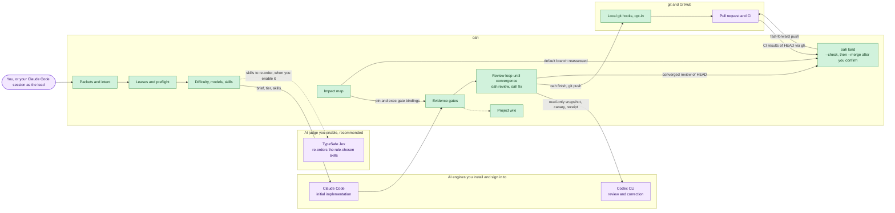
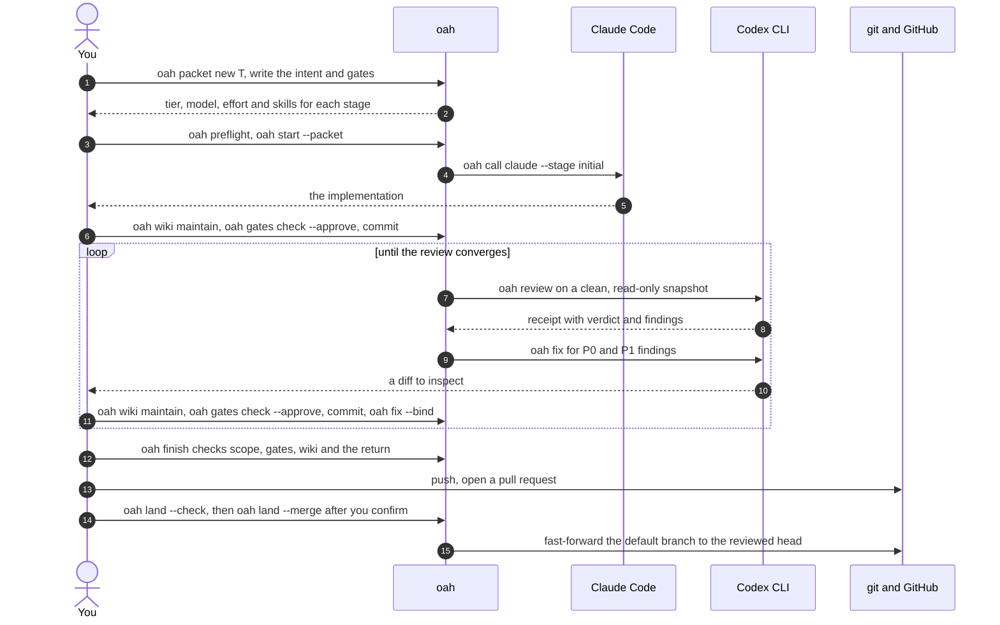
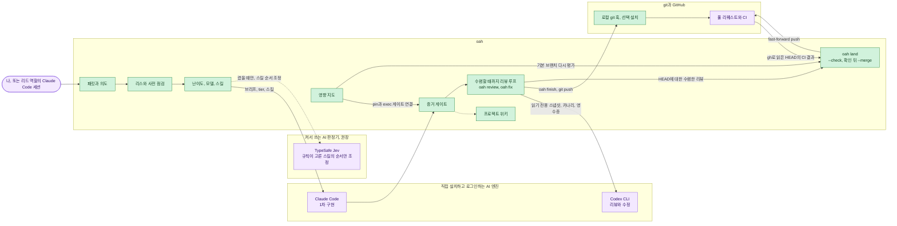

<p align="center">
  
</p>

<p align="center">
  <a href="../../actions/workflows/ci.yml"></a>
  <a href="LICENSE"></a>
  
  
</p>

# open-agent-harness (`oah`)

## Purpose: a harness that keeps adapting

`oah` is not meant to be the one perfect harness that everyone adopts as is. It is a worked reference and a
guideline for building a development environment that fits you and keeps changing as AI changes.

A harness is set up once and then usually left alone, while the models and skills under it keep improving. Rules
and skills that helped an older model can hold a newer one back from its full ability, and outdated skills can make
results worse. A good harness flows like water: it keeps up with each new model, drops skills that are no longer
needed, adds the ones that are, and changes its rules to match.

- **Adapt the parts you need.** If you already use other AI tools or another harness, read how `oah` handles
  leases, engine stages, evidence gates, the impact map, the wiki and the review loop, and carry over only the
  ideas that fit your tools. The rules are written down in [`docs/PLAN.md`](docs/PLAN.md) so they can be copied
  as ideas, not only as code.
- **Or follow it and make it yours.** If you start from `oah` as it is, treat it as a starting point: change the
  config, the stages and the rules to match your own goals, and grow your own project wiki and impact map as your
  code grows. The harness you end up with should be yours, not a copy of ours.
- **Keep updating it.** Review your models, skills and rules as the tools change. Remove what no longer helps and
  add what does. `oah` keeps updating too, so that its users can adapt to a changing AI environment together.

So `oah` prefers defaults you can understand and change over checks you cannot turn off. When a rule gets in
the way of your work or of a newer model, the project treats that as a design problem to fix.

### Why Claude implements and Codex reviews

This split is the author's own setup, based on personal experience rather than a measurement. In my use, Claude
is good at implementing a task while filling in what a beginner tends to miss, and Codex is good at checking and
correcting work inside a fixed scope. So I let Claude write the first version, and Codex review, correct and
re-review it.

### Use it with any AI setup

The `oah` command drives Claude Code and Codex CLI today, but the harness itself is not tied to them. Its parts
(leases, packets, gates, the review loop, the impact map and the wiki) work with a single AI or with several
different AIs. Fit them to your own environment, and give each stage to whichever AI works best for you.

`oah` is a small command-line tool that makes **Claude Code** and **Codex CLI** work as one disciplined
team on your own repository, with **TypeSafe Jev** as an optional judge. It is written for developers and
small teams who already use git and pull requests and want production-grade review discipline from AI
coding, on their own machine.

| Role | Tool | What it does |
|---|---|---|
| Implements | **Claude Code** | The first implementation of every task. |
| Reviews and corrects | **Codex CLI** | Review, correction and re-review, until the review converges. |
| Judges, if you enable it | **TypeSafe Jev** | Re-orders the closed lists that fixed rules produce, such as the skills for a task. It never adds or removes a candidate. |

Two AI coding sessions on one repository will happily edit the same files. "Done" means whatever the agent
says, and a review has no rule for when it is finished. `oah` gives both engines one rulebook:

- **Leases** keep parallel sessions off each other's paths.
- **A packet** states the goal and its success conditions, and that intent travels unchanged to every stage.
- **The task's difficulty** picks the model, the effort and the skills, by fixed rules you can read.
- **Gates** prove "done" with commands and recorded evidence.
- **Codex reviews, corrects and re-reviews** until the review converges, and stops to ask you when a decision
  is needed.
- **An impact map** says what a change affects, and **a project wiki** remembers why it was made.
- Work **lands only after you confirm**, and only the exact head that was reviewed.
- **Models and skills follow upstream updates**, with every change checked and logged.

`oah` is Python 3.11+ with the standard library only, and runs natively on macOS and Windows (no WSL). It does
not replace Claude Code or Codex: it drives them and keeps the records that make their work trustworthy.

> [!NOTE]
> **v0.1.0 is the first release.** It is for developers fluent with git and pull requests, on macOS and
> native Windows. Linux is not yet supported.

## Contents

- [Purpose: a harness that keeps adapting](#purpose-a-harness-that-keeps-adapting)
- [Next update](#next-update)
- [How it fits together](#how-it-fits-together)
- [Strengths](#strengths)
- [Beginner mistakes oah guards against](#beginner-mistakes-oah-guards-against)
- [Install](#install)
- [First run](#first-run)
- [The loop](#the-loop)
- [Commands at a glance](#commands-at-a-glance)
- [Requirements](#requirements)
- [Documentation](#documentation)
- [Development](#development)
- [Security](#security)
- [License and third-party notices](#license-and-third-party-notices)
- [한국어 소개](#한국어-소개)

## Next update

These four features are in review for the next update and are **not available in v0.1.0**.

- Jev chooses the model and effort for each call within the tier pools you allow.
- Impact reports say which scope was analysed and which was not, with conservative fallback checks.
- Reproducible evaluations of real cases use hidden expected answers (`oah eval`).
- A review budget covers the whole task, with ways to stop, resume and increase it.

## How it fits together



Purple boxes are tools outside oah that you install and sign in to; green boxes are parts of oah. Dashed arrows
are optional. Each part is explained in [Concepts](docs/concepts.md).

## Strengths

- **Engines by stage.** Claude Code writes the first version; Codex CLI reviews, corrects and re-reviews. A call
  for the wrong engine at a stage is refused (`OAH_STAGE_ENGINE_MISMATCH`) unless you override it, and the
  override is recorded.
- **Difficulty picks the model and effort.** Fixed rules score four axes and choose a tier; an effort the CLI
  cannot prove is recorded as unverified, and a lower launch effort fails (`OAH_EFFORT_DOWNGRADED`).
- **Skills chosen for the task,** each with a reason. An optional judge, TypeSafe Jev, only re-orders that list.
- **An impact map** lists the gates and commands that pin or run a changed file, so you re-run exactly those.
- **A project wiki** records decisions next to the code, and `oah finish` checks that it was maintained.
- **Evidence gates.** A task is done when its gates pass with recorded evidence, not when an agent says so.
- **Intent that travels** from the packet into the lease and the brief of every call.
- **Leases and preflight** keep parallel sessions off each other's files and off a stale base.
- **Reviews that converge.** Codex reviews a read-only snapshot, corrections are bound to their findings, and a
  repeat or a design question stops for your decision.
- **No secrets in the repository.** Keys are read at runtime only; `oah land` requires a gitleaks scan.
- **A toolkit with provenance** for skills and MCP templates, with exact pins and safe updates.
- **Easy setup:** one-command installers, `oah doctor`, and a guided `oah init` that shows its plan first.

## Beginner mistakes oah guards against

| Mistake | What oah does |
|---|---|
| Committing an API key | `oah init` adds `.env`, `*.pem`, `*.key` and similar to `.gitignore`; the opt-in pre-push hook scans pushed commits only when gitleaks is installed, otherwise warns and permits an unscanned push; `oah land` refuses without a scan (`OAH_LAND_SCAN_REQUIRED`). |
| Starting on a stale branch | `oah preflight` aborts when the base is behind and says which `git rebase` to run. |
| Starting with uncommitted changes | `oah preflight` warns, lists the files and allows proceeding if no other check aborts. |
| Two AI sessions on the same files | `oah start` refuses an overlapping lease (`OAH_LEASE_CONFLICT`); `oah finish` compares the real changes with the scope (`OAH_SCOPE_EXCEEDED`). |
| Pushing in the middle of a task | The opt-in pre-push hook refuses while any lease, active or stale, is recorded for this worktree (`OAH_PUSH_REFUSED`). |
| Letting an agent push or force-push | The shared rules block tells agents not to; landing is a command you confirm. |
| Calling work "done" with no evidence | `oah finish` and the Stop hook refuse unmet gates (`OAH_GATES_UNMET`). |
| Not knowing what a change breaks | `oah impact --changed-since` lists what to re-check, including untracked files, with `re-run:` lines. |
| Merging without review or CI | `oah land --check` checks the lease, intent, review, gates, impact, required checks, fast-forward, a gitleaks scan and CI at the exact head. Unverified CI blocks (`OAH_LAND_CI_UNVERIFIED`) unless you record an explicit exception. |
| Losing track of why a change was made | Packets keep the intent, review receipts keep the findings, and the wiki keeps the decisions. |
| No CI, or CI on one OS only | `oah ci init` writes a starter workflow for the runners you choose (macOS, Windows, Linux), after you confirm. |

## Install

One command per OS installs `oah`. It asks before it installs any missing tool, shows the official command
for each one, and never sees your passwords or keys. To install from a clone, run the commands below.
For v0.1.0, you can instead download the tag’s source archive and `SHA256SUMS` from the repository’s release
page. Refuse to unpack it unless its SHA-256 matches that archive’s digest in `SHA256SUMS`; then run the
included installer. The OS guides below show how to check it.

macOS (you need git first: `xcode-select --install`):

```sh
git clone https://github.com/KenSuh/open-agent-harness.git
cd open-agent-harness
bash install/install.sh
```

Windows PowerShell (you need git first: `winget install --id Git.Git -e`):

```powershell
git clone https://github.com/KenSuh/open-agent-harness.git
cd open-agent-harness
powershell -ExecutionPolicy Bypass -File .\install\install.ps1
```

Add `--dry-run` (`-DryRun` on Windows) to see every step without changing anything. The installer checks the
tools, installs `oah` with uv (or pipx, or pip), checks that a new terminal finds `oah`, and runs `oah doctor`.
The full guides are [Install on macOS](docs/install-macos.md) and [Install on Windows](docs/install-windows.md).

Then open a new terminal and check:

```console
$ oah --version
oah 0.1.0
```

## First run

Inside your project (a git repository with a remote), run the guided setup:

```sh
oah init
```

`oah init` first asks once about each option: tier agents, hooks, unlazy (the gate checker), the knowledge
graph, the CI starter, the companion apps Orca and Aside, the TypeSafe Jev re-ranker and automatic skill
updates. Then inspect the complete plan and confirm the changes before they are applied. It:

- checks every tool and installs only what you confirm;
- checks your Claude Code and Codex sign-ins with their own status commands, and shows the command to run
  when one is missing;
- writes `.oah/config.toml`, the rules block in `AGENTS.md` (imported by `CLAUDE.md`), the wiki in
  `docs/wiki/`, templates in `.oah/templates/` and `.gitignore` entries for local secret files;
- builds the first impact map.

A second run writes only what is still missing. Each question also has a flag, such as `--with-unlazy` or
`--without-ci`, so you can answer without a prompt. Commit what it wrote, then follow the worked example.

**Your first task:** [`examples/hello-oah`](examples/hello-oah/README.md) walks one small task through the
whole loop with real commands, in about 20 minutes.

## The loop



| Step | Commands | What it guarantees |
|---|---|---|
| Describe the task | `oah packet new`, `oah packet check`, `oah gates new` | The goal and its success conditions are written and accepted before work starts. |
| Start safely | `oah preflight`, `oah start --packet` | Your branch is fresh, and no other session holds your paths. |
| Implement | `oah call claude --stage initial`, or your own Claude Code session | Claude works from the packet, with the tier's model, effort and skills. |
| Prove it | `oah wiki maintain`, `oah gates check --approve`, commit | Every success condition has a command and recorded evidence. |
| Review and correct | `oah review`, `oah fix`, `oah fix --bind` | Codex reviews until the review converges; each round leaves a receipt. |
| Finish | `oah finish --return` | Changes stayed in scope, gates are met, and the return matches the intent. |
| Land | `oah land --check`, `oah land --merge` | The exact reviewed head lands after a secret scan and CI verification (or a recorded CI exception), when you confirm. |

Maintain the wiki, run the final approved gate check and commit in that order, including after every
correction. Unverified CI blocks landing by default: missing `gh`, no CI results, or a required check
missing for HEAD produces `OAH_LAND_CI_UNVERIFIED`. To accept that risk, pass
`--accept-unverified-ci "<reason>"` to `oah land --check` and `oah land --merge`. The exception and reason
are recorded for that exact head; CI stays `unverified` and never counts as a pass. Failed or pending CI
still blocks landing. See [Landing](docs/concepts.md#landing) for the target branch’s CI policy.

[Concepts](docs/concepts.md) explains each step; [Troubleshooting](docs/troubleshooting.md) explains each
refusal.

## Commands at a glance

| Command | What it does |
|---|---|
| `oah init` | Guided setup: tools, sign-ins, project files and the first impact map. |
| `oah doctor` | Checks the tools `oah` uses and prints the install command for each missing one. |
| `oah packet new` / `check` | Creates or checks a task packet (`.oah/tasks/<task>/PACKET.md`). |
| `oah intent show` / `check` | Shows a task's intent, its digest and its binding state. |
| `oah preflight` | Checks the base branch, the working tree and the leases before you start. |
| `oah start`, `renew`, `status`, `finish`, `release`, `log` | Leases: claim paths, extend, list, close with checks, drop, note. |
| `oah recommend` | Picks a tier from the four difficulty axes. |
| `oah models` | Shows, and with `--refresh` re-reads, the model each tier uses. |
| `oah call`, `oah wait` | Launches Claude Code or Codex for one stage and records the run; waits for a background run. |
| `oah gates` | Writes, lints and checks a task's gate ledger. |
| `oah check` | Portable assertions for gate CHECK lines. |
| `oah wiki` | Keeps the project wiki linked, sourced and tidy. |
| `oah impact` | Lists what to re-check when files or database objects change. |
| `oah graph` | Uses the graphify knowledge graph when graphify is installed. |
| `oah review` | Runs one Codex review round and records its receipt; `review summary` prints a block for the pull request. |
| `oah fix` | Has Codex correct the latest review's findings, then binds the committed correction. |
| `oah land` | Checks that the exact reviewed head may land, or lands it after you confirm. |
| `oah rules` | Keeps the shared rules block in `AGENTS.md` in sync. |
| `oah skills` | Lists, installs and updates bundled and linked skills. |
| `oah hooks` | Installs or removes the opt-in Claude Code and git hooks. |
| `oah ci` | Sets up GitHub Actions checks for your project. |

Every command takes `--help`. Exit codes are `0` done, `1` refused, `2` usage or an `ABORT` verdict from
`oah preflight`, `69` environment and `75` when `oah wait` reaches its timeout with the run still active
(run `oah wait <run-id>` again). Every refusal starts with an `OAH_*` code and says what to run next.

## Requirements

| | Requirement | Needed for |
|---|---|---|
| OS | **macOS 13+** or **Windows 11**, natively; no WSL. Windows 10 22H2 is best effort. Linux is not yet supported. | everything |
| Runtime | **Python 3.11+**. No third-party Python packages at runtime. | everything |
| Version control | **git**, and a remote such as a GitHub repository | everything |
| Engines | **Claude Code** and **Codex CLI**, installed and signed in by you | implementation, review and correction |
| Gates | **unlazy**, which needs **Node.js** | gates and the Stop hook |
| Landing | **gitleaks**, and **gh** for reading CI results | `oah land` |
| Optional | **uv** (recommended installer), **graphify** (knowledge graph), **TypeSafe Jev** (needs a TypeSafe account and key), **Orca** and **Aside** (companion apps) | convenience |

`oah doctor` checks every tool in this table except Jev, and prints the official install command for anything
missing. Jev's state shows in every `rerank=` result instead.

## Documentation

| Page | What it covers |
|---|---|
| [Worked example](examples/hello-oah/README.md) | One task through the whole loop, step by step. |
| [Concepts](docs/concepts.md) | Leases, packets and intent, difficulty, skills, impact map, wiki, gates, review, landing, updates, toolkit, CI and companion apps. |
| [Troubleshooting](docs/troubleshooting.md) | The common `OAH_*` refusals, what they mean and what to run next. |
| [Keys](docs/keys.md) | Where each optional key lives, and what is off without it. |
| [Upgrade](docs/upgrade.md) | Updating `oah`, your project files, skills, MCP templates and models. |
| [Install on macOS](docs/install-macos.md), [on Windows](docs/install-windows.md) | The installers, step by step. |
| [CI starter](docs/ci-starter.md) | `oah ci init`, reading CI results and making checks required. |
| [Companion apps](docs/companions.md) | Orca and Aside: what they add and how to set them up. |
| [Toolkit](docs/toolkit.md) | Every bundled or linked skill, MCP template and CLI, with its source and license. |
| [The plan](docs/PLAN.md) | The full design and the reasons behind each rule. |

Every page has a Korean version under [`docs/ko/`](docs/ko/).

## Development

Run the tests with Python 3.11, and again with the newest Python you have. Point `TMPDIR` at the git-ignored
`.tmp/` folder so every test write stays inside the checkout. Create the folder first: Python ignores a
`TMPDIR` that does not exist.

```sh
mkdir -p .tmp/test-tmp
TMPDIR="$PWD/.tmp/test-tmp" python3.11 -m unittest discover -s tests -t .
```

- **CI** runs the tests on macOS and Windows for every pull request to `main`. Pull requests that change only
  documentation skip the tests.
- **Secret scan.** A separate workflow runs gitleaks over the full history and the privacy scan on every pull
  request and every push, documentation included. Any finding fails it.
- **Before every push**, run the privacy scan with gitleaks required. It must print `PRIVACY_SCAN_CLEAN`:

  ```sh
  python3 tools/privacy_scan.py --gitleaks require
  ```

- Commits record which engine wrote them with an `Agent-Engine: claude|codex|human` trailer.

## Security

**The hard rule.** No API key, token, password, cookie, OAuth secret or account identifier ever enters this
repository, its history, releases, issues or CI logs.

- Keys are read only at runtime, from environment variables or the OS keychain, through one documented
  lookup. When a key is missing, the feature stays off and reports `unused(no key)`.
- Templates use `${ENV_VAR}` placeholders only.
- gitleaks and the privacy scan run before every push, and in CI on every pull request and every push, over
  the full history. Any finding fails the build.
- Keep your own keys in your environment or your keychain, never in project files. [Keys](docs/keys.md) says
  how.

## License and third-party notices

`oah` is released under the [MIT License](LICENSE), copyright open-agent-harness contributors. The only
third-party code it vendors is the bundled skills under `skills/`, shipped unchanged with their own licenses
and only where those licenses allow it. They, and the tools it runs or links to, such as unlazy, superpowers,
graphify, Claude Code and Codex CLI, are listed with their licenses in
[`THIRD_PARTY_NOTICES.md`](THIRD_PARTY_NOTICES.md).

---

## 한국어 소개

### 이 프로젝트의 목적

`oah`는 모두가 그대로 써야 하는 완벽한 하네스를 내놓는 것이 목적이 아니다. 각자에게 맞고, AI가 바뀌는 만큼
함께 바뀌는 개발 환경을 만들도록 돕는 참고 구현이자 가이드라인이다.

하네스는 보통 한 번 세팅해 두면 그대로 쓰인다. 그 사이 AI 모델과 스킬은 계속 업데이트된다. 예전 모델에서 잘
쓰던 규칙과 스킬이 업그레이드된 모델의 최대 성능을 막는 제약이 되기도 하고, 시대에 뒤떨어진 스킬이 오히려
더 나쁜 결과를 내기도 한다. 좋은 하네스는 흐르는 물처럼 새 모델에 맞춰 계속 바뀐다. 필요 없어진 스킬은
지우고, 필요한 스킬은 더하고, 규칙도 그에 맞게 고친다.

- **필요한 부분만 가져가 적용한다.** 이미 다른 AI 도구나 다른 하네스를 쓰고 있다면 `oah`가 리스, 단계별
  엔진, 증거 게이트, 영향 지도, 위키, 리뷰 루프를 어떻게 다루는지 참고해서 자기 도구에 맞는 부분만 옮겨
  하네스를 업그레이드하면 된다. 규칙은 [`docs/PLAN.md`](docs/PLAN.md)에 글로 적어 두었으니 코드가 아니라
  생각으로도 가져갈 수 있다.
- **그대로 따라 하더라도 자기 것으로 키운다.** `oah`를 그대로 시작점으로 삼는다면 설정과 단계, 규칙을 자기
  개발 목적에 맞게 바꾸고, 코드가 자라는 만큼 자기 프로젝트 위키와 영향 지도를 만들어 가면 된다. 결국 남는
  하네스는 우리 것을 복사한 것이 아니라 사용자 자신의 것이어야 한다.
- **계속 업데이트한다.** 도구가 바뀌면 모델과 스킬, 규칙을 다시 살핀다. 더는 도움이 안 되는 것은 지우고
  도움이 되는 것은 더한다. `oah`도 계속 업데이트하면서 사용자들이 변하는 AI 환경에 함께 적응하도록 돕는다.

그래서 `oah`는 끌 수 없는 검사보다 이해하고 바꿀 수 있는 기본값을 고른다. 규칙이 사용자의 작업이나 새 모델을
가로막으면 이 프로젝트는 그것을 고쳐야 할 설계 문제로 다룬다.

#### Claude가 구현하고 Codex가 검토하는 이유

이 역할 분담은 만든 사람의 개인적인 경험에서 나온 방식이고, 측정한 결과는 아니다. 내가 써 보니 Claude는 초보자
입장에서 놓치기 쉬운 부분까지 채워 넣으며 구현하는 데 강했고, Codex는 정해진 범위 안에서 검사하고 고치는 데
강했다. 그래서 첫 버전은 Claude에게 맡기고 검토와 수정, 재검토는 Codex에게 맡긴다.

#### 어떤 AI 구성에도 맞춰 쓴다

지금 `oah` 명령은 Claude Code와 Codex CLI를 움직이지만, 하네스 자체가 이 둘에 묶여 있지는 않다. 리스, 패킷,
게이트, 리뷰 루프, 영향 지도, 위키 같은 구성 부분은 AI 하나만 써도, 여러 다른 AI를 함께 써도 그대로 쓸 수
있다. 자기 환경에 맞추고, 단계마다 자기에게 가장 잘 맞는 AI를 고르면 된다.

### oah는 무엇인가

`oah`는 **Claude Code**와 **Codex CLI**가 내 저장소에서 한 팀처럼 일하게 해 주는 작은 명령줄 도구예요. 작업에 쓸 스킬의 순서를 정할 때는 **TypeSafe Jev**가 판정을 돕습니다.

AI로 프로그램을 만들면서 «원하는 결과가 잘 안 나온다»고 느끼는 분, 그리고 AI 작업 환경(하네스)을 이제 막 꾸려 보려는 분을 가장 먼저 생각하고 만들었어요.

| 역할 | 도구 | 하는 일 |
|---|---|---|
| 만들기 | **Claude Code** | 모든 작업의 첫 버전을 만듭니다. |
| 검토와 수정 | **Codex CLI** | 더 고칠 곳이 없을 때까지 검토하고, 고치고, 다시 검토합니다. |
| 판정 | **TypeSafe Jev** | 정해진 규칙이 먼저 후보를 고르면, Jev는 그 안에서 순서만 정합니다. 후보를 새로 넣거나 빼지는 않아요. 지금은 «작업에 쓸 스킬 고르기»에 쓰이고, «영향 범위 결과 정렬»은 준비 중입니다. |

Jev는 함께 쓰기를 권하지만 꼭 필요하지는 않아요. 사용자가 직접 켜고 Jev 키가 있을 때만 작동해요.

- 처음 설정할 때 `oah init`이 Jev를 쓸지 한 번 물어봐요. 나중에 설정 파일에서 켜도 돼요.
- `oah doctor`는 아직 Jev 상태를 점검하지 않아요. 대신 각 작업 결과에 Jev를 썼는지가 표시돼요.
- Jev가 없으면 정해진 규칙만으로 판단해요.

AI 코딩 세션 둘이 한 저장소를 함께 쓰면 같은 파일을 쉽게 동시에 고친다. "끝났다"는 에이전트의 말뿐이고 리뷰는
언제 끝나는지 정한 규칙이 없다. `oah`는 두 엔진에 같은 규칙을 적용한다.

- **리스**가 동시에 도는 세션이 서로의 경로를 건드리지 않게 한다.
- **패킷**에 목표와 성공 조건을 적고, 그 의도는 바뀌지 않은 채 모든 단계로 간다.
- **작업 난이도**가 읽을 수 있는 정해진 규칙으로 모델과 추론 강도, 스킬을 고른다.
- **게이트**가 명령과 기록된 증거로 "끝났다"를 증명한다.
- **Codex가 리뷰하고 고친 뒤 다시 리뷰한다.** 리뷰가 수렴할 때까지 이어 가고 결정이 필요하면 멈춰서 묻는다.
- **영향 지도**는 변경이 무엇에 닿는지 알려 주고 **프로젝트 위키**는 왜 그렇게 했는지 기억한다.
- 작업은 **사용자가 확인한 뒤에만**, 리뷰한 head 그대로 반영된다.
- **모델과 스킬이 원본의 업데이트를 따라간다.** 바뀔 때마다 검사하고 기록한다.

`oah`는 Python 3.11 이상과 표준 라이브러리만으로 동작하고 macOS와 Windows에서 WSL 없이 바로 돈다. Claude Code나
Codex를 대신하지 않는다. 두 도구를 움직이고 그 작업을 믿을 수 있게 하는 기록을 남긴다.

> [!NOTE]
> **v0.1.0은 첫 릴리스다.** git과 pull request에 익숙한 개발자를 위한 버전이며 macOS와 네이티브 Windows를
> 지원한다. Linux는 아직 지원하지 않는다.

### 다음 업데이트

다음 네 기능은 다음 업데이트를 위해 리뷰 중이며 **v0.1.0에서는 아직 쓸 수 없다**.

- 호출마다 사용자가 허용한 tier별 후보 안에서 Jev가 모델과 추론 강도를 고른다.
- 영향 보고서가 분석한 범위와 분석하지 못한 범위를 밝히고 보수적인 대체 검사를 제시한다.
- 정답을 숨긴 실제 사례 평가를 재현할 수 있게 한다(`oah eval`).
- 작업 전체의 리뷰 예산을 두고 멈추기, 이어 하기, 늘리기를 제공한다.

### 한눈에 보는 구조



보라색 상자는 직접 설치하고 로그인하는 oah 밖의 도구이고, 초록색 상자는 oah의 부품이다. 점선 화살표는 선택
사항이다. 각 부품의 설명은 [개념](docs/ko/concepts.md)에 있다.

### 강점

- **단계별 엔진.** Claude Code가 1차 구현을 하고 Codex CLI가 리뷰, 수정, 재리뷰를 한다. 단계에 맞지 않는 엔진
  호출은 거절되고(`OAH_STAGE_ENGINE_MISMATCH`), 직접 덮어쓰면 그 사실이 기록된다.
- **난이도가 모델과 추론 강도를 정한다.** 고정 규칙이 네 축에 점수를 매겨 tier를 고른다. CLI가 증명하지 못하는
  강도는 미검증으로 기록되고, 더 낮은 강도로 실행되면 실패한다(`OAH_EFFORT_DOWNGRADED`).
- **작업에 맞게 고른 스킬.** 각 스킬에 이유가 붙는다. 선택 사항인 판정기 TypeSafe Jev는 그 목록의 순서만 바꾼다.
- **영향 지도**는 바뀐 파일을 고정하거나 실행하는 게이트와 명령을 알려 줘서, 정확히 그것만 다시 돌리게 한다.
- **프로젝트 위키**가 결정을 코드 옆에 남기고, `oah finish`가 위키 정리 여부를 확인한다.
- **증거 게이트.** 에이전트가 끝났다고 말할 때가 아니라, 게이트가 증거와 함께 통과할 때 작업이 끝난다.
- **따라다니는 의도.** 패킷의 의도가 리스와 모든 호출의 브리프로 이어진다.
- **리스와 사전 점검**이 병렬 세션이 서로의 파일이나 낡은 기준점에서 작업하지 않게 막는다.
- **수렴하는 리뷰.** Codex가 읽기 전용 스냅샷을 리뷰하고, 수정은 해당 지적에 묶이며, 같은 종류가 반복되거나
  설계 판단이 필요하면 멈추고 사용자에게 묻는다.
- **저장소에 비밀값이 없다.** 키는 실행할 때만 읽는다. `oah land`는 gitleaks 검사를 요구한다.
- **출처가 남는 툴킷.** 스킬과 MCP 템플릿을 정확한 버전으로 고정하고 안전하게 업데이트한다.
- **쉬운 설치.** 한 줄 설치 스크립트, `oah doctor`, 그리고 계획을 먼저 보여 주는 안내형 `oah init`이 있다.

### 초보자가 자주 하는 실수와 oah

| 실수 | oah가 하는 일 |
|---|---|
| API 키를 커밋함 | `oah init`이 `.env`, `*.pem`, `*.key` 같은 항목을 `.gitignore`에 넣는다. 선택 설치하는 pre-push 훅은 gitleaks가 설치돼 있을 때만 푸시할 커밋을 검사하고, 없으면 경고한 뒤 검사 없이 푸시를 허용한다. `oah land`는 검사 없이는 거절한다(`OAH_LAND_SCAN_REQUIRED`). |
| 낡은 브랜치에서 시작함 | `oah preflight`가 기준점이 뒤처졌으면 중단하고 어떤 `git rebase`를 할지 알려 준다. |
| 커밋하지 않은 변경을 두고 시작함 | `oah preflight`가 경고와 파일 목록을 보여 주며, 다른 검사에서 중단하지 않으면 계속 진행할 수 있다. |
| 두 AI 세션이 같은 파일을 고침 | `oah start`가 겹치는 리스를 거절한다(`OAH_LEASE_CONFLICT`). `oah finish`가 실제 변경을 범위와 비교한다(`OAH_SCOPE_EXCEEDED`). |
| 작업 중간에 푸시함 | 선택 설치하는 pre-push 훅이 이 워크트리에 리스가 남아 있는 동안, 활성이든 만료든 푸시를 거절한다(`OAH_PUSH_REFUSED`). |
| 에이전트가 푸시나 강제 푸시를 함 | 공유 규칙 블록이 에이전트에게 금지하고, 반영은 사용자가 확인하는 명령이다. |
| 증거 없이 "끝났다"고 함 | `oah finish`와 Stop 훅이 미충족 게이트를 거절한다(`OAH_GATES_UNMET`). |
| 변경이 무엇을 깨는지 모름 | `oah impact --changed-since`가 추적하지 않은 파일까지 포함해 다시 볼 것을 `re-run:` 줄로 알려 준다. |
| 리뷰나 CI 없이 합침 | `oah land --check`가 정확한 HEAD에서 리스, 의도, 리뷰, 게이트, 영향, 필수 검사, fast-forward, gitleaks 검사, CI를 확인한다. 검증되지 않은 CI는 명시적 예외를 기록하지 않는 한 막힌다(`OAH_LAND_CI_UNVERIFIED`). |
| 왜 바꿨는지 잊어버림 | 패킷이 의도를, 리뷰 영수증이 지적을, 위키가 결정을 남긴다. |
| CI가 없거나 한 OS에서만 돎 | `oah ci init`이 확인을 받은 뒤 고른 러너(macOS, Windows, Linux)용 기본 워크플로를 만든다. |

### 설치

OS마다 명령 하나로 `oah`를 설치한다. 빠진 도구는 설치하기 전에 묻고 도구마다 공식 명령을 보여 주며, 사용자의
비밀번호나 키는 보지 않는다. 클론에서 설치하려면 아래 명령을 실행한다. v0.1.0은 저장소의 릴리스 페이지에서
태그의 소스 압축 파일과 `SHA256SUMS`를 받는 방법도 있다. 압축 파일의 SHA-256이 `SHA256SUMS`의 해당 파일
지문과 일치할 때만 풀고 안의 설치 프로그램을 실행한다. 확인 방법은 아래 OS별 안내에 있다.

macOS에서는 먼저 git이 있어야 한다(`xcode-select --install`).

```sh
git clone https://github.com/KenSuh/open-agent-harness.git
cd open-agent-harness
bash install/install.sh
```

Windows PowerShell에서도 먼저 git이 있어야 한다(`winget install --id Git.Git -e`).

```powershell
git clone https://github.com/KenSuh/open-agent-harness.git
cd open-agent-harness
powershell -ExecutionPolicy Bypass -File .\install\install.ps1
```

`--dry-run`(Windows에서는 `-DryRun`)을 붙이면 아무것도 바꾸지 않고 모든 단계를 보여 준다. 설치 프로그램은 도구를
확인하고, uv(없으면 pipx나 pip)로 `oah`를 설치하고, 새 터미널에서 `oah`를 찾을 수 있는지 확인한 뒤 `oah doctor`를
실행한다. 자세한 안내는 [macOS에 설치하기](docs/ko/install-macos.md)와
[Windows에 설치하기](docs/ko/install-windows.md)에 있다.

그다음 새 터미널을 열고 확인한다.

```console
$ oah --version
oah 0.1.0
```

### 처음 실행하기

원격 저장소가 연결된 내 git 저장소 안에서 안내형 설정을 실행한다.

```sh
oah init
```

`oah init`은 먼저 선택 사항마다 한 번씩 묻는다. 단계별 에이전트 파일, 훅, 게이트 검사기 unlazy, 지식 그래프,
CI 시작 워크플로, 동반 앱 Orca와 Aside, TypeSafe Jev 재정렬기, 스킬 자동 업데이트다. 선택을 마친 뒤 전체 계획을
살펴보고 승인해야 변경이 적용된다. 설정 과정에서는 다음 일을 한다.

- 도구를 모두 확인하고 사용자가 확인한 것만 설치한다.
- Claude Code와 Codex 로그인을 각 도구의 상태 명령으로 확인하고, 빠졌으면 실행할 명령을 알려 준다.
- `.oah/config.toml`, `AGENTS.md`의 규칙 블록(`CLAUDE.md`가 불러온다), `docs/wiki/`의 위키, `.oah/templates/`의
  템플릿, 로컬 비밀 파일을 위한 `.gitignore` 항목을 쓴다.
- 첫 영향 지도를 만든다.

두 번째로 실행하면 아직 빠진 것만 쓴다. 질문마다 `--with-unlazy`, `--without-ci` 같은 옵션이 있어서 묻지 않고
답할 수도 있다. 쓴 파일을 커밋한 다음 따라 하기 예제로 넘어간다.

**첫 작업.** [`examples/hello-oah`](examples/hello-oah/README.ko.md)가 작은 작업 하나를 실제 명령으로 전체 흐름에
태워 20분쯤 안에 끝까지 진행한다.

### 작업 흐름

위 영어 절의 [The loop](#the-loop) 도표가 전체 흐름을 보여 준다.

| 단계 | 명령 | 보장하는 것 |
|---|---|---|
| 작업 적기 | `oah packet new`, `oah packet check`, `oah gates new` | 일을 시작하기 전에 목표와 성공 조건을 적고 승인한다. |
| 안전하게 시작 | `oah preflight`, `oah start --packet` | 브랜치가 최신이고 다른 세션이 내 경로를 잡고 있지 않다. |
| 구현 | `oah call claude --stage initial`, 또는 직접 연 Claude Code 세션 | Claude가 패킷을 보고 tier에 맞는 모델, 추론 강도, 스킬로 일한다. |
| 증명 | `oah wiki maintain`, `oah gates check --approve`, 커밋 | 성공 조건마다 명령과 기록된 증거가 있다. |
| 리뷰와 수정 | `oah review`, `oah fix`, `oah fix --bind` | Codex가 리뷰가 수렴할 때까지 리뷰하고 라운드마다 영수증을 남긴다. |
| 끝내기 | `oah finish --return` | 변경이 범위 안에 있고, 게이트를 충족했고, 보고가 의도와 맞는다. |
| 반영 | `oah land --check`, `oah land --merge` | 비밀 스캔과 CI 검증(또는 기록된 CI 예외)을 거친 뒤 사용자가 확인하면 리뷰한 head 그대로 반영된다. |

수정한 뒤에도 위키 정리, 최종 승인된 게이트 검사, 커밋 순서를 지킨다. 기본적으로 CI 미검증은 반영을 막는다.
`gh`가 없거나 HEAD의 CI 결과 또는 필수 검사 결과가 없으면 `OAH_LAND_CI_UNVERIFIED`로 거절한다. 이 위험을
받아들이려면 `oah land --check`와 `oah land --merge`에 `--accept-unverified-ci "<reason>"`을 붙인다.
예외와 사유는 해당 head에만 기록되고 CI는 `unverified`로 남아 통과로 세지 않는다. 실패하거나 진행 중인 CI는
여전히 반영을 막는다. 대상 브랜치의 CI 정책은 [반영](docs/ko/concepts.md#반영)을 참고한다.

각 단계의 이유는 [개념](docs/ko/concepts.md)에, 거절 메시지마다의 해결법은 [문제 해결](docs/ko/troubleshooting.md)에
있다.

### 명령 한눈에 보기

| 명령 | 하는 일 |
|---|---|
| `oah init` | 안내형 설정. 도구, 로그인, 프로젝트 파일, 첫 영향 지도를 준비한다. |
| `oah doctor` | `oah`가 쓰는 도구를 확인하고 빠진 도구마다 설치 명령을 알려 준다. |
| `oah packet new` / `check` | 작업 패킷(`.oah/tasks/<task>/PACKET.md`)을 만들거나 검사한다. |
| `oah intent show` / `check` | 작업의 의도와 다이제스트, 결속 상태를 보여 준다. |
| `oah preflight` | 시작하기 전에 기본 브랜치, 작업 트리, 리스를 확인한다. |
| `oah start`, `renew`, `status`, `finish`, `release`, `log` | 리스. 경로를 잡고, 연장하고, 목록을 보고, 검사하며 닫고, 내려놓고, 메모를 남긴다. |
| `oah recommend` | 네 가지 난이도 축으로 tier를 고른다. |
| `oah models` | tier마다 쓰는 모델을 보여 주고 `--refresh`로 다시 읽는다. |
| `oah call`, `oah wait` | 단계 하나에 Claude Code나 Codex를 띄우고 실행을 기록한다. 백그라운드 실행을 기다린다. |
| `oah gates` | 작업의 게이트 원장을 쓰고, 검토하고, 검사한다. |
| `oah check` | 게이트 CHECK 줄에 쓰는 운영체제 공통 검사. |
| `oah wiki` | 프로젝트 위키의 링크와 출처, 정리 상태를 관리한다. |
| `oah impact` | 파일이나 데이터베이스 객체가 바뀔 때 다시 확인할 것을 알려 준다. |
| `oah graph` | graphify가 있으면 그 지식 그래프를 쓴다. |
| `oah review` | Codex 리뷰 라운드를 하나 돌리고 영수증을 남긴다. `review summary`는 pull request에 붙일 블록을 출력한다. |
| `oah fix` | 최근 리뷰의 지적을 Codex가 고치게 하고, 커밋한 수정을 기록에 묶는다. |
| `oah land` | 리뷰한 head 그대로 반영해도 되는지 확인하거나, 사용자가 확인한 뒤 반영한다. |
| `oah rules` | `AGENTS.md`의 공유 규칙 블록을 최신으로 유지한다. |
| `oah skills` | 함께 싣거나 연결된 스킬을 보여 주고, 설치하고, 업데이트한다. |
| `oah hooks` | 선택형 Claude Code 훅과 git 훅을 설치하거나 지운다. |
| `oah ci` | 내 프로젝트의 GitHub Actions 검사를 설정한다. |

모든 명령은 `--help`를 받는다. 종료 코드는 `0` 완료, `1` 거절, `2` 사용법 오류 또는 `oah preflight`의 `ABORT` 판정,
`69` 환경 문제다. `75`는 `oah wait`의 제한 시간이 끝나도 실행이 진행 중임을 뜻한다. `75`이면
`oah wait <run-id>`를 다시 실행한다. 거절할 때는 언제나 `OAH_*` 코드로 시작하고 다음에 실행할 것을 알려 준다.

### 요구 사항

| 항목 | 요구 사항 | 필요한 곳 |
|---|---|---|
| 운영체제 | **macOS 13 이상**이나 **Windows 11** 네이티브(WSL 불필요). Windows 10 22H2는 되는 데까지만 지원한다. Linux는 아직 지원하지 않는다. | 전부 |
| 런타임 | **Python 3.11 이상**. 실행에 외부 파이썬 패키지가 필요 없다. | 전부 |
| 버전 관리 | **git**과 GitHub 저장소 같은 원격 | 전부 |
| 엔진 | 사용자가 설치하고 로그인한 **Claude Code**와 **Codex CLI** | 구현, 리뷰, 수정 |
| 게이트 | **unlazy**와 그것이 쓰는 **Node.js** | 게이트와 Stop 훅 |
| 반영 | **gitleaks**, CI 결과를 읽는 **gh** | `oah land` |
| 선택 | **uv**(권장 설치 도구), **graphify**(지식 그래프), **TypeSafe Jev**(TypeSafe 계정과 키 필요), **Orca**와 **Aside**(동반 앱) | 편의 |

`oah doctor`는 이 표의 도구를 Jev만 빼고 모두 확인하고 빠진 도구마다 공식 설치 명령을 알려 준다. Jev의 상태는
`rerank=` 결과마다 드러난다.

### 문서

| 문서 | 내용 |
|---|---|
| [따라 하기 예제](examples/hello-oah/README.ko.md) | 작업 하나를 전체 흐름에 태워 단계별로 진행한다. |
| [개념](docs/ko/concepts.md) | 리스, 패킷과 의도, 난이도, 스킬, 영향 지도, 위키, 게이트, 리뷰, 반영, 업데이트, 툴킷, CI, 동반 앱. |
| [문제 해결](docs/ko/troubleshooting.md) | 자주 만나는 `OAH_*` 거절의 뜻과 다음에 실행할 명령. |
| [키](docs/ko/keys.md) | 선택 기능의 키를 어디에 두는지, 없으면 무엇이 꺼지는지. |
| [업그레이드](docs/ko/upgrade.md) | `oah`, 프로젝트 파일, 스킬, MCP 템플릿, 모델 업데이트. |
| [macOS에 설치하기](docs/ko/install-macos.md), [Windows에 설치하기](docs/ko/install-windows.md) | 설치 프로그램 단계별 안내. |
| [CI 스타터](docs/ko/ci-starter.md) | `oah ci init`, CI 결과 읽기, 검사를 필수로 만들기. |
| [동반 앱](docs/ko/companions.md) | Orca와 Aside가 더해 주는 것과 설정 방법. |
| [툴킷](docs/ko/toolkit.md) | 함께 싣거나 연결한 스킬, MCP 템플릿, 명령줄 도구와 각각의 출처, 라이선스. |
| [계획](docs/PLAN.md) | 전체 설계와 규칙마다의 이유(영어). |

### 개발

테스트는 Python 3.11로 돌리고, 가진 것 가운데 가장 새 Python으로 한 번 더 돌린다. 테스트가 쓰는 파일이 모두
체크아웃 안에 남도록 `TMPDIR`을 git이 무시하는 `.tmp/` 폴더로 지정한다. Python은 없는 `TMPDIR`을 무시하므로 폴더를
먼저 만든다. 명령은 위 영어 절의 [Development](#development)에 있다.

- **CI**는 `main`으로 가는 pull request마다 macOS와 Windows에서 테스트를 돌린다. 문서만 바꾸는 pull request는
  테스트를 건너뛴다.
- **비밀 스캔.** 별도 워크플로가 pull request와 push마다 gitleaks로 전체 이력을 검사하고 개인정보 스캔을 돌린다.
  문서만 바꿔도 돈다. 하나라도 걸리면 실패한다.
- **push하기 전에는 언제나** gitleaks를 필수로 해서 개인정보 스캔을 돌리고 `PRIVACY_SCAN_CLEAN`이 나와야 한다.
- 커밋은 `Agent-Engine: claude|codex|human` 트레일러로 쓴 엔진을 남긴다.

### 보안

**철칙.** API 키, 토큰, 비밀번호, 쿠키, OAuth 시크릿, 계정 식별자는 이 저장소와 그 이력, 릴리스, 이슈, CI 로그
어디에도 들어가지 않는다.

- 키는 실행할 때만 환경 변수나 OS 키체인에서 읽는다. 조회 경로는 문서로 정한 한 가지뿐이다. 키가 없으면 그
  기능은 꺼 둔 채 `unused(no key)`라고 알린다.
- 템플릿에는 `${ENV_VAR}` 자리표시자만 쓴다.
- gitleaks와 개인정보 스캔은 push하기 전에 돌고, CI에서도 pull request와 push마다 전체 이력을 검사한다. 하나라도
  걸리면 빌드가 실패한다.
- 내 키는 내 환경 변수나 키체인에만 두고 프로젝트 파일에는 절대 넣지 않는다. 방법은 [키](docs/ko/keys.md)에 있다.

### 라이선스

MIT 라이선스로 배포한다. 함께 싣는 외부 코드는 `skills/` 아래의 스킬뿐이며 라이선스가 허락하는 것만 원본 그대로
싣는다. 이 스킬들과 함께 쓰는 외부 도구, 그 라이선스는 [`THIRD_PARTY_NOTICES.md`](THIRD_PARTY_NOTICES.md)에 있다.
