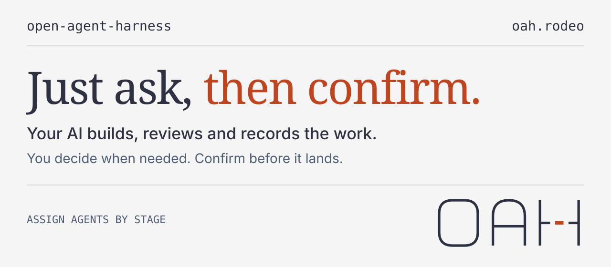
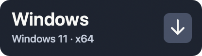
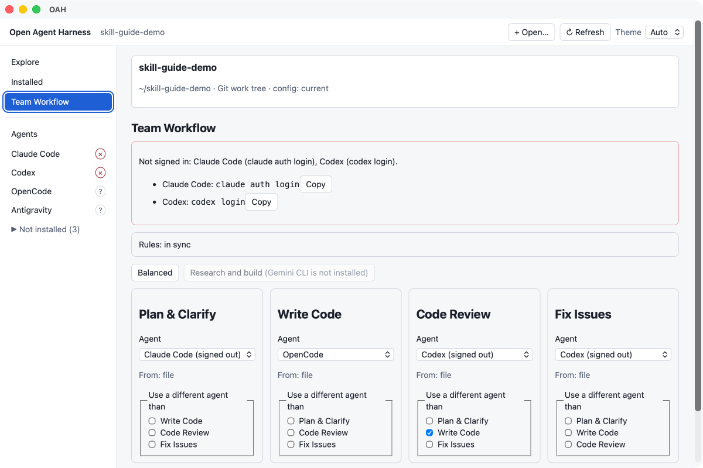
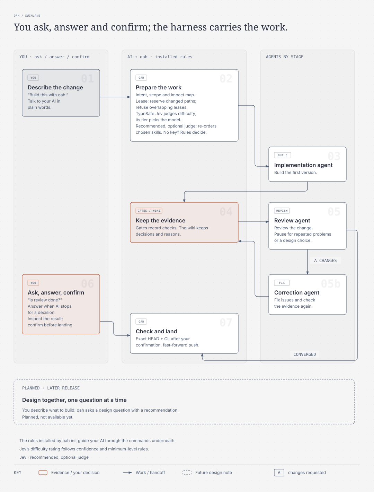
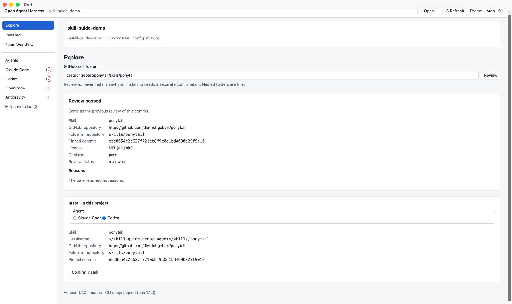
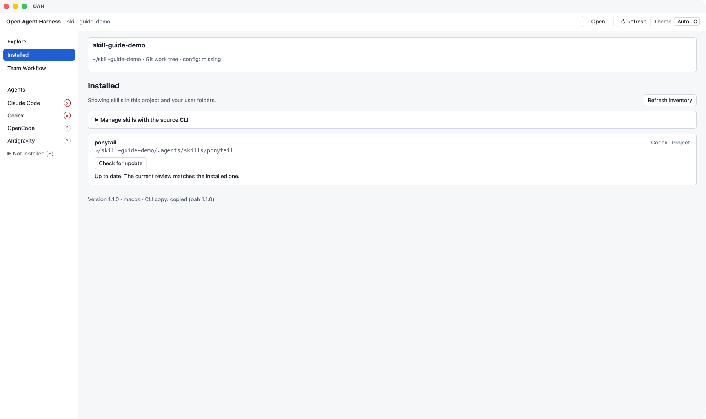

<p align="center">
  <picture>
    <source media="(prefers-color-scheme: dark)" srcset="docs/assets/banner-dark.svg">
    
  </picture>
</p>

<p align="center">
  <a href="https://oah.rodeo/"></a>
  <a href="https://github.com/KenSuh/open-agent-harness/actions/workflows/ci.yml"></a>
  <a href="LICENSE"></a>
  
  
</p>

<p align="center"><strong>English</strong> · <a href="README.ko.md">한국어</a></p>

# open-agent-harness (`oah`)

**Set up your AI coding team in OAH Desktop.** See which agents are available, assign each stage in **Team Workflow**, and use **Explore** and **Installed** to find and manage the skills your team uses.

**Download OAH Desktop v1.4.0**

<p>
  <a href="https://github.com/KenSuh/open-agent-harness/releases/download/v1.4.0/OAH_1.4.0_aarch64.dmg"></a>
  <a href="https://github.com/KenSuh/open-agent-harness/releases/download/v1.4.0/OAH_1.4.0_x64-setup.exe"></a>
</p>

[Install the desktop app](#desktop-app) · [Project tools](#configure-project-tools) · [Manage skills](#find-install-and-update-skills-in-desktop) · [Release notes](https://github.com/KenSuh/open-agent-harness/releases/tag/v1.4.0) · [Checksums](https://github.com/KenSuh/open-agent-harness/releases/download/v1.4.0/SHA256SUMS) · [Source CLI](#source-cli)

[](docs/assets/readme-v1/team-workflow-layout.png)

- **Assign roles.** Choose an available agent for each stage and sync the project's rules from **Team Workflow**.
- **Manage skills by agent.** In **Installed**, filter by agent, register GitHub sources for existing skills, and confirm shared removal with the affected agents listed.
- **Update OAH from the app.** When a new version is available, use **Install and restart** in the lower-left sidebar.

## Purpose: a harness that keeps adapting

`oah` helps you build an AI development workflow that fits you and keeps changing as AI improves.
It is a working reference and a guide you can adapt. A **harness** is the set of tools, rules and records
around an AI coding assistant.

Your AI takes care of the whole job of building and fixing a program like an expert. It checks what a change
might affect, keeps the project wiki, proves the result and runs the review cycle.
**You ask, answer when the AI stops for a decision, and confirm before anything lands.**

Take the parts that help, or start with the whole setup and make it yours. Older rules and skills
(instructions an AI can load) can hold a newer model back or make its results worse. Keep what helps,
remove what no longer does, and change the rules as your tools change. `oah` keeps evolving too.
Its defaults should be easy to understand and change.

### Choose an agent for each role

OAH started with a two-engine recipe. Claude Code wrote the first version, and Codex reviewed and corrected it.
In v1.0.0, **Team Workflow** lets you choose an agent for each section of a repository. Claude Code is still the
default for planning and building. Codex is the default for review and fixes.

### Use it with any AI setup

The desktop app offers **Claude Code, Codex, Gemini CLI, Copilot CLI, OpenCode and Antigravity** as workflow
choices. **Agents** also lists Cursor for skills and rules only. Choose from the agents available on your machine.

The desktop app saves assignments in `.oah/config.toml` and syncs them into the managed rules in `AGENTS.md`.
Use each agent in its own tool, or use the desktop's bundled commands with that configuration. The bundled
helper provides `doctor`, `sections show`, `rules check` and `rules sync`. The source CLI reads the same
build, review and fix assignments. `oah call` launches Claude Code and Codex CLI directly. Use other
assigned agents through their own tools. The dedicated `oah review` and automatic `oah fix` commands run Codex.

## What oah does for you

You describe the result you want. Your AI uses these parts together to carry the work through.

<picture>
  <source media="(prefers-color-scheme: dark)" srcset="docs/assets/features-dark.svg">
  
</picture>

- **[Impact map](docs/concepts.md#the-impact-map).** When your AI changes a file, the impact map shows related code,
  documents and the checks to rerun, so a small edit is easier to follow through.
- **[Project wiki](docs/concepts.md#the-project-wiki).** Your AI keeps the task history, decisions and reasons
  beside the code. The next session has a record to read instead of making you explain everything again.
- **[Leases](docs/concepts.md#leases).** A lease reserves the paths a task changes, and an overlapping lease
  is refused. Each task has a clear scope, and its changes are checked against that scope when it finishes.
- **[Gates](docs/concepts.md#gates).** Your AI turns “done” into checks with recorded results.
  You can ask what passed and see the evidence.
- **[Build and review](docs/concepts.md#the-review-loop-and-corrections).** Agents assigned to build, review and
  fix carry the work through. A repeated problem or a design choice pauses the loop for your answer.
- **[TypeSafe Jev](docs/how-it-works.md#jev-the-optional-judge).** The recommended, optional judge re-orders
  chosen skills and judges difficulty so its tier can pick the model, subject to confidence and minimum-level
  rules. Without a key, the rules decide.

## How it works

<picture>
  <source media="(prefers-color-scheme: dark)" srcset="docs/assets/how-it-works-v1-dark.svg">
  
</picture>

Talk to your AI in plain words. The rules installed by `oah init` and each command’s next-step message guide it
through recording your goal and scope, reserving paths, choosing the model and skills, and checking the impact
map between review rounds. If you enable Jev, it can judge difficulty and rank chosen skills.
The agent assigned to build implements the change. Gates record the checks and the wiki keeps the reasons.
The reviewer checks the change and the agent assigned to fixes addresses the findings. The loop can stop for
your answer when a problem repeats or a design decision is needed. A round limit is optional.

Ask “Is the review done?” or “Did all the gates pass?” Inspect the result and confirm before it lands in your
project's main branch. The [CLI walkthrough](docs/how-it-works.md) shows the underlying commands.
Start or resume a [guided design conversation in Claude Code](docs/skills-and-capabilities.md#guided-design) with the Python source CLI.

## Install

### Desktop app

The DMG supports Apple silicon Macs running macOS 13 or later. The NSIS installer supports Windows 11 x64.
Get the installer and `SHA256SUMS` from the [v1.4.0 downloads](#open-agent-harness-oah). Check the downloaded
file with `shasum -a 256` on macOS or `Get-FileHash -Algorithm SHA256` in PowerShell. Open it only after the
digest matches the corresponding entry.

- **macOS.** Open the DMG and drag OAH into Applications. macOS may warn on the first launch because the
  app uses an ad hoc signature and has no Apple notarization. Follow Apple's instructions after verifying
  the file. [Apple’s guide to opening apps](https://support.apple.com/en-us/102445)
- **Windows.** Run the installer. The installer is unsigned, so Microsoft Defender SmartScreen may warn and
  your organization’s policy may restrict installation.

In-app updates are available from v1.2.0. Use **Check for app updates** in the lower-left sidebar to check
manually. OAH verifies the release signature before it installs an update. If you use an earlier version,
download the current installer above.

### Source CLI

Use the source CLI for project setup, skills and the full task loop. It needs Git and Python 3.11 or later.
The installers check prerequisites and ask before installing missing tools.

- **macOS.** Download [install.sh](https://github.com/KenSuh/open-agent-harness/releases/download/v1.4.0/install.sh), verify it against `SHA256SUMS`, then run `bash ./install.sh` from its folder. [macOS CLI guide](docs/install-macos.md)
- **Windows.** Download [install.ps1](https://github.com/KenSuh/open-agent-harness/releases/download/v1.4.0/install.ps1), verify it against `SHA256SUMS`, then run `powershell -ExecutionPolicy Bypass -File .\install.ps1` from its folder. [Windows CLI guide](docs/install-windows.md)

You can also verify and unpack the [macOS source archive](https://github.com/KenSuh/open-agent-harness/releases/download/v1.4.0/open-agent-harness-v1.4.0.tar.gz)
or [Windows source archive](https://github.com/KenSuh/open-agent-harness/releases/download/v1.4.0/open-agent-harness-v1.4.0.zip),
then run the corresponding installer under `install/`. Add `--dry-run` (`-DryRun` on Windows) to preview the steps.

Then open a new terminal and check the version.

```console
$ oah --version
oah 1.4.0
```

## First run

### Desktop app path: set up your team

1. **Check the agents.** Open **Agents** to see what OAH found and which sign-in states it can verify.
   Follow the install or sign-in instructions for the agents you want to use, then choose **Rescan agents**.

   

   *Open an agent card to find its sign-in instructions and check whether it can take a section.*

   Select **Check OpenCode details** on the **OpenCode** card to see saved provider connections
   and the default model when available. The check may start OpenCode’s background service.
   Choose **View installed skills** to open its skills in **Installed**.

2. **Open a repository and assign roles.** Use **+ Open…** to choose a Git worktree, then open **Team Workflow**.
   Check readiness and choose an **Agent** on each card. The defaults are Claude Code for **Plan & Clarify**
   and **Write Code**, and Codex for **Code Review** and **Fix Issues**. The **Use a different agent than**
   checkboxes let you require two sections to use different agents.

3. **Check the project rules.** If **Rules** shows drift, choose **Sync now** to update the managed block in
   `AGENTS.md`. Review the changes in the worktree before committing them.

4. **Add a project skill.** Follow the [Desktop skill guide](#find-install-and-update-skills-in-desktop).

The desktop app uses `~/.oah` on macOS or `%USERPROFILE%\.oah` on Windows. It writes `settings.toml`
and places its helper in `bin/`. These bundled commands work with the desktop configuration.

### Configure project tools

Open a Git worktree, then go to **Team Workflow → Project Tools**.

- **Project Wiki.** Set up a new wiki or point OAH to existing Markdown notes. Use text search or build a
  local semantic index of committed notes with gbrain and Ollama.
- **Impact Map.** Build or refresh a map of the selected worktree and check whether an existing Graphify
  graph matches it. Use `oah impact` in the source CLI to query affected files and checks.
- **Jev.** Turn on optional Impact Map result ordering for this project. Review what is sent and approve it
  on this device. Store a key in macOS Keychain or Windows Credential Manager and manage approval from the
  same panel. [Key and approval settings](docs/keys.md#a-key-alone-never-turns-the-re-ranker-on)

### Alternative: initialize a separate project with the source CLI

Use a separate working copy for this walkthrough. Source CLI commands `oah init` and `oah rules sync` can
replace the managed `AGENTS.md` block. In a Git repository with a remote, run `oah init` after installing
the source CLI. Review and confirm the setup plan, then commit the project files it creates. Open your AI
in that project and ask in plain words.

- “Build login with oah.”
- “Is the review done? Did all the gates pass?”
- “Land this version.” Say this after inspecting the result and the checks.

[Source CLI first-task walkthrough](examples/hello-oah/README.md).
[Setup details](docs/how-it-works.md#first-run) explain the plan and the generated files.

### Find, install and update skills in Desktop

1. **Find a skill folder.** Browse the [OAH toolkit catalog](docs/toolkit.md) for repositories and licenses, or find
   a GitHub folder containing `SKILL.md`. In **Explore**, paste `dietrichgebert/ponytail/skills/ponytail` into
   **GitHub skill folder** to try Ponytail (MIT). Use `owner/repo/folder`, with the full folder path within the repository.
2. **Review and install.** Select **Review** to see the source pinned to a commit, the license and the review decision.
   To install an eligible skill, open the destination project with **+ Open…**. Choose an installed, compatible
   agent and check the destination. Claude Code uses `.claude/skills/` and Codex uses `.agents/skills/` in the project.
   Acknowledge any warnings, then select **Confirm install**.

   [](docs/assets/readme-v1/explore-1.1.0.png)
3. **Find installed copies and check for updates.** **Installed** shows copies in the open project and your user
   folders, with the agent, scope and path for each copy. Choose an agent to see its own skills and shared skills.
   **Refresh inventory** rereads those folders. For an eligible
   OAH-managed project copy, select **Check for update** to review the upstream revision. When a compatible new
   revision passes review, read the result, acknowledge any warnings and select **Apply update** to confirm.

   [](docs/assets/readme-v1/installed-1.1.0.png)

4. **Register or remove an existing skill.** In **Installed**, open **Manage…** next to the skill. Use **Register Git source**
   to review a GitHub folder or `SKILL.md` link. A Claude Code or Codex project copy that matches the reviewed files
   can use **Check for update**. Use **Remove…** to check the folder and its agents before moving it to a recovery location.

The bundled native CLI lists local skill folders with `oah skills list`. Use `--json` to include
`compatible_agents` when other agents use a location. See [Installed skill management](docs/skills-and-capabilities.md#manage-a-skill-already-installed-on-your-computer).

For search by technology and toolkit management, use the [Python source CLI](#inspect-and-choose-skills-in-the-cli).

### Inspect and choose skills in the CLI

Use the full [Python source CLI](#source-cli) for these commands. Desktop ships its own helper. Run the commands
from a Git project folder. Start with a built-in catalog search by technology, which needs no design.

```sh
oah skills find --tech database=postgresql --provider seed
oah skills review --seed S1
oah skills read --review REVIEW_ID
```

The seed search lists `S1` for `supabase-postgres-best-practices`. Use the ID printed by `review` in place of
`REVIEW_ID` to read the reviewed text. A review records the source commit and license. For a provider that returns
stored query hits, use `--hit QUERY_ID:N` with the query ID and result index from `find --json`.

For an existing design, search with `oah skills find --design PROJECT/DESIGN --provider seed`. Link a review to a
stage with the `link-skill` operation in `oah design coverage edit PROJECT DESIGN --from EDITS.json`, then run the
`oah design save` command it prints.
[Finding and reviewing skills](docs/skills-and-capabilities.md#finding-and-reviewing-skills) · [Design stages](docs/skills-and-capabilities.md#the-nine-design-stages)

For a project install, choose a bundled or linked entry by name from `oah skills list`. Preview the bundled
`ponytail` entry for Codex, then run the install without `--dry-run` to apply it.

```sh
oah skills list
oah skills install ponytail --project --target codex --dry-run
oah skills install ponytail --project --target codex
```

Use `oah skills update --project --check` to check for updates and `oah skills update --project` to apply updates
to OAH toolkit copies tracked in that project. The install targets are `claude`, `codex` and `both`. [Toolkit commands](docs/toolkit.md#commands)

v1.4.0 ships with no qualified host profile for managed worker delivery. `oah skills find --task` needs
that profile to create the needs file used by `oah skills select --needs FILE --review REVIEW_ID`.
[Managed delivery requirements](docs/skills-and-capabilities.md#required-managed-delivery)

## New in v0.4.0

The [v0.4.0 release](https://github.com/KenSuh/open-agent-harness/releases/tag/v0.4.0) introduced the features
below before the v1.0.0 desktop app. [Upgrade notes for v0.4.0](docs/upgrade.md#7-from-030-to-040)

- **Designs you keep.** `oah design` introduced numbered design revisions and acceptance records in the project
  wiki. `oah packet new --design` bound each task to an accepted revision and taught the task loop to check that
  binding. [Designs](docs/concepts.md#designs)
- **Sources you can check.** `oah sources` added verified snapshots of public design sources with version and
  license evidence, and checks when upstream moves. [Design sources](docs/design-sources.md)
- **Nine design stages and reviewed skills.** `oah design coverage` showed open checks and what needed a
  re-check. The release added `oah skills find --design`, pinned skill reviews and selections linked to a design
  or a task.
- **Native subagents and tool routes.** `oah call ... --launcher native` introduced checked briefs the lead could
  hand to a native subagent. The `oah capabilities` commands added inspection, tool routing and relay records.
  Managed delivery and `oah skills find --task` required a qualified host profile. The release shipped without
  one, so those operations stopped with `OAH_SKILLS_BUDGET_EXCEEDED(target-capacity-unknown)` before sending
  anything. [Ordinary-work admission](docs/skills-and-capabilities.md#ordinary-work-and-managed-admission)
- **Safer reviews, Jev calls and landing.** v0.4.0 added Codex version pinning, a cooldown after repeated Jev
  errors and an exact-HEAD CI check for deferred gates. It also moved temporary review and evaluation files
  under a private scratch directory. [Scratch folders](docs/concepts.md#scratch-folders)

## Roadmap

Plans can change as the tools change. See the [project plan](docs/PLAN.md) and [release history](https://github.com/KenSuh/open-agent-harness/releases).

### Guided design

[Guided design](docs/skills-and-capabilities.md#guided-design)

### Planned work

- **Stack suggestions with trade-offs.** oah suggests a language and source combination that fits, with what it
  means for learning and operation. It never forces Rust or a multi-language setup.
- **Sources refreshed as work moves.** v0.4.0 checks registered sources when you ask or once a day. Refreshing
  them when work starts or resumes is planned; a failed refresh will still never be shown as fresh.
- **Only affected work goes out of date.** In v0.4.0 any newer accepted revision makes a bound task stale.
  Tracking which work instructions and reviews each decision affects, so that approving a change marks only those,
  is planned. Before such work can be merged, those instructions must be updated and those reviews run again.
- **Design changes update earlier project documents.** When you approve a change to the design or one of its
  decisions, oah uses gbrain to find earlier wiki pages, notes and documents that depend on the previous design.
  It updates affected material within the project's configured scope, and you can roll back those changes.
  gbrain searches on your computer using embeddings from Ollama. This feature is planned to be on by default for
  everyone. It needs Ollama, Bun, about 2.7 GB of disk space and time to build the first search index.
- **Skills delivered on every supported host.** v0.4.0 prepares skill texts and tool results the same way for
  Claude Code, Codex, Orca workers and native subagents, but delivers them only on a host with a qualified capacity
  profile, and none is qualified yet. Qualifying real hosts is planned.
- **Repeated problems are traced to their cause.** When the same kind of review problem comes back after a fix,
  the correction has to explain why the earlier fix missed it, fix every place with the same cause, and add one
  test that catches the whole kind.
- **Jev helps rank design options.** TypeSafe Jev can help rank options inside the conversation. The design
  follows recorded facts and your decisions.

## Documentation

| Page | What it covers |
|---|---|
| [How it works](docs/how-it-works.md) | How the parts fit, the full loop, checks, requirements and setup details. |
| [Commands](docs/commands.md) | Find a command and understand its result. |
| [Worked example](examples/hello-oah/README.md) | One task through the whole loop, step by step. |
| [Concepts](docs/concepts.md) | Leases, packets and intent, difficulty, skills, impact map, wiki, designs, gates, review, landing, updates, toolkit, scratch folders, CI and companion apps. |
| [Design sources](docs/design-sources.md) | Following a design's libraries and documents, snapshots, licenses and daily checks. |
| [Skills and capabilities](docs/skills-and-capabilities.md) | The nine design stages, finding and reviewing skills, native subagents, tool routes and managed delivery limits. |
| [Troubleshooting](docs/troubleshooting.md) | The common `OAH_*` refusals, what they mean and what to run next. |
| [Keys](docs/keys.md) | Where each optional key lives, and what is off without it. |
| [Upgrade](docs/upgrade.md) | Updating `oah`, your project files, skills, MCP templates and models, and what changes by release. |
| [Install on macOS](docs/install-macos.md), [on Windows](docs/install-windows.md) | The installers, step by step. |
| [CI starter](docs/ci-starter.md) | `oah ci init`, reading CI results and making checks required. |
| [Companion apps](docs/companions.md) | Orca and Aside: what they add and how to set them up. |
| [Toolkit](docs/toolkit.md) | Every bundled or linked skill, MCP template and CLI, with its source and license. |
| [The plan](docs/PLAN.md) | The full design and the reasons behind each rule. |

Every page has a Korean version under [`docs/ko/`](docs/ko/).

## Development

See the [contribution guide](CONTRIBUTING.md).
[Development checks](docs/how-it-works.md#development) covers tests, CI, privacy scans and commit attribution.

## Security

No API key, token, password, cookie, OAuth secret or account identifier may appear in the repository,
its history, releases, issues or CI logs.
[Security rules](docs/how-it-works.md#security) explains key storage, scans and the full policy. Report vulnerabilities privately. [Security policy](SECURITY.md)

## License and third-party notices

`oah` is released under the [MIT License](LICENSE), copyright open-agent-harness contributors.
Bundled skills under `skills/` carry their upstream texts where their licenses allow it, with their own licenses.
The diagram HTML and SVGs adapt the MIT-licensed diagram-design templates and styles.
[Third-party notices](THIRD_PARTY_NOTICES.md) credits these works and the tools oah runs or links to,
including unlazy, superpowers, graphify, Claude Code and Codex CLI.
