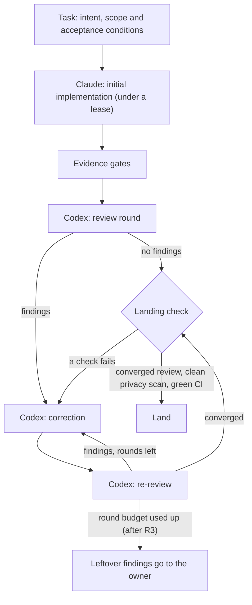
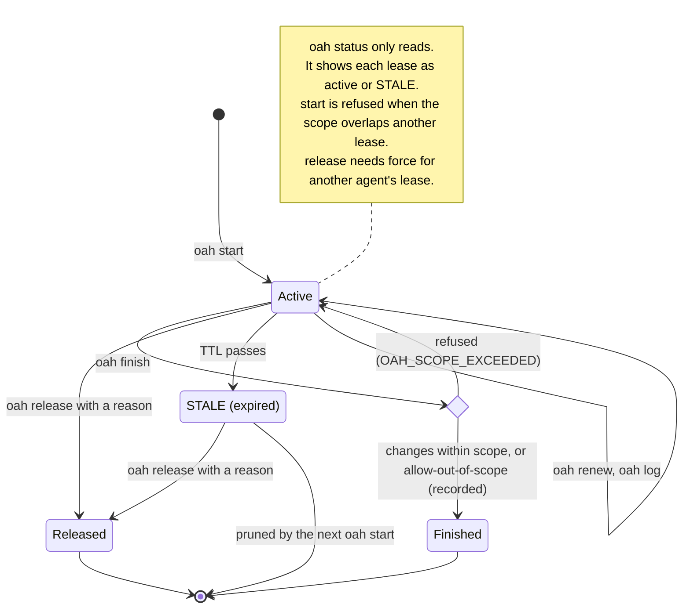
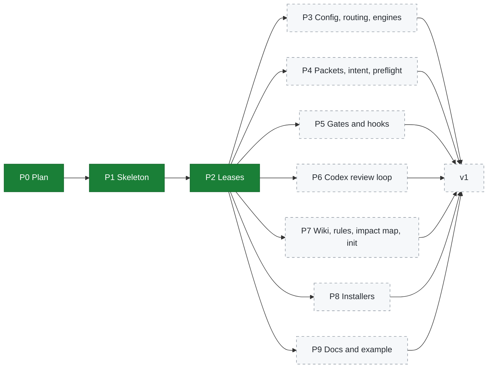

<p align="center">
  
</p>

<p align="center">
  <a href="../../actions/workflows/ci.yml"></a>
  <a href="LICENSE"></a>
  
  
</p>

# open-agent-harness (`oah`)

`oah` is a small command-line tool that makes **Claude Code** and **Codex CLI** work as one disciplined
team on your own repository. It is written for people who are starting to program with AI: you run one
install command and `oah init`, and you get a complete, working harness without assembling it yourself.
The problem it solves is simple to state. When two AI coding sessions share one repository, nothing stops
them from editing the same files, "done" means whatever the agent says, and reviews have no budget and
no proof. `oah` gives them a shared rulebook: Claude implements, Codex reviews and corrects in bounded
rounds, every claim of "done" is backed by evidence, and work lands only after the review converges.

> [!WARNING]
> **Developer preview. Not ready for general use yet.**
> Phases P0 to P2 are done: the plan, the project skeleton (`oah --version`, `oah doctor`, the privacy
> scan, CI on macOS and Windows) and leases. Phases P3 to P9 are in progress. Commands, file formats and
> this README will change. The one-command installer and `oah init` do not exist yet.

## Contents

- [How it works](#how-it-works)
- [What works today](#what-works-today)
- [Requirements and supported platforms](#requirements-and-supported-platforms)
- [Concepts](#concepts)
- [Roadmap](#roadmap)
- [Development](#development)
- [Security](#security)
- [License and third-party notices](#license-and-third-party-notices)
- [한국어 소개](#한국어-소개)

## How it works

`oah` is a Python 3.11+ program that uses only the standard library. It runs natively on macOS and
Windows (no WSL). It does not replace Claude Code or Codex. It drives them and keeps the records that
make their work trustworthy.

| Piece | What it does | Status |
|---|---|---|
| Workflow by stage | Claude does the initial implementation. Codex reviews, corrects and re-reviews. Landing happens only after convergence. | planned (P3, P6) |
| Leases | Parallel sessions and worktrees never edit the same files. | **works today** (P2) |
| Evidence gates | "Done" is a ledger of checks with evidence, not a sentence. | planned (P5) |
| Project wiki and impact map | An Obsidian-compatible wiki for project knowledge, and an impact map that is refreshed automatically. | planned (P7) |
| Tier agents | Difficulty picks the model and the effort, and the model list follows engine updates. | planned (P3, P7) |
| Skills | Skills are selected, updated and used automatically. | planned (P3, P7) |

### The workflow loop

This is the target design from [`docs/PLAN.md`](docs/PLAN.md) (sections 5.9 and 11). It is not built yet.



- **Rounds are bounded.** A review series stops at its round budget (three rounds by default). Extra
  rounds are possible only on request, and they are recorded.
- **Leftover findings go to the owner**, the person who runs `oah`. Nothing is silently dropped.
- **Landing needs three things:** a converged review, a clean privacy scan and green CI.

### The lease lifecycle

This diagram matches the code in [`src/oah/lease.py`](src/oah/lease.py) today.



- `oah start` creates an active lease. It is refused with `OAH_LEASE_CONFLICT` when its scope overlaps
  another lease. The scope `repo` overlaps everything.
- `oah renew` sets a new expiry and can replace the scope. It is refused on an expired lease
  (`OAH_LEASE_EXPIRED`). `oah log` appends a note to the event log and leaves the lease as it is.
- `oah status` is read-only. It takes no lock and creates no file.
- `oah finish` compares the files changed since the lease started (committed, staged, unstaged and
  untracked) with the scope. Files outside the scope refuse it with `OAH_SCOPE_EXCEEDED`, unless you
  pass `--allow-out-of-scope`, which is recorded.
- `oah release` needs `--reason`, and `--force` to release another agent's lease. Both are recorded.
- An expired lease shows as `STALE` in `oah status`. It is not deleted until the next `oah start` prunes it.
  Until then it cannot be renewed (`OAH_LEASE_EXPIRED`), but it can still be released, or finished with
  the same scope check.

## What works today

Everything in this section was run on macOS with Python 3.11 before it was written down.

### Install from a clone (for development)

Use the HTTPS URL from the repository's green **Code** button as `<repository-url>`.

macOS (zsh or bash):

```sh
git clone <repository-url> open-agent-harness
cd open-agent-harness
python3.11 -m venv .venv
source .venv/bin/activate
python -m pip install -e .
```

Windows (PowerShell):

```powershell
git clone <repository-url> open-agent-harness
cd open-agent-harness
py -3.11 -m venv .venv
.venv\Scripts\Activate.ps1
python -m pip install -e .
```

The Windows steps were not run for this README. CI runs the tests and `oah --version` on Windows for
pull requests that change code. If PowerShell refuses to run `Activate.ps1`, run
`Set-ExecutionPolicy -Scope Process -ExecutionPolicy RemoteSigned` in that window first, or use
`.venv\Scripts\activate.bat` from `cmd.exe`.

### Check the install

```console
$ oah --version
oah 0.1.0.dev0
```

`oah doctor` checks the tools `oah` needs and prints the official install command for anything that is
missing. It exits 0 with `DOCTOR_OK` when every required tool is present, and 1 with
`DOCTOR_MISSING required=<n>` otherwise. An excerpt (versions and one path shortened):

```console
$ oah doctor
oah doctor (macOS)
  TOOL      STATUS  VERSION  NOTE
  git       ok      …        version control
  python    ok      3.11.…   runs oah
  …
  codex     ok      …        review and correction; signed in
  …

DOCTOR_OK
```

Add `--json` for machine-readable output.

### Leases in a fresh repository

Make a throwaway repository and take a lease on `src`:

```sh
mkdir hello && cd hello
git init
echo "# hello" > README.md
git add README.md
git commit -m "first commit"
```

```console
$ oah start --task hello --agent claude --scope src
OAH_LEASE_STARTED task=hello agent=claude scope=src expires=2026-10-23T09:18:45.201080Z

$ oah status
active  task=hello agent=claude scope=src expires=2026-10-23T09:18:45.201080Z  worktree=…/hello

$ oah log --task hello --agent claude --message "starting on src"
OAH_NOTE_LOGGED task=hello
```

(path shortened in the `status` line.)

A second agent cannot take an overlapping scope. The refusal names the holder (path shortened):

```console
$ oah start --task other --agent codex --scope src/app.py
OAH_LEASE_CONFLICT: scope src/app.py overlaps task hello held by claude (scope src; expires 2026-10-23T09:18:45.201080Z; worktree …/hello)
```

Now create `src/app.py` and also `docs/notes.md`, which is outside the scope. `finish` refuses until the
scope covers every change:

```console
$ oah finish --task hello --agent claude --summary "add app"
OAH_SCOPE_EXCEEDED: changes outside scope src: docs/notes.md. Widen the scope with oah renew --scope, or pass --allow-out-of-scope (recorded)

$ oah renew --task hello --agent claude --scope src --scope docs
OAH_LEASE_RENEWED task=hello agent=claude scope=src,docs expires=2026-10-23T09:18:45.624862Z

$ oah finish --task hello --agent claude --summary "add app"
OAH_LEASE_FINISHED task=hello agent=claude changed=2
```

Releasing someone else's lease needs `--force` (path shortened in the first reply):

```console
$ oah start --task tidy --agent claude --scope README.md
OAH_LEASE_STARTED task=tidy agent=claude scope=README.md expires=2026-10-23T09:18:45.849786Z

$ oah release --task tidy --agent codex --reason "taking over"
OAH_LEASE_NOT_YOURS: task tidy held by claude (scope README.md; expires 2026-10-23T09:18:45.849786Z; worktree …/hello); pass --force to release it anyway

$ oah release --task tidy --agent codex --reason "taking over" --force
OAH_LEASE_RELEASED task=tidy holder=claude by=codex
```

An expired lease shows as `STALE`, and the next `start` prunes it (paths shortened):

```console
$ oah start --task quick --agent claude --scope tests --ttl-hours 0.0002
OAH_LEASE_STARTED task=quick agent=claude scope=tests expires=2026-10-23T05:18:46.779404Z

$ oah status
STALE   task=quick agent=claude scope=tests expires=2026-10-23T05:18:46.779404Z  worktree=…/hello

$ oah start --task next --agent claude --scope tests
OAH_LEASE_STARTED task=next agent=claude scope=tests expires=2026-10-23T09:18:47.715811Z

$ oah status
active  task=next agent=claude scope=tests expires=2026-10-23T09:18:47.715811Z  worktree=…/hello
```

Useful facts about leases:

| Fact | Value |
|---|---|
| Default lease time | 4 hours (`--ttl-hours`, above 0 and at most 168) |
| Where state lives | `oah/` inside the repository's git common directory, shared by every worktree and never shown in `git status`. `OAH_STATE_DIR` overrides it. |
| Event log | Every change is appended to `events.jsonl` next to `leases.json`. |
| Exit codes | `0` done, `1` refused (for example a conflict), `69` environment problem (for example not a git repository) |
| Task and agent names | Letters, digits, `.`, `_` and `-`. Up to 64 characters for a task and 32 for an agent. |

## Requirements and supported platforms

| | Requirement | Needed for |
|---|---|---|
| OS | **macOS 13+** or **Windows 11**, natively. No WSL. Windows 10 22H2 is best effort. Linux probably works but is not tested. | everything |
| Runtime | **Python 3.11+**. No third-party Python packages at runtime. | everything |
| Version control | **git** | everything |
| Engines | **Claude Code** and **Codex CLI**, installed and signed in by you | later phases (routing, `oah call`, review loop) |
| Gates | **unlazy**, which needs **Node.js** | later phases (gates and the Stop hook) |
| Optional | **uv** (recommended installer), **graphify** (knowledge graph), **gh** (pull requests from the terminal), **gitleaks** (secret scan before push) | convenience |

`oah doctor` already checks all of these. It counts Claude Code, Codex CLI, Node.js and unlazy as
required, because the planned workflow needs them.

## Concepts

**Leases** (works today). A lease says who is working on which paths of the repository, and until when.
`oah start` refuses a scope that overlaps another lease, so two sessions never edit the same files.
Nothing can intercept an editor's writes, so the scope is checked when you `finish`: changed files
outside the scope are refused unless you widen the scope or record an exception.

**Intent** (planned, P4). Every task carries one intent section: the problem, the desired outcome and
success conditions written as results. The same section goes to every stage, worker and reviewer, and a
changed goal raises its revision instead of starting a new one. Workers report each success condition as
met, unmet or deferred, with evidence.

**Gates** (planned, P5). A gate is a check with a command, an expected result and recorded evidence, in
the [unlazy](https://github.com/Leonxlnx/unlazy) ledger format. `oah finish` will refuse while the
task's gates are unmet. An optional Stop hook keeps a Claude Code session from ending with unmet gates.

**Review loop** (planned, P6). Codex reviews a clean snapshot of the branch head with the agent
instruction files removed, and a canary token shows that it read the snapshot. Every round leaves a
receipt, and the series stops at its round budget. Each receipt labels the review honestly: it is only
called independent when the reviewer wrote none of the commits.

## Roadmap

The full design is in [`docs/PLAN.md`](docs/PLAN.md). Section 11 lists the phases.



Green phases are done. Dashed phases are planned and being built in parallel now.

| Phase | Contents | Status |
|---|---|---|
| P0 | The plan ([`docs/PLAN.md`](docs/PLAN.md)) | done |
| P1 | Skeleton: `oah --version`, `oah doctor`, privacy scan, CI on macOS and Windows | done |
| P2 | Leases: `oah start`, `renew`, `status`, `finish`, `release`, `log` | done |
| P3 | Config, routing, engines and `oah call`; automatic model and effort by difficulty; a model catalog that follows engine updates; skill selection with an optional re-ranker | in progress |
| P4 | Packets, intent, preflight | in progress |
| P5 | Gates (unlazy), Stop hook, git hooks | in progress |
| P6 | Codex review loop with canary, receipts and a landing check | in progress |
| P7 | Wiki (Obsidian-compatible), rules block, impact map with a default SQL plugin, a toolkit of bundled skills and MCP templates with automatic skill updates, guided `oah init` onboarding | in progress |
| P8 | One-command installers, a guided tool installer that asks for consent, `oah doctor` tool checks | in progress |
| P9 | Full docs, the worked example `examples/hello-oah`, troubleshooting | in progress |

## Development

Run the tests with Python 3.11. Point `TMPDIR` at the git-ignored `.tmp/` folder so that every test
write stays inside the checkout. Create the folder first: Python ignores a `TMPDIR` that does not exist.

```sh
mkdir -p .tmp/test-tmp
TMPDIR="$PWD/.tmp/test-tmp" python3.11 -m unittest discover -s tests -t .
```

- **CI** runs the tests on macOS and Windows for every pull request to `main`. Pull requests that change
  only documentation skip the tests.
- **Secret scan.** A separate workflow runs on every pull request and every push, documentation
  included. It runs gitleaks over the full history and the privacy scan, and any finding fails it.
- **Before every push**, run the privacy scan with gitleaks required. It must print `PRIVACY_SCAN_CLEAN`.

```sh
python3 tools/privacy_scan.py --gitleaks require
```

- Commits record which engine wrote them with an `Agent-Engine: claude|codex|human` trailer.

## Security

**The hard rule.** No API key, token, password, cookie, OAuth secret or account identifier ever enters
this repository, its history, releases, issues or CI logs.

- Keys are read only at runtime, from environment variables or the OS keychain, through one documented
  lookup. When a key is missing, the feature stays off and reports `unused(no key)`.
- Templates use `${ENV_VAR}` placeholders only.
- gitleaks and the privacy scan run before every push. They also run in CI on every pull request and every
  push, over the full history, and any finding fails the build.
- Keep your own keys in your environment or your keychain, never in project files.

**철칙.** API 키, 토큰, 비밀번호, 쿠키, OAuth 시크릿, 계정 식별자는 이 저장소와 그 이력, 릴리스, 이슈, CI
로그 어디에도 들어가지 않는다.

- 키는 실행할 때만 환경 변수나 OS 키체인에서, 문서로 정한 한 가지 조회 경로로 읽는다. 키가 없으면 그 기능은
  꺼진 채로 두고 `unused(no key)` 라고 알린다.
- 템플릿에는 `${ENV_VAR}` 자리표시자만 쓴다.
- gitleaks 와 개인정보 스캔은 push 전마다 돈다. CI 에서도 모든 pull request 와 push 마다 전체 이력을 대상으로
  돌고, 하나라도 걸리면 빌드가 실패한다.
- 내 키는 내 환경 변수나 키체인에만 두고, 프로젝트 파일에는 절대 넣지 않는다.

## License and third-party notices

`oah` is released under the [MIT License](LICENSE), copyright open-agent-harness contributors.
It vendors no third-party code yet. Bundled skills will ship unchanged with their own licenses, and only where
those licenses allow it. The tools it runs or links to, such as unlazy, graphify, Claude Code and Codex CLI,
are listed with their licenses in [`THIRD_PARTY_NOTICES.md`](THIRD_PARTY_NOTICES.md).

---

## 한국어 소개

### oah 는 무엇인가

`oah` 는 **Claude Code** 와 **Codex CLI** 를 내 저장소에서 규율 있는 한 팀처럼 일하게 해 주는 작은 명령줄
도구다. AI 로 프로그래밍을 막 시작한 사람을 먼저 생각하고 만든다. 설치 명령 하나와 `oah init` 만 실행하면
완성된 하네스가 자동으로 갖춰지는 것이 목표다.

두 AI 코딩 세션이 한 저장소를 함께 쓰면 같은 파일을 동시에 고치는 일을 막을 장치가 없고, "끝났다" 는 에이전트의
말뿐이며, 리뷰에는 횟수 제한도 증거도 없다. `oah` 는 둘에게 같은 규칙을 준다. Claude 가 1차 구현을 하고,
Codex 가 정해진 라운드 안에서 리뷰하고 고치고 다시 리뷰한다. "끝났다" 는 주장은 증거로 뒷받침하고, 리뷰가
수렴한 뒤에만 작업을 반영한다.

### 현재 상태

> [!WARNING]
> **개발자 미리보기다. 아직 일반 사용에는 준비되지 않았다.**
> P0~P2 는 끝났다. 계획, 프로젝트 뼈대(`oah --version`, `oah doctor`, 개인정보 스캔, macOS·Windows CI),
> 리스가 여기에 들어간다. P3~P9 는 지금 진행 중이다. 명령, 파일 형식, 이 문서는 바뀔 수 있다. 원클릭 설치
> 프로그램과 `oah init` 은 아직 없다.

### 지금 되는 것

- **클론해서 개발용으로 설치.** 위 [What works today](#what-works-today) 의 명령을 따른다. `<repository-url>` 에는 저장소의 초록색 **Code** 버튼에 있는 HTTPS 주소를 넣는다. macOS 는
  `source .venv/bin/activate`, Windows PowerShell 은 `.venv\Scripts\Activate.ps1` 로 가상 환경을 켠 뒤
  `python -m pip install -e .` 를 실행한다.
- **`oah --version`** 은 버전을 출력한다.
- **`oah doctor`** 는 필요한 도구가 설치됐는지 확인하고, 빠진 도구에는 공식 설치 명령을 알려 준다.
- **리스 명령.** `oah start`, `renew`, `status`, `finish`, `release`, `log` 가 동작한다. 실행 예시는 위
  영어 절에 있다.

| 명령 | 하는 일 |
|---|---|
| `oah start` | 경로에 리스를 잡는다. 다른 리스와 범위가 겹치면 `OAH_LEASE_CONFLICT` 로 거절한다. |
| `oah renew` | 만료 시각을 늘리고, 원하면 범위를 바꾼다. 이미 만료된 리스는 거절한다. |
| `oah status` | 활성 리스와 만료된(STALE) 리스를 보여 준다. 읽기만 한다. |
| `oah finish` | 바뀐 파일을 범위와 비교한다. 범위 밖 파일이 있으면 `--allow-out-of-scope` 없이는 `OAH_SCOPE_EXCEEDED` 로 거절한다. |
| `oah release` | 리스를 끝내지 않고 내려놓는다. `--reason` 이 필요하고, 다른 에이전트의 리스에는 `--force` 도 필요하다. |
| `oah log` | 이벤트 로그에 메모를 남긴다. |

만료된 리스는 `oah status` 에 STALE 로 보이고, 다음 `oah start` 가 정리한다.

### 요구 사항

| 항목 | 내용 |
|---|---|
| 운영체제 | macOS 13 이상, Windows 11 네이티브(WSL 불필요). Windows 10 22H2 는 최선 지원이다. |
| 런타임 | Python 3.11 이상. 실행에 외부 파이썬 패키지가 필요 없다. |
| 버전 관리 | git |
| 엔진 | Claude Code, Codex CLI. 이후 단계(라우팅, `oah call`, 리뷰 루프)에 필요하다. |
| 게이트 | unlazy 와 Node.js. 이후 단계(게이트, Stop 훅)에 필요하다. |
| 선택 | uv, graphify, gh, gitleaks |

### 핵심 개념

- **리스(지금 동작).** 누가 저장소의 어느 경로를 언제까지 작업하는지 기록한다. 겹치는 범위는 시작할 때
  거절하므로 두 세션이 같은 파일을 고치지 않는다. 범위는 `finish` 할 때 실제 변경 파일과 다시 대조한다.
- **의도(계획, P4).** 모든 작업은 문제, 바라는 결과, 결과 기준의 성공 조건을 담은 의도 절 하나를 가진다. 이
  절은 모든 단계와 워커, 리뷰어에게 그대로 전달되고, 목표가 바뀌면 새 의도를 만들지 않고 개정 번호만 올린다.
- **게이트(계획, P5).** 명령, 기대 결과, 기록된 증거로 이루어진 확인 항목이다. unlazy 원장 형식을 쓰며,
  게이트가 충족되지 않으면 `oah finish` 가 거절하게 된다.
- **리뷰 루프(계획, P6).** Codex 가 에이전트 지시 파일을 뺀 깨끗한 스냅샷을 리뷰하고, 카나리 토큰으로
  스냅샷을 읽었음을 보인다. 라운드마다 영수증을 남기고, 정해진 라운드 수에서 멈추며, 남은 지적은 소유자에게
  넘긴다.

### 보안

API 키, 토큰, 비밀번호, 쿠키, OAuth 시크릿, 계정 식별자는 저장소와 그 이력, 릴리스, 이슈, CI 로그 어디에도
들어가지 않는다. 키는 실행할 때만 환경 변수나 OS 키체인에서 읽고, 키가 없으면 기능을 끈 채 `unused(no key)`
라고 알린다. 템플릿에는 `${ENV_VAR}` 자리표시자만 쓴다. 자세한 내용은 위 [Security](#security) 절에 있다.

### 라이선스

MIT 라이선스로 배포한다. 함께 쓰는 외부 도구와 그 라이선스는
[`THIRD_PARTY_NOTICES.md`](THIRD_PARTY_NOTICES.md) 에 있다.
