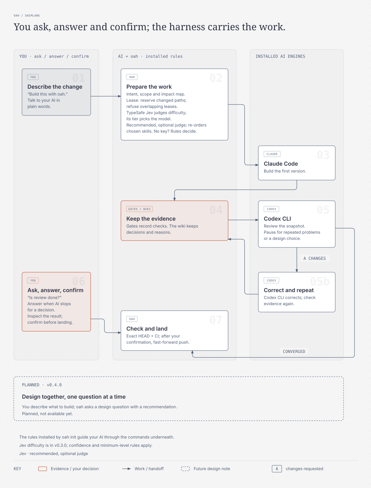
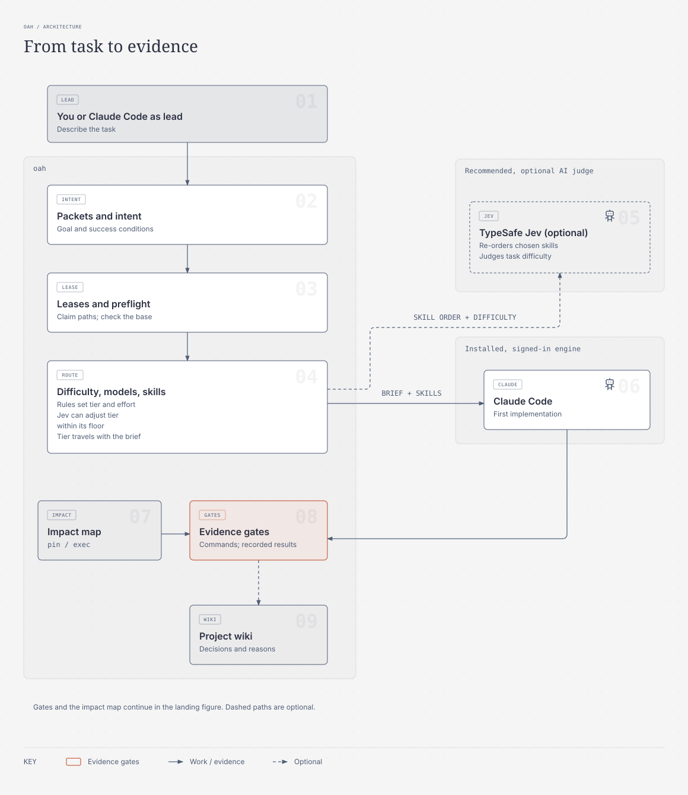
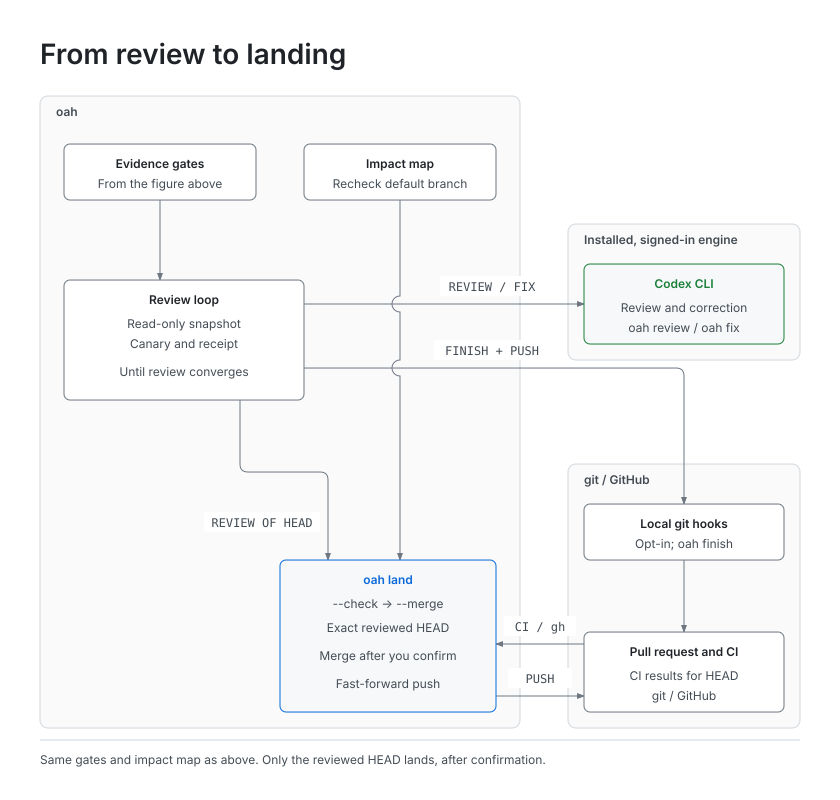
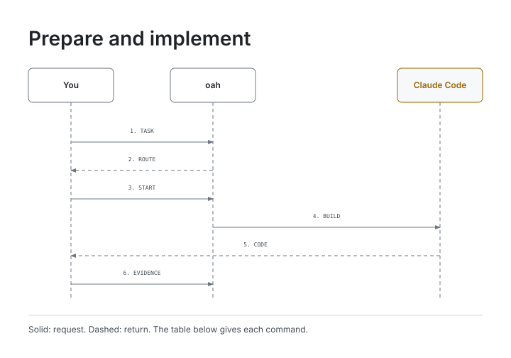
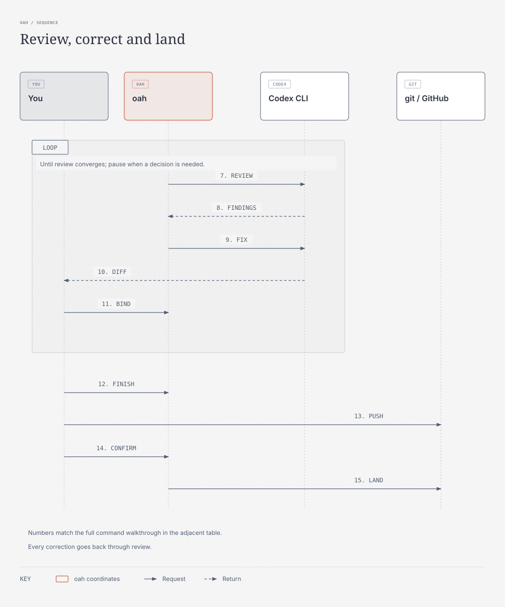

# How it works

[README](../README.md) · [Commands](commands.md) · [한국어](ko/how-it-works.md)

`oah` is a small command-line tool that makes Claude Code and Codex CLI work as one team on your own
repository, with TypeSafe Jev as a recommended, optional judge. It is for developers and small teams who already
use git and pull requests and want production-grade review discipline on their own machine. It was made
first of all for people dissatisfied with AI coding results or setting up their first harness. The released
version still expects familiarity with git and pull requests.

It runs on Python 3.11+ with the standard library only, natively on macOS and Windows, without WSL.
It drives Claude Code and Codex and keeps their work records; you install and sign in to those engines yourself.

## How the parts fit

A **packet** is the written task and its success conditions. A **lease** reserves the paths
that task changes; an overlapping lease is refused. **Gates** are commands that check success and record evidence. The **impact map**
lists what a change could affect and what to re-check. The **project wiki** keeps decisions and their reasons
beside the code. A **tier** is a difficulty level that guides model choice and reasoning effort; **skills**
are instructions loaded by the AI. **CI** is the automated testing attached to a push or pull request.
**HEAD** is the current commit, the exact version being checked.

<picture>
  <source media="(prefers-color-scheme: dark)" srcset="assets/how-it-works-dark.svg">
  
</picture>

Two AI sessions can edit the same files, call work done without evidence, or keep reviewing without an
ending rule. oah gives them a shared rulebook. The two architecture figures below show all the parts
and their connections; the table explains them. Evidence gates and the impact map appear in both figures
to connect preparation with review and landing. Dashed arrows mark optional connections.

<picture>
  <source media="(prefers-color-scheme: dark)" srcset="assets/architecture-build-dark.svg">
  
</picture>

<picture>
  <source media="(prefers-color-scheme: dark)" srcset="assets/architecture-land-dark.svg">
  
</picture>

| Part | How it connects to the work |
|---|---|
| You, or your Claude Code session as lead | Write the packet and its intent: the goal and success conditions. The intent travels unchanged into the lease and every stage's brief. |
| Leases and preflight | Reserve the paths the task changes after checking the base is fresh; overlapping leases are refused. |
| Difficulty, models and skills | Readable rules score the task and choose a tier, model, effort and skills. Claude receives that brief, tier and skills. Recommended, optional Jev judgements are described below. |
| Claude Code | Writes the first implementation, which then needs evidence gates. |
| Evidence gates | Commands and recorded results prove completion before review. The impact map's `pin` and `exec` bindings identify gates that name or run a changed file. |
| Project wiki | Keeps the decisions from the work and its evidence. When the configured wiki folder exists, `oah finish` checks its maintenance record. |
| Codex CLI and the review loop | `oah review` uses a clean, read-only snapshot, a canary that proves the reviewer could read it and a receipt of the findings. `oah fix` corrects those findings, then review repeats until convergence or a decision is needed. A round limit is optional. |
| Local git hooks, opt-in | After `oah finish`, the user's `git push` passes through any installed hooks to the pull request and CI on GitHub. |
| git and GitHub | Hold the pull request and CI results for HEAD. `gh` reads those results for landing. |
| Impact map at landing | Reassesses the default branch as well as identifying gates to re-run. |
| Landing | `oah land --check` checks the converged review of HEAD, CI and other evidence. `oah land --merge` fast-forwards and pushes the default branch to that exact reviewed head only after you confirm. |
| Model and skill updates | Follow upstream changes, checking and recording each change. |

## Jev, the optional judge

TypeSafe Jev is the recommended, optional judge. `oah init` asks once whether to enable it; you can also enable
it later in the config. It needs your own TypeSafe account and key. Without it, fixed rules decide.
`oah doctor` does not check Jev's state; ranking results say `rerank=used` or `rerank=unused(<reason>)`.

- **Ranking:** Jev re-orders the closed skill list produced by the rules. It never adds or drops a
  candidate. Impact-result re-ranking remains planned, not a shipped feature.
- **Difficulty on main, not released yet:** Jev judges the accepted Intent and Scope paths. A confident
  answer may change the tier, never below its floor. With Jev off, an error or low confidence, the rules
  decide and the call is not blocked by Jev. [Difficulty details](concepts.md#jev-judges-difficulty) explains
  what is sent, privacy checks, explicit tier overrides and the recorded result.
- **Model choice:** Jev can choose a model and effort only from candidates the rules allow, subject to
  model pins, qualified pools, supported effort and the task's minimum requirements. It cannot invent a
  candidate or bypass the floor. [Routing](concepts.md#routing-and-difficulty) and
  [model selection on main](concepts.md#how-a-model-is-chosen) describe the current choices and limits.

The [v0.3.0 roadmap](../README.md#roadmap) remains a release plan. Features already on main are identified
as unreleased; their presence there does not make them available in v0.2.0.

## Strengths

- **Engines by stage.** Claude Code writes the first version; Codex CLI reviews, corrects and re-reviews. A call
  for the wrong engine at a stage is refused (`OAH_STAGE_ENGINE_MISMATCH`) unless you override it, and the
  override is recorded.
- **Difficulty picks the model and effort.** Fixed rules score four axes and choose a tier; optional Jev judging on main can adjust it within its floor; an effort the CLI
  cannot prove is recorded as unverified, and a lower launch effort fails (`OAH_EFFORT_DOWNGRADED`).
- **Skills chosen for the task,** each with a reason. The recommended, optional judge, TypeSafe Jev, only re-orders that list.
- **An impact map** lists the gates and commands that pin or run a changed file, so you re-run exactly those.
- **A project wiki** records decisions next to the code, and `oah finish` checks that it was maintained.
- **Evidence gates.** A task is done when its gates pass with recorded evidence, not when an agent says so.
  Gates watch repository files and the run environment only. They do not notice changes to external services or
  ignored untracked files, so check those separately.
- **Intent that travels** from the packet into the lease and the brief of every call.
- **Leases** reserve the paths a task changes and refuse overlapping leases. **Preflight** checks that the base is fresh.
- **Reviews that converge.** Codex reviews a read-only snapshot, corrections are bound to their findings, and a
  repeat or a design question stops for your decision.
- **No secrets in the repository.** Keys are read at runtime only; `oah land` requires a gitleaks scan.
- **A toolkit with provenance** for skills and MCP templates, with exact pins and safe updates.
- **Easy setup:** one-command installers, `oah doctor`, and a guided `oah init` that shows its plan first.

## Beginner mistakes oah guards against

| Mistake | What oah does |
|---|---|
| Committing an API key | `oah init` adds `.env`, `*.pem`, `*.key` and similar to `.gitignore`; the opt-in pre-push hook scans pushed commits only when gitleaks is installed, otherwise warns and permits an unscanned push; `oah land` refuses without a scan (`OAH_LAND_SCAN_REQUIRED`). |
| Starting on a stale branch | `oah preflight` aborts when the base is behind and says which `git rebase` to run. |
| Starting with uncommitted changes | `oah preflight` warns, lists the files and allows proceeding if no other check aborts. |
| Two AI sessions on the same files | `oah start` refuses an overlapping lease (`OAH_LEASE_CONFLICT`); `oah finish` compares the real changes with the scope (`OAH_SCOPE_EXCEEDED`). |
| Pushing in the middle of a task | The opt-in pre-push hook refuses while any lease, active or stale, is recorded for this worktree (`OAH_PUSH_REFUSED`). |
| Letting an agent push or force-push | The shared rules block tells agents not to; landing is a command you confirm. |
| Calling work "done" with no evidence | `oah finish` and the Stop hook refuse unmet gates (`OAH_GATES_UNMET`). |
| Not knowing what a change breaks | `oah impact --changed-since` lists what to re-check, including untracked files, with `re-run:` lines. |
| Merging without review or CI | `oah land --check` checks the lease, intent, review, gates, impact, required checks, fast-forward, a gitleaks scan and CI at the exact head. Unverified CI blocks (`OAH_LAND_CI_UNVERIFIED`) unless you record an explicit exception. |
| Losing track of why a change was made | Packets keep the intent, review receipts keep the findings, and the wiki keeps the decisions. |
| No CI, or CI on one OS only | `oah ci init` writes a starter workflow for the runners you choose (macOS, Windows, Linux), after you confirm. |

## First run

Inside your project (a git repository with a remote), run the guided setup:

```sh
oah init
```

`oah init` first asks once about each option: tier agents, hooks, unlazy (the gate checker), the knowledge
graph, the CI starter, the companion apps Orca and Aside, the TypeSafe Jev re-ranker and automatic skill
updates. Then inspect the complete plan and confirm the changes before they are applied. It:

- checks every tool and installs only what you confirm;
- checks your Claude Code and Codex sign-ins with their own status commands, and shows the command to run
  when one is missing;
- writes `.oah/config.toml`, the rules block in `AGENTS.md` (imported by `CLAUDE.md`), the wiki in
  `docs/wiki/`, templates in `.oah/templates/` and `.gitignore` entries for local secret files;
- builds the first impact map.

A second run writes only what is still missing. Each question also has a flag, such as `--with-unlazy` or
`--without-ci`, so you can answer without a prompt. Commit what it wrote, then follow the worked example.

**Your first task:** [`examples/hello-oah`](../examples/hello-oah/README.md) walks one small task through the
whole loop with real commands, in about 20 minutes.

## The loop

Ask your AI in plain words in the project; the installed rules and each command’s next-step
message guide it through the commands below.
You ask about the result, answer when a repeated problem or design choice stops the loop, and confirm before landing.
The tables show what runs underneath that conversation; where a row says “you”, your AI usually runs it for you.

### Prepare and implement

<picture>
  <source media="(prefers-color-scheme: dark)" srcset="assets/loop-start-dark.svg">
  
</picture>

| Exchange | What happens |
|---|---|
| 1.<br>Task | You run `oah packet new T` and write the intent and gates. |
| 2.<br>Route | oah provides the tier, model, effort and skills for each stage. |
| 3.<br>Start | You run `oah preflight`, then `oah start --packet`. |
| 4.<br>Build | `oah call claude --stage initial` sends the work to Claude Code. |
| 5.<br>Code | Claude returns the implementation to you. |
| 6.<br>Evidence | You run `oah wiki maintain`, then `oah gates check --approve`, then commit. |

### Review, correct and land

<picture>
  <source media="(prefers-color-scheme: dark)" srcset="assets/loop-review-dark.svg">
  
</picture>

| Exchange | What happens |
|---|---|
| 7.<br>Review | `oah review` sends Codex a clean, read-only snapshot. |
| 8.<br>Findings | Codex returns a receipt with its verdict and findings. |
| 9.<br>Fix | `oah fix` asks Codex to correct P0 and P1 findings. |
| 10.<br>Diff | Codex returns a diff for you to inspect. |
| 11.<br>Bind | Maintain the wiki, run approved gates, commit, then `oah fix --bind`. Repeat review until it converges; a repeated problem or design question stops for your decision. |
| 12.<br>Finish | `oah finish` checks scope, gates, wiki and the return. |
| 13.<br>Push | You push and open a pull request. |
| 14.<br>Confirm | Run `oah land --check`, then `oah land --merge` after you confirm. |
| 15.<br>Land | oah fast-forwards the default branch to the reviewed head. |

### Commands and guarantees

| Step | Commands | What it guarantees |
|---|---|---|
| Describe the task | `oah packet new`, `oah packet check`, `oah gates new` | The goal and its success conditions are written and accepted before work starts. |
| Start safely | `oah preflight`, `oah start --packet` | Your branch is fresh, and no other session holds your paths. |
| Implement | `oah call claude --stage initial`, or your own Claude Code session | Claude works from the packet, with the tier's model, effort and skills. |
| Prove it | `oah wiki maintain`, `oah gates check --approve`, commit | Every success condition has a command and recorded evidence. |
| Review and correct | `oah review`, `oah fix`, `oah fix --bind` | Codex reviews until the review converges; each round leaves a receipt. |
| Finish | `oah finish --return` | Changes stayed in scope, gates are met, and the return matches the intent. |
| Land | `oah land --check`, `oah land --merge` | The exact reviewed head lands after a secret scan and CI verification (or a recorded CI exception), when you confirm. |

Maintain the wiki, run the final approved gate check and commit in that order, including after every
correction. Unverified CI blocks landing by default: missing `gh`, no CI results, or a required check
missing for HEAD produces `OAH_LAND_CI_UNVERIFIED`. To accept that risk, pass
`--accept-unverified-ci "<reason>"` to `oah land --check` and `oah land --merge`. The exception and reason
are recorded for that exact head; CI stays `unverified` and never counts as a pass. Failed or pending CI
still blocks landing. See [Landing](concepts.md#landing) for the target branch’s CI policy.

[Concepts](concepts.md) explains each step; [Troubleshooting](troubleshooting.md) explains each
refusal.

## Requirements

| | Requirement | Needed for |
|---|---|---|
| OS | **macOS 13+** or **Windows 11**, natively; no WSL. Windows 10 22H2 is best effort. Linux is not yet supported. | everything |
| Runtime | **Python 3.11+**. No third-party Python packages at runtime. | everything |
| Version control | **git**, and a remote such as a GitHub repository | everything |
| Engines | **Claude Code** and **Codex CLI**, installed and signed in by you | implementation, review and correction |
| Gates | **unlazy**, which needs **Node.js** | gates and the Stop hook |
| Landing | **gitleaks**, and **gh** for reading CI results | `oah land` |
| Optional | **uv** (recommended installer), **graphify** (knowledge graph), **TypeSafe Jev** (needs a TypeSafe account and key), **Orca** and **Aside** (companion apps) | convenience |

`oah doctor` checks every tool in this table except Jev, and prints the official install command for anything
missing. Jev's state shows in every `rerank=` result instead.

## Adapting the harness

`oah` is not meant to be the one perfect harness that everyone adopts as is. It is a worked reference and a
guideline for building a development environment that fits you and keeps changing as AI changes.

A harness is set up once and then usually left alone, while the models and skills under it keep improving. Rules
and skills that helped an older model can hold a newer one back from its full ability, and outdated skills can make
results worse. A good harness flows like water: it keeps up with each new model, drops skills that are no longer
needed, adds the ones that are, and changes its rules to match.

- **Adapt the parts you need.** If you already use other AI tools or another harness, read how `oah` handles
  leases, engine stages, evidence gates, the impact map, the wiki and the review loop, and carry over only the
  ideas that fit your tools. The rules are written down in [the plan](PLAN.md) so they can be copied
  as ideas, not only as code.
- **Or follow it and make it yours.** If you start from `oah` as it is, treat it as a starting point: change the
  config, the stages and the rules to match your own goals, and grow your own project wiki and impact map as your
  code grows. The harness you end up with should be yours, not a copy of ours.
- **Keep updating it.** Review your models, skills and rules as the tools change. Remove what no longer helps and
  add what does. `oah` keeps updating too, so that its users can adapt to a changing AI environment together.

So `oah` prefers defaults you can understand and change over checks you cannot turn off. When a rule gets in
the way of your work or of a newer model, the project treats that as a design problem to fix.

## Development

Run the tests with Python 3.11, and again with the newest Python you have. Point `TMPDIR` at the git-ignored
`.tmp/` folder so every test write stays inside the checkout. Create the folder first: Python ignores a
`TMPDIR` that does not exist.

```sh
mkdir -p .tmp/test-tmp
TMPDIR="$PWD/.tmp/test-tmp" python3.11 -m unittest discover -s tests -t .
```

- **CI** runs the tests on macOS and Windows for every pull request to `main`. Pull requests that change only
  documentation skip the tests.
- **Secret scan.** A separate workflow runs gitleaks over the full history and the privacy scan on every pull
  request and every push, documentation included. Any finding fails it.
- **Before every push**, run the privacy scan with gitleaks required. It must print `PRIVACY_SCAN_CLEAN`:

  ```sh
  python3 tools/privacy_scan.py --gitleaks require
  ```

- Commits record which engine wrote them with an `Agent-Engine: claude|codex|human` trailer.

## Security

**The hard rule.** No API key, token, password, cookie, OAuth secret or account identifier ever enters this
repository, its history, releases, issues or CI logs.

- Keys are read only at runtime, from environment variables or the OS keychain, through one documented
  lookup. When a key is missing, the feature stays off and reports `unused(no key)`.
- Templates use `${ENV_VAR}` placeholders only.
- gitleaks and the privacy scan run before every push, and in CI on every pull request and every push, over
  the full history. Any finding fails the build.
- Keep your own keys in your environment or your keychain, never in project files. [Keys](keys.md) says
  how.

