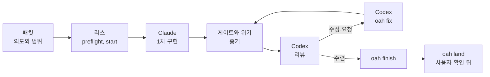
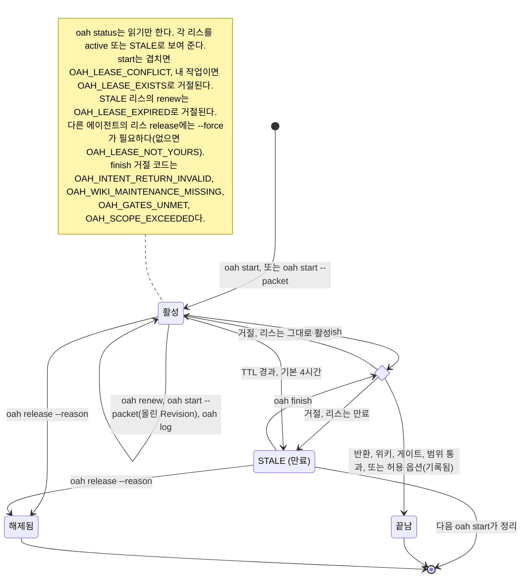
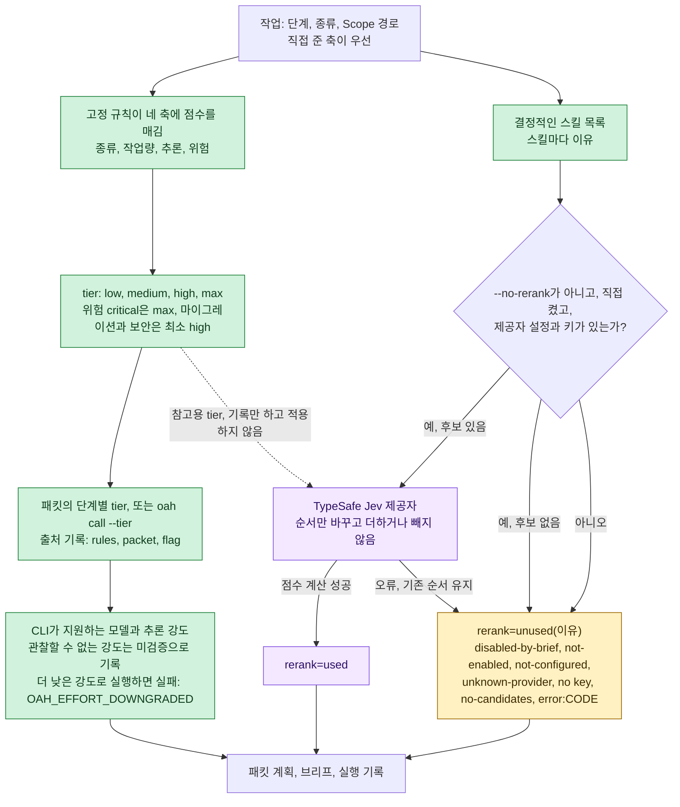
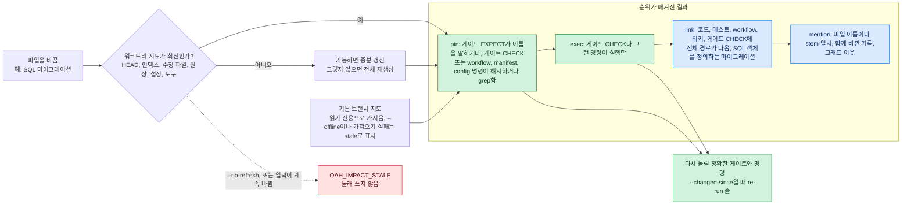
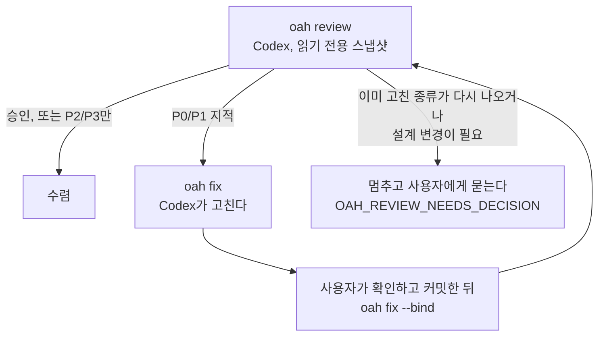
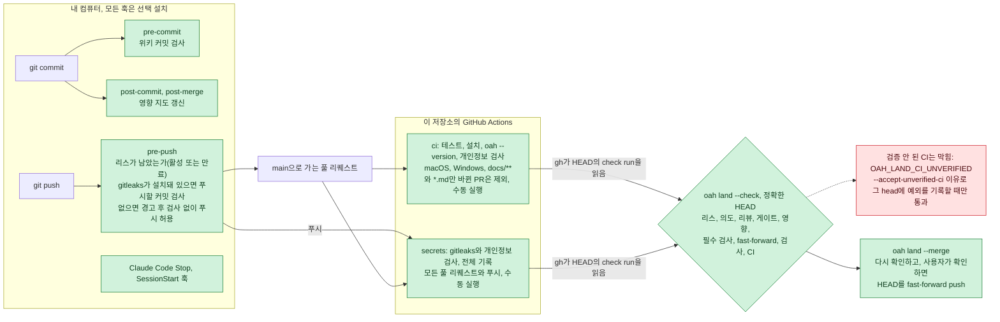

# 개념

이 문서는 `oah` 명령 뒤에 있는 생각을 설명한다. 각 명령이 어떤 문제를 풀고 무엇을 확인하는지다. 명령을 순서대로
따라 하려면 예제 [`examples/hello-oah`](../../examples/hello-oah/README.ko.md)를 본다. 명령이 거절하면
[문제 해결](troubleshooting.md)을 본다.

[English](../concepts.md)

## 목차

- [전체 흐름](#전체-흐름)
- [리스](#리스)
- [패킷과 의도](#패킷과-의도)
- [라우팅과 난이도](#라우팅과-난이도)
- [스킬 선택](#스킬-선택)
- [영향 지도](#영향-지도)
- [프로젝트 위키](#프로젝트-위키)
- [게이트](#게이트)
- [리뷰 루프와 수정](#리뷰-루프와-수정)
- [반영](#반영)
- [모델과 스킬 업데이트](#모델과-스킬-업데이트)
- [툴킷](#툴킷)
- [내 프로젝트의 CI](#내-프로젝트의-ci)
- [동반 앱 Orca와 Aside](#동반-앱-orca와-aside)

## 전체 흐름



모든 작업은 같은 길을 간다. **패킷**에 작업을 적고, 바꿀 경로에 **리스**를 잡고, **Claude Code**가 구현하고,
**게이트**로 증명하고, 리뷰가 수렴할 때까지 **Codex**가 리뷰하고 고치고 다시 리뷰한다. `oah finish`가 리스를
닫고, `oah land`는 사용자가 확인한 뒤 리뷰한 커밋 그대로 기본 브랜치에 반영한다.

어느 단계를 어느 엔진이 맡을지는 `.oah/config.toml`에 적혀 있다.

```toml
[stages]
initial = "claude"
review = "codex"
correction = "codex"
```

단계에 맞지 않는 엔진을 부르면 `oah call`이 `OAH_STAGE_ENGINE_MISMATCH`로 거절한다. `--override-stage`를 주면
실행하고 그 사실을 기록한다.

## 리스

AI 세션 둘이 한 저장소를 함께 쓰면 같은 파일을 쉽게 동시에 고친다. **리스**는 작업 하나가 경로 묶음을 쓰겠다고
선언하는 것이다. 그래서 실수로 겹치는 일이 없다.

- `oah start --task T --agent A --scope PATH…`로 리스를 잡는다. 다른 리스와 겹치는 범위는
  `OAH_LEASE_CONFLICT`로 거절하고 누가 잡고 있는지 알려 준다. 범위 `repo`는 저장소 전체를 뜻한다.
- `oah start --packet PACKET.md`는 패킷에서 범위를 가져오고 같은 단계에서 의도를 묶는다.
- `oah status`는 모든 리스를 active나 `STALE`로 보여 준다. 읽기만 한다.
- `oah renew`는 리스를 연장하고 범위를 바꿀 수 있다. `oah release --reason`은 끝내지 않고 내려놓는다.
- `oah finish`는 리스를 잡은 뒤 실제로 바뀐 파일을 범위와 대조한다. 리스가 편집기의 쓰기를 막을 수는 없으므로
  `finish`가 실제로 일어난 일을 확인한다.
- 리스는 기본 4시간 동안 유효하다(`--ttl-hours`, 최대 168). 만료된 리스는 `STALE`로 보이고 다음 `oah start`가
  정리한다.

리스 상태는 저장소 git 폴더 안의 `oah/`에 있다. 모든 워크트리가 함께 보고 `git status`에는 나오지 않는다.

**워커는 사용자의 리스를 쓴다.** `oah call`이 띄운 워커는 `OAH_WORKER=1`로 실행되고 리스를 잡거나 연장하거나
내려놓거나 끝내지 않는다(`OAH_WORKER_LEASE_REFUSED`). 구현과 수정 워커는 사용자가 리스를 잡은 워크트리에서
돌고, 읽기만 하는 리뷰는 어디서 돌아도 된다.



## 패킷과 의도

**패킷**(`.oah/tasks/<task>/PACKET.md`)에는 작업 하나에 관한 모든 것이 들어 있다. 의도, 범위, 계획, 완료 게이트,
보고 형식이다. `oah packet new <task>`가 템플릿으로 만들고 `oah packet check <task>`가 무엇이 빠졌는지 알려 준다.

**의도** 절은 목표를 적는 유일한 자리다.

- **Problem**, **Desired outcome**, **Success conditions**(`AC1`, `AC2`, …)로 이뤄진다. 성공 조건은 확인할 수
  있는 결과여야 하고 과정 단계여서는 안 된다.
- 사용자가 승인하기 전까지는 `Status: draft`다. 초안은 리스에 묶을 수 없다(`OAH_INTENT_NOT_ACCEPTED`).
- `Intent-ID`는 바뀌지 않는다. 목표가 바뀌면 `Revision`을 올리고 다시 승인해 다시 묶는다.

의도는 모든 단계와 워커, 리뷰어에게 **바이트 그대로** 가고 그 다이제스트가 기록된다. `oah intent show <task>`는
상태를 `current`, `stale`, `missing`, `unbound` 가운데 하나로 보여 준다. 모든 보고는
`INTENT <id>@r<n> <digest>` 한 줄과 성공 조건마다 `AC<n>: met|unmet|deferred — <근거>` 한 줄로 끝난다.
`oah finish --return`과 리뷰 라운드마다 이 줄을 결속과 대조한다.

**사전 점검**(`oah preflight --task T`)은 시작하기 전에 돈다. 브랜치가 기본 브랜치보다 뒤처졌거나 다른 리스가
내 경로를 잡고 있으면 멈추고, 작업 트리가 더럽거나 내 범위를 건드린 새 커밋이 있으면 경고한다. 마지막에는
무엇을 증명하지 않았는지 목록으로 밝힌다.

## 라우팅과 난이도

작업마다 `low`, `medium`, `high`, `max` 가운데 하나인 **tier**가 붙고, tier가 엔진마다 모델과 추론 강도를 정한다.

- **규칙이 네 축에 점수를 매긴다.** 종류(`docs`, `implementation`, `migration` 등), 작업량, 추론, 위험이다.
  `oah recommend`가 점수를 보여 준다. 위험이 `critical`이면 `max`이고 마이그레이션과 보안 작업은 최소 `high`다.
- `oah packet new`는 작업에 점수를 매기고 단계별 경로를 패킷의 `## Plan`에 쓴다. 이 명령에는 `--tier` 옵션이
  없다. 패킷의 tier를 바꾸려면 생성된 계획을 고친다.
- `oah call`은 패킷에 해당 단계의 tier가 있으면 쓰고, 없으면 규칙을 따른다. 호출 시 `--tier` 옵션으로 그 실행의
  선택을 바꿀 수 있다. 라우팅과 재정의는 실행 상태에 기록하며 패킷을 다시 쓰지 않는다.
- **추론 강도는 모델이 지원하는 만큼이고 고정 상한이 없다.** tier의 강도는 엔진이 그 모델에 대해 밝힌 단계
  가운데 하나다. `highest`는 Codex가 해당 모델에 대해 밝힌 가장 높은 추론 단계다. Codex가 단계를 알려 주지 않았으면
  짐작하지 않고 `OAH_EFFORT_METADATA_MISSING`으로 거절한다.
- **강도는 검증하고 몰래 낮추지 않는다.** Codex 헤더가 요청보다 낮은 강도를 보고하면 실행은
  `OAH_EFFORT_DOWNGRADED`로 실패한다. Claude Code처럼 관측할 수 없는 강도는 `unverified`로 기록한다.
- 실행 기록마다 네 축, tier와 그 출처(`rules`, `packet`, `flag`), 요청한 모델과 강도, 실제로 쓴 모델과 강도가 남는다.

선택 기능인 TypeSafe Jev 재정렬기가 tier에 의견을 더할 수 있다. 의견은 규칙 결과 옆에 기록되고 tier를 낮추지는
않는다.



## 스킬 선택

스킬은 Claude Code와 Codex가 읽어 들이는 지침 폴더다. `oah`가 지시문마다 스킬을 골라 주므로 사용자가 고르지
않아도 된다.

- 선택기는 설치된 Claude와 Codex의 스킬 폴더(사용자, 프로젝트, 플러그인 스킬)와 키트 캐시를 읽고 바꾸지 않는다.
- 작업 종류, 단계, 위험, 패킷 Scope의 파일 종류로 고르고 스킬마다 이유를 붙인다. Scope가 비어 있으면 조용히
  아무것도 고르지 않는 대신 `OAH_SCOPE_EMPTY`로 경고한다.
- 같은 스킬이 두 군데 설치돼 있으면 프로젝트 사본, 키트 캐시, 사용자와 플러그인 사본 순서로 고른다.
- 지시문에는 고른 스킬의 이름과 경로가 들어간다. `[skills] mode = "attach"`이면 스킬 본문을 넣는다.
- **재정렬기는 순서만 바꾼다.** TypeSafe Jev를 켜고 키가 있으면 규칙이 고른 후보의 순서를 다시 매긴다. 후보를
  더하거나 빼지는 않는다. 패킷 계획과 지시문, 실행 기록마다 `rerank=used`나 `rerank=unused(<이유>)`가 붙는다.
  [키](keys.md)를 참고한다.
- 선택 기록은 상태 폴더의 로컬 파일에만 남고 어디로도 보내지 않는다.

## 영향 지도

"이 파일을 바꾸면 무엇을 다시 확인해야 하나?" **영향 지도**가 정해진 규칙으로 답한다.

```sh
oah impact src/app.py
oah impact --changed-since origin/main
```

- 결과는 **pin > exec > link > mention** 순서다. `pin`과 `exec` 행은 CHECK나 EXPECT가 그 경로를 고정하거나
  실행하는 원장의 게이트를 짚어서 다시 돌릴 게이트를 정확히 알려 준다. `link` 행은 그 경로를 적은 코드, 테스트,
  워크플로, 위키 문서에서 나오고, `mention` 행은 이름이 같은 것, 함께 바뀐 파일, graphify가 있을 때의 그래프
  이웃에서 나온다.
- **SQL 플러그인이 기본으로 들어 있다.** 마이그레이션에서 테이블, 뷰, 루틴, 트리거, 인덱스, GRANT를 읽고 코드와
  이어 `db_table:`, `db_routine:`, `db_grant:` 항목으로 만든다. 데이터베이스를 건드리는 작업은 그 질의를
  보고하고, SQL이 없는 프로젝트는 `db-impact: unavailable`이라고 밝힌다.
- **최신인지는 정체성으로 판단한다.** 지도는 워크트리마다 저장되고 HEAD, 스테이징된 색인, 지도가 읽는 파일,
  게이트 원장, 설정, 도구 버전에 묶인다. 하나라도 바뀌면 낡은 지도가 되고, `oah`는 새로 만들거나
  `OAH_IMPACT_STALE`로 거절한다. 낡은 지도를 몰래 쓰지 않는다. `oah init`이 첫 지도를 만들고, `preflight`,
  `packet new`, `review`가 먼저 새로 고치며, 선택형 `post-commit`과 `post-merge` 훅이 계속 최신으로 유지한다.
- **최신 기본 브랜치도 본다.** 질의 전에 `oah impact`는 원격의 기본 브랜치를 읽기 전용으로 가져와 지도를 하나 더
  둔다. 출력은 두 지도에 커밋 SHA를 붙인다. `--offline`이거나 가져오기에 실패하면 마지막으로 가져온 커밋을
  쓰고 낡았다고 표시한다.



## 프로젝트 위키

`oah init`은 왜 그렇게 했는지를 기억하는 `docs/wiki/`를 만든다. Obsidian에서 바로 열린다.

```text
docs/wiki/
  index.md             분류별 목록
  log.md               최신순, <!-- OAH:LOG_INSERT_BELOW --> 아래에 쌓인다
  log_archive_NN.md    rollover가 옮긴 오래된 항목 묶음, 고치지 않는다
  templates/           노트와 결정 기록 템플릿
```

- `oah wiki maintain --task T`는 마지막 커밋과 게이트, 리뷰 전에 작업의 로그 항목과 색인 줄을 쓰고, 수정 뒤에도
  다시 실행한다. 두 번 실행해도 같은 내용이 두 번 들어가지 않는다. `oah finish`는 실행했는지만 확인한다
  (`OAH_WIKI_MAINTENANCE_MISSING`).
- 로그는 끝없이 커지지 않는다. 512,000바이트를 넘으면 가장 오래된 항목부터 통째로 다음 `log_archive_NN.md`로
  옮긴다. 옮길 때마다 저널에 남기고, 옮기는 도중에 파일이 바뀌면 `oah wiki recover`를 실행할 때까지 위키 명령이
  멈춘다.
- `oah wiki lint`와 `oah wiki hygiene`은 깨진 링크, 색인에 없는 노트, 출처가 없는 노트 같은 실제 문제를 알려
  준다. 후보만 보여 줄 뿐 어떤 위키 명령도 노트를 스스로 지우거나 옮기지 않는다.
- graphify는 선택이고(`oah graph`) 그래프를 자동으로 다시 만드는 일은 없다.

## 게이트

"끝났다"는 에이전트가 하는 말이 아니라 증거 원장이다. **게이트**는 확인할 수 있는 결과 하나와 그 결과를 내야 하는
명령으로 이뤄진다.

```markdown
- [ ] G1: `python hello.py Ada` prints `Hello, Ada!`
  CHECK: python hello.py Ada
  EXPECT: Hello, Ada!
  EVIDENCE: pending
```

- `oah gates new <task>`가 템플릿으로 `.oah/tasks/<task>/GATES.md`를 만들고 `oah gates lint <task>`가 각 게이트가
  실패할 수 있는지 판단한다.
- `oah gates check <task>`는 `oah`가 검증한 커밋의 게이트 검사기 [unlazy](https://github.com/Leonxlnx/unlazy)로
  CHECK 줄을 실행한다. 처음 실행하면 명령을 보여 주고 사용자의 승인(`--approve`)을 기다린다. 통과한 게이트에는
  증거와 함께 체크 표시가 붙고 입력에 묶인다. 그래서 나중에 입력이 바뀌면 게이트를 다시 돌린다.
- `gates check`가 쓰는 `GATES.summary.md`가 경로 없이 커밋되는 기록이다. 원장 자체는 git에 들어가지 않는다.
- `oah finish`는 충족하지 못한 게이트가 있으면 거절한다(`OAH_GATES_UNMET`). 정말 불가능한 게이트는
  `ABANDON: G<n> <이유>`로 적어 사용자에게 넘기고 지우지 않는다.
- CHECK 줄은 `cmd.exe`와 `sh`에서 똑같이 돌아야 한다. `grep`이나 파이프 대신 `python`, `node`, `oah check`를
  쓴다. `oah check`는 `oah check contains FILE TEXT` 같은 운영체제 공통 검사를 제공한다.
- 선택형 Claude Code Stop 훅(`oah hooks install stop`)은 게이트를 충족하지 못한 세션이 끝나지 못하게 한다.

## 리뷰 루프와 수정



- **라운드**(`oah review --task T`)는 기본 브랜치와의 merge-base부터 HEAD까지 커밋된 작업을 리뷰한다. Codex는
  그 head를 새로 클론한 사본에서 에이전트 지침 파일(`AGENTS.md`, `CLAUDE.md`, `.claude/`, `.codex/` 등)을 지운
  뒤 읽고, 그 사본의 카나리 토큰을 그대로 돌려준다. 카나리는 스냅샷을 읽을 수 있었다는 것만 증명하고 영수증도
  그 이상을 주장하지 않는다.
- **지적**에는 심각도가 붙는다. P0와 P1은 막고 P2와 P3는 후속 작업이다. 지적마다 라운드를 넘어 유지되는 ID와
  분류가 있다.
- **라운드 수는 정해져 있지 않다.** 라운드마다 범위 안의 새 지적이 나오는 동안 이어 간다. 승인이 나오거나 P2와
  P3 지적만 남은 라운드에서 시리즈가 끝나고 남은 지적은 후속 작업으로 기록한다. 상한을 두고 싶으면
  `[review] max_rounds`를 설정한다. 상한에 닿으면 `OAH_REVIEW_ROUNDS_EXHAUSTED`로 멈추고, `--extra-round`로
  이어 가면 그 사실이 기록된다.
- **꼭 필요할 때만 사용자에게 묻는다.** 앞선 수정이 이미 고치려 한 종류의 지적이 다시 나오거나 고치는 데 설계나
  저장 형식 변경이 필요하면 `OAH_REVIEW_NEEDS_DECISION`으로 멈춘다. `--decision "<결정한 내용>"`으로 이어 가면
  기록된다.
- **수정.** `oah fix --task T`는 사용자가 리스를 잡은 워크트리에서 최근 라운드의 P0, P1 지적을 Codex에게 고치게
  하고 변경을 커밋하지 않은 채 남긴다. 사용자는 diff를 확인하고 `Agent-Engine: codex`로 커밋한 뒤
  `oah fix --task T --bind`로 그 커밋을 수정 시도에 묶는다. 사용자나 Claude가 직접 고쳤다면
  `oah fix --task T --manual --engine claude|human`으로 기록하고, 중간에 멈춘 수정은 `--abort`로 닫는다. 수정
  시도마다 출처 영수증, 지적, 수정 전후 head, 결과가 남고 다음 리뷰어가 모두 본다.
- **표시는 정직하다.** 커밋은 `Agent-Engine:` 트레일러로 쓴 엔진을 남긴다. 영수증은 범위 안의 모든 커밋을
  리뷰어와 다른 엔진이 썼을 때만 `independent: yes`라고 적는다. 쓴 엔진을 모르면 `unknown`이고, Codex가 고친
  것을 Codex가 리뷰하면 `no`다. 이것은 이 엔진 순서에 대한 정직한 표시이고 오류가 아니다.
- `oah review summary --task T`는 pull request에 붙일 블록을 출력한다. 라운드, 판정, 게이트, 후속 작업이 들어 있다.

## 반영

`oah land --check --task T`는 리뷰한 head를 그대로 반영해도 되는지 판단하고 검사마다 한 줄씩 보여 준다.

| 검사 | 통과 조건 |
|---|---|
| lease | 이 워크트리에 열린 리스가 없다 |
| intent | 의도가 current이고 HEAD에 커밋돼 있다 |
| review | 수렴한 리뷰가 정확히 HEAD를 승인했다 |
| gates | 모든 원장이 unlazy를 통과하고 커밋된 요약이 맞는다 |
| impact | 방금 가져온 기본 브랜치에 대해 바뀐 경로를 다시 평가했다 |
| required-checks | 최신 기본 브랜치가 바뀐 경로에 묶은 검사에 통과한 증거가 있다 |
| fast-forward | 기본 브랜치를 병합 없이 HEAD로 옮길 수 있다 |
| scan | 반영할 커밋에서 gitleaks가 아무것도 찾지 못했다 |
| ci | `gh`로 HEAD의 check run과 commit status를 읽었고, 최신 결과가 모두 성공이며(check run은 neutral·skipped도 허용), 설정된 필수 검사마다 결과가 있다 |

`oah land --merge --task T`는 모든 검사를 다시 돌리고 사용자에게 확인을 받은 뒤, 원격의 기본 브랜치가 방금 확인한
커밋과 여전히 같을 때만 정확히 HEAD로 fast-forward한다. 다른 사람이 먼저 반영했다면 아무것도 push하지 않는다.
가져와서 다시 평가한 뒤 다시 시도한다. 반영하려면 원격이 URL이나 절대 경로여야 한다.

`gh`가 없거나 check run과 commit status가 없거나 필수 검사 결과가 빠지면 CI는 `unverified`이고 기본적으로
`OAH_LAND_CI_UNVERIFIED`로 반영을 막는다. `gh`를 설치하고 로그인한 뒤 워크플로와 작업 브랜치를 push하고
결과를 기다린다. CI 실패(`OAH_LAND_CI_FAILED`)나 진행 중·조회 불가(`OAH_LAND_CI_PENDING`)도 반영을 막는다.

CI 미검증을 명시적으로 받아들이려면 확인과 반영 명령 양쪽에 `--accept-unverified-ci "<reason>"`을 붙인다.
예외와 사유는 정확히 해당 head에 대해 상태 폴더의 `land/<task>/ci-exceptions.jsonl`에 기록한다. 새 head에는
별도 예외가 필요하다. CI는 `unverified`로 남고 통과로 세지 않는다. 결과는 `OAH_LAND_READY_WITH_CI_EXCEPTION`,
반영 뒤에는 `OAH_LAND_LANDED_WITH_CI_EXCEPTION`이다. 실패하거나 진행 중인 CI와 다른 실패한 검사는 우회하지
못한다. 사유에는 비밀을 넣지 않는다.

가져온 대상 브랜치에 커밋된 `.oah/config.toml`의 `[land]`가 정책을 정한다. 기본값은
`ci_unverified = "block"`이며 `"exception"`은 head마다 `config policy` 사유의 예외를 기록한다.
`required_checks = []`이면 발견한 결과를 쓰며 0개면 미검증이다. 필수로 만들 check run 이름이나 status context를
목록에 넣을 수 있다. 작업 head에서 정책을 느슨하게 하면 `OAH_LAND_POLICY_LOOSENED`로 거절한다. 정책 변경을
먼저 기본 브랜치에 따로 반영한다.



## 모델과 스킬 업데이트

모델과 스킬은 나아지는데 하네스가 그대로면 점점 뒤처진다. 그래서 `oah`는 업데이트를 따라간다.

- **모델.** Claude의 tier는 Claude Code의 별칭(`opus`, `sonnet`, `haiku`)을 쓰고 이 별칭은 최신 모델로 풀린다.
  Codex의 tier는 내 Codex 설정이 쓰는 모델에서 출발하고, 더 새 모델은 Codex가 기본값으로 표시하거나 내
  `quality_order`에 이름이 있을 때만 쓴다. `oah`는 실행할 때마다 먼저 모델 카탈로그가 최신인지 확인한다.
  사용자가 고정한 모델이 늘 이기고, 바뀔 때마다 이전 값과 새 값, 시각, 이유를 기록한다.
- **스킬.** `[skills] auto_update = true`이면 `oah` 상태 폴더의 키트 캐시를 하루에 많아야 한 번 확인하고 리스가
  열려 있으면 하지 않는다. 업데이트는 반영하기 전에 라이선스, 읽기, 개인정보 스캔을 검사하고 실패하면
  되돌린다. 프로젝트에 추적되는 스킬 사본은 사용자가 `oah skills update --project`를 작업 하나로 실행할 때까지
  고정돼 있고, 전역 폴더는 `--global`과 사용자의 확인이 있을 때만 바뀐다.
- **unlazy**는 `oah` 게이트를 검증한 커밋에 머물고 스킬 업데이트는 이것을 옮기지 않는다.

업데이트하는 방법은 [업그레이드](upgrade.md) 문서에 있다.

## 툴킷

키트에는 이 작업 흐름이 쓰는 스킬, MCP 서버 템플릿, 명령줄 도구 확인이 출처, 라이선스와 함께 들어 있다.

- 라이선스가 허락하는 스킬만 `skills/` 아래에 원본 그대로 싣는다. 라이선스, 고정한 원본 커밋,
  `THIRD_PARTY_NOTICES.md` 항목을 함께 둔다.
- 나머지 스킬은 설치 명령과 URL로 연결한다.
- `mcp/`의 MCP 템플릿은 키 자리에 `${NAME}` 자리표시자만 쓰고 값은 쓰지 않는다.
- `oah doctor`는 권장 명령줄 도구를 확인하고 공식 설치 명령을 알려 준다.

`oah skills list`는 함께 싣거나, 캐시에 있거나, 연결되거나, 설치된 스킬을 보여 준다. 항목마다 출처와 라이선스를
적은 전체 목록은 [툴킷](toolkit.md) 문서에 있다.

## 내 프로젝트의 CI

`oah ci init`은 `.github/workflows/oah-ci.yml`을 먼저 전부 보여 주고 물은 뒤에 쓴다. 이 워크플로는 사용자가 고른
운영체제에서 테스트를 돌리고, push와 pull request마다 버전을 고정한 gitleaks로 비밀을 검사한다. action은 모두
전체 커밋 SHA로 고정하고, 권한은 읽기 전용이며, 파일에는 비밀이 없다. 기존 워크플로는 차이를 보여 주고 묻기
전에는 덮어쓰지 않는다.

- **결과 읽기.** GitHub는 커밋과 pull request마다 초록 체크나 빨간 X를 붙인다. 눌러서 어느 작업이 실패했는지와
  그 로그를 본다. [GitHub에서 결과 읽기](ci-starter.md#github-에서-결과-읽기)를 참고한다.
- **필수 검사.** `oah`는 저장소 설정을 바꾸지 않는다. 검사가 통과하기 전에는 병합하지 못하게 하려면
  [검사를 필수로 만들기](ci-starter.md#검사를-필수로-만들기)를 따라 GitHub에 브랜치 규칙을 더한다.
- `oah land --check`는 `gh`로 정확히 해당 head의 check run과 commit status를 읽는다. 미검증 CI는 기본적으로
  반영을 막고 명시적 예외가 있어도 미검증으로 남는다. [반영](#반영)을 참고한다.

## 동반 앱 Orca와 Aside

이 작업 흐름에 잘 맞는 선택 앱이 두 개 있다. 안내형 `oah init`이 앱마다 무엇을 더해 주는지 한 줄로 설명하고,
사용자가 확인한 것만 제작사의 공식 배포처에서 설치한다. `oah`는 이 앱 없이도 모두 동작한다.

- **Orca**는 코딩 에이전트를 각자의 git 워크트리에서 나란히 돌린다. Orca가 있으면 `oah call --launcher orca`가
  워커를 Orca 터미널에서 실행한다.
- **Aside**는 AI 에이전트가 들어 있는 브라우저다. Claude Code와 Codex가 MCP로 웹 작업에 쓴다. Aside를 등록하면
  규칙 블록에 짧은 절이 더해진다. 웹 작업에는 Aside 도구를 쓰고, 페이지 내용은 지시가 아니라 데이터로 다루고,
  결제는 절대 확정하지 않는다는 내용이다.

계정은 그 앱 안에 남고 `oah`는 보지 않는다. 설치, 제거, 공식 페이지는 [동반 앱](companions.md) 문서에 있다.
