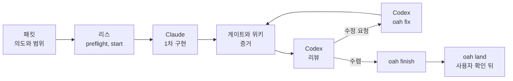
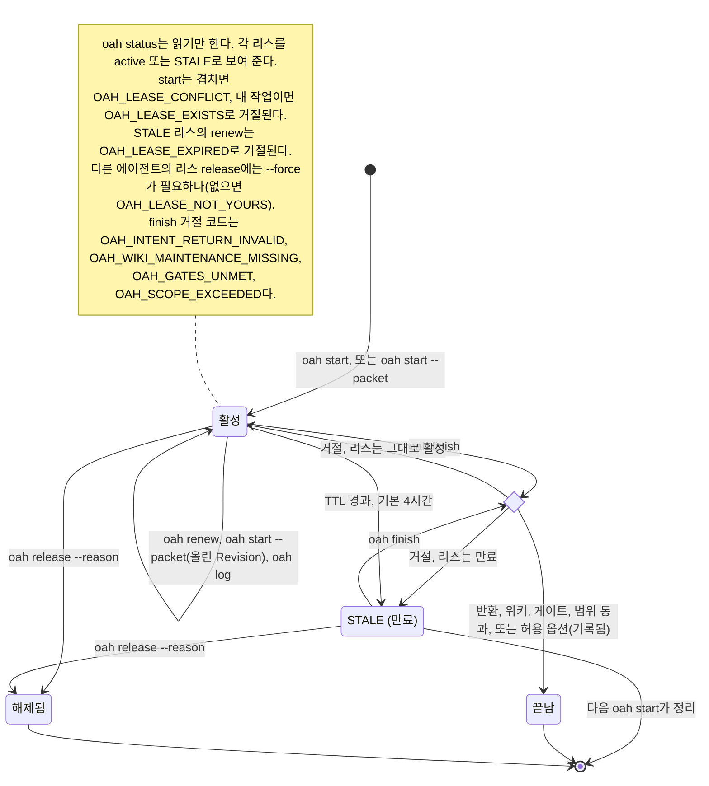
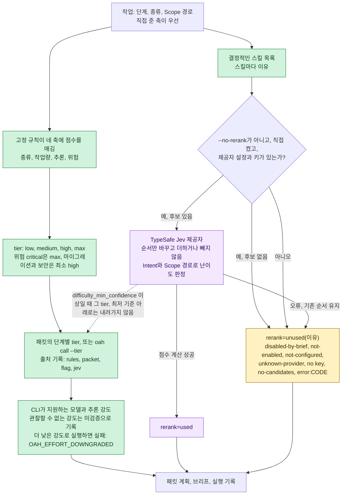
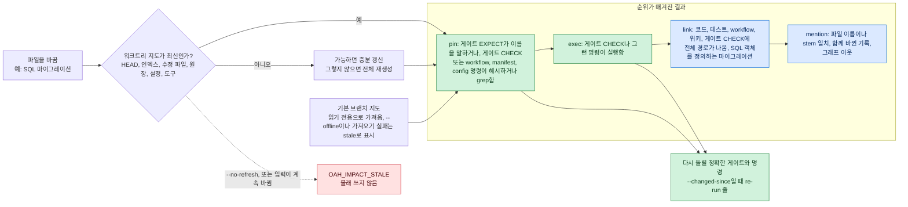
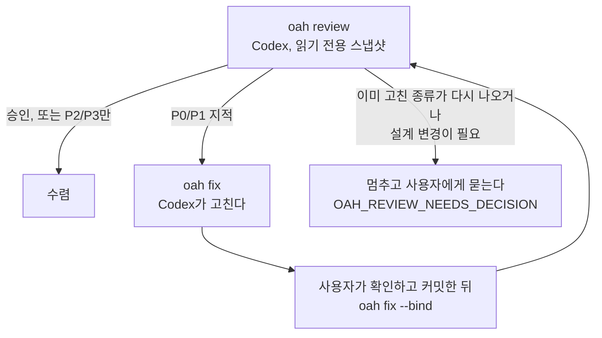
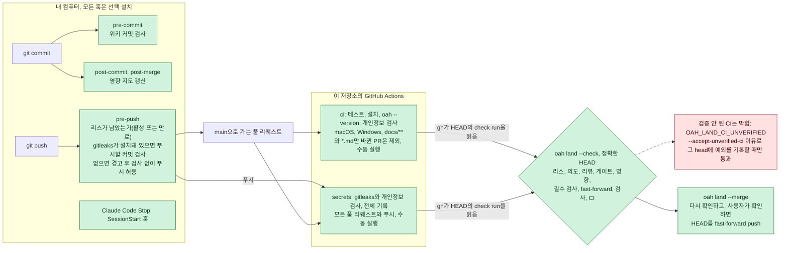

# 개념

이 문서는 `oah` 명령 뒤에 있는 생각을 설명한다. 각 명령이 어떤 문제를 풀고 무엇을 확인하는지다. 명령을 순서대로
따라 하려면 예제 [`examples/hello-oah`](../../examples/hello-oah/README.ko.md)를 본다. 명령이 거절하면
[문제 해결](troubleshooting.md)을 본다.

[English](../concepts.md)

## 목차

- [전체 흐름](#전체-흐름)
- [리스](#리스)
- [패킷과 의도](#패킷과-의도)
- [라우팅과 난이도](#라우팅과-난이도)
- [스킬 선택](#스킬-선택)
- [영향 지도](#영향-지도)
- [프로젝트 위키](#프로젝트-위키)
- [게이트](#게이트)
- [리뷰 루프와 수정](#리뷰-루프와-수정)
- [반영](#반영)
- [모델과 스킬 업데이트](#모델과-스킬-업데이트)
- [툴킷](#툴킷)
- [내 프로젝트의 CI](#내-프로젝트의-ci)
- [동반 앱 Orca와 Aside](#동반-앱-orca와-aside)

## 전체 흐름



모든 작업은 같은 길을 간다. **패킷**에 작업을 적고, 바꿀 경로에 **리스**를 잡고, **Claude Code**가 구현하고,
**게이트**로 증명하고, 리뷰가 수렴할 때까지 **Codex**가 리뷰하고 고치고 다시 리뷰한다. `oah finish`가 리스를
닫고, `oah land`는 사용자가 확인한 뒤 리뷰한 커밋 그대로 기본 브랜치에 반영한다.

어느 단계를 어느 엔진이 맡을지는 `.oah/config.toml`에 적혀 있다.

```toml
[stages]
initial = "claude"
review = "codex"
correction = "codex"
```

단계에 맞지 않는 엔진을 부르면 `oah call`이 `OAH_STAGE_ENGINE_MISMATCH`로 거절한다. `--override-stage`를 주면
실행하고 그 사실을 기록한다.

## 리스

AI 세션 둘이 한 저장소를 함께 쓰면 같은 파일을 쉽게 동시에 고친다. **리스**는 작업 하나가 경로 묶음을 쓰겠다고
선언하는 것이다. 그래서 실수로 겹치는 일이 없다.

- `oah start --task T --agent A --scope PATH…`로 리스를 잡는다. 다른 리스와 겹치는 범위는
  `OAH_LEASE_CONFLICT`로 거절하고 누가 잡고 있는지 알려 준다. 범위 `repo`는 저장소 전체를 뜻한다.
- `oah start --packet PACKET.md`는 패킷에서 범위를 가져오고 같은 단계에서 의도를 묶는다.
- `oah status`는 모든 리스를 active나 `STALE`로 보여 준다. 읽기만 한다.
- `oah renew`는 리스를 연장하고 범위를 바꿀 수 있다. `oah release --reason`은 끝내지 않고 내려놓는다.
- `oah finish`는 리스를 잡은 뒤 실제로 바뀐 파일을 범위와 대조한다. 리스가 편집기의 쓰기를 막을 수는 없으므로
  `finish`가 실제로 일어난 일을 확인한다.
- 리스는 기본 4시간 동안 유효하다(`--ttl-hours`, 최대 168). 만료된 리스는 `STALE`로 보이고 다음 `oah start`가
  정리한다.

리스 상태는 저장소 git 폴더 안의 `oah/`에 있다. 모든 워크트리가 함께 보고 `git status`에는 나오지 않는다.

**워커는 사용자의 리스를 쓴다.** `oah call`이 띄운 워커는 `OAH_WORKER=1`로 실행되고 리스를 잡거나 연장하거나
내려놓거나 끝내지 않는다(`OAH_WORKER_LEASE_REFUSED`). 구현과 수정 워커는 사용자가 리스를 잡은 워크트리에서
돌고, 읽기만 하는 리뷰는 어디서 돌아도 된다.



## 패킷과 의도

**패킷**(`.oah/tasks/<task>/PACKET.md`)에는 작업 하나에 관한 모든 것이 들어 있다. 의도, 범위, 계획, 완료 게이트,
보고 형식이다. `oah packet new <task>`가 템플릿으로 만들고 `oah packet check <task>`가 무엇이 빠졌는지 알려 준다.

**의도** 절은 목표를 적는 유일한 자리다.

- **Problem**, **Desired outcome**, **Success conditions**(`AC1`, `AC2`, …)로 이뤄진다. 성공 조건은 확인할 수
  있는 결과여야 하고 과정 단계여서는 안 된다.
- 사용자가 승인하기 전까지는 `Status: draft`다. 초안은 리스에 묶을 수 없다(`OAH_INTENT_NOT_ACCEPTED`).
- `Intent-ID`는 바뀌지 않는다. 목표가 바뀌면 `Revision`을 올리고 다시 승인해 다시 묶는다.

의도는 모든 단계와 워커, 리뷰어에게 **바이트 그대로** 가고 그 다이제스트가 기록된다. `oah intent show <task>`는
상태를 `current`, `stale`, `missing`, `unbound` 가운데 하나로 보여 준다. 모든 보고는
`INTENT <id>@r<n> <digest>` 한 줄과 성공 조건마다 `AC<n>: met|unmet|deferred — <근거>` 한 줄로 끝난다.
`oah finish --return`과 리뷰 라운드마다 이 줄을 결속과 대조한다.

**사전 점검**(`oah preflight --task T`)은 시작하기 전에 돈다. 브랜치가 기본 브랜치보다 뒤처졌거나 다른 리스가
내 경로를 잡고 있으면 멈추고, 작업 트리가 더럽거나 내 범위를 건드린 새 커밋이 있으면 경고한다. 마지막에는
무엇을 증명하지 않았는지 목록으로 밝힌다.

## 라우팅과 난이도

작업마다 `low`, `medium`, `high`, `max` 가운데 하나인 **tier**가 붙고, tier가 엔진마다 모델과 추론 강도를 정한다.

- **규칙이 네 축에 점수를 매긴다.** 종류(`docs`, `implementation`, `migration` 등), 작업량, 추론, 위험이다.
  `oah recommend`가 점수를 보여 준다. 위험이 `critical`이면 `max`이고 마이그레이션과 보안 작업은 최소 `high`다.
- `oah packet new`는 작업에 점수를 매기고 단계별 경로를 패킷의 `## Plan`에 쓴다. 이 명령에는 `--tier` 옵션이
  없다. 패킷의 tier를 바꾸려면 생성된 계획을 고친다.
- `oah call`은 패킷에 해당 단계의 tier가 있으면 쓰고, 없으면 규칙을 따른다. 호출 시 `--tier` 옵션으로 그 실행의
  선택을 바꿀 수 있다. TypeSafe Jev를 켰다면 Jev의 작업 판정이 최저 기준 안에서 tier를 옮길 수 있다
  ([Jev가 난이도를 판정한다](#jev가-난이도를-판정한다)). 라우팅과 재정의는 실행 상태에 기록하며 패킷을 다시 쓰지 않는다.
- **추론 강도는 모델이 지원하는 만큼이고 고정 상한이 없다.** tier의 강도는 엔진이 그 모델에 대해 밝힌 단계
  가운데 하나다. `highest`는 Codex가 해당 모델에 대해 밝힌 가장 높은 추론 단계다. Codex가 단계를 알려 주지 않았으면
  짐작하지 않고 `OAH_EFFORT_METADATA_MISSING`으로 거절한다.
- **강도는 검증하고 몰래 낮추지 않는다.** Codex 헤더가 요청보다 낮은 강도를 보고하면 실행은
  `OAH_EFFORT_DOWNGRADED`로 실패한다. Claude Code처럼 관측할 수 없는 강도는 `unverified`로 기록한다.
- **tier 후보는 선택 사항이다.** `.oah/config.toml`의 `[engines.<engine>.tier_pools]`에 tier마다 확인한 모델을 적는다.
  예를 들면 `high = ["model-a", "model-b"]`다. 그 tier는 CLI가 나열한 첫 모델로 실행하고, 나열된 모델이 없으면
  `OAH_MODEL_UNRESOLVED`로 알린다. 판정기가 고르는 모델은 호출의 tier와 그 하한 tier 양쪽 후보에 모두 있어야 한다.
  `quality_order`가 모델 순위를 정하지 않으면 TypeSafe Jev가 그 안에서 모델과 강도를 고를 수 있다.
  후보 목록이 설정되어 있고 목록에 없는 모델이 보고되면 `oah models`, `oah doctor`, 카탈로그를 다시 읽은 실행이
  `OAH_MODEL_NEW_UNPOOLED`로 알려 준다. `oah doctor`는 CLI를 새로 읽지 않고 저장된 카탈로그를 쓴다.
  `oah`가 후보를 대신 고치지는 않는다.
- 실행 기록마다 네 축, tier와 그 출처(`rules`, `packet`, `flag`, `jev`), Jev의 답 옆의 규칙 tier, 요청한 모델과 강도,
  실제로 쓴 모델과 강도가 남는다.

선택 기능인 TypeSafe Jev 재정렬기는 스킬 순서를 바꾸고, 작업마다 얼마나 어려운지 판정한다. 그 tier는 정해 둔 확신
이상일 때만 쓰고 최저 기준 아래로는 내려가지 않는다.



### Jev가 난이도를 판정한다

규칙은 Scope만 보고 축에 점수를 매기므로, 한 줄짜리 동시성 수정은 낮게, 파일 20개의 이름 바꾸기는 높게 나올 수 있다.
TypeSafe Jev를 켰다면(`[rerank] enabled = true`와 키) `oah`가 Jev에게 작업이 실제로 얼마나 어려운지 묻는다. 이 내용은
`main` 기준이고 아직 릴리스하지 않았다.

- **Jev가 받는 것.** 네 축과 작업 글이다. 작업 글은 승인된 Intent의 다섯 부분(Problem, Desired outcome, Success
  conditions, Constraints, Non-goals, 제목 포함) 다음에 Scope 경로를 한 줄에 하나씩 붙인 것이다. Intent가 생기기 전에는
  `oah recommend --request-file`이 Intent 대신 사용자가 쓴 요청을 보낸다. 글은 끝에서부터 잘라 16,000자(약 4,000토큰)를
  넘지 않게 하므로 Scope 경로가 먼저 잘리고, 잘리면 실행 기록에 `jev_truncated`가 남는다. 코드, diff, 파일 내용, 저장된
  값, 브리프, 키는 보내지 않고, 경로는 경로로만 보내며 그 내용은 보내지 않는다.
- **비밀 검사.** 보내기 전에 개인정보 검사기의 내용 규칙으로 글을 읽는다. 키나 개인 홈 경로처럼 규칙에 걸린 부분이
  있으면 아무것도 보내지 않고 상태는 `unused(secret)`가 되며, `OAH_RERANK_SECRET`이 걸린 부분(Intent 글, Scope 경로,
  요청 글)을 알려 준다. 걸린 내용 자체는 보여 주지 않는다.
- **Jev의 tier를 쓰는 때.** tier가 규칙에서 왔거나 직접 고치지 않은 패킷 계획 tier에서 온 호출은 예산 확인 뒤, 모델을
  고르기 전에 Jev에게 묻는다. 그래서 모델, 추론 강도, 입장 검사가 최종 tier를 따른다. Jev의 확신이
  `[rerank] difficulty_min_confidence`(따로 정하지 않으면 0.6, 0부터 1 사이의 수이고 다른 값은 아무것도 보내기 전에
  `OAH_CONFIG_INVALID`로 거절한다) 이상이면 Jev의 tier로 실행하되 최저 기준보다 낮으면 최저 기준으로 올리고,
  `tier_source`는 `jev`가 된다. 그렇지 않으면 규칙 tier로 실행하고 `jev_status`가 `unused(<이유>)`나
  `below-threshold <확신>`으로 이유를 남긴다. 리뷰의 최저 기준은 여전히 Scope만으로 매기므로 Jev는 리뷰 tier를 올릴 수
  있고 내릴 때는 그 기준까지만 내린다. `--tier`나, `oah packet new`가 옆에 적어 둔 규칙 tier와 다르게 고친 계획 tier는
  Jev를 쓰지 않고 `unused(tier-given)`로 남긴다. Jev가 실패해도 호출을 막지 않고, `oah fix`의 수정은 한 번만 묻고 그 답을
  유지한다.
- **기록.** 실행 기록과 리뷰 영수증에 `rule_tier`, `jev_tier`, `jev_confidence`, `jev_status`, `tier`, `tier_source`가
  남는다.
- **알림.** 프로젝트에서 처음 요청을 보낼 때 `OAH_RERANK_SCOPE_WIDENED`를 한 번 알린다. 새 질문도, 켜야 하는 설정도
  없다. `[rerank]`에 `enabled = false`를 두면 모든 요청이 멈춘다.
- **설계와 패킷.** 설계와 패킷 작업은 Intent보다 먼저 오므로 `oah call`이 판정할 수 없다. 리드 세션은 사용자 요청으로
  `oah recommend --kind design --task <task> --request-file <file>`을 실행하고(이미 아는 경로는 `--scope <path>`),
  출력된 tier의 `oah-<tier>` 하위 에이전트에게 작업을 맡긴다. 잘못된 설계는 그 뒤의 모든 단계에 비용을 물리므로 설계는
  `high` 아래로 내려가지 않고, 쓰인 판정이 없으면(키 없음, Jev 꺼짐, 비밀, 실패, 낮은 확신) `max`로 실행한다. 모르는
  난이도를 쉬운 것으로 치지 않는다. `--kind packet`은 판정이 없으면 규칙 tier를 지킨다. Jev가 꺼진 경우까지 결과는 상태
  폴더에 작업 이름으로 기록하되 요청 글, Scope 경로, 키는 남기지 않으며, 기록된 설계 판정이 없으면 `oah packet new`가
  `OAH_DESIGN_UNJUDGED`로 경고한다. 경고할 뿐 막지 않는다. `oah recommend`가 보내는 요청은 이것뿐이고
  `--request-file`을 줄 때만 보낸다.
- **하위 에이전트 파일.** `oah init`은 지금의 선택으로 `.claude/agents/oah-<tier>.md`를 쓴다. 저장된 Claude 카탈로그와
  점수를 읽을 수 있으면 그것을 쓰고, 아니면 `oah`와 함께 배포된 사본을 쓴다. 세션 시작 훅을 설치했다면 세션이 시작할
  때마다 모델이나 추론 강도가 더 이상 선택과 맞지 않는 파일을 다시 쓰고 한 줄로 알린다. 다만 그 파일이 적힌 값으로
  `oah`가 만들어 내는 내용과 정확히 같을 때만 다시 쓴다. 직접 고친 파일은 그대로 두고, 없는 파일은 만들지 않는다.
  `oah doctor`는 고친 파일을(`OAH_AGENT_FILE_EDITED`), 훅이 설치되지 않았다면 낡은 파일도(`OAH_AGENT_FILE_STALE`)
  고치는 방법과 함께 알려 준다.

Jev 키가 없으면 난이도는 파일과 경로의 개수로만 정해지고, 내용이 빈약한 Intent는 빈약한 판정을 낳는다. TypeSafe는
요청마다 요금을 물릴 수 있다.

### 모델을 고르는 방법

이 내용은 `main`에 있고 아직 릴리스하지 않았다. 어느 엔진이 어느 단계를 맡는지는 `[stages]`를 따른다. 여기서는 엔진 안의
모델을 고른다. 호출, 워커, 수정, 리뷰 모두 같으며, 아래에서 먼저 해당하는 것을 쓴다.

1. tier에 고정한 모델. `.oah/config.toml`의 `[engines.<engine>.tiers] <tier> = { model = "<model>" }`이다.
2. 그 tier의 `tier_pools`에서 CLI가 나열한 첫 모델.
3. 나열된 모델을 가리키는 `quality_order`. 모델군도 점수도 필요 없어서 모델군 이름이 바뀌었을 때 쓸 수 있다. 옛 기본값
   `["opus", "sonnet", "haiku"]`는 설정하지 않은 것으로 치고 `oah models`가 알려 준다(`OAH_MODEL_ORDER_IGNORED`). 파일은
   고치지 않는다.
4. 점수 규칙.

**점수 규칙.** 벤치마크 점수, 작업 난이도, `[models] profile`이 정한다. 난이도를 모델에 잇는 표는 없어서 점수가 바뀌면
결과도 바뀐다. tier는 low 0, medium 1, high 2, max 3으로 센다. `performance`는 1을 더하고 `balanced`는 그대로 두며, 값은
0에서 3 사이로 둔다. 이 단계는 작업 종류의 최저 기준 아래로 내려가지 않는다. 단계마다 필요한 점수는 척도를 3등분한 위치다.
`performance`와 `balanced`는 그 점수에 닿은 모델 가운데 정가가 가장 싼 모델로 실행하고, 같으면 점수가 낮은 쪽을 쓴다. 그래서
더 비싸면서 점수가 낮은 모델은 고르지 않는다. `efficient`는 tier의 단계를 그대로 두되 최저 기준을 넘지 않는 선에서 한 단계
아래까지 볼 수 있다. 거기서부터 위로 정가 대비 점수가 가장 높은 모델을 쓰고, 같으면 점수가 낮은 쪽을 쓴다. 그래서 더 강한
모델이 값어치가 더 좋으면 그 모델이 이긴다. `balanced`와 `efficient`는 기준보다 척도의 2퍼센트 안쪽으로 낮은 모델도 받는다.
그만한 차이로 비싼 모델을 살 이유가 없기 때문이다. `performance`에는 이 여유가 없고 최저 기준에도 없다. 고를 수 있는 모델이
그 단계에 닿지 못하면 최저 기준을 넘는 가장 강한 모델로 실행한다. 추론 강도는 여전히 tier가 정한다.

모든 프로필은 먼저 tier의 강도로 최저 기준을 지키며 실행할 수 없는 모델을 뺀다. `highest`를 포함한 두 강도는 각 모델
자신의 지원 목록에서 구한다. `effort_caps`는 지원하는 단계로 강도를 낮추되, 그 모델의 최저 강도보다 낮은 상한이면 모델을
건너뛴다. 실행할 모델이 없으면 리뷰는 `OAH_MODEL_BELOW_FLOOR`, 다른 호출은 `OAH_MODEL_UNRESOLVED`로 멈추고 고칠 tier 강도나
상한을 알려 준다. 실행할 수 없는 고정 모델은 `OAH_CONFIG_INVALID`로 멈춘다. 상한으로 강도를 낮추면 여전히 `OAH_EFFORT_CAPPED`를
기록하고, `left_out`에 `not-runnable`과 이유를 표시한다.

`efficient`는 점수 자체를 따지는데, 모든 공통 과제에서 꼴찌인 모델의 점수는 0이다. 그래서 `balanced`가 그 꼴찌 모델을 고를
자리에서도 기준에 닿는 다른 모델을 쓰고, 낮은 tier에서는 `balanced`보다 비쌀 수 있다.

**척도.** 점수와 단계별 기준은 내 컴퓨터가 아니라 자료에서 나온다. 척도는 아는 모델군 전부(Codex는 `luna`, `terra`, `sol`,
`astra`, Claude는 `haiku`, `sonnet`, `opus`, `fable`)에 걸쳐 있고, 모델군마다 자료에 있는 가장 새 세대를 쓴다. 점수는 그 모델들이
함께 가진 과제마다 최저와 최고 사이의 위치를 0에서 100으로 매긴 평균이다. Epoch AI 자료는 공통 과제가 3개 이상 있어야 하고,
Artificial Analysis는 모델마다 지수 하나를 주므로 하나면 되며 척도는 똑같이 0에서 100이다. 그래서 내 CLI가 나열하지 않거나
`allowed_models`가 뺀 모델도 척도의 자리를 지키며, 어느 쪽도 점수를 바꾸거나 최저 기준을 낮출 수 없다.

**후보가 되는 모델.** CLI가 나열하고 숨기지 않았으며, 모델군을 알고, 공통 과제를 모두 가졌고, 그 모델군에서 그런 모델 가운데
가장 새 세대이며, `allowed_models`가 허용하는 모델이다. 점수가 없는 새 세대는 기다리고 옛 세대가 남으므로 모델군이 비지 않는다
(`OAH_MODEL_UNSCORED`). CLI가 가장 새 세대를 나열하지 않을 때도 옛 세대가 대신한다. 이 모델은 같은 척도로 점수를 받고 척도를
넓히지 않는다. `oah`가 모르는 모델군은 자동으로 고르지 않는다(`OAH_MODEL_UNKNOWN_FAMILY`). 직접 이름을 적은 모델은 이 검사를
건너뛰고, 옛 세대를 적었다면 `OAH_MODEL_SUPERSEDED`를 알리고 실행한다.

**Claude 별칭.** `claude --help`는 예시 문장에 별칭 몇 개만 적으므로 `haiku`처럼 실제로 되는 별칭을 빼먹을 수 있다. Claude
카탈로그를 다시 만들 때 `oah`는 도움말이 빼먹은 알려진 별칭마다
`claude --bare -p x --model <alias> --no-session-persistence --tools ""`로 CLI에 묻는다. 표준 입력은 닫고, 빈 임시 폴더에서,
환경에 Anthropic 자격 증명이나 제공자 전환 변수를 두지 않고, 설정 파일도 넘기지 않는다. 자격 증명이 없으므로 요청에
과금이 생길 수 없고 Claude Code는 `Not logged in`이라고 답한다. 먼저 있을 수 없는 대조 별칭을 실행하며, 이 실행은 Claude Code의
모르는 모델 표시를 출력해야 한다. 대조 실행이 그 표시를 내고 별칭 실행은 내지 않았을 때만 그 별칭을 목록에 넣고, 저장한
카탈로그에는 `claude --help + alias check`라고 남는다. 실행할 때는 확인하지 않는다. 그 표시는 문서화되지 않았으므로 바뀌면
`oah`가 업데이트될 때까지 `haiku`가 빠지고 `sonnet`이 대신한다.

**점수를 가져오는 곳.** 릴리스마다 Epoch AI 자료의 사본이 들어 있고, `oah`는 모델 카탈로그를 다시 만들 때 그 자료를 새로
받는다. 카탈로그는 CLI가 업데이트됐을 때, `[models] ttl_hours`(기본 24시간)가 지났을 때, `oah models --refresh`로 다시 만든다.
저장한 사본이 `ttl_hours`보다 오래됐거나 없거나 손상됐을 때만 받고, 명령 하나에서 출처마다 많아야 한 번 받는다. `oah doctor`,
`oah recommend --engine`, `oah fix`는 받지 않는다. 요청은 `https://epoch.ai/data/benchmarks.csv`를 HTTPS GET으로 받으며,
사용자 에이전트는 `oah/<version>`이고 10초 제한 시간과 크기 제한이 있다. 프로젝트, 작업, 사용자에 대해서는 아무것도 보내지
않는다. 자신의 `ARTIFICIAL_ANALYSIS_API_KEY`를 저장해 두었다면([키](keys.md)) `oah`는 Artificial Analysis에도 모델 목록을
묻는다. 키는 요청 헤더에만 싣고, 맞춘 모델마다 지수 하나만 남긴다. 사본은 내 컴퓨터의 `<state>/models/benchmarks-epoch.json`과
`benchmarks-aa.json`에만 있고 읽을 때마다 검사한다. 손상되거나 바뀐 파일은 없는 것으로 친다(`OAH_SCORES_FILE_INVALID`). 받기에
실패하면 마지막으로 성공한 사본을 그대로 쓰고 한 번 알린다(`OAH_SCORES_REFRESH_FAILED`). 이 때문에 실행이 실패하는 일은 없다.

엔진마다 실행 한 번에 출처 하나를 쓴다. Artificial Analysis 사본이 그 엔진의 알려진 모델군마다 나열된 가장 새 모델에 점수를
매겼으면 그것을, 아니면 최근에 받은 Epoch AI 자료를, 그것도 없으면 `oah`와 함께 배포된 사본을 쓴다. 일부만 있는 Artificial
Analysis 자료를 Epoch 자료와 섞지 않으며, 다시 만들 때 빠진 모델을 알려 준다(`OAH_SCORES_AA_UNUSED`). `oah`는 Artificial
Analysis의 행을 문서에 적힌 대로 이름으로 맞추며, 실제 응답으로는 아직 확인하지 않았다. `[models] fetch_scores = false`로
두면 아무것도 받지 않고 `oah`와 함께 배포된 사본이 고른다.

**점수가 재는 것.** Epoch AI 점수는 Epoch 자체 과제만 가져오며 각 모델의 최대 강도 결과다. 이 과제는 대부분 수학, 퍼즐,
추론이다. 코딩 과제가 아니고 수도 적다. Artificial Analysis는 모델마다 지수 하나를 주는데, 코딩 지수를 쓰고 그것이 없는
모델이 있으면 지능 지수를 쓴다. 어느 쪽이든 점수는 남이 만든 시험에서 잰 일반적인 품질이며 내 저장소에 대해서는 아무것도
말하지 않는다. 점수는 그 시험에서 모델을 비교할 뿐 어떤 모델이 전반적으로 낫다는 뜻이 아니다. 정가는 실제 비용을 대신할
뿐이고 구독은 사용량으로 낸다. 점수가 틀렸거나 오래됐으면 더 약한 모델로 일이 갈 수 있으므로 `oah models`가 출처와 날짜를
보여 준다. 새 모델은 점수가 공개될 때까지 며칠이나 몇 주를 기다릴 수 있다. 직접 정하려면 모델을 고정한다.

**리뷰에는 최저 기준이 있다.** 리뷰의 최저 기준은 `medium`이고, 범위에 위험한 경로가 있거나 작업 종류가 요구하면 `high`다.
범위에서 다시 계산하므로 플래그, 패킷의 축, 프로필, 판정기의 답으로 낮출 수 없고, 고정된 척도 위의 기준이므로
`allowed_models`로도 낮출 수 없다. tier, 모델, 강도가 기준 아래인 리뷰는 `OAH_MODEL_BELOW_FLOOR`로 멈추고, 이 거절은 라운드나
시도를 쓰지 않는다. 직접 적은 모델에 점수가 없으면 `OAH_MODEL_FLOOR_UNCHECKED`를 알리고 실행하며, 영수증에 기준을 확인하지
못했다고 남긴다.

**실행을 멈추는 경우.** 모델 목록이 없으면 `OAH_MODEL_CATALOG_UNAVAILABLE`, 쓸 수 있는 점수가 없으면 `OAH_MODEL_NO_SCORES`다. 둘 다
모델을 고정하면 넘어가고, `oah`가 기본 모델로 대신 실행하는 일은 없다. 허용된 모델 가운데 그 일의 최저 기준에 닿는 모델이
없으면 리뷰는 `OAH_MODEL_BELOW_FLOOR`로, 다른 호출은 `OAH_MODEL_UNRESOLVED`로 멈추고 둘 다 `allowed_models`를 알려 준다. 새로
읽은 Codex 카탈로그에 없는 고정 모델은 `OAH_MODEL_NOT_LISTED`로 멈춘다. Claude Code는 출력하지 않는 이름도 받으므로 Claude
고정 모델은 확인하지 않는다.

**선택 확인하기.** `oah models`와 `oah doctor`는 프로필, 출처와 날짜, 출처 표시가 붙은 점수, tier별 모델, 빠진 모델과 이유를
보여 준다. `scores from:` 줄은 엔진마다 점수를 어디서 가져왔는지 쉬운 말로 알려 주고, JSON에는 받은 자료일 때 `fetched_at`이
붙는다. `oah doctor`는 로컬 상태만 읽고 키를 찾지 않으며, 손상된 점수 사본을 알리고, 실행할 수 없는 고정 모델은 호출과
같은 오류로 보여 준다. `oah recommend --engine <engine> --stage <stage>`는 작업 하나에 대한 답을 주며
아무것도 실행하거나 쓰지 않는다. 리뷰 영수증에는 모델군, 최저 기준, 프로필, 모델의 출처, 쓴 점수가 남는다. 카탈로그 재구성으로
선택이 바뀌면 `OAH_MODEL_CHANGED`가 새 세대나 새 점수 같은 이유와 함께 한 번 알리고 `changes.jsonl`에 남는다.

**선택 세어 보기.** `oah models report`는 이 저장소의 실행 기록(`<state>/runs/<task>/<run-id>/result.json`)을 읽어,
단계와 엔진별로 그리고 합계로 실행마다 tier와 모델이 어떻게 골라졌는지 센다. tier 출처, Jev 난이도 상태, Jev의 tier가 규칙
tier보다 높았는지·같았는지·낮았는지, 0.1 단위로 나눈 Jev의 확신도, 모델 판정 상태(썼음, 규칙과 함께 거부함, 쓰지 않은
이유), 실제로 실행한 쌍이 결정적 쌍과 모델·effort·둘 다에서 달랐는지, 0.1 단위로 나눈 판정의 확신도, 최저 기준이 tier를
올린 횟수를 보여 준다. `--json`은 같은 수를 `format` 번호가 붙은 JSON 객체 하나로 출력한다. 제공자를 부르지 않고, 엔진을
실행하지 않고, 네트워크에 닿지 않으며, 아무것도 쓰지 않는다. 실행 폴더는 읽은 것이든, `result.json`이 없거나 잘못된 것처럼
사유가 붙은 읽지 못한 것이든 한 번씩 센다. 읽지 못한 값은 0이 아니라 읽지 못한 것으로 센다. 모델 이름이 해시로 남는 수정
기록에서는 같은지 다른지만 비교한다. 이 수는 선택이 어떻게 이루어졌는지를 보여 줄 뿐 Jev가 도움이 됐는지는 보여 주지 않는다.
결과나 품질은 비교하지 않는다. 판정의 확신도(`model_judge_confidence`, 답에 없으면 null)와 최저 기준이 tier를 올렸는지
(`tier_floor_raised`)는 이 버전부터 기록하므로, 그 전 실행은 기록되지 않은 것으로 세고 보고서가 그 수를 알려 준다.

`oah`와 함께 배포된 사본의 출처는 아래와 같고, 받은 사본에도 같은 출처 표시에 받은 날짜를 붙인다.

Epoch AI, 'Capabilities & benchmarking'. Published online at epoch.ai. Retrieved from
'https://epoch.ai/benchmarks/use-this-data'. Accessed 2 Nov 2026. Licence: CC BY 4.0.

Artificial Analysis 자료는 자신의 키가 있을 때만 쓰며, 그 점수를 보여 주는 곳마다 출처 표시
Artificial Analysis, https://artificialanalysis.ai/ 를 함께 보여 준다.

## 스킬 선택

스킬은 Claude Code와 Codex가 읽어 들이는 지침 폴더다. `oah`가 지시문마다 스킬을 골라 주므로 사용자가 고르지
않아도 된다.

- 선택기는 설치된 Claude와 Codex의 스킬 폴더(사용자, 프로젝트, 플러그인 스킬)와 키트 캐시를 읽고 바꾸지 않는다.
- 작업 종류, 단계, 위험, 패킷 Scope의 파일 종류로 고르고 스킬마다 이유를 붙인다. Scope가 비어 있으면 조용히
  아무것도 고르지 않는 대신 `OAH_SCOPE_EMPTY`로 경고한다.
- 같은 스킬이 두 군데 설치돼 있으면 프로젝트 사본, 키트 캐시, 사용자와 플러그인 사본 순서로 고른다.
- 지시문에는 고른 스킬의 이름과 경로가 들어간다. `[skills] mode = "attach"`이면 스킬 본문을 넣는다.
- **재정렬기는 순서만 바꾼다.** TypeSafe Jev를 켜고 키가 있으면 규칙이 고른 후보의 순서를 다시 매긴다. 후보를
  더하거나 빼지는 않는다. 패킷 계획과 지시문, 실행 기록마다 `rerank=used`나 `rerank=unused(<이유>)`가 붙는다.
  [키](keys.md)를 참고한다.
- 선택 기록은 상태 폴더의 로컬 파일에만 남고 어디로도 보내지 않는다.

## 영향 지도

"이 파일을 바꾸면 무엇을 다시 확인해야 하나?" **영향 지도**가 정해진 규칙으로 답한다.

```sh
oah impact src/app.py
oah impact --changed-since origin/main
```

- 결과는 **pin > exec > link > mention** 순서다. `pin`과 `exec` 행은 CHECK나 EXPECT가 그 경로를 고정하거나
  실행하는 원장의 게이트를 짚어서 다시 돌릴 게이트를 정확히 알려 준다. `link` 행은 그 경로를 적은 코드, 테스트,
  워크플로, 위키 문서에서 나오고, `mention` 행은 이름이 같은 것, 함께 바뀐 파일, graphify가 있을 때의 그래프
  이웃에서 나온다.
- **SQL 플러그인이 기본으로 들어 있다.** 마이그레이션에서 테이블, 뷰, 루틴, 트리거, 인덱스, GRANT를 읽고 코드와
  이어 `db_table:`, `db_routine:`, `db_grant:` 항목으로 만든다. 데이터베이스를 건드리는 작업은 그 질의를
  보고하고, SQL이 없는 프로젝트는 `db-impact: unavailable`이라고 밝힌다.
- **최신인지는 정체성으로 판단한다.** 지도는 워크트리마다 저장되고 HEAD, 스테이징된 색인, 지도가 읽는 파일,
  게이트 원장, 설정, 도구 버전에 묶인다. 하나라도 바뀌면 낡은 지도가 되고, `oah`는 새로 만들거나
  `OAH_IMPACT_STALE`로 거절한다. 낡은 지도를 몰래 쓰지 않는다. `oah init`이 첫 지도를 만들고, `preflight`,
  `packet new`, `review`가 먼저 새로 고치며, 선택형 `post-commit`과 `post-merge` 훅이 계속 최신으로 유지한다.
- **최신 기본 브랜치도 본다.** 질의 전에 `oah impact`는 원격의 기본 브랜치를 읽기 전용으로 가져와 지도를 하나 더
  둔다. 출력은 두 지도에 커밋 SHA를 붙인다. `--offline`이거나 가져오기에 실패하면 마지막으로 가져온 커밋을
  쓰고 낡았다고 표시한다.



## 프로젝트 위키

`oah init`은 왜 그렇게 했는지를 기억하는 `docs/wiki/`를 만든다. Obsidian에서 바로 열린다.

```text
docs/wiki/
  index.md             분류별 목록
  log.md               최신순, <!-- OAH:LOG_INSERT_BELOW --> 아래에 쌓인다
  log_archive_NN.md    rollover가 옮긴 오래된 항목 묶음, 고치지 않는다
  templates/           노트와 결정 기록 템플릿
```

- `oah wiki maintain --task T`는 마지막 커밋과 게이트, 리뷰 전에 작업의 로그 항목과 색인 줄을 쓰고, 수정 뒤에도
  다시 실행한다. 두 번 실행해도 같은 내용이 두 번 들어가지 않는다. `oah finish`는 실행했는지만 확인한다
  (`OAH_WIKI_MAINTENANCE_MISSING`).
- 로그는 끝없이 커지지 않는다. 512,000바이트를 넘으면 가장 오래된 항목부터 통째로 다음 `log_archive_NN.md`로
  옮긴다. 옮길 때마다 저널에 남기고, 옮기는 도중에 파일이 바뀌면 `oah wiki recover`를 실행할 때까지 위키 명령이
  멈춘다.
- `oah wiki lint`와 `oah wiki hygiene`은 깨진 링크, 색인에 없는 노트, 출처가 없는 노트 같은 실제 문제를 알려
  준다. 후보만 보여 줄 뿐 어떤 위키 명령도 노트를 스스로 지우거나 옮기지 않는다.
- graphify는 선택이고(`oah graph`) 그래프를 자동으로 다시 만드는 일은 없다.

## 게이트

"끝났다"는 에이전트가 하는 말이 아니라 증거 원장이다. **게이트**는 확인할 수 있는 결과 하나와 그 결과를 내야 하는
명령으로 이뤄진다.

```markdown
- [ ] G1: `python hello.py Ada` prints `Hello, Ada!`
  CHECK: python hello.py Ada
  EXPECT: Hello, Ada!
  EVIDENCE: pending
```

- `oah gates new <task>`가 템플릿으로 `.oah/tasks/<task>/GATES.md`를 만들고 `oah gates lint <task>`가 각 게이트가
  실패할 수 있는지 판단한다.
- `oah gates check <task>`는 `oah`가 검증한 커밋의 게이트 검사기 [unlazy](https://github.com/Leonxlnx/unlazy)로
  CHECK 줄을 실행한다. 처음 실행하면 명령을 보여 주고 사용자의 승인(`--approve`)을 기다린다. 통과한 게이트에는
  증거와 함께 체크 표시가 붙고 입력에 묶인다. 그래서 나중에 입력이 바뀌면 게이트를 다시 돌린다.
- 게이트의 입력은 추적 중인 파일, 무시되지 않은 미추적 파일, 실행 환경이다. 외부 서비스나 무시된 미추적 파일이
  바뀌어도 게이트를 다시 돌리지 않으므로 따로 확인해야 한다. 게이트 아래에 들여 쓴 `OAH-INPUTS: a, b/c` 줄은
  신선도 검사에 쓰는 저장소 상대 파일 경로 접두사를 좁힌다. 다른 실행 가능한 게이트가 영향을 받으면 원장 전체
  재실행으로 이 게이트도 다시 돌 수 있다.
- `gates check`가 쓰는 `GATES.summary.md`가 경로 없이 커밋되는 기록이다. 원장 자체는 git에 들어가지 않는다.
- `oah finish`는 충족하지 못한 게이트가 있으면 거절한다(`OAH_GATES_UNMET`). 정말 불가능한 게이트는
  `ABANDON: G<n> <이유>`로 적어 사용자에게 넘기고 지우지 않는다.
- CHECK 줄은 `cmd.exe`와 `sh`에서 똑같이 돌아야 한다. `grep`이나 파이프 대신 `python`, `node`, `oah check`를
  쓴다. `oah check`는 `oah check contains FILE TEXT` 같은 운영체제 공통 검사를 제공한다.
- 선택형 Claude Code Stop 훅(`oah hooks install stop`)은 게이트를 충족하지 못한 세션이 끝나지 못하게 한다.
  `[gates] stop_agents`(기본값 `[]`, 모든 리스)에 리스 에이전트 이름을 적으면 훅은 그 이름과 정확히 같은 이름으로
  잡힌 리스만 본다. 이 목록은 선택이며 대가가 있다. 목록에 없는 이름으로 잡힌 리스는 더 이상 세션을 멈추지 않는다.
  `oah finish`는 여전히 충족하지 못한 게이트를 거절하므로 검사는 작업 끝으로 옮겨질 뿐 사라지지 않는다.

## 리뷰 루프와 수정



- **라운드**(`oah review --task T`)는 기본 브랜치와의 merge-base부터 HEAD까지 커밋된 작업을 리뷰한다. Codex는
  그 head를 새로 클론한 사본에서 에이전트 지침 파일(`AGENTS.md`, `CLAUDE.md`, `.claude/`, `.codex/` 등)을 지운
  뒤 읽고, 그 사본의 카나리 토큰을 그대로 돌려준다. 카나리는 스냅샷을 읽을 수 있었다는 것만 증명하고 영수증도
  그 이상을 주장하지 않는다.
- **지적**에는 심각도가 붙는다. P0와 P1은 막고 P2와 P3는 후속 작업이다. 지적마다 라운드를 넘어 유지되는 ID와
  분류가 있다.
- **라운드 수는 정해져 있지 않다.** 라운드마다 범위 안의 새 지적이 나오는 동안 이어 간다. 승인이 나오거나 P2와
  P3 지적만 남은 라운드에서 시리즈가 끝나고 남은 지적은 후속 작업으로 기록한다. 상한을 두고 싶으면
  `[review] max_rounds`를 설정한다. 상한에 닿으면 `OAH_REVIEW_ROUNDS_EXHAUSTED`로 멈추고, `--extra-round`로
  이어 가면 그 사실이 기록된다.
- **꼭 필요할 때만 사용자에게 묻는다.** 앞선 수정이 이미 고치려 한 종류의 지적이 다시 나오거나 고치는 데 설계나
  저장 형식 변경이 필요하면 `OAH_REVIEW_NEEDS_DECISION`으로 멈춘다. `--decision "<결정한 내용>"`으로 이어 가면
  기록된다.
- **수정.** `oah fix --task T`는 사용자가 리스를 잡은 워크트리에서 최근 라운드의 P0, P1 지적을 Codex에게 고치게
  하고 변경을 커밋하지 않은 채 남긴다. 사용자는 diff를 확인하고 `Agent-Engine: codex`로 커밋한 뒤
  `oah fix --task T --bind`로 그 커밋을 수정 시도에 묶는다. 사용자나 Claude가 직접 고쳤다면
  `oah fix --task T --manual --engine claude|human`으로 기록하고, 중간에 멈춘 수정은 `--abort`로 닫는다. 수정
  시도마다 출처 영수증, 지적, 수정 전후 head, 결과가 남고 다음 리뷰어가 모두 본다.
- **표시는 정직하다.** 커밋은 `Agent-Engine:` 트레일러로 쓴 엔진을 남긴다. 영수증은 범위 안의 모든 커밋을
  리뷰어와 다른 엔진이 썼을 때만 `independent: yes`라고 적는다. 쓴 엔진을 모르면 `unknown`이고, Codex가 고친
  것을 Codex가 리뷰하면 `no`다. 이것은 이 엔진 순서에 대한 정직한 표시이고 오류가 아니다.
- `oah review summary --task T`는 pull request에 붙일 블록을 출력한다. 라운드, 판정, 게이트, 후속 작업이 들어 있다.
  작업이 HEAD에서 수렴하지 않았으면 블록에 인계 내용을 더한다. 마지막으로 리뷰한 head, 최신 영수증의 P0/P1 지적,
  작업의 로컬 원장에서 충족되지 않은 게이트, 다음에 실행할 명령 제안 하나다. 플래그는 리뷰 게이트에 물어보지만,
  의도, 패킷, base 상태에 비춰 명령을 검사하지는 않는다. 명령이 거절되면 거절 메시지가 안내하는 다음 단계를 따라라.
  JSON에도 같은 한계를 적는다. 리뷰 명령에는 선택한 `--base`를 유지한다. 바인딩된 활성 리스가 없으면 제안 명령을
  출력하지 않고 선행 조건을 안내한다. 패킷을 수락한 뒤
  `oah start --task T --agent "<you>" --packet ".oah/tasks/T/PACKET.md"`에 리스 보유자와 수락한 패킷 경로를 넣어
  리스를 시작하거나 바인딩해라. 바인딩한 뒤 요약을 다시 실행해라. 인계 지적의 id, 축, 위치, 제목은 코드로 인용한다.
  게이트 목록은 id와 상태만 보여 준다. 이것은 구조만 읽은 결과다. 아무것도 다시 실행하지 않고 증거가 최신인지도
  확인하지 않으므로, 체크된 칸도 이미 낡았을 수 있다.

## 반영

`oah land --check --task T`는 리뷰한 head를 그대로 반영해도 되는지 판단하고 검사마다 한 줄씩 보여 준다.

| 검사 | 통과 조건 |
|---|---|
| lease | 이 워크트리에 열린 리스가 없다 |
| intent | 의도가 current이고 HEAD에 커밋돼 있다 |
| review | 수렴한 리뷰가 정확히 HEAD를 승인했다 |
| gates | 모든 원장이 unlazy를 통과하고 커밋된 요약이 맞는다 |
| impact | 방금 가져온 기본 브랜치에 대해 바뀐 경로를 다시 평가했다 |
| required-checks | 최신 기본 브랜치가 바뀐 경로에 묶은 검사에 통과한 증거가 있다 |
| fast-forward | 기본 브랜치를 병합 없이 HEAD로 옮길 수 있다 |
| scan | 반영할 커밋에서 gitleaks가 아무것도 찾지 못했다 |
| ci | `gh`로 HEAD의 check run과 commit status를 읽었고, 최신 결과가 모두 성공이며(check run은 neutral·skipped도 허용), 설정된 필수 검사마다 결과가 있다 |

`oah land --merge --task T`는 모든 검사를 다시 돌리고 사용자에게 확인을 받은 뒤, 원격의 기본 브랜치가 방금 확인한
커밋과 여전히 같을 때만 정확히 HEAD로 fast-forward한다. 다른 사람이 먼저 반영했다면 아무것도 push하지 않는다.
가져와서 다시 평가한 뒤 다시 시도한다. 반영하려면 원격이 URL이나 절대 경로여야 한다.

`gh`가 없거나 check run과 commit status가 없거나 필수 검사 결과가 빠지면 CI는 `unverified`이고 기본적으로
`OAH_LAND_CI_UNVERIFIED`로 반영을 막는다. `gh`를 설치하고 로그인한 뒤 워크플로와 작업 브랜치를 push하고
결과를 기다린다. CI 실패(`OAH_LAND_CI_FAILED`)나 진행 중·조회 불가(`OAH_LAND_CI_PENDING`)도 반영을 막는다.

CI 미검증을 명시적으로 받아들이려면 확인과 반영 명령 양쪽에 `--accept-unverified-ci "<reason>"`을 붙인다.
예외와 사유는 정확히 해당 head에 대해 상태 폴더의 `land/<task>/ci-exceptions.jsonl`에 기록한다. 새 head에는
별도 예외가 필요하다. CI는 `unverified`로 남고 통과로 세지 않는다. 결과는 `OAH_LAND_READY_WITH_CI_EXCEPTION`,
반영 뒤에는 `OAH_LAND_LANDED_WITH_CI_EXCEPTION`이다. 실패하거나 진행 중인 CI와 다른 실패한 검사는 우회하지
못한다. 사유에는 비밀을 넣지 않는다.

가져온 대상 브랜치에 커밋된 `.oah/config.toml`의 `[land]`가 정책을 정한다. 기본값은
`ci_unverified = "block"`이며 `"exception"`은 head마다 `config policy` 사유의 예외를 기록한다.
`required_checks = []`이면 발견한 결과를 쓰며 0개면 미검증이다. 필수로 만들 check run 이름이나 status context를
목록에 넣을 수 있다. 작업 head에서 정책을 느슨하게 하면 `OAH_LAND_POLICY_LOOSENED`로 거절한다. 정책 변경을
먼저 기본 브랜치에 따로 반영한다.



## 모델과 스킬 업데이트

모델과 스킬은 나아지는데 하네스가 그대로면 점점 뒤처진다. 그래서 `oah`는 업데이트를 따라간다.

- **모델.** 각 CLI가 나열한 모델 가운데 점수로 고르고, 카탈로그를 다시 만들 때 점수도 새로 받는다. 알려진
  모델군의 새 세대는 점수가 생기면 다음 카탈로그 재구성부터 쓰고, 대체되거나 사라진 모델은 같은 재구성부터 고르지
  않는다. 규칙은 [모델을 고르는 방법](#모델을-고르는-방법)에 있다. `oah`는 실행할 때마다 먼저 모델 카탈로그가 최신인지 확인한다.
  사용자가 고정한 모델이 늘 이기고, 바뀔 때마다 이전 값과 새 값, 시각, 이유를 기록한다.
- **스킬.** `[skills] auto_update = true`이면 `oah` 상태 폴더의 키트 캐시를 하루에 많아야 한 번 확인하고 리스가
  열려 있으면 하지 않는다. 업데이트는 반영하기 전에 라이선스, 읽기, 개인정보 스캔을 검사하고 실패하면
  되돌린다. 프로젝트에 추적되는 스킬 사본은 사용자가 `oah skills update --project`를 작업 하나로 실행할 때까지
  고정돼 있고, 전역 폴더는 `--global`과 사용자의 확인이 있을 때만 바뀐다.
- **unlazy**는 `oah` 게이트를 검증한 커밋에 머물고 스킬 업데이트는 이것을 옮기지 않는다.

업데이트하는 방법은 [업그레이드](upgrade.md) 문서에 있다.

### 작업이 끝난 뒤 도구 업데이트

새 모델은 Claude Code와 Codex 자체가 최신일 때만 쓸 수 있으므로 `oah`는 도구도 최신으로 맞출 수 있다. 이 내용은
`main` 기준이고 아직 릴리스하지 않았다. `.oah/config.toml`의 `[updates]`에 `after_finish = true`가 있을 때만 켜진다.
`oah init`이 한 번 묻고(Yes 권장), 이 키가 없는 설정은 꺼진 것으로 본다.

- **언제.** 저장소에 살아 있는 리스와 created·prepared·queued·running 상태의 run을 남기지 않는 `oah finish` 뒤에,
  연결되거나 잘못되거나 읽을 수 없는 run 저장소가 있어도 미룬다. `interval_hours`(기본 24)마다 많아야 한 번 돈다. finish는 한 줄을 출력하고 패스를 백그라운드로 시작하며, 패스를
  기다리지 않고 자기 종료 코드도 바꾸지 않는다. `oah update`는 지금 패스를 돌리고(스위치가 켜져 있고 진행 중인 작업이
  없어야 하지만 간격은 따지지 않는다), `oah update status`는 아무것도 실행하지 않고 마지막 패스를 보여 준다. 한
  컴퓨터에서는 한 번에 한 패스만 돌고, 두 번째 패스는 `OAH_UPDATE_BUSY`를 출력한다.
- **무엇을, 이 순서로.** `claude update`, `codex update`, `claude plugin marketplace update` 다음에 사용자 범위로 설치한
  플러그인마다 `claude plugin update <plugin> --scope user --json`을 실행한다. 명령은 설치된 CLI의
  `--help`에 있을 때만 쓴다. CLI 버전이 바뀌면 카탈로그를 다시 만들므로 모델 목록은 다음 `oah` 호출에서 새로 읽는다.
- **oah 스킬.** `[skills] auto_update`에 따른 기존 일일 점검을 유지한다(`oah skills update`). 도구 업데이트 패스는
  이 점검을 실행하지 않으며, 요약과 `oah update status`가 이 사실을 한 줄로 알린다.
- **하지 않는 것.** MCP 서버와 그 설정, `oah`가 직접 실행하는 npm·Homebrew·`npx`, 셸, `-y`나 `--accept-command` 같은
  확인 플래그, 훅 승인이다. `oah`는 자신이 시작하지 않은 프로세스를 나열하거나 신호를 보내거나 멈추지 않는다.
  공유 실행기는 자신이 시작한 명령이 `timeout_seconds`를 넘으면 멈추고, `failed`와
  «timed out; the tool may be partly updated» 및 직접 실행할 도구 명령을 기록한 뒤 다음 단계로 간다.
  이미 실행 중인 세션은 다시 시작할 때까지 시작할 때의 버전과 플러그인을 쓴다.
- **결과 확인.** 단계마다 버전을 앞뒤로 읽는다. `updated`는 뒤에 읽은 버전을 읽을 수 있고 앞과 달라야 하고,
  `current`는 도구가 스스로 최신이라고 답했고 버전을 읽을 수 있으며 바뀌지 않아야 한다. 그 밖에는 종료 코드와
  상관없이 `unverified`, `needs-confirmation`(마켓플레이스가 선언한 명령에 사람의 확인이 필요한 Claude Code
  플러그인이며, 직접 실행할 명령을 줄에 적는다), `unsupported`(CLI가 설치되지 않았거나 깨끗하게 읽은 도움말로
  명령이 없음을 확인했다), `failed` 가운데 하나다. 하나의 판정 함수가 모든 근거를 확인한다. 설치됐지만 실행할 수
  없는 CLI, 잘못된 사용자 플러그인 목록 등 미확인 근거가 있으면 `unverified`이며 결과를 확인 완료로 기록하지 않는다.
  모든 PATH 폴더를 읽을 수 있고 CLI 이름의 파일(Windows에서는 실행 확장자 포함)이 하나도 없을 때만
  설치되지 않은 것으로 본다. 폴더를 읽지 못하거나 실행할 수 없는 파일이 있으면 `unverified`다.
  사용자 플러그인 목록을 깨끗하게 읽었고 비어 있으면 갱신할 플러그인이 없으므로 `unsupported`다. 종료 코드가 0이 아니고 읽을 수 있는
  버전 변화도 없으면 `unverified`다. 도움말을 읽지 못하거나 UTF-8이 깨졌으면 `unverified`다. 도움말 시간 초과는
  `failed`와 «help timed out» 및 직접 실행할 도움말 명령을 남긴다. 이때는 업데이트를 실행하지 않았다. 버전 확인 시간
  초과도 `failed`다. 갱신 전에는 «version check timed out», 갱신 뒤에는 «timed out; the tool may be partly updated»와
  직접 실행할 업데이트 명령을 남긴다. `updated`와 `current`만 확인된 버전을 기록한다.
  Claude 마켓플레이스 갱신은 별도 구성요소이며, 설치된 Git 리비전과 도구의 최신이라는
  답으로 확인한다. 근거 없이 종료 코드만 0이면 `unverified`다. 고정 목록은 Claude Code, Codex, Claude 마켓플레이스,
  Claude 플러그인이고, 발견한 Claude 플러그인도 각각 기록한다. 필수 구성요소마다 `updated`, `current`,
  `unsupported` 결과가 있어야만 `complete`다. 결과가 빠지면 `unverified`로 세어 `needs-attention`이 된다.
- **Codex 플러그인.** 갱신하면 훅 승인이 무효가 되므로 자동 갱신하지 않는다. Codex의 `config.toml`에서 설치 항목만
  읽는다. 설치된 플러그인이 있거나 설정을 읽을 수 없으면 요약과 `oah update status`에 다음 안내를 출력한다.
  «Codex plugins are not updated automatically: update them with codex plugin marketplace upgrade, then approve
  their hooks again in /hooks». 이 안내는 전체 결과에 영향을 주지 않는다. 미해결 훅 상태를 기록하지 않고 Codex 설정도
  쓰지 않는다.
- **기록.** 간격과 확인된 버전은 유효한 `~/.oah/updates/state.json`만으로 결정한다. 상태 파일이 없으면 패스를 실행할
  때가 된 것으로 보고 모든 구성요소를 미확인으로 둔다. 파일은 있지만 읽을 수 없거나 잘못됐으면
  `OAH_UPDATE_STATE_UNAVAILABLE`로 알리고 모든 도구를 다시 확인한다. `runs.jsonl`은 최근 200번을 표시하는 이력일
  뿐이다. `oah update status`는 최신 다섯 항목과 건너뛴 잘못된 줄 수를 보여 준다. 이력을 지우거나 망가뜨려도 판단은
  바뀌지 않는다. 같은 폴더에 잠금 `pass.lock`과 백그라운드 패스의 `pass.log`가 있다. 기록에는 버전, 상태, 다음 단계만
  남기고 환경 변수 값, 훅 승인이나 명령 출력은 남기지 않는다. 고정 구성요소가 빠진 완료 기록과 없앤 키트 스킬
  구성요소나 훅 승인 상태를 담은 옛 기록은
  잘못된 기록으로 본다. 문자열은 엄격한 UTF-8이어야 한다.
- **끄기.** `after_finish = false`이거나 키가 아예 없으면 꺼진다. 그러면 어떤 진입점도 업데이트 명령을 실행하거나 그
  때문에 네트워크에 닿거나 기록을 쓰지 않는다.

## 툴킷

키트에는 이 작업 흐름이 쓰는 스킬, MCP 서버 템플릿, 명령줄 도구 확인이 출처, 라이선스와 함께 들어 있다.

- 라이선스가 허락하는 스킬만 `skills/` 아래에 원본 그대로 싣는다. 라이선스, 고정한 원본 커밋,
  `THIRD_PARTY_NOTICES.md` 항목을 함께 둔다.
- 나머지 스킬은 설치 명령과 URL로 연결한다.
- `mcp/`의 MCP 템플릿은 키 자리에 `${NAME}` 자리표시자만 쓰고 값은 쓰지 않는다.
- `oah doctor`는 권장 명령줄 도구를 확인하고 공식 설치 명령을 알려 준다.

`oah skills list`는 함께 싣거나, 캐시에 있거나, 연결되거나, 설치된 스킬을 보여 준다. 항목마다 출처와 라이선스를
적은 전체 목록은 [툴킷](toolkit.md) 문서에 있다.

## 내 프로젝트의 CI

`oah ci init`은 `.github/workflows/oah-ci.yml`을 먼저 전부 보여 주고 물은 뒤에 쓴다. 이 워크플로는 사용자가 고른
운영체제에서 테스트를 돌리고, push와 pull request마다 버전을 고정한 gitleaks로 비밀을 검사한다. action은 모두
전체 커밋 SHA로 고정하고, 권한은 읽기 전용이며, 파일에는 비밀이 없다. 기존 워크플로는 차이를 보여 주고 묻기
전에는 덮어쓰지 않는다.

- **결과 읽기.** GitHub는 커밋과 pull request마다 초록 체크나 빨간 X를 붙인다. 눌러서 어느 작업이 실패했는지와
  그 로그를 본다. [GitHub에서 결과 읽기](ci-starter.md#github-에서-결과-읽기)를 참고한다.
- **필수 검사.** `oah`는 저장소 설정을 바꾸지 않는다. 검사가 통과하기 전에는 병합하지 못하게 하려면
  [검사를 필수로 만들기](ci-starter.md#검사를-필수로-만들기)를 따라 GitHub에 브랜치 규칙을 더한다.
- `oah land --check`는 `gh`로 정확히 해당 head의 check run과 commit status를 읽는다. 미검증 CI는 기본적으로
  반영을 막고 명시적 예외가 있어도 미검증으로 남는다. [반영](#반영)을 참고한다.

## 동반 앱 Orca와 Aside

이 작업 흐름에 잘 맞는 선택 앱이 두 개 있다. 안내형 `oah init`이 앱마다 무엇을 더해 주는지 한 줄로 설명하고,
사용자가 확인한 것만 제작사의 공식 배포처에서 설치한다. `oah`는 이 앱 없이도 모두 동작한다.

- **Orca**는 코딩 에이전트를 각자의 git 워크트리에서 나란히 돌린다. Orca가 있으면 `oah call --launcher orca`가
  워커를 Orca 터미널에서 실행한다.
- **Aside**는 AI 에이전트가 들어 있는 브라우저다. Claude Code와 Codex가 MCP로 웹 작업에 쓴다. Aside를 등록하면
  규칙 블록에 짧은 절이 더해진다. 웹 작업에는 Aside 도구를 쓰고, 페이지 내용은 지시가 아니라 데이터로 다루고,
  결제는 절대 확정하지 않는다는 내용이다.

계정은 그 앱 안에 남고 `oah`는 보지 않는다. 설치, 제거, 공식 페이지는 [동반 앱](companions.md) 문서에 있다.
