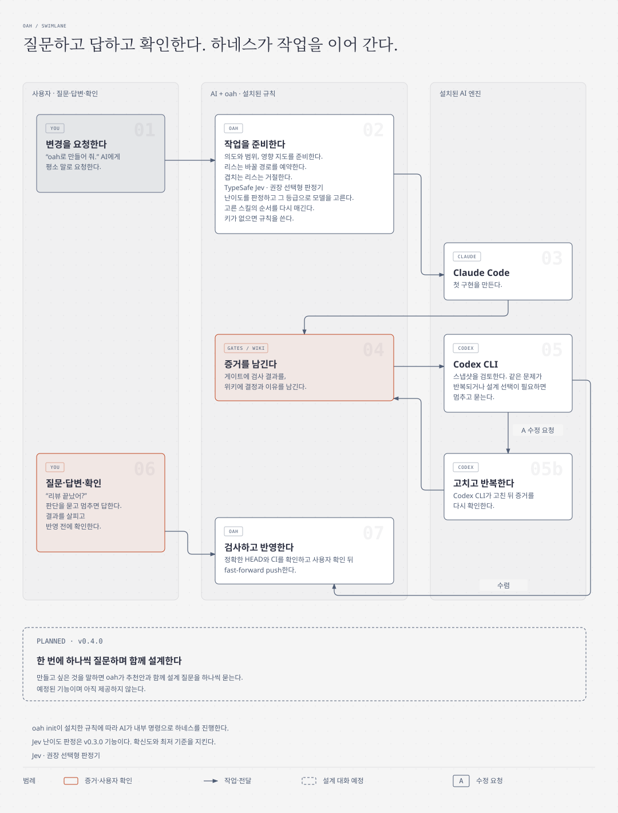
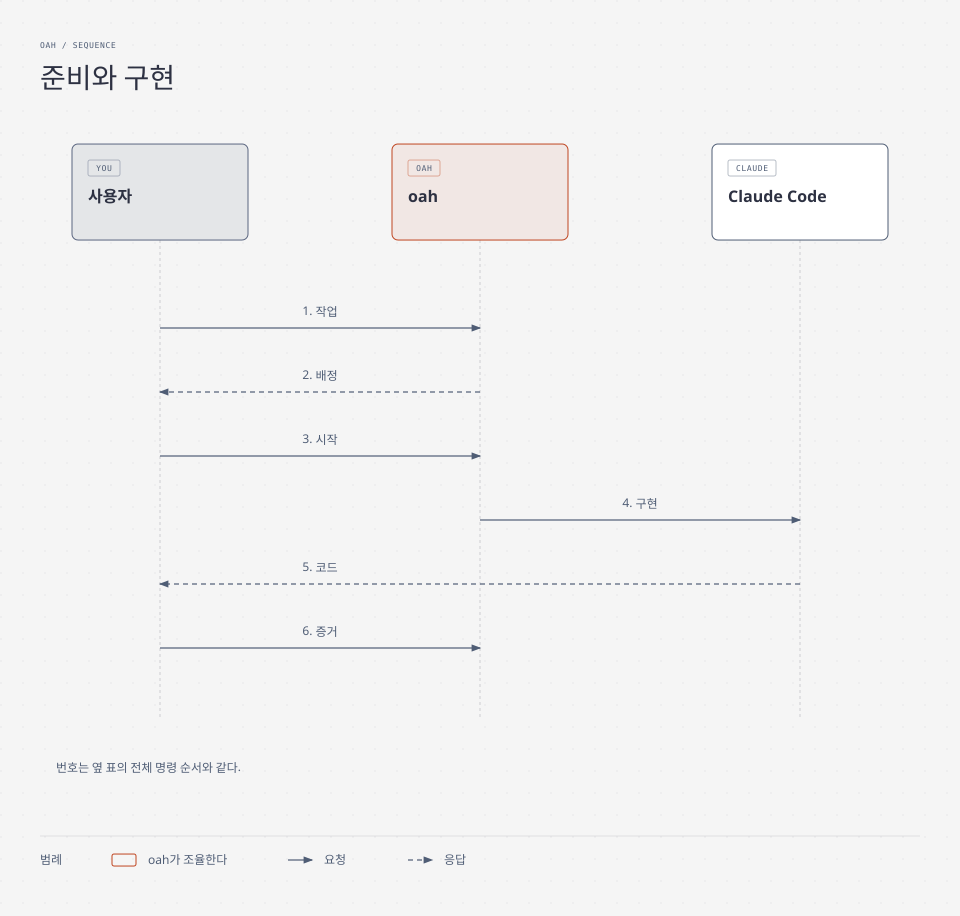
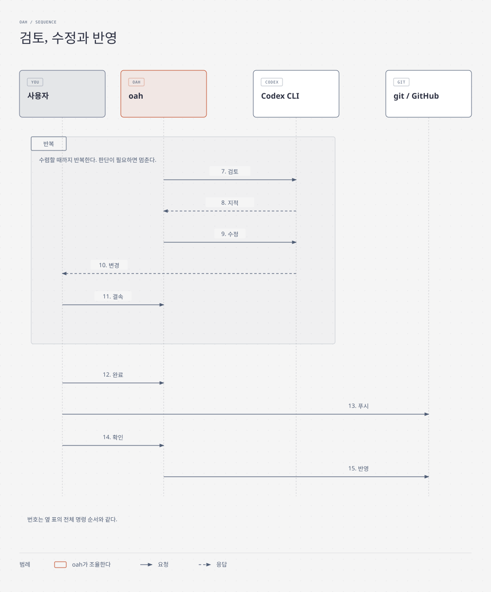

# 동작 방식

[README](../../README.ko.md) · [명령 안내](commands.md) · [English](../how-it-works.md)

`oah`는 Claude Code와 Codex CLI가 내 저장소에서 한 팀처럼 일하게 하는 작은 명령줄 도구다.
TypeSafe Jev를 선택형 AI 판정기로 함께 쓸 수 있다. git과 pull request를 이미 쓰는 개발자와 작은 팀이
자기 컴퓨터에서 실무 수준의 검토 절차를 지키도록 돕는다. AI 코딩 결과가 아쉽거나 처음 AI 작업 환경을
꾸리는 사람에게도 도움이 되고자 한다. 현재 릴리스는 여전히 git과 pull request에 익숙한 사용자를 전제로 한다.

Python 3.11 이상과 표준 라이브러리만 쓰며 macOS와 Windows에서 WSL 없이 바로 돈다.
사용자가 직접 설치하고 로그인한 Claude Code와 Codex를 움직이고 작업 기록을 남긴다.

## 각 부분이 연결되는 방식

**패킷**은 작업과 성공 조건을 적은 문서다. **리스**는 그 작업이 바꿀 파일을 잠시 맡아 두는 표시다.
**게이트**는 성공 여부를 검사하고 증거를 남기는 명령이다. **영향 지도**는 변경이 어디에 영향을 주며 무엇을
다시 검사해야 하는지 알려 준다. **프로젝트 위키**는 결정과 그 이유를 코드 옆에 남긴다.
**tier**는 모델과 추론 강도를 고를 때 쓰는 난이도 등급이고, **스킬**은 AI가 읽어 쓰는 작업 지침이다.
**CI**는 push나 pull request에 연결된 자동 검사다. **HEAD**는 지금 검사하는 정확한 버전인 현재 커밋이다.

<picture>
  <source media="(prefers-color-scheme: dark)" srcset="../assets/how-it-works-ko-dark.svg">
  
</picture>

AI 세션 둘은 같은 파일을 고치거나 증거 없이 끝났다고 하거나 끝낼 기준 없이 검토를 반복할 수 있다.
oah는 함께 지킬 규칙을 준다. 그림은 네 단계로 묶었고, 각 부분 사이의 연결은 다음 표에 모두 남겼다.

| 부분 | 작업과 연결되는 방식 |
|---|---|
| 사용자 또는 리드 역할의 Claude Code 세션 | 패킷에 목표와 성공 조건인 의도를 적는다. 의도는 바뀌지 않고 리스와 모든 단계의 작업 지시문으로 간다. |
| 리스와 사전 점검 | 기준점이 최신인지 확인하고 경로를 맡는다. 다른 세션과 겹치면 거절한다. |
| 난이도, 모델, 스킬 | 읽을 수 있는 규칙이 작업에 점수를 매겨 tier, 모델, 추론 강도, 스킬을 고른다. Claude는 그 지시문, tier, 스킬을 받는다. 선택형 Jev 판정은 아래에서 설명한다. |
| Claude Code | 첫 구현을 만들고 증거 게이트로 넘긴다. |
| 증거 게이트 | 검토 전에 명령과 기록된 결과로 완료를 증명한다. 영향 지도의 `pin`과 `exec` 연결은 바뀐 파일을 지목하거나 실행하는 게이트를 알려 준다. |
| 프로젝트 위키 | 작업과 증거에서 나온 결정을 남긴다. 설정된 위키 폴더가 있으면 `oah finish`가 정리 기록을 검사한다. |
| Codex CLI와 검토 반복 | `oah review`가 깨끗한 읽기 전용 스냅샷, 검토자가 이를 읽을 수 있었음을 증명하는 카나리, 지적을 담은 영수증을 쓴다. `oah fix`가 지적을 고치고, 검토가 수렴하거나 판단이 필요할 때까지 다시 검토한다. 반복 횟수의 상한은 선택이다. |
| 선택 설치하는 로컬 git 훅 | `oah finish` 뒤 사용자의 `git push`가 설치된 훅을 거쳐 GitHub의 pull request와 CI로 간다. |
| git과 GitHub | pull request와 HEAD의 CI 결과를 보관한다. `gh`가 반영 검사에 쓸 결과를 읽는다. |
| 반영할 때의 영향 지도 | 다시 실행할 게이트를 알려 주고 기본 브랜치도 다시 평가한다. |
| 반영 | `oah land --check`가 HEAD에 대해 수렴한 검토, CI와 나머지 증거를 확인한다. `oah land --merge`는 사용자가 확인한 뒤에만 기본 브랜치를 검토한 head로 fast-forward하고 push한다. |
| 모델과 스킬 업데이트 | 원본의 변경을 따라가며 바뀔 때마다 검사하고 기록한다. |

## 선택형 판정기 Jev

TypeSafe Jev는 함께 쓰기를 권하지만 필수는 아니다. `oah init`이 쓸지 한 번 묻고, 나중에 설정에서도 켤 수 있다.
자기 TypeSafe 계정과 키가 필요하다. 없으면 정해진 규칙으로 판단한다. `oah doctor`는 Jev 상태를 검사하지 않는다.
순서 판정 결과에 `rerank=used`나 `rerank=unused(<reason>)`이 표시된다.

- **순서 판정.** Jev는 규칙이 고른 스킬 목록 안에서 순서만 바꾸고 후보를 넣거나 빼지 않는다.
  영향 범위 결과의 재정렬은 아직 계획이며 제공 중인 기능이 아니다.
- **main에 있지만 아직 릴리스하지 않은 난이도 판정.** Jev가 승인한 Intent와 Scope 경로를 보고 판단한다.
  확신도가 충분하면 tier를 바꿀 수 있지만 하한보다 낮추지는 못한다. 꺼져 있거나 오류가 나거나 확신도가 낮으면
  규칙으로 판단하며 Jev 때문에 호출을 막지 않는다. [난이도 상세](concepts.md#jev가-난이도를-판정한다)에서
  보내는 내용, 개인정보 검사, 명시적 tier 지정과 결과 기록을 설명한다.
- **모델 선택.** Jev는 규칙이 허용한 후보 안에서만 모델과 추론 강도를 고를 수 있다. 고정한 모델, 자격을 갖춘
  후보 묶음, 지원하는 추론 강도, 작업의 최저 기준을 지킨다. 후보를 만들어 내거나 하한을 우회할 수 없다.
  [라우팅](concepts.md#라우팅과-난이도)과 [main의 모델 선택](concepts.md#모델을-고르는-방법)에서 현재 방식과 한계를 설명한다.

[v0.3.0 로드맵](../../README.ko.md#로드맵)은 릴리스 계획으로 유지한다. main에 먼저 들어온 기능은 미출시로
표시하며, main에 있다고 v0.2.0에서 쓸 수 있는 것은 아니다.

## 강점

- **단계별 엔진.** Claude Code가 1차 구현을 하고 Codex CLI가 리뷰, 수정, 재리뷰를 한다. 단계에 맞지 않는 엔진
  호출은 거절되고(`OAH_STAGE_ENGINE_MISMATCH`), 직접 덮어쓰면 그 사실이 기록된다.
- **난이도가 모델과 추론 강도를 정한다.** 고정 규칙이 네 축에 점수를 매겨 tier를 고른다. main의 선택형 Jev 판정은 하한 안에서 이를 조정할 수 있다. CLI가 증명하지 못하는
  강도는 미검증으로 기록되고, 더 낮은 강도로 실행되면 실패한다(`OAH_EFFORT_DOWNGRADED`).
- **작업에 맞게 고른 스킬.** 각 스킬에 이유가 붙는다. 선택 사항인 판정기 TypeSafe Jev는 그 목록의 순서만 바꾼다.
- **영향 지도**는 바뀐 파일을 고정하거나 실행하는 게이트와 명령을 알려 줘서, 정확히 그것만 다시 돌리게 한다.
- **프로젝트 위키**가 결정을 코드 옆에 남기고, `oah finish`가 위키 정리 여부를 확인한다.
- **증거 게이트.** 에이전트가 끝났다고 말할 때가 아니라, 게이트가 증거와 함께 통과할 때 작업이 끝난다.
  게이트는 저장소 파일과 실행 환경만 확인한다. 외부 서비스와 무시된 미추적 파일의 변경은 감지하지 못하므로
  따로 확인해야 한다.
- **따라다니는 의도.** 패킷의 의도가 리스와 모든 호출의 브리프로 이어진다.
- **리스와 사전 점검**이 병렬 세션이 서로의 파일이나 낡은 기준점에서 작업하지 않게 막는다.
- **수렴하는 리뷰.** Codex가 읽기 전용 스냅샷을 리뷰하고, 수정은 해당 지적에 묶이며, 같은 종류가 반복되거나
  설계 판단이 필요하면 멈추고 사용자에게 묻는다.
- **저장소에 비밀값이 없다.** 키는 실행할 때만 읽는다. `oah land`는 gitleaks 검사를 요구한다.
- **출처가 남는 툴킷.** 스킬과 MCP 템플릿을 정확한 버전으로 고정하고 안전하게 업데이트한다.
- **쉬운 설치.** 한 줄 설치 스크립트, `oah doctor`, 그리고 계획을 먼저 보여 주는 안내형 `oah init`이 있다.

## 초보자가 자주 하는 실수와 oah

| 실수 | oah가 하는 일 |
|---|---|
| API 키를 커밋함 | `oah init`이 `.env`, `*.pem`, `*.key` 같은 항목을 `.gitignore`에 넣는다. 선택 설치하는 pre-push 훅은 gitleaks가 설치돼 있을 때만 푸시할 커밋을 검사하고, 없으면 경고한 뒤 검사 없이 푸시를 허용한다. `oah land`는 검사 없이는 거절한다(`OAH_LAND_SCAN_REQUIRED`). |
| 낡은 브랜치에서 시작함 | `oah preflight`가 기준점이 뒤처졌으면 중단하고 어떤 `git rebase`를 할지 알려 준다. |
| 커밋하지 않은 변경을 두고 시작함 | `oah preflight`가 경고와 파일 목록을 보여 주며, 다른 검사에서 중단하지 않으면 계속 진행할 수 있다. |
| 두 AI 세션이 같은 파일을 고침 | `oah start`가 겹치는 리스를 거절한다(`OAH_LEASE_CONFLICT`). `oah finish`가 실제 변경을 범위와 비교한다(`OAH_SCOPE_EXCEEDED`). |
| 작업 중간에 푸시함 | 선택 설치하는 pre-push 훅이 이 워크트리에 리스가 남아 있는 동안, 활성이든 만료든 푸시를 거절한다(`OAH_PUSH_REFUSED`). |
| 에이전트가 푸시나 강제 푸시를 함 | 공유 규칙 블록이 에이전트에게 금지하고, 반영은 사용자가 확인하는 명령이다. |
| 증거 없이 "끝났다"고 함 | `oah finish`와 Stop 훅이 미충족 게이트를 거절한다(`OAH_GATES_UNMET`). |
| 변경이 무엇을 깨는지 모름 | `oah impact --changed-since`가 추적하지 않은 파일까지 포함해 다시 볼 것을 `re-run:` 줄로 알려 준다. |
| 리뷰나 CI 없이 합침 | `oah land --check`가 정확한 HEAD에서 리스, 의도, 리뷰, 게이트, 영향, 필수 검사, fast-forward, gitleaks 검사, CI를 확인한다. 검증되지 않은 CI는 명시적 예외를 기록하지 않는 한 막힌다(`OAH_LAND_CI_UNVERIFIED`). |
| 왜 바꿨는지 잊어버림 | 패킷이 의도를, 리뷰 영수증이 지적을, 위키가 결정을 남긴다. |
| CI가 없거나 한 OS에서만 돎 | `oah ci init`이 확인을 받은 뒤 고른 러너(macOS, Windows, Linux)용 기본 워크플로를 만든다. |

## 처음 실행하기

원격 저장소가 연결된 내 git 저장소 안에서 안내형 설정을 실행한다.

```sh
oah init
```

`oah init`은 먼저 선택 사항마다 한 번씩 묻는다. 단계별 에이전트 파일, 훅, 게이트 검사기 unlazy, 지식 그래프,
CI 시작 워크플로, 동반 앱 Orca와 Aside, TypeSafe Jev 재정렬기, 스킬 자동 업데이트다. 선택을 마친 뒤 전체 계획을
살펴보고 승인해야 변경이 적용된다. 설정 과정에서는 다음 일을 한다.

- 도구를 모두 확인하고 사용자가 확인한 것만 설치한다.
- Claude Code와 Codex 로그인을 각 도구의 상태 명령으로 확인하고, 빠졌으면 실행할 명령을 알려 준다.
- `.oah/config.toml`, `AGENTS.md`의 규칙 블록(`CLAUDE.md`가 불러온다), `docs/wiki/`의 위키, `.oah/templates/`의
  템플릿, 로컬 비밀 파일을 위한 `.gitignore` 항목을 쓴다.
- 첫 영향 지도를 만든다.

두 번째로 실행하면 아직 빠진 것만 쓴다. 질문마다 `--with-unlazy`, `--without-ci` 같은 옵션이 있어서 묻지 않고
답할 수도 있다. 쓴 파일을 커밋한 다음 따라 하기 예제로 넘어간다.

**첫 작업.** [`examples/hello-oah`](../../examples/hello-oah/README.ko.md)가 작은 작업 하나를 실제 명령으로 전체 흐름에
태워 20분쯤 안에 끝까지 진행한다.

## 작업 흐름

### 준비와 구현

<picture>
  <source media="(prefers-color-scheme: dark)" srcset="../assets/loop-start-ko-dark.svg">
  
</picture>

| 순서 | 하는 일 |
|---|---|
| 1. 작업 | `oah packet new T`를 실행하고 의도와 게이트를 적는다. |
| 2. 배정 | oah가 단계마다 tier, 모델, 추론 강도와 스킬을 알려 준다. |
| 3. 시작 | `oah preflight` 뒤 `oah start --packet`을 실행한다. |
| 4. 구현 | `oah call claude --stage initial`이 Claude Code에 일을 보낸다. |
| 5. 코드 | Claude가 사용자에게 구현을 돌려준다. |
| 6. 증거 | `oah wiki maintain`, `oah gates check --approve`, 커밋 순서로 실행한다. |

### 검토, 수정과 반영

<picture>
  <source media="(prefers-color-scheme: dark)" srcset="../assets/loop-review-ko-dark.svg">
  
</picture>

| 순서 | 하는 일 |
|---|---|
| 7. 검토 | `oah review`가 Codex에 깨끗한 읽기 전용 스냅샷을 보낸다. |
| 8. 지적 | Codex가 판정과 지적을 담은 영수증을 돌려준다. |
| 9. 수정 | `oah fix`가 Codex에게 P0와 P1 지적을 고치게 한다. |
| 10. 변경 | Codex가 사용자가 살펴볼 변경 내역을 돌려준다. |
| 11. 결속 | 위키 정리, 승인한 게이트 실행, 커밋, `oah fix --bind` 순서로 진행한다. 수렴할 때까지 다시 검토하며, 같은 문제가 반복되거나 설계 판단이 필요하면 멈추고 사용자에게 묻는다. |
| 12. 완료 | `oah finish`가 범위, 게이트, 위키와 보고를 확인한다. |
| 13. 푸시 | 사용자가 push하고 pull request를 연다. |
| 14. 확인 | `oah land --check` 뒤 사용자가 확인하면 `oah land --merge`를 실행한다. |
| 15. 반영 | oah가 기본 브랜치를 검토한 head로 fast-forward한다. |

### 명령과 보장하는 것

| 단계 | 명령 | 보장하는 것 |
|---|---|---|
| 작업 적기 | `oah packet new`, `oah packet check`, `oah gates new` | 일을 시작하기 전에 목표와 성공 조건을 적고 승인한다. |
| 안전하게 시작 | `oah preflight`, `oah start --packet` | 브랜치가 최신이고 다른 세션이 내 경로를 잡고 있지 않다. |
| 구현 | `oah call claude --stage initial`, 또는 직접 연 Claude Code 세션 | Claude가 패킷을 보고 tier에 맞는 모델, 추론 강도, 스킬로 일한다. |
| 증명 | `oah wiki maintain`, `oah gates check --approve`, 커밋 | 성공 조건마다 명령과 기록된 증거가 있다. |
| 리뷰와 수정 | `oah review`, `oah fix`, `oah fix --bind` | Codex가 리뷰가 수렴할 때까지 리뷰하고 라운드마다 영수증을 남긴다. |
| 끝내기 | `oah finish --return` | 변경이 범위 안에 있고, 게이트를 충족했고, 보고가 의도와 맞는다. |
| 반영 | `oah land --check`, `oah land --merge` | 비밀 스캔과 CI 검증(또는 기록된 CI 예외)을 거친 뒤 사용자가 확인하면 리뷰한 head 그대로 반영된다. |

수정한 뒤에도 위키 정리, 최종 승인된 게이트 검사, 커밋 순서를 지킨다. 기본적으로 CI 미검증은 반영을 막는다.
`gh`가 없거나 HEAD의 CI 결과 또는 필수 검사 결과가 없으면 `OAH_LAND_CI_UNVERIFIED`로 거절한다. 이 위험을
받아들이려면 `oah land --check`와 `oah land --merge`에 `--accept-unverified-ci "<reason>"`을 붙인다.
예외와 사유는 해당 head에만 기록되고 CI는 `unverified`로 남아 통과로 세지 않는다. 실패하거나 진행 중인 CI는
여전히 반영을 막는다. 대상 브랜치의 CI 정책은 [반영](concepts.md#반영)을 참고한다.

각 단계의 이유는 [개념](concepts.md)에, 거절 메시지마다의 해결법은 [문제 해결](troubleshooting.md)에
있다.

## 요구 사항

| 항목 | 요구 사항 | 필요한 곳 |
|---|---|---|
| 운영체제 | **macOS 13 이상**이나 **Windows 11** 네이티브(WSL 불필요). Windows 10 22H2는 되는 데까지만 지원한다. Linux는 아직 지원하지 않는다. | 전부 |
| 런타임 | **Python 3.11 이상**. 실행에 외부 파이썬 패키지가 필요 없다. | 전부 |
| 버전 관리 | **git**과 GitHub 저장소 같은 원격 | 전부 |
| 엔진 | 사용자가 설치하고 로그인한 **Claude Code**와 **Codex CLI** | 구현, 리뷰, 수정 |
| 게이트 | **unlazy**와 그것이 쓰는 **Node.js** | 게이트와 Stop 훅 |
| 반영 | **gitleaks**, CI 결과를 읽는 **gh** | `oah land` |
| 선택 | **uv**(권장 설치 도구), **graphify**(지식 그래프), **TypeSafe Jev**(TypeSafe 계정과 키 필요), **Orca**와 **Aside**(동반 앱) | 편의 |

`oah doctor`는 이 표의 도구를 Jev만 빼고 모두 확인하고 빠진 도구마다 공식 설치 명령을 알려 준다. Jev의 상태는
`rerank=` 결과마다 드러난다.

## 내 환경에 맞게 바꾸기

`oah`는 모두가 그대로 써야 하는 완벽한 하네스를 내놓는 것이 목적이 아니다. 각자에게 맞고, AI가 바뀌는 만큼
함께 바뀌는 개발 환경을 만들도록 돕는 참고 구현이자 가이드라인이다.

하네스는 보통 한 번 세팅해 두면 그대로 쓰인다. 그 사이 AI 모델과 스킬은 계속 업데이트된다. 예전 모델에서 잘
쓰던 규칙과 스킬이 업그레이드된 모델의 최대 성능을 막는 제약이 되기도 하고, 시대에 뒤떨어진 스킬이 오히려
더 나쁜 결과를 내기도 한다. 좋은 하네스는 흐르는 물처럼 새 모델에 맞춰 계속 바뀐다. 필요 없어진 스킬은
지우고, 필요한 스킬은 더하고, 규칙도 그에 맞게 고친다.

- **필요한 부분만 가져가 적용한다.** 이미 다른 AI 도구나 다른 하네스를 쓰고 있다면 `oah`가 리스, 단계별
  엔진, 증거 게이트, 영향 지도, 위키, 리뷰 루프를 어떻게 다루는지 참고해서 자기 도구에 맞는 부분만 옮겨
  하네스를 업그레이드하면 된다. 규칙은 [계획](../PLAN.md)에 글로 적어 두었으니 코드가 아니라
  생각으로도 가져갈 수 있다.
- **그대로 따라 하더라도 자기 것으로 키운다.** `oah`를 그대로 시작점으로 삼는다면 설정과 단계, 규칙을 자기
  개발 목적에 맞게 바꾸고, 코드가 자라는 만큼 자기 프로젝트 위키와 영향 지도를 만들어 가면 된다. 결국 남는
  하네스는 우리 것을 복사한 것이 아니라 사용자 자신의 것이어야 한다.
- **계속 업데이트한다.** 도구가 바뀌면 모델과 스킬, 규칙을 다시 살핀다. 더는 도움이 안 되는 것은 지우고
  도움이 되는 것은 더한다. `oah`도 계속 업데이트하면서 사용자들이 변하는 AI 환경에 함께 적응하도록 돕는다.

그래서 `oah`는 끌 수 없는 검사보다 이해하고 바꿀 수 있는 기본값을 고른다. 규칙이 사용자의 작업이나 새 모델을
가로막으면 이 프로젝트는 그것을 고쳐야 할 설계 문제로 다룬다.

## 개발

테스트는 Python 3.11로 돌리고, 가진 것 가운데 가장 새 Python으로 한 번 더 돌린다. 테스트가 쓰는 파일이 모두
체크아웃 안에 남도록 `TMPDIR`을 git이 무시하는 `.tmp/` 폴더로 지정한다. Python은 없는 `TMPDIR`을 무시하므로 폴더를
먼저 만든다. 다음 명령을 쓴다.

```sh
mkdir -p .tmp/test-tmp
TMPDIR="$PWD/.tmp/test-tmp" python3.11 -m unittest discover -s tests -t .
```

- **CI**는 `main`으로 가는 pull request마다 macOS와 Windows에서 테스트를 돌린다. 문서만 바꾸는 pull request는
  테스트를 건너뛴다.
- **비밀 스캔.** 별도 워크플로가 pull request와 push마다 gitleaks로 전체 이력을 검사하고 개인정보 스캔을 돌린다.
  문서만 바꿔도 돈다. 하나라도 걸리면 실패한다.
- **push하기 전에는 언제나** gitleaks를 필수로 해서 개인정보 스캔을 돌리고 `PRIVACY_SCAN_CLEAN`이 나와야 한다.

  ```sh
  python3 tools/privacy_scan.py --gitleaks require
  ```

- 커밋은 `Agent-Engine: claude|codex|human` 트레일러로 쓴 엔진을 남긴다.

## 보안

**철칙.** API 키, 토큰, 비밀번호, 쿠키, OAuth 시크릿, 계정 식별자는 이 저장소와 그 이력, 릴리스, 이슈, CI 로그
어디에도 들어가지 않는다.

- 키는 실행할 때만 환경 변수나 OS 키체인에서 읽는다. 조회 경로는 문서로 정한 한 가지뿐이다. 키가 없으면 그
  기능은 꺼 둔 채 `unused(no key)`라고 알린다.
- 템플릿에는 `${ENV_VAR}` 자리표시자만 쓴다.
- gitleaks와 개인정보 스캔은 push하기 전에 돌고, CI에서도 pull request와 push마다 전체 이력을 검사한다. 하나라도
  걸리면 빌드가 실패한다.
- 내 키는 내 환경 변수나 키체인에만 두고 프로젝트 파일에는 절대 넣지 않는다. 방법은 [키](keys.md)에 있다.

